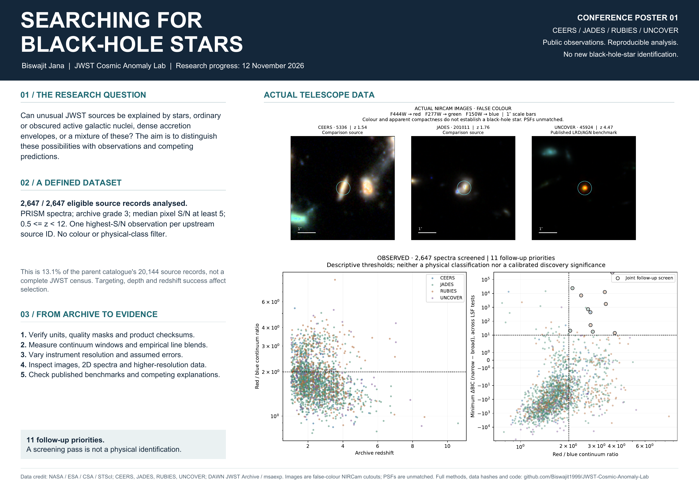
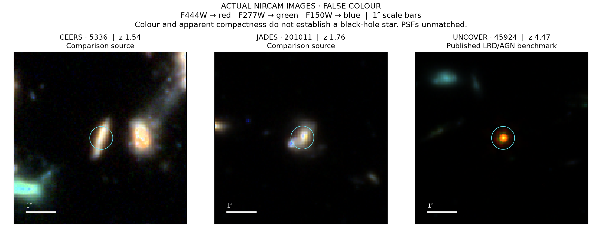
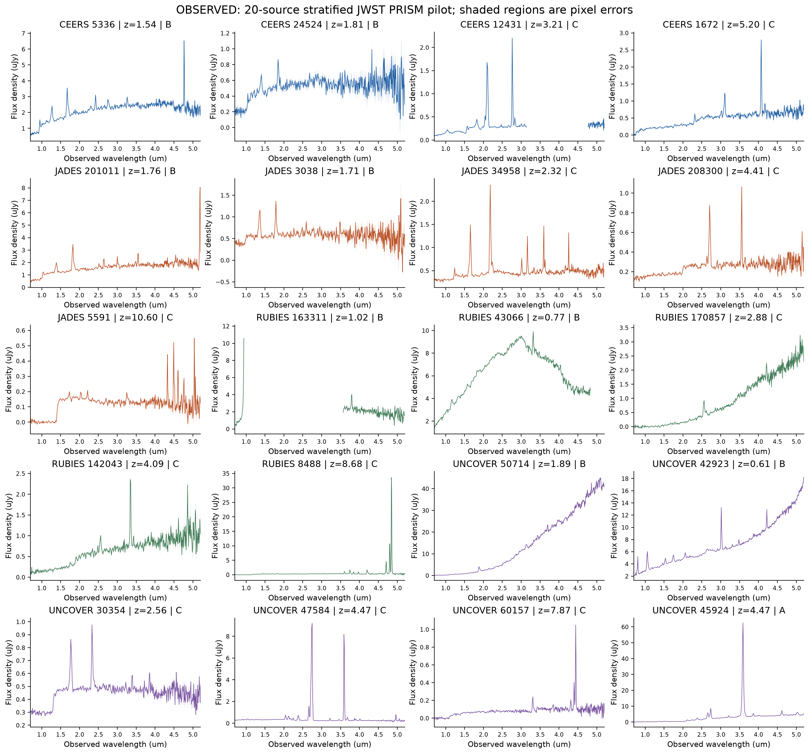

# JWST Cosmic Anomaly Lab

A provenance-first Python research platform for comparing ordinary, unusual, and
unclassified JWST sources across independent fields. **This is an executed
research programme in progress, not a completed physical classification.**

## Expanded search: 12 November 2026

**2,647 / 2,647 eligible PRISM source records analysed**, across four surveys.
The fixed high-S/N subset is 13.1% of the 20,144-record parent catalogue, not a
complete JWST census. Eleven sources pass both empirical screens; all eleven,
three comparison sources and the published candidate The Cliff received detailed
image/spectrum inspection. Seven yielded conditional medium-resolution fits.

**No new black-hole star is established.** One PRISM priority favours a narrow
model at higher resolution, and The Cliff exposes a missed-candidate limitation. Its
exponential-profile preference weakens when the central pixels are excluded.
The GLIMPSE-17775 reanalysis also retains a quality-mask discrepancy and a
line-profile disagreement with the published analysis.

Start with the [expanded research report and source images](reports/expanded_search.md),
[measurements and coverage](results/expanded/summary.json), and
[execution ledger](experiments/expanded_search.yaml).

### Conference posters

Two A1 landscape posters, with vector plots and actual telescope images:

- [Project purpose and methods (PDF)](output/pdf/jwst_project_purpose_methods_A1.pdf)
- [Evidence and limitations (PDF)](output/pdf/jwst_evidence_limits_A1.pdf)
- [Poster previews and regeneration instructions](output/pdf/README.md)



The expanded download uses a finite **4 GiB** raw-data cap. Run:

```sh
python scripts/replay_manifest.py --budget-mib 4096  # restore all pinned inputs first
python scripts/download_expanded_sample.py
python scripts/analyse_expanded_sample.py
python scripts/analyse_glimpse_benchmark.py
python scripts/validate_line_profiles.py
python scripts/inspect_followup_sources.py
python scripts/audit_cliff_sensitivity.py
python scripts/build_expanded_report.py
```

## Original 20-source pilot

The pilot ingests 20,144 DJA source records and 44,619 observations from JADES,
CEERS, RUBIES, and UNCOVER, across GOODS-N, GOODS-S, EGS, UDS, and Abell 2744.
It also imports the independent JADES DR4 and UNCOVER DR4.1 reference catalogues.
These counts overlap: they are not counts of independent physical galaxies.

Twenty actual NIRSpec/PRISM spectra are analysed. Nine diagnostic apertures are
measured in NIRCam cutouts of three sources. The code produces error-aware
archive rankings, field-held-out calibration, synthetic injection/recovery tests,
source evidence reports, and figures labelled OBSERVED or SIMULATED.

**See the actual sources in the [image and spectrum gallery](reports/visual_gallery.md):
20 individual evidence sheets, 18 usable three-band colour composites, and
the observed 2D spectral images. Two sources have partial image-band coverage.**



**Have we identified a black-hole star? No.** The observational pilot is complete
within its stated scope; competing physical models have not been tested enough
to establish that interpretation. Read the [physical-test status](reports/black_hole_star_status.md).

The imaging extension is recorded separately in
[visual execution metrics](results/visual_atlas_run.json) and
[rendering methods](docs/visual_evidence.md). The original pilot's nine apertures
and run summary remain a historical record.

**For the original pilot, start with the [research report](reports/multi_survey_investigation.md),
[execution metrics](results/run_summary.json), and
[experiment registry](experiments/registry.yaml).**



## Installation and use

Python 3.12 or later. From the repository root:

```sh
python -m venv .venv
# Activate .venv using your shell's activation command.
python -m pip install -e '.[dev]'
pytest -q
ruff check src tests scripts
cosmic-lab --help
```

For the exact tested environment, `requirements-lock.txt` records installed
versions. Its Windows-only dependency is platform-marked for Linux CI.

```sh
python scripts/probe_archives.py       # ~227 MB of three catalogue products
python scripts/prepare_pilot.py        # ingest, select, download 20 spectra
python scripts/download_instrument.py  # resolving power reference
python scripts/download_cutouts.py     # three sources, three NIRCam filters
python scripts/download_cutouts.py --all  # request images for all 20 pilot sources
python scripts/build_visual_atlas.py   # images, 2D spectra, evidence sheets, gallery
cosmic-lab verify                     # SHA256 verification
cosmic-lab analyse                    # numerical analysis, figures, reports
python scripts/build_report.py        # human-readable synthesis of outputs
cosmic-lab sources --survey UNCOVER --limit 5
```

Run these commands from the root; `cosmic-lab --root PATH ...` can explicitly
select another checkout. Network-dependent scripts are separate from offline CI.
`python scripts/replay_manifest.py` restores the exact recorded download set,
refusing upstream changes that do not match recorded checksums.

## What exists

| Capability | Scope |
| --- | --- |
| Discovery | Public MAST metadata/product queries; pinned DJA, JADES, UNCOVER catalogue adapters |
| Provenance | Atomic bounded downloads, publisher checksum where available, SHA256 snapshots, version history |
| Registry | SQLite sources/observations/evidence/link tables; CSV exports; spherical candidate crossmatching |
| Spectroscopy | FITS units and quality masks, specutils interoperability, rest wavelengths, continuum ratio, pixel-integrated Gaussian blend fits, conditional EW/errors, LSF sensitivity |
| Imaging | WCS-aware aperture diagnostics and registered cutout panels; no PSF-corrected morphology |
| Inference | Gaussian covariance/calibration likelihood, independent censored upper-limit likelihood, empirical BIC comparisons |
| Physics | Explicit analytic blackbody, Eddington/accretion luminosity and cosmological flux baselines |
| Anomaly search | Complete-feature error-aware robust distance, shared-ratio covariance, holdout calibration and field validation |
| Validation | Seeded line recovery, synthetic anomaly FPR/recovery, unit/integration tests |
| Literature | Crossref/OpenAlex query logs, explicit-identifier deduplication, curated references and research gaps |

The complete mission is preserved in [the specification](docs/research_specification.md).
Only implemented functionality has Python modules. Configured hypotheses do not
imply implemented physical solvers. No source is declared a new class or a black-hole star.

## Data and reproducibility

Large data and SQLite are excluded from Git. Small catalogues, manifests,
measurement tables, source reports, and PNG/vector PDF figures are committed.
The default raw-data budget is 512 MiB; it includes cached products. Interrupted
downloads restart the incomplete file; completed files are verified and reused.
The cache is **single-writer**. A local hash is not a publisher authentication check.

`data/manifests/downloads.json` records exact URLs, versions, timestamps, sizes,
checksums, and ETags. `data/catalogues/sources.csv.gz` uses the upstream DJA objid
namespace, not newly inferred physical associations. JADES and UNCOVER reference
rows remain separate. Ambiguous positional matches are retained without merges.

The [data dictionary](docs/data_dictionary.md) explains units and missing values.
The [selection contract](configs/pilot.yaml) documents population and measurement
biases. Common DJA processing is **not independent reduction validation**.

## Scientific boundaries

Local continuum and blend fits cannot distinguish stellar populations, obscured
AGN, dense envelopes, or composites. Their statistical uncertainties omit several
systematics. PRISM broad-profile preference is not a black-hole mass measurement.
Image apertures lack PSF matching, aperture corrections, deblending and drizzle
covariance. A statistical ranking is a triage list, not a discovery catalogue.

Physical SPS/atmosphere/radiative-transfer grids, lens reconstructions, posterior
sampling/evidence, calibrated variability analyses, and quantitative observing
forecasts remain unimplemented. See the report and experiment registry for the
precise next work and for experiments that only ran in a limited pilot form.

## Credit and license

Research owner and code author: Biswajit Jana. Code: MIT. Upstream observations,
calibrations and catalogue rights remain with their creators; the code license
does not relicense their data. Cite JWST/STScI, survey teams, DJA/msaexp, Astropy,
astroquery, specutils, NumPy, SciPy, pandas, scikit-learn and Matplotlib as appropriate.
Survey and software references are in [the literature registry](literature/curated_references.json).

