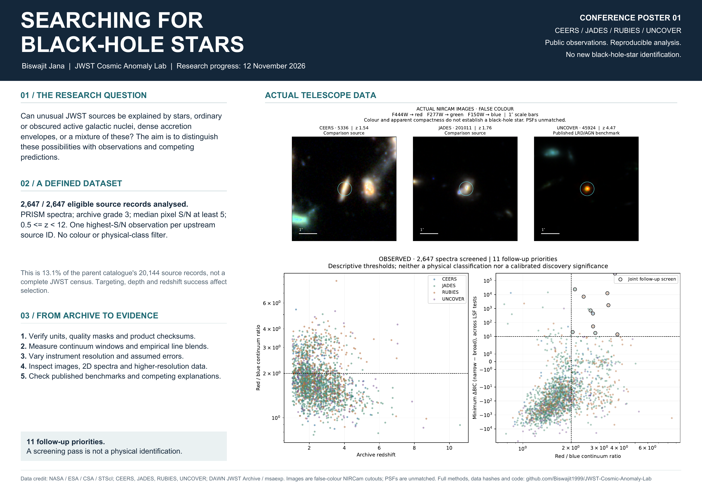
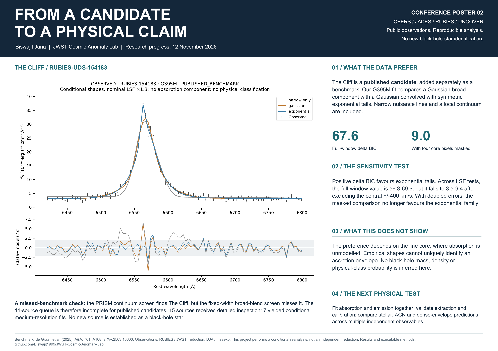

# Research/conference posters

Two single-page, A1 landscape posters (841 × 594 mm). Plot text and curves are
embedded as vectors. Astronomical images are actual observed pixels, with their
display transformations identified. Print the PDFs at 100% for A1, or scale to
A2/A3 for handouts. The PNG files are screen previews, not the print masters.

## Purpose and methods

[Print PDF](jwst_project_purpose_methods_A1.pdf)



## Evidence and limitations

[Print PDF](jwst_evidence_limits_A1.pdf)



## Updating the posters

After rerunning the analysis and reviewing the scientific interpretation:

```sh
python -m pip install -e '.[posters]'
python scripts/build_research_posters.py
pdftoppm -r 90 -png -singlefile output/pdf/jwst_project_purpose_methods_A1.pdf output/pdf/jwst_project_purpose_methods_A1
pdftoppm -r 90 -png -singlefile output/pdf/jwst_evidence_limits_A1.pdf output/pdf/jwst_evidence_limits_A1
```

The script reads the result files for coverage, counts, benchmark statistics and
snapshot date. The source includes interpretive text for this research stage;
review that text when the model or scientific conclusions change. Regeneration
does not replace scientific review. Inspect both rendered previews for clipping
and readability. `poster_manifest.json` records the input hashes and outputs.

The posters make no new black-hole-star discovery claim. Source references and
data credits appear on each poster; detailed assumptions are in the linked
[research report](../../reports/expanded_search.md).
