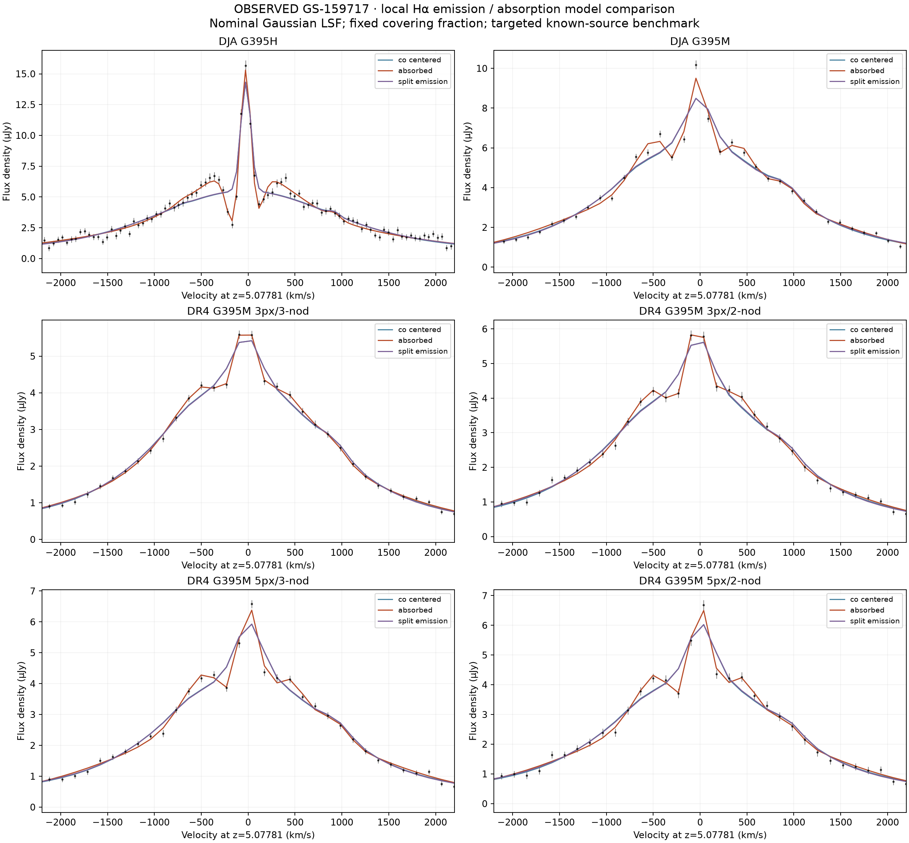
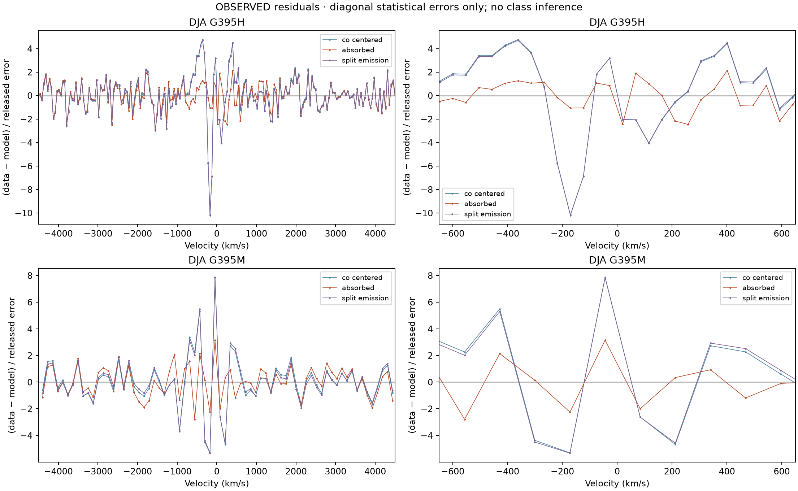
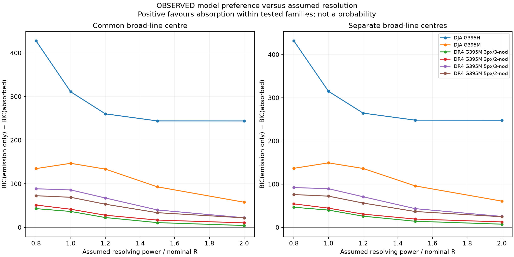
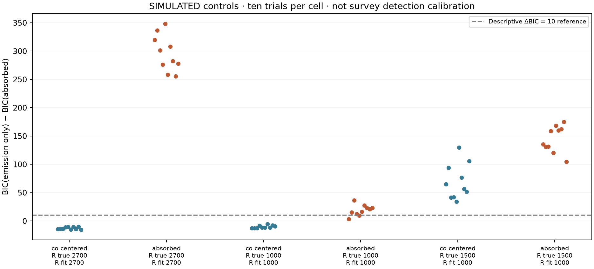

# Can emission and absorption explain the central structure?

Research snapshot: **15 November 2026**. Author: Biswajit Jana.

This targeted experiment analyses the known benchmark **JADES-GS-159717**,
recovered by our [open search](open_search.md). It replaces the inadequate
central-dip statistic with explicit local emission/absorption models. It does
not add a newly discovered source or establish a black-hole star.

**Main result:** the high-resolution spectrum supports absorption structure
within the tested families. **Main failure mode:** all ten emission-only mock
spectra with true R=1500 falsely favoured absorption at ΔBIC>10 when fitted
assuming R=1000. This limited synthetic counterexample prevents us from treating
medium-resolution model preference alone as reliable evidence of an absorber.

## Observed fits

We executed **90 fits**: six extraction variants, three model families and five
assumed resolutions. Inputs comprise DJA G395H and G395M, plus a separately
reduced JADES DR4 G395M product with 3/5-pixel and 2/3-nod extractions. The four
DR4 variants share data; they are not four independent detections. The DR4
identifier, programme and header coordinates were checked against the DJA
association. No independent G395H reduction was analysed here.

The high-resolution data favour a model with absorption of broad Hα emission
over both tested emission-only families. This explains how troughs can flank a
narrow central emission peak, causing a simple centre-minus-shoulders diagnostic
to miss the absorption structure. These are conditional model comparisons;
the assumed instrumental response and model flexibility remain consequential.



At nominal R=2700 (G395H) and R=1000 (G395M):

| Extraction | ΔBIC common-centre minus absorbed | ΔBIC split-centre minus absorbed | Absorbed χ²/(n−k) | Absorbed parameters at bounds |
| --- | ---: | ---: | ---: | --- |
| DJA G395H | 310.8 | 314.9 | 1.23 | none |
| DJA G395M | 147.0 | 149.4 | 1.69 | narrow_sigma, tau |
| DR4 G395M 3px/3-nod | 36.6 | 40.1 | 0.64 | narrow_sigma, tau |
| DR4 G395M 3px/2-nod | 41.6 | 44.6 | 0.75 | narrow_sigma, tau |
| DR4 G395M 5px/3-nod | 86.0 | 89.6 | 1.00 | narrow_sigma, tau |
| DR4 G395M 5px/2-nod | 69.1 | 72.4 | 0.96 | narrow_sigma, tau |

Positive ΔBIC favours the absorbed model **within these families and assumptions**.
It is not a discovery significance or posterior probability. Absorption at zero
depth has unidentified nuisance parameters, and several solutions reach bounds,
so regular asymptotic model-selection interpretations are not justified here.
Residuals and optimizer attempts are retained, rather than treating the preferred
fit as automatically adequate.



## What was actually modelled

All families include a linear continuum, narrow Hα, and narrow [NII] with the
6585/6549 area ratio fixed at 2.96. Narrow lines share velocity and width.
Two positive broad Gaussians either share a centre (11 parameters) or have
independent centres (12 parameters). The absorbed family adds optical-depth
amplitude, absorber width and velocity to the common-centre model (14 parameters).
The two Gaussians describe a line shape; they do not imply two black holes.

The absorbed broad emission is multiplied by
`exp[-tau * exp(-(v-v_abs)^2 / (2*sigma_abs^2))]` **before** Gaussian instrumental
convolution and integration over each spectral pixel. Narrow emission and the
continuum remain unabsorbed. Covering fraction is fixed to one, so fitted tau
is an effective local parameter. It is not an inferred gas column or density.

Fits use released signed Fν and diagonal errors, no extra photometric scaling,
no residual-based clipping, four deterministic starting points, and the same
±4500 km/s window around vacuum Hα at z=5.07781. Widths, shifts and amplitudes
are bounded; all optimizer outcomes are saved. A 5 km/s integration grid is
checked against 2.5 km/s: the largest nominal-fit change is **0.031**
times a released pixel error. This numerical check does not validate the LSF.

The [published study](https://arxiv.org/html/2506.14870v2) reports Balmer
absorption in this source and models the instrument response and covering
fraction in greater detail. Our local least-squares exercise is a qualitative
benchmark recovery, not a reproduction of its full Bayesian multi-line analysis.

## Instrument-response sensitivity

[STScI's disperser documentation](https://jwst-docs.stsci.edu/jwst-near-infrared-spectrograph/nirspec-instrumentation/nirspec-dispersers-and-filters)
gives approximate nominal R=1000/2700 and explains that resolving power varies
with wavelength and illumination. Here a local constant Gaussian LSF is assumed,
not calibrated to this source. We test factors 0.8, 1.0, 1.2, 1.5 and 2.0 of the
nominal resolving power. Factors 1.5 and 2.0 were added **after** the initial
54-fit run exposed boundary solutions. This is an exploratory sensitivity test,
not a preregistered threshold or a calibrated slit-underfill correction.



For DJA G395H, ΔBIC against common-centre emission remains
244.0–427.7 across the tested range.
For DR4 G395M 3px/3-nod, it falls from 36.6 at R=1000 to
4.4 at R=2000. That is a substantial loss of discriminatory power;
neither R value is established as the correct source-specific response here.

The complete [comparison table](../results/balmer_audit/model_preference.csv)
records every assumption. Resolving power must not be chosen merely to maximize
an absorption preference. Instrument and narrow-line constraints should inform
it independently. Medium-resolution boundary solutions cannot supply reliable
absorber optical depths, even when their conditional fit statistic improves.

## Synthetic controls

We executed 60 source-inspired mock trials, with ten per cell. Truth uses the
nominal high-resolution absorbed fit, with absorption removed for emission-only
controls. Pixels and diagonal errors come from the corresponding DJA grids.
Two cells deliberately fit an incorrect, broader instrumental response to a
medium-resolution truth spectrum. Each mock is refit with both common-centre
families using two starts. These mocks do not cover the full astrophysical
population, correlated errors, extraction defects or alternative line geometries.

| Pixel/error grid | Injected family | True R / fitted R | ΔBIC > 10 |
| --- | --- | ---: | ---: |
| DJA G395H | co_centered | 2700 / 2700 | 0/10 |
| DJA G395H | absorbed | 2700 / 2700 | 10/10 |
| DJA G395M | co_centered | 1000 / 1000 | 0/10 |
| DJA G395M | absorbed | 1000 / 1000 | 8/10 |
| DJA G395M | co_centered | 1500 / 1000 | 10/10 |
| DJA G395M | absorbed | 1500 / 1000 | 10/10 |



With the matched instrumental response, the emission-only controls produced
0/10 absorption flags at each resolution; injected absorption produced 10/10
at high resolution and 8/10 at medium resolution. Deliberately fitting a broader
LSF than the truth produced 10/10 flags even without absorption. This is a
demonstration of model mismatch, not an estimate of how often real JWST data
suffer that mismatch.

The counts are conditional synthetic flag frequencies, **not survey false-positive
rates or completeness**. Binomial intervals are stored in the
[validation record](../results/balmer_audit/synthetic_validation.json); ten trials
per cell give broad uncertainty. A clean zero count cannot certify a method safe
against real instrumental or astrophysical mismatch.

## What remains unresolved

This experiment does not identify the absorber's geometry, density, physical
size, covering fraction, black-hole mass or evolutionary fate. It does not
compare stellar populations, full AGN/reprocessing spectra or radiative-transfer
envelope models. The split-Gaussian alternative is only one emission-only family;
other velocity distributions could mimic features. Narrow and broad components
may also have different effective LSFs because their spatial extents differ.

The [GS-13905 extraction discrepancy](reduction_audit.md) remains unresolved and
is not promoted to physical modelling by this experiment. Next priorities are
source-specific instrument-response constraints, independent high-resolution
extraction, and consistent multi-line posterior/predictive tests before applying
these diagnostics to new candidates. The total search remains **4,731 records**.

## Reproduction and provenance

```sh
python scripts/replay_manifest.py --budget-mib 4096
python scripts/analyse_balmer_audit.py
python scripts/validate_balmer_audit.py
python scripts/build_balmer_report.py
pytest -q
ruff check src tests scripts
```

Inputs and hashes: [spectra](../results/balmer_audit/inputs.json),
[run summary](../results/balmer_audit/summary.json),
[all fits](../results/balmer_audit/fits.json), and
[execution ledger](../experiments/balmer_audit.yaml).
Local verification: 50 tests passed and Ruff passed. The
[cache and verification record](../results/balmer_audit/verification.json)
documents byte-level checks and the finite raw-storage budget.
Plots are available as PNG and vector PDF. Conference posters remain dated
12 November snapshots pending the final synthesis; these new measurements are
kept separately for that revision.
