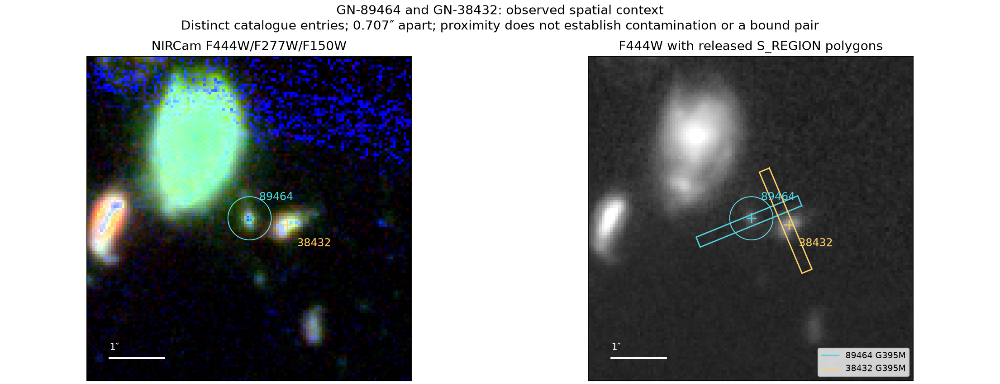
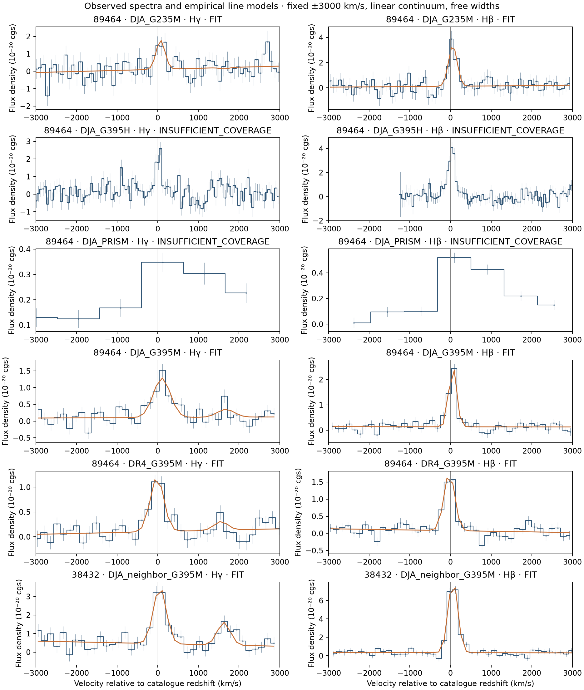

# GN-89464 and GN-38432 in fitted Balmer profiles

Executed 21 November 2026. An empirical line fit preserves the elevated Hγ/Hβ
point estimates of GN-89464 relative to its nearby comparison galaxy GN-38432
in the G395M products. The numerical ratio changes with the fit assumptions.
The physical explanation for GN-89464 remains unresolved.

The two catalogue positions are 0.707 arcseconds apart. Their images and
released slit polygons are described in the
[spatial follow-up](spatial_context.md). This analysis reuses six fingerprinted
spectra. It fixes each source's DR4 redshift, fits signed Hγ and Hβ amplitudes,
includes a signed nuisance line at [O III] λ4363 near Hγ, and integrates the
Gaussian profiles over the released wavelength bins. The fit solves for
observed Gaussian widths, either shared or free between the lines. A Gaussian
approximates the instrumental and intrinsic profile together. No explicit
source-dependent line-spread function, stellar absorption component, or
deconvolved width is inferred.

The grid crosses ±2,400 and ±3,000 km/s fit windows, constant and linear
continua, and shared or independent centers and widths. The wavelength mask
requires at least 80% of nominal window pixels, at least three valid pixels
beyond ±800 km/s on each side, and at least 75% overlap in the central ±350 km/s
window. Reported ranges require S/N ≥5 in both lines, interior fit parameters,
and reduced chi-squared ≤2 using the diagonal errors. These are exploratory
quality criteria. The formal covariance omits resampling, reduction
systematics and mismatch with the chosen profile.

| Source | Product | Eligible ratios / attempted | Hγ/Hβ point estimates |
|---|---|---:|---:|
| GN-38432 | DJA G395M | 8/8 | 0.392–0.482 |
| GN-89464 | DJA G395M | 8/8 | 0.585–1.049 |
| GN-89464 | JADES DR4 G395M | 8/8 | 0.646–0.826 |
| GN-89464 | DJA G235M | 0/8 | Both-line significance gate fails |
| GN-89464 | DJA G395H | 0/8 | Insufficient usable window coverage |
| GN-89464 | DJA PRISM | 0/8 | Insufficient usable window sampling |

All 48 attempts are retained, including failed coverage checks. For the
±3,000 km/s model with free kinematics and linear continua, the formal
ratios are 0.962 ± 0.161 (GN-89464 DJA), 0.730 ± 0.109 (GN-89464 DR4),
and 0.465 ± 0.056 (GN-38432 DJA). The ranges are sensitivity ranges across
reused data. The G395M reductions share observations. A near-standard
ratio in the comparison galaxy and an elevated value in GN-89464 do not
identify the mechanism producing the contrast. Distinguishing stellar
absorption, intrinsic emission, and spatial or instrumental effects requires
more discriminating observations and a model for the instrument response.

Run `python scripts/analyse_balmer_profile_comparison.py` after restoring
the prior spectra. [All fits](../results/balmer_profiles/fits.csv) ·
[Fit parameters and masks](../results/balmer_profiles/fits.json) ·
[Execution metadata](../results/balmer_profiles/summary.json)
