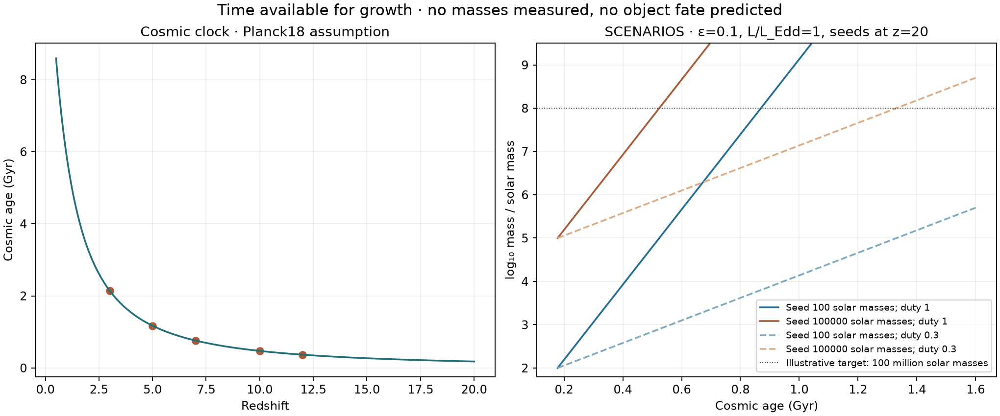

# Evolution, cosmology, and the search for unfamiliar objects

Research notes reviewed 13 November 2026. This document separates published
models, calculations executed in this repository, and hypotheses still to test.

## What could these objects become?

We observe a distant source at the time its light was emitted. We cannot watch
its entire subsequent history. A future evolutionary path must therefore be a
conditional model prediction, constrained by the spectrum, luminosity, size,
environment and time available. Cosmic expansion supplies a redshift–time
relation; it does not by itself establish an object's power source or require a
new type of star.

The idea of a black hole inside a massive envelope predates JWST. The
[Begelman, Rossi & Armitage quasi-star calculation](https://arxiv.org/abs/0711.4078v2)
examined how an embedded accretor and its hydrostatic envelope evolve, including
eventual envelope loss. This is a proposed formation channel, not a confirmed
identity for our sources. Modern
[MESA-QUEST implementations](https://arxiv.org/abs/2507.12651) and
[evolutionary tracks](https://arxiv.org/abs/2510.17952v2) provide more detailed
predictions that can be tested. Their assumptions and predicted lifetimes are
model dependent; a selected catalogue fraction cannot establish a lifetime.

Nor are all uses of “black-hole star” equivalent. A massive hydrostatic
quasi-star envelope, a dense photoionised AGN cocoon, and a nuclear-powered
supermassive star describe different physical structures. The recent
[Sneppen et al. cocoon model](https://arxiv.org/abs/2601.18864v2) fits a set of
LRD grating spectra using radiative transfer and predicts related changes in
Balmer features and scattering widths. It does not require a stellar-like
photosphere. A competing
[supermassive-star atmosphere calculation](https://arxiv.org/abs/2507.12618v3)
shows that some apparently unusual LRD features can arise in a stellar model.
These studies make it essential to compare several mechanisms on the same data.

## Executed calculation: time available for growth

The [growth grid](../results/open_search/conditional_growth_grid.csv) uses
Astropy's [Planck18 cosmology](https://docs.astropy.org/en/stable/cosmology/realizations.html)
and a simple radiatively efficient black-hole growth clock:

\[
t_e = \frac{c\sigma_T}{4\pi Gm_p}\,
      \frac{\epsilon}{(1-\epsilon)\lambda f_{\rm duty}},
\qquad t_{\rm required}=t_e\ln(M_{\rm target}/M_{\rm seed}).
\]

Here epsilon is radiative efficiency, lambda is luminosity divided by the
black-hole Eddington luminosity, and duty is the assumed active fraction.
We compare three seed masses, three efficiencies, two duty fractions and two
Eddington ratios at five redshifts, fixing the illustrative seed formation
redshift at 20 and the target mass at 100 million solar masses. Those are **input
scenarios**, not masses or formation times measured for our outliers.

At epsilon=0.1, lambda=1 and duty=1, the e-folding time is about 50 million years.
Growing from 100 to 100 million solar masses then takes about 692 million years;
starting with 100,000 solar masses takes about 346 million years. Lower duty
fractions lengthen both clocks. This explains why reliable masses, ages and
growth histories can distinguish formation scenarios. It does **not** show that
any individual source must have a heavy seed, and our spectra here do not
measure those masses. This exponential approximation omits finite gas supply,
feedback, mergers, spin evolution and envelope structure. It is not a substitute
for MESA-QUEST or radiation-hydrodynamic evolution, and must not be extrapolated
indefinitely to predict the distant future.

## Predictions that could separate explanations

The following are proposed research tests, not results already demonstrated by
this repository. Several hypotheses can coexist within one source.

| Hypothesis | Measurements to compare jointly | Important degeneracy or failure test |
| --- | --- | --- |
| Dense gas surrounding an accretor | Resolved hydrogen profiles, absorption, Balmer/Paschen ratios, continuum, X-ray limits | Absorption and velocity substructure must not masquerade as scattering wings; test an independent extraction |
| Hydrostatic quasi-star | Luminosity, temperature, surface-gravity-sensitive spectrum and predicted evolutionary lifetime | Must reproduce lines as well as continuum; correct lens magnification before luminosity comparison |
| Nuclear-powered supermassive star | Consistent atmosphere spectrum and luminosity, multiple absorption/emission features | Compare against accretion models with the same coverage, calibration and nuisance parameters |
| Ordinary AGN plus host galaxy/dust | Host starlight, reddening, broad and narrow lines, infrared energy budget | A successful combined fit can remove the apparent need for an exotic object |
| Extreme star-forming galaxy | Nebular complexes, stellar continuum, ionisation and abundance constraints | Strong emission lines can dominate broad bands and produce a rare shape |
| Composite or lensed source | Multi-band morphology, spatial traces, independent lens/source association | Different objects or magnified components may contribute to one extraction |
| Misassigned redshift or calibration defect | Alternate line identifications, repeat observations, 2D detector/extraction diagnostics | The anomaly should weaken or disappear when the measurement error is corrected |
| Unresolved empirical phenomenon | Repeated, independently measured residual pattern after adequate competing fits | “Unresolved” alone is not evidence of a new physical class |

## How to look beyond published labels

Our new search does not require an LRD tag, a red continuum or a broad hydrogen
line. It measures signed optical and ultraviolet spectral shapes and compares
them with same-survey peers of similar redshift and signal-to-noise. All
unscorable objects retain a reason; missing data are not replaced by zero.
The complete method and source images are in the
[open-search report](open_search.md).

An unusual shape may reveal an unfamiliar combination of familiar components,
a short evolutionary phase, a measurement defect, or a genuinely missing
physical mechanism. We cannot distinguish these possibilities by rarity alone.
An analogous lesson comes from the
[DESI anomaly-search study](https://arxiv.org/abs/2506.17376v2), which found both
data artefacts and astrophysically unusual spectra. Our implementation is an
explicit broad-band peer comparison, not a reproduction of that paper's neural
network or its validation.

Before proposing an unpublished class we need: a repeatable observable;
independent verification; a literature/coordinate audit; adequate competing
forward models; and a prediction that new data could falsify. New descriptions
or names do not meet these requirements. The present results are follow-up
priorities, not a newly established family of objects.

## Specific next discriminating work

1. Inspect the strongest shape outliers in their original 1D/2D spectra and
   actual NIRCam cutouts, retaining crowded-field and coverage concerns.
2. Test dependence on redshift, the dominant spectral band and peer selection.
   Obtain repeat observations or an independent reduction for surviving cases.
3. Fit instrument-convolved stellar/nebular, AGN/host, stellar-atmosphere and
   reprocessing models with calibration and absorption nuisance parameters.
   The repository still lacks this complete comparison; peer residuals do not
   reject those physical models.
4. Broaden to uncertain-redshift and foreground-source branches using observed
   wavelengths and multiple redshift solutions. Current grade-3 selection can
   exclude exactly the unfamiliar objects we wish to discover.
5. Measure selection and injection recovery across survey depths before any
   population abundance, lifetime or cosmic-evolution claim.

The existing conference posters remain an explicitly dated snapshot of the
earlier high-S/N experiment. New evidence should enter a later poster revision
only after the interpretation has been reviewed.
