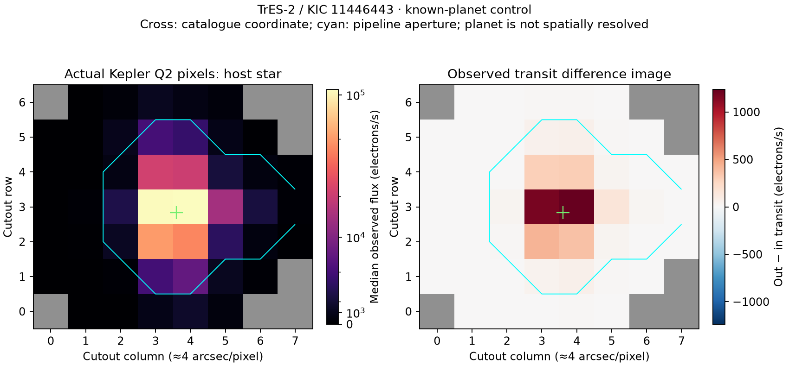
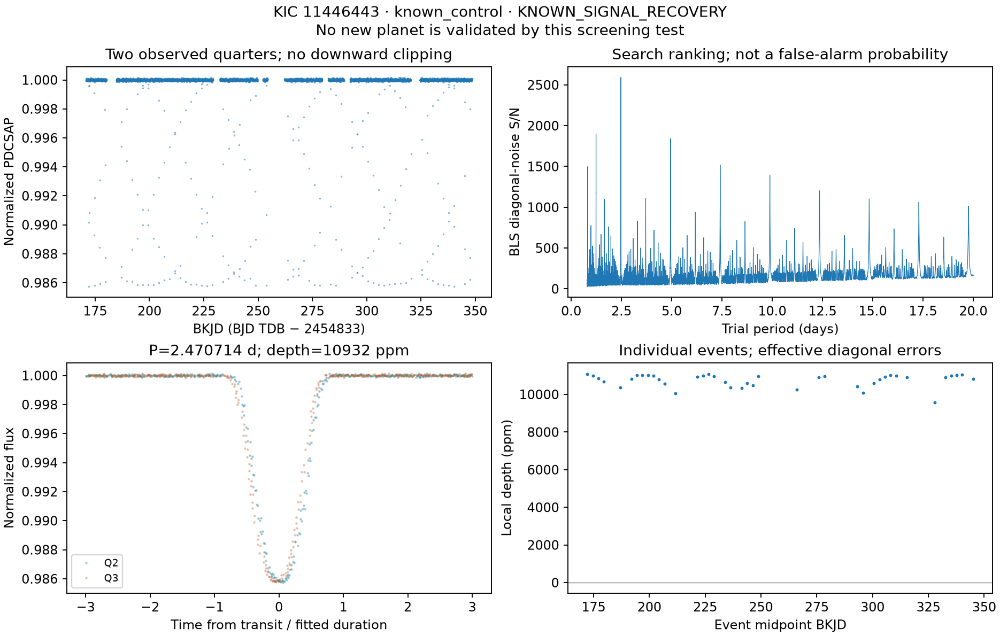
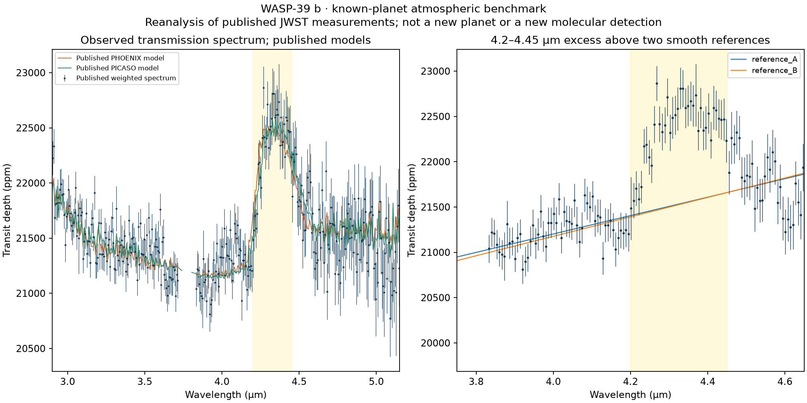

# Exoplanet research: first executed Kepler search and JWST atmosphere benchmark

Executed 16 November 2026. **No new planet is validated by this work.**
This begins a parallel exoplanet programme inside the repository. It uses actual
public Kepler observations and a published JWST atmospheric spectrum, with
search targets, known controls and synthetic injections explicitly separated.

The NASA Exoplanet Archive TAP query `select count(*) as n from pscomppars`
returned **6,470 confirmed planets** in the retrieved snapshot. The total will
change; it is not hardcoded as the future archive size. The archive documents
the [one-row-per-planet composite table](https://exoplanetarchive.ipac.caltech.edu/docs/API_TD_columns.html).

## What was searched

A fixed convenience sample was selected from the public Kepler `0114` directory:
the twelve KIC numbers numerically nearest to KIC 11446443, excluding that ID.
Numerical proximity is **not angular proximity or a population-representative
selection**. TrES-2 / KIC 11446443 was added as a known positive control.
Selection was recorded before light-curve and KOI inspection. It is a bounded
method-development pilot, not a search of all Kepler stars.

Quarters 2 and 3 were requested for each target. Twenty-four long-cadence files
were available: eleven search stars plus the control, two quarters each.
KIC 11446387 lacked both requested products and remains an explicit unavailable
case, not a nondetection. **80,650 retained cadences** were analysed.

Identity and quarter were checked in every FITS header, as were BKJD time origin
(BJD TDB minus 2454833) and product fingerprints. Processing keeps only finite,
positive-error/positive-flux rows with `SAP_QUALITY=0`. A two-day running median
is fitted separately across gaps longer than half a day; one day is trimmed
from segment edges. Downward points are not clipped. PDCSAP errors are scaled
by the median trend, then floored at the robust point scatter for searching.
This still does not model correlated noise or detrending uncertainty.

[Astropy Box Least Squares](https://docs.astropy.org/en/stable/timeseries/bls.html)
searches periods 0.8–20 days and durations 0.06, 0.10, 0.16 and 0.24 days.
The strongest peak per star is retained. Diagnostics include separate-quarter
depths, individual events, odd/even depths, a phase-0.5 secondary, and an inverted
light-curve scan. The preliminary screen requires S/N≥8, at least three sampled
events, both quarters at S/N≥5, odd/even contrast <3, secondary S/N<3, and a
weaker inverted maximum (<80% of the positive search S/N).

**These thresholds are exploratory and are not a validated classifier.**
No global false-alarm probability, survey completeness, eclipsing-binary model,
Gaia neighbour/dilution model or radial-velocity validation has been computed.

## Executed results and an important control limitation

The known control is recovered at **2.470714 days**, matching the catalogue
period 2.470613377 days. This is a grid estimate with no period uncertainty,
not a replacement ephemeris. Its box depth is about 1.093%; the box depth and
duration should not be used as a limb-darkened planet-radius measurement.

The image comes from the actual Kepler Q2 target-pixel cube. The right panel is
the mean local-phase out-of-transit image minus the mean in-transit image.
Gray pixels have no usable flux. The planet is **not spatially resolved**. The marked coordinate and aperture
locate the host; the difference image is a visual diagnostic, not a measured
centroid significance or proof against every contaminating neighbour.

The control exposed a real vetting limitation: the formal box-model odd/even
contrast is 40.4 despite its known planet status. An exploratory comparison
using the scatter of measured individual-event depths gives only 0.60.
That change is not a calibrated substitute test; it demonstrates why diagonal
formal errors, coarse box geometry and long-cadence sampling cannot be used
as an automatic planet rejection rule. The original failure is retained in
the output table, and the method must be calibrated before automatic vetting.

The eleven search stars have strongest short-period peaks with ranking S/N
5.18–6.81; none reaches the preliminary S/N≥8 threshold. **This is not evidence
that these stars have no planets**, especially outside the period/duration
window or below the sensitivity of this two-quarter pilot.

The current [KOI cumulative table](https://exoplanetarchive.ipac.caltech.edu/docs/PurposeOfKOITable.html)
was checked by KIC identifier, including periods and half/double-period aliases.
KIC 11446424 already hosts the unconfirmed entry **K08223.01**, with catalogue
period 66.716453 days and candidate radius 2.20 Earth radii. This is outside
the initial search window. A separate, explicitly catalogue-directed check
finds a signed local depth about 856±178 ppm (formal effective-diagonal error),
S/N=4.82. A follow-up 20–90 day BLS scan on this star instead has its maximum
at 57.95 days with S/N=6.05. Neither result validates or refutes the candidate,
and neither is a new discovery. No atmospheric spectrum was analysed for it.

## Synthetic recovery checks

Three artificial 1,000-ppm, 0.1-day box transits were multiplied into the actual
PDCSAP flux of KIC 11446440 **before detrending**, at periods 1.7, 5.3 and 12.7
days. All three periods were recovered within 1%. Recovered depths were 996,
980 and 942 ppm, illustrating some attenuation at the longest test period.
These are simulated signals, not additional objects or detections. Three
injections in one star do not establish completeness or false-alarm rates.

## Atmospheric and physical benchmark: WASP-39 b

A published 344-bin JWST/NIRSpec G395H transmission spectrum and released
model curves were retrieved from [Alderson et al.'s Zenodo release](https://doi.org/10.5281/zenodo.7185300).
The publisher's MD5 and local SHA256 were checked. The original authors
attribute features to CO₂, H₂O and SO₂ through atmospheric modelling in
[the associated research paper](https://pmc.ncbi.nlm.nih.gov/articles/PMC9946835/).
Those chemical identifications are **published results**, not newly established
by this repository's simpler diagnostic.

Across 38 bins at 4.20–4.45 µm, a weighted excess above two alternative local
linear references is **805±54 ppm** and **813±67 ppm**. The errors propagate
diagonal bin errors and the fitted reference covariance. They do not include
all inter-bin/reduction correlations. The resulting formal contrasts are not
molecule-detection significances: a smooth reference is not an atmosphere
without CO₂, and neighbouring windows may contain other molecular opacity.
The published model curves are overlaid for context; no new abundance retrieval,
temperature-pressure inference, C/O measurement or chemical discovery is claimed.

The NetCDF unit label for depth is ambiguous. Stored values around 0.022 are
used as fractional transit depths, consistent with the release notebook's
conversion by ×100 to percent. No spurious Jupiter/Solar-radius conversion is
applied, and the file's placeholder system-parameter metadata is not treated as
measured stellar or planetary properties. Downloaded notebooks and pickle files
are not executed.

The independently retrieved NASA composite-parameter snapshot provides these
**literature inputs for the known benchmark**, not measurements of our new
search stars:

| Property | Value | Provenance / interpretation |
|---|---:|---|
| Orbital period | 4.0552941±0.0000034 days | NASA composite literature value |
| Radius | 1.279±0.040 Jupiter radii | NASA composite literature value |
| Mass | 0.281±0.032 Jupiter masses | NASA composite literature value |
| Equilibrium temperature | 1,166 K | Catalogue model-dependent estimate; not a measured surface temperature |
| Bulk density | 0.167±0.025 g/cm³ | Derived here from the listed mass and radius |
| Surface gravity | 4.26±0.55 m/s² | Derived here from the listed mass and radius |

Derived errors assume independent mass and radius errors and use the quoted
upper uncertainties symmetrically. Composite values may originate in different
papers; these are illustrative derived properties rather than a joint posterior.

## Next research decisions

Before searching many more stars, calibrate a cadence-integrated transit model
and event-level noise treatment on confirmed planets and eclipsing binaries.
Then expand to more Kepler/K2 quarters and TESS sectors, with held-out-sector
replication, pixel/difference-centroid tests, contamination checks and current
catalogue/literature crossmatches. **TESS/K2 data were not analysed in this first
pass.** Absence from one catalogue will not be treated as evidence of novelty.

Physical radii require reliable stellar parameters and dilution treatment;
planet masses usually need additional dynamical information. Atmospheric chemistry
requires suitable time-series spectroscopy and forward models. Most transit
search targets will not have JWST transmission spectra, so missing atmospheric
information must remain missing rather than be inferred from broadband dips.

## Reproduce and inspect

Install the optional reader with `pip install -e '.[exoplanets]'`.
Run the download, analysis, synthetic recovery, control audit, image and
atmosphere scripts named in the [execution ledger](../experiments/parallel_research.yaml).
The retrieval uses a finite shared 4 GiB raw-data budget and a single manifest
writer. All public-data inputs are fingerprinted and excluded from Git.

- [Fixed selection](../results/exoplanet_pilot/selection.json)
- [All screening results, including failures](../results/exoplanet_pilot/screening.csv)
- [Input quality and metadata](../results/exoplanet_pilot/input_metadata.csv)
- [Individual events](../results/exoplanet_pilot/individual_events.csv)
- [Synthetic recovery results](../results/exoplanet_pilot/injection_recovery.csv)
- [Control limitations and known-candidate follow-up](../results/exoplanet_pilot/control_audit.json)
- [Atmosphere feature measurements](../results/exoplanet_pilot/wasp39_feature_contrasts.csv)
- [Physical-property inputs and assumptions](../results/exoplanet_pilot/wasp39_properties.json)

This parallel programme is underway. It has not discovered or validated a new
exoplanet, and it does not replace the continuing unusual-galaxy investigation.
