# Expanded search for evidence of gas-enshrouded accretion

Research owner: Biswajit Jana. This is a measured research progress report, not a
black-hole-star discovery announcement. The conference posters summarize this
stage and can be regenerated when the evidence changes.

## Scope and coverage

The search completed diagnostics for **2,647 of 2,647
eligible upstream source records** (100.0%), with
0 analysis failures. Eligibility was fixed before the bulk search:
PRISM, archive grade 3, median pixel S/N≥5, and 0.5≤z<12. The highest-S/N product
per upstream source ID was selected, with filename tie-breaking and no colour or
physical-class filter. We did not stop after an appealing source appeared.

The parent catalogue contains 20,144 upstream source records and 44,619
observations across four surveys. This run covers 13.1% of those source records,
not the majority of all public JWST objects. It covers the entire stated eligible
high-S/N subset. Targeting, release dates, redshift success and S/N selection
prevent interpreting these fractions as cosmic abundance or completeness.
Upstream IDs are not an independently verified count of physical galaxies.

| Assigned survey of selected product | Analysed | Joint follow-up priorities |
| --- | ---: | ---: |
| CEERS | 326 | 1 |
| JADES | 1569 | 4 |
| RUBIES | 574 | 5 |
| UNCOVER | 178 | 1 |

## Executed screening

- 2,164 usable continuum-ratio measurements.
- 1,892 usable empirical Hα+[NII] blend comparisons.
- 474 pass the continuum-only screen.
- 37 pass the broad-blend-only screen.
- **11 pass both screens**, forming a follow-up queue.
- 559 change the broad/narrow preference sign across LSF assumptions.
- 8 joint priorities retain the line criteria
  if line errors are doubled; this is sensitivity analysis, not a revised discovery threshold.

The continuum criterion requires red/blue fν>2 and its conditional 3σ lower
bound>1.5, with the lower-bound requirement repeated in shifted continuum windows.
The blend criterion requires ΔBIC(narrow−broad)>10 and broad-component S/N>5 under
each of three resolving-power scales (1, 1.3, 1.6). PRISM blends cannot separate
Hα, [NII], absorption, velocity structure and scattering. These cuts have no
calibrated physical-class false-positive rate or posterior probability.

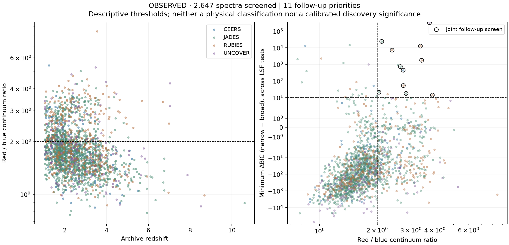

### Follow-up queue, not confirmed objects

| Upstream source ID | Survey | z | Continuum ratio | Minimum ΔBIC | Minimum blend S/N |
| --- | --- | ---: | ---: | ---: | ---: |
| CAL-cf2762adfeb35e39 | UNCOVER | 4.467 | 3.75 | 323082.5 | 1784.7 |
| CAL-822484b865235523 | RUBIES | 1.876 | 3.88 | 14.1 | 20.4 |
| CAL-6f95e2608a9752cc | RUBIES | 6.688 | 3.36 | 12568.9 | 166.9 |
| CAL-d256290324db5226 | JADES | 1.877 | 2.83 | 17.7 | 12.8 |
| CAL-11f0c5ef758e5d00 | CEERS | 3.240 | 2.73 | 443.0 | 54.7 |
| CAL-e9dc16edfa5553bb | RUBIES | 4.900 | 2.74 | 52.7 | 21.2 |
| CAL-b153aa637a685751 | JADES | 3.127 | 2.64 | 731.6 | 73.4 |
| CAL-b1c696ad792151c2 | RUBIES | 5.277 | 2.39 | 7134.2 | 179.1 |
| CAL-efc95b2a0f8a519d | JADES | 5.040 | 2.11 | 23928.7 | 390.8 |
| CAL-ee21ea17c6f8511b | JADES | 2.047 | 2.04 | 20.7 | 20.3 |
| CAL-c692e9afcfd85c9a | RUBIES | 5.681 | 3.41 | 1743.6 | 65.6 |

The full queue and signed/missing measurements are preserved in
[follow-up priorities](../results/expanded/followup_priority.csv) and
[all measurements](../results/expanded/measurements.csv). Full per-source fit
details are in [compressed JSON Lines](../results/expanded/source_fits.jsonl.gz).
Selection does not establish novelty: some sources are already published, and
the complete queue has not undergone a source-by-source literature audit.

All eleven selected sources have poor absolute fits under the fixed-width PRISM
blend model: nominal reduced χ² ranges from approximately 4.9 to 4167. Relative
preference over an even poorer narrow model is not model adequacy. The queue is
therefore a list of spectra requiring better modelling, not eleven successful
physical-model fits.

### Literature and missed-benchmark checks

The queue includes already published sources. RUBIES-EGS-49140 and
UNCOVER-A2744-45924 are discussed in
[Wang et al. (2026)](https://arxiv.org/abs/2609.22623); RUBIES-EGS-9809 is described
as a dusty AGN host with stellar-population contributions in
[D'Eugenio et al. (2026)](https://arxiv.org/abs/2609.07825). These checks establish
that the queue is not a list of new discoveries. Later, deeper products in those
papers are not automatically present in our pinned DJA release.

The Cliff (RUBIES-UDS-154183; CAL-ebc2a6a997b3535d) is an especially important
benchmark from [de Graaff et al. (2025)](https://arxiv.org/abs/2503.16600). Our
continuum ratio is 8.46±2.12, but the fixed-width PRISM broad-line test rejects
it. A single 1500 km/s intrinsic sigma cannot represent all physically broad
profiles; it is also not the same quantity as FWHM. We retain this missed
published candidate as direct evidence of the screening method's incompleteness.
It is separately inspected and is not retroactively added to the eleven passes.

In its G395M spectrum, the full-window Gaussian-versus-exponential comparison
favours the exponential family: ΔBIC=56.8–69.6 over the LSF tests, remaining
10.7–13.9 when errors double. However, removing four central pixels within
±400 km/s reduces ΔBIC to 3.5–9.4 (−2.6 to −1.1 with doubled errors).
The signal is sensitive to the line core, where absorption is unmodelled.
This is conditional shape evidence, not a robust diagnosis from the wings alone.
See [all sensitivity cases](../results/cliff_sensitivity.json).

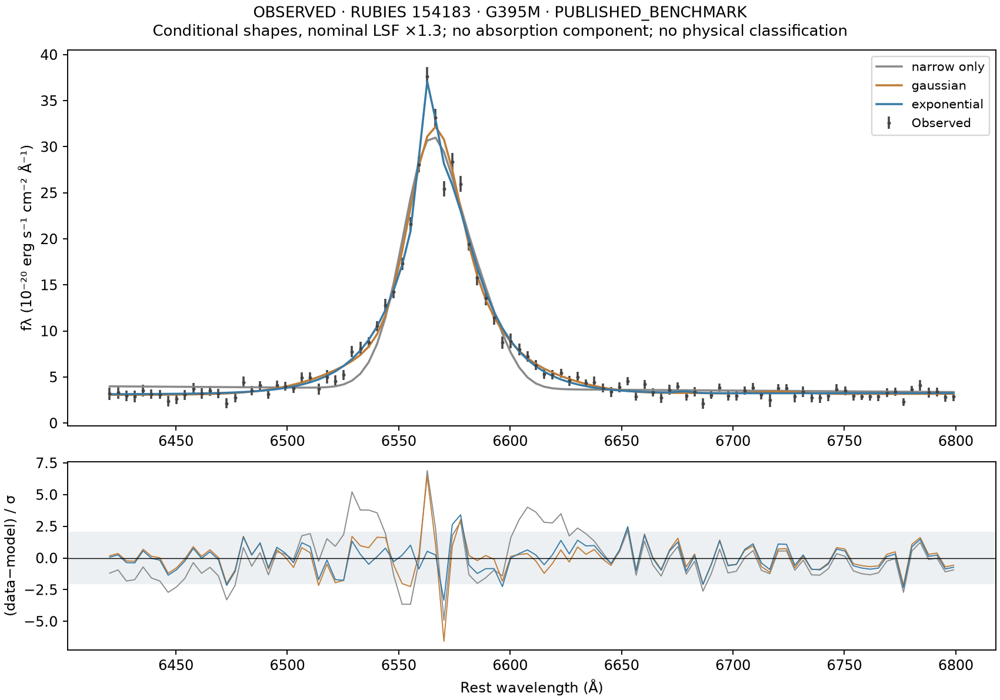

## Published GLIMPSE-17775 benchmark

We downloaded the authors' stacked, slit-loss-corrected G395M spectrum and
verified its publisher MD5. This is reanalysis of their released spectrum, not
an independent detector-level reduction or a new source discovery.
Data: [Kokorev's public release](https://doi.org/10.5281/zenodo.17575391).
Context: [Kokorev et al.](https://arxiv.org/abs/2511.07515).

The comparison uses a linear local continuum, tied narrow nuisance components,
and either a Gaussian or a Gaussian convolved with symmetric exponential tails
for the broad component. Both are pixel integrated and convolved with a Gaussian
instrument response. We vary resolving power and use multi-start bounded fits.
These are empirical line shapes, not complete gas-envelope, stellar or AGN
forward models. Positive ΔBIC below favours the exponential shape.

| Window, resolving power ×1.7 | ΔBIC(G−E) | ΔBIC with doubled errors |
| --- | ---: | ---: |
| Halpha | 1445.80 | 357.99 |
| Paschen_delta | -2.68 | -4.17 |

**Hα is provisional:** the released flux and errors are finite, but NPIX is zero
throughout that window. The strict mask admits zero Hα pixels. The supplemental
finite-flux/error fit therefore requires resolution of the metadata discrepancy.
Even that exponential fit has large structured residuals (reduced χ²≈12.7), so
a large relative BIC improvement does not make it an adequate physical model.

**Paschen-δ uses the strict mask.** This implementation finds no clear evidence
for the extra exponential-tail parameter (ΔBIC≈−2.7); residuals remain above the
nominal error expectation. That differs from the published fit and is not a
refutation of it: the nuisance components, absorption treatment and fitting
assumptions have not been replicated in full. This disagreement is retained as
an unresolved methodological test, not hidden or counted as confirmation.

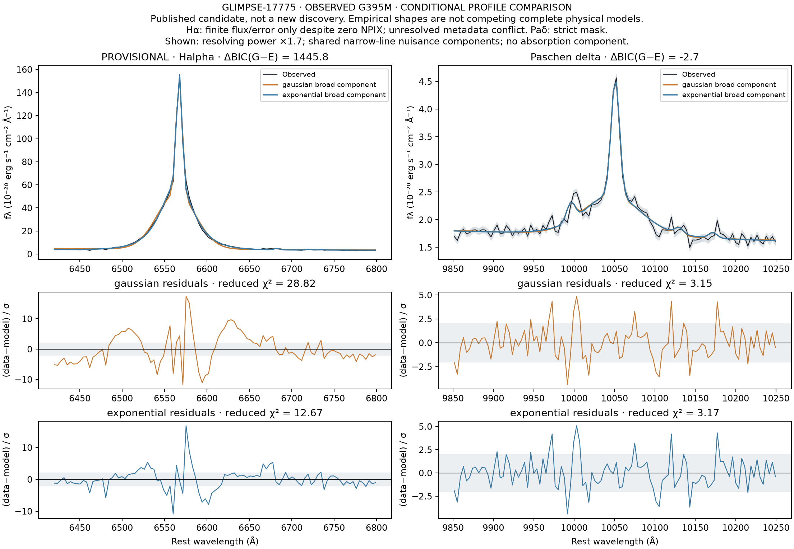

## Validation and interpretation

Under a correctly specified isolated-line simulation, 0/50
Gaussian controls and 27/50 exponential injections exceed
ΔBIC>10. The exact 95% intervals for these selection fractions are
[0.0, 0.07112173646419764] and
[0.39324197611692235, 0.6818508214313913]. This checks recovery under
known assumptions; it does not calibrate real-source discovery probabilities.
The simulations omit blending, absorption, covariance, calibration errors and
physical-model degeneracy. See [simulation records](../results/profile_simulation_validation.json).

**No new source is established as a black-hole star by this run.** The next
scientific requirements are independent extraction/metadata checks, realistic
line and continuum models, PSF-matched host/nucleus photometry, density and
fluorescence diagnostics, and comparisons against stellar, ordinary AGN and
composite alternatives. A negative or ambiguous result remains valid evidence.

## Bounded detailed inspection

We inspected the first twelve joint priorities (all eleven in this run) ordered by continuum lower bound
and blend ΔBIC, with up to four approximate same-survey comparison sources matched
in redshift and archive S/N. These controls are not certified normal galaxies.
The exact selection and higher-resolution outcomes are recorded in
[inspection audit](../results/expanded/inspection_audit.json).
Only one eligible medium-resolution counterpart per inspected source is used;
it shares the DJA processing and is not an independent reduction. Higher-resolution
fits use a nominal LSF ×1.3 and remain conditional on the adopted components.
The completed detailed set has eleven priorities, three comparison sources and
The Cliff as an added published benchmark. Seven sources yielded conditional
medium-resolution fits. In particular, JADES 10072503 prefers the narrow-only
model over a broad Gaussian (ΔBIC≈−11.6), warning that a PRISM screen can select
a source whose higher-resolution profile does not support the same conclusion.

### CEERS 2779 — JOINT_SCREEN_PRIORITY

CAL-11f0c5ef758e5d00; z=3.2396. Imaging: RGB_AVAILABLE. NO_ELIGIBLE_MEDIUM_RESOLUTION_COUNTERPART: No matching released medium-resolution product in this catalogue.

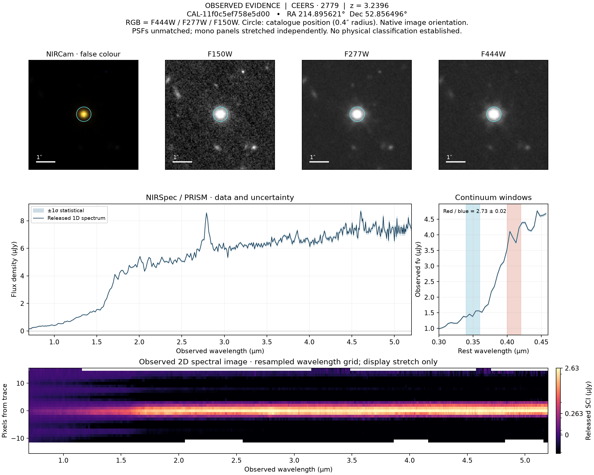

### JADES 3417 — JOINT_SCREEN_PRIORITY

CAL-b153aa637a685751; z=3.1270. Imaging: RGB_AVAILABLE. NO_ELIGIBLE_MEDIUM_RESOLUTION_COUNTERPART: No matching released medium-resolution product in this catalogue.

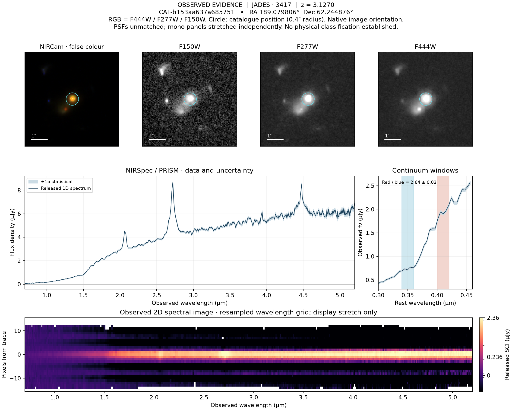

### JADES 3901 — JOINT_SCREEN_PRIORITY

CAL-d256290324db5226; z=1.8770. Imaging: RGB_AVAILABLE. NO_ELIGIBLE_MEDIUM_RESOLUTION_COUNTERPART: No matching released medium-resolution product in this catalogue.

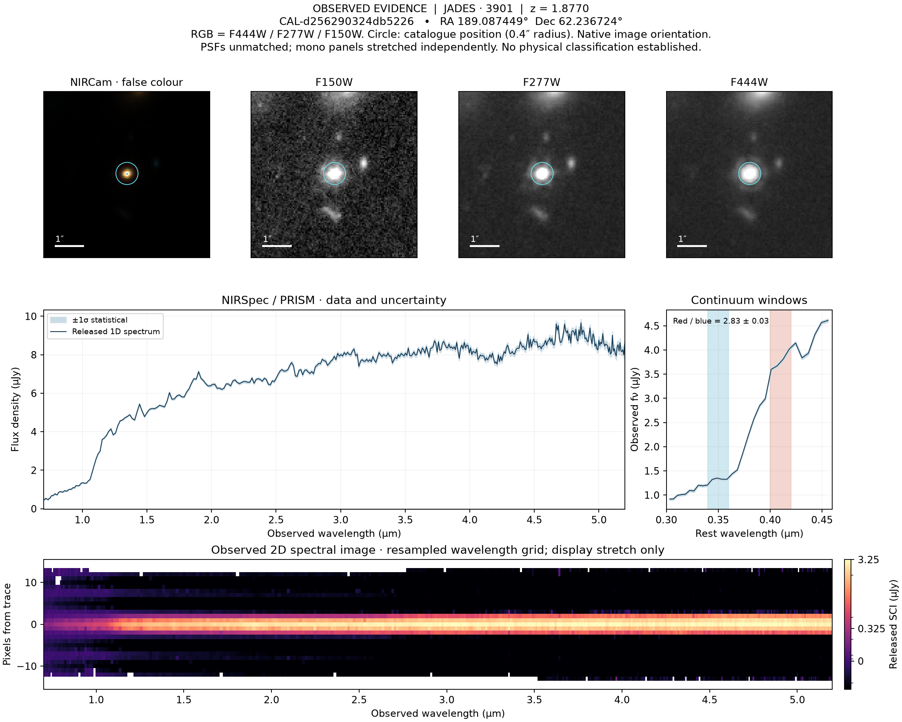

### JADES 203438 — COMPARISON

CAL-e4bba52cb24e58eb; z=1.9055. Imaging: RGB_AVAILABLE. G235M: ΔBIC(narrow−Gaussian)=14.1; ΔBIC(Gaussian−exponential)=-6.9; reduced χ²(G/E)=2.19/2.24. [Fit and residuals](../figures/expanded_sources/CAL-e4bba52cb24e58eb_medium.png)

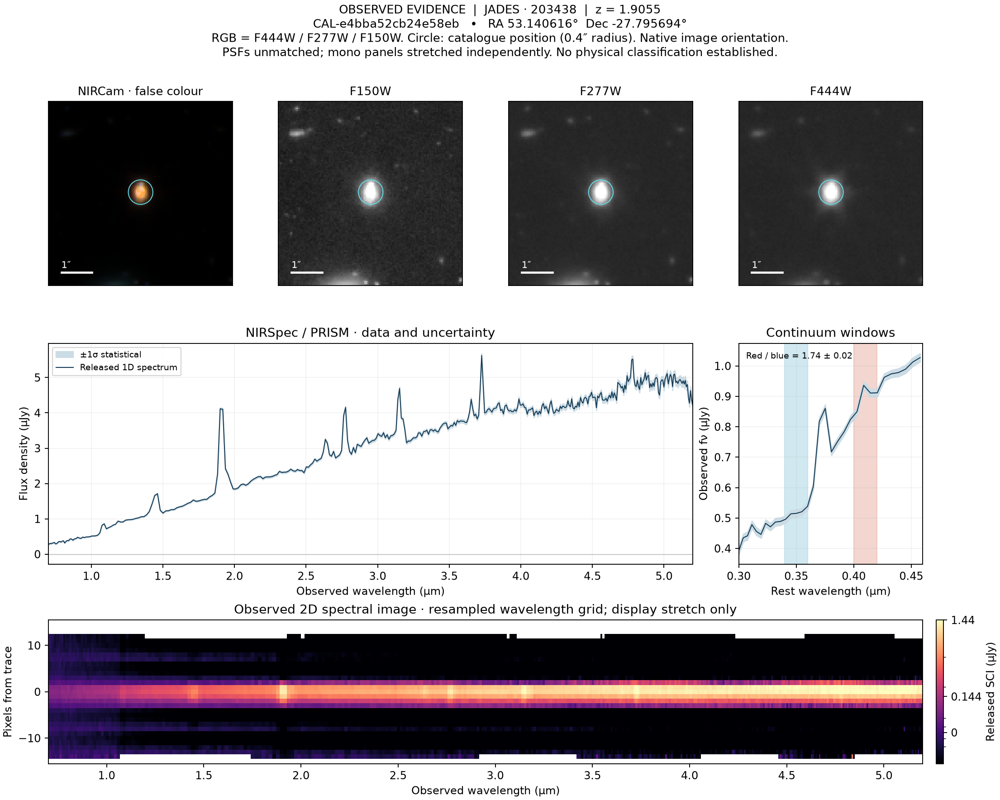

### JADES 10072503 — JOINT_SCREEN_PRIORITY

CAL-ee21ea17c6f8511b; z=2.0466. Imaging: RGB_AVAILABLE. G235M: ΔBIC(narrow−Gaussian)=-11.6; ΔBIC(Gaussian−exponential)=-7.4; reduced χ²(G/E)=1.01/1.04. [Fit and residuals](../figures/expanded_sources/CAL-ee21ea17c6f8511b_medium.png)

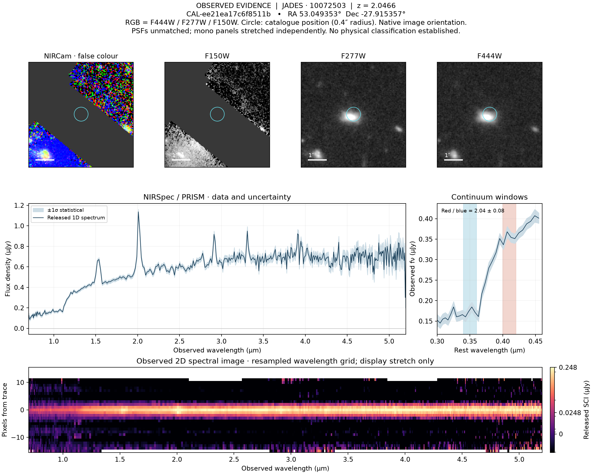

### JADES 68797 — JOINT_SCREEN_PRIORITY

CAL-efc95b2a0f8a519d; z=5.0398. Imaging: RGB_AVAILABLE. G395M: ΔBIC(narrow−Gaussian)=8992.3; ΔBIC(Gaussian−exponential)=305.1; reduced χ²(G/E)=17.30/14.90. [Fit and residuals](../figures/expanded_sources/CAL-efc95b2a0f8a519d_medium.png)

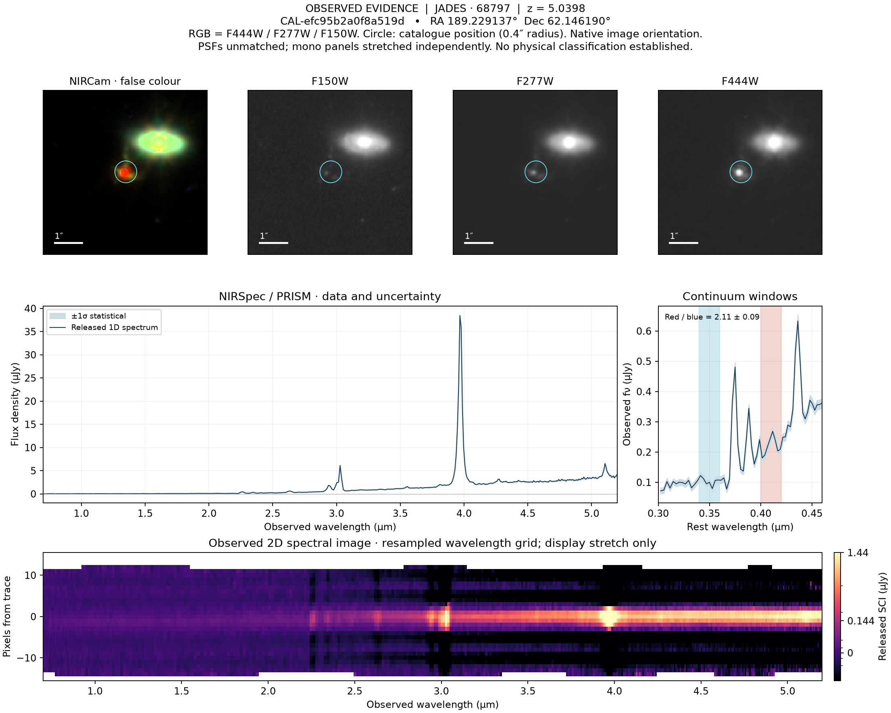

### RUBIES 55604 — COMPARISON

CAL-2729bede58b35cb4; z=6.9843. Imaging: RGB_AVAILABLE. NO_ELIGIBLE_MEDIUM_RESOLUTION_COUNTERPART: No matching released medium-resolution product in this catalogue.

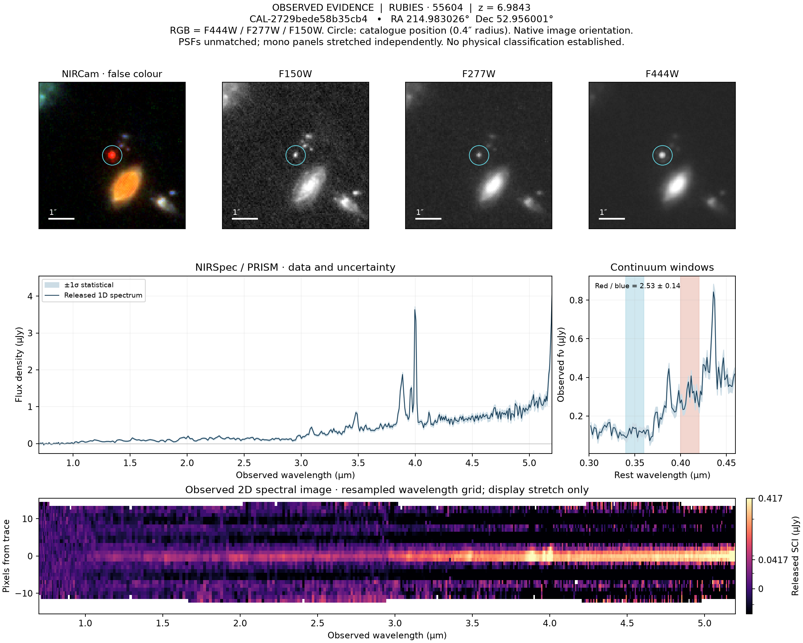

### RUBIES 49140 — JOINT_SCREEN_PRIORITY

CAL-6f95e2608a9752cc; z=6.6885. Imaging: RGB_AVAILABLE. G395M: ΔBIC(narrow−Gaussian)=693.9; ΔBIC(Gaussian−exponential)=13.4; reduced χ²(G/E)=2.09/1.97. [Fit and residuals](../figures/expanded_sources/CAL-6f95e2608a9752cc_medium.png)

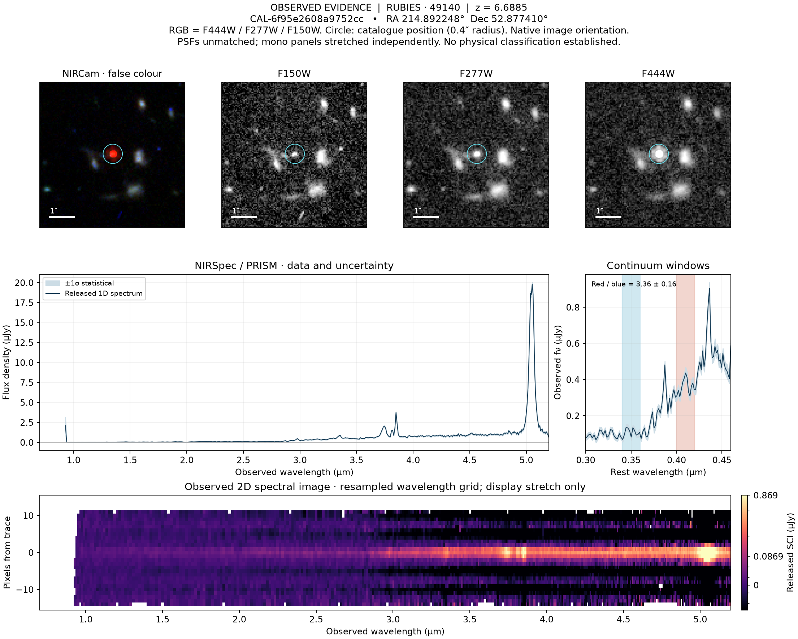

### RUBIES 26634 — JOINT_SCREEN_PRIORITY

CAL-822484b865235523; z=1.8756. Imaging: RGB_AVAILABLE. NO_ELIGIBLE_MEDIUM_RESOLUTION_COUNTERPART: No matching released medium-resolution product in this catalogue.

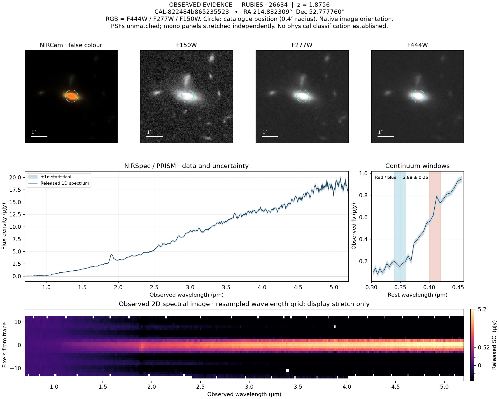

### RUBIES 26833 — COMPARISON

CAL-94bb0488729b5fd2; z=1.8097. Imaging: RGB_AVAILABLE. NO_ELIGIBLE_MEDIUM_RESOLUTION_COUNTERPART: No matching released medium-resolution product in this catalogue.

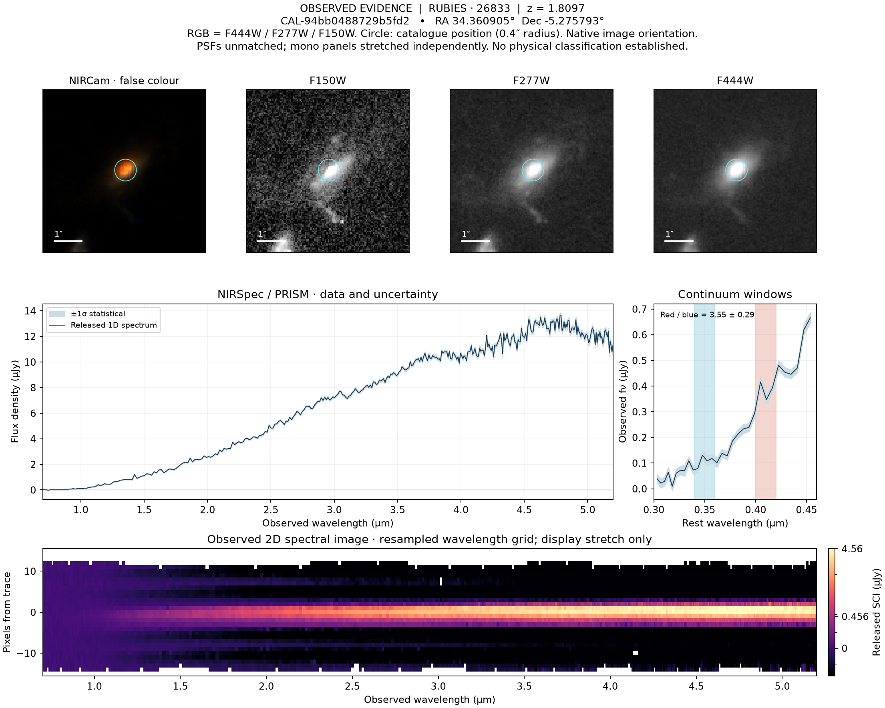

### RUBIES 42046 — JOINT_SCREEN_PRIORITY

CAL-b1c696ad792151c2; z=5.2772. Imaging: RGB_AVAILABLE. G395M: ΔBIC(narrow−Gaussian)=3387.8; ΔBIC(Gaussian−exponential)=7.5; reduced χ²(G/E)=9.43/9.41. [Fit and residuals](../figures/expanded_sources/CAL-b1c696ad792151c2_medium.png)

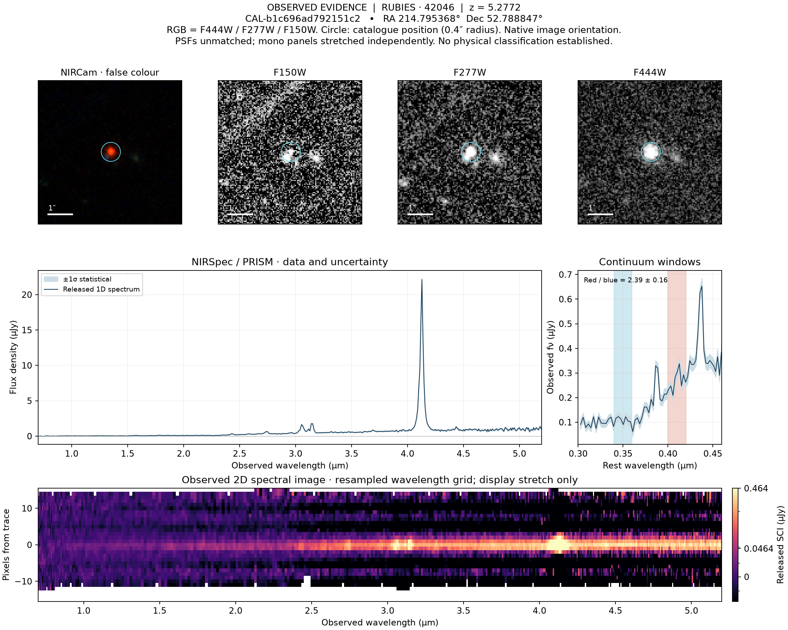

### RUBIES 9809 — JOINT_SCREEN_PRIORITY

CAL-c692e9afcfd85c9a; z=5.6812. Imaging: RGB_AVAILABLE. UNAVAILABLE_OR_FAILED: Insufficient medium-resolution Halpha coverage

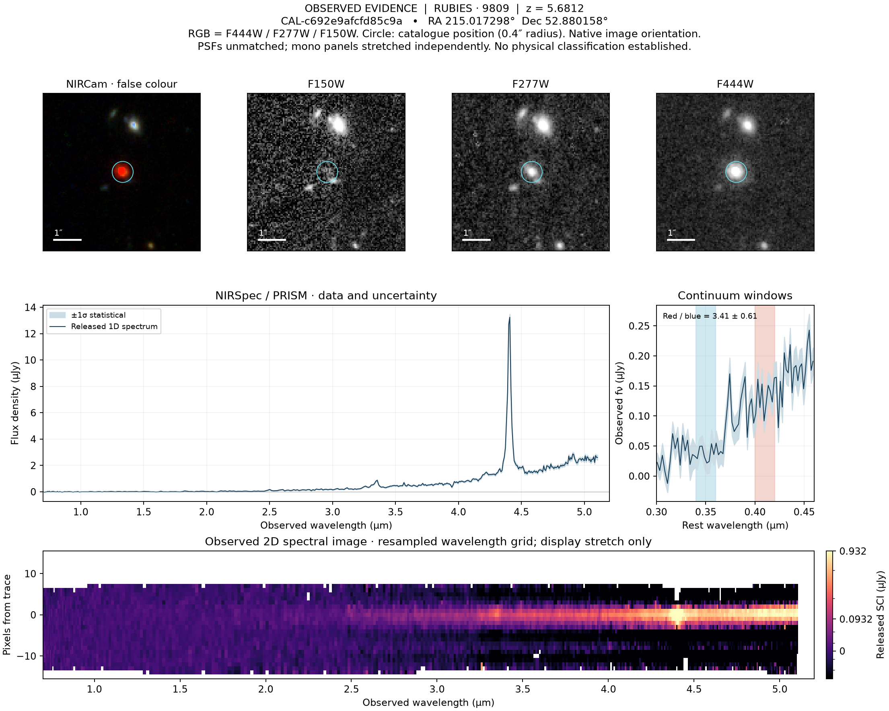

### RUBIES 75646 — JOINT_SCREEN_PRIORITY

CAL-e9dc16edfa5553bb; z=4.9000. Imaging: RGB_AVAILABLE. G395M: ΔBIC(narrow−Gaussian)=-10.0; ΔBIC(Gaussian−exponential)=-4.6; reduced χ²(G/E)=1.10/1.10. [Fit and residuals](../figures/expanded_sources/CAL-e9dc16edfa5553bb_medium.png)

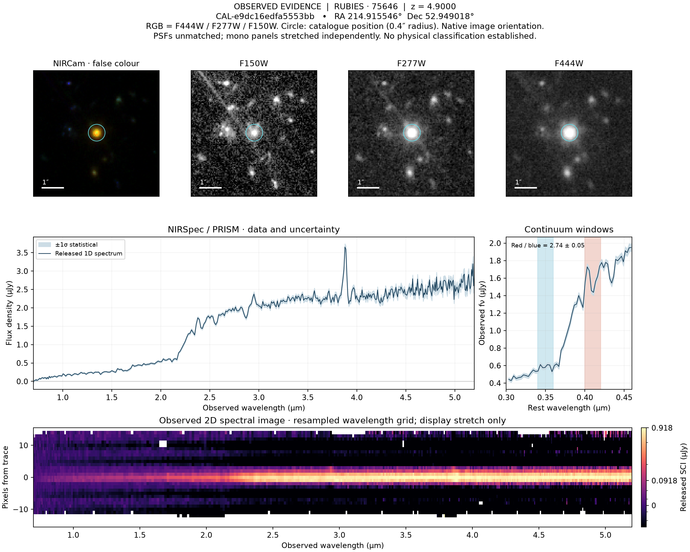

### RUBIES 154183 — PUBLISHED_BENCHMARK

CAL-ebc2a6a997b3535d; z=3.5460. Imaging: RGB_AVAILABLE. G395M: ΔBIC(narrow−Gaussian)=195.1; ΔBIC(Gaussian−exponential)=67.6; reduced χ²(G/E)=2.13/1.34. [Fit and residuals](../figures/expanded_sources/CAL-ebc2a6a997b3535d_medium.png)

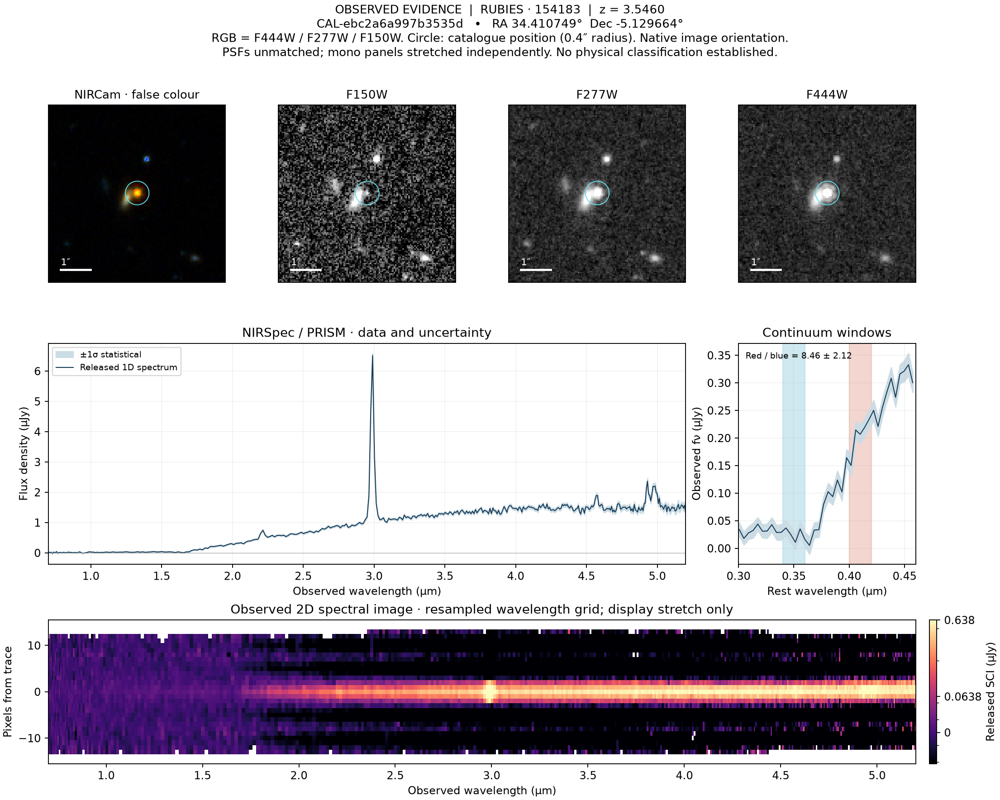

### UNCOVER 45924 — JOINT_SCREEN_PRIORITY

CAL-cf2762adfeb35e39; z=4.4673. Imaging: RGB_AVAILABLE. NO_ELIGIBLE_MEDIUM_RESOLUTION_COUNTERPART: No matching released medium-resolution product in this catalogue.

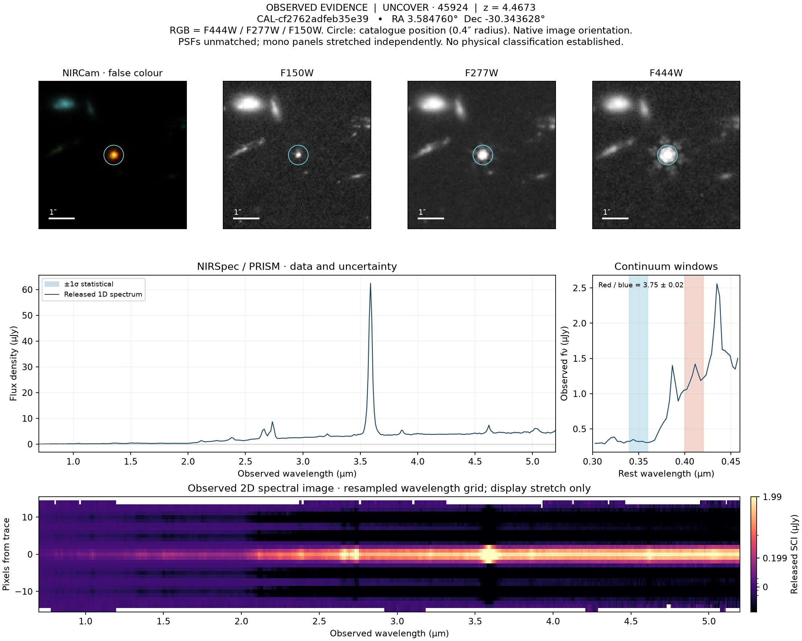

## Reproduction

```sh
python scripts/replay_manifest.py --budget-mib 4096
python scripts/download_expanded_sample.py
python scripts/analyse_expanded_sample.py
python scripts/analyse_glimpse_benchmark.py
python scripts/validate_line_profiles.py
python scripts/inspect_followup_sources.py
python scripts/audit_cliff_sensitivity.py
python scripts/build_expanded_report.py
cosmic-lab verify
```

Raw downloads use a finite 4 GiB cap and six bounded network workers with a single
manifest writer. All 2,647 requested PRISM products downloaded successfully.
The download cap does not authorize running multiple cache writers concurrently.
The earlier 20-source pilot and its manifest summaries remain historical records.
Use `scripts/replay_manifest.py --budget-mib 4096` to restore recorded bytes;
upstream checksum changes are rejected.
