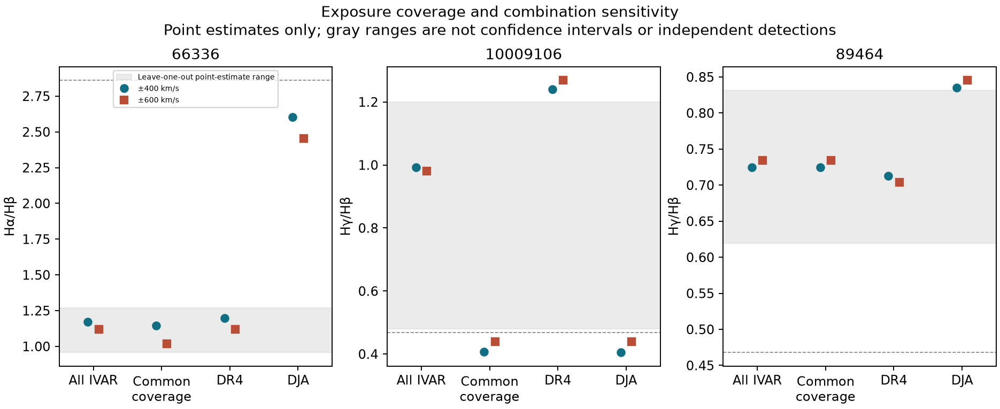
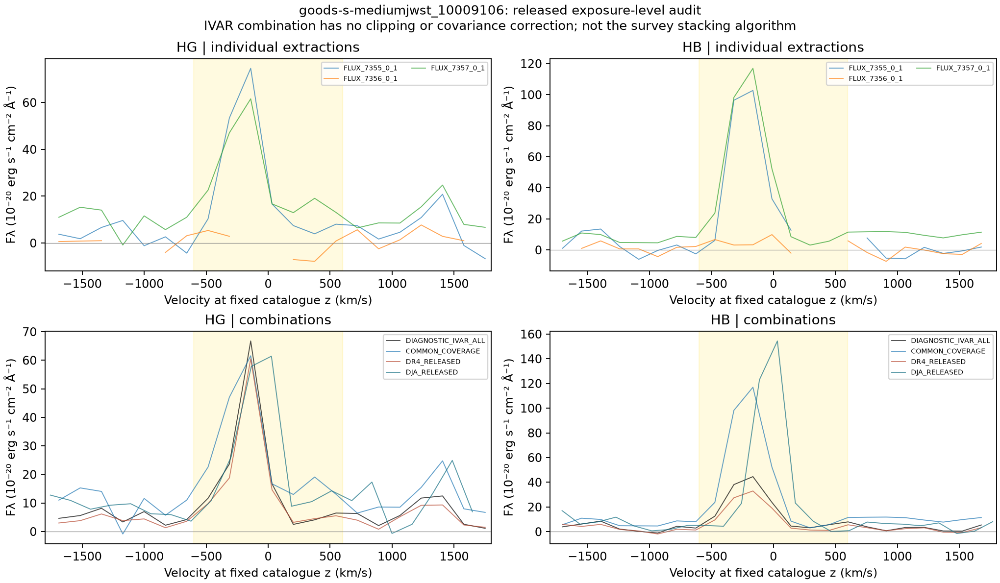
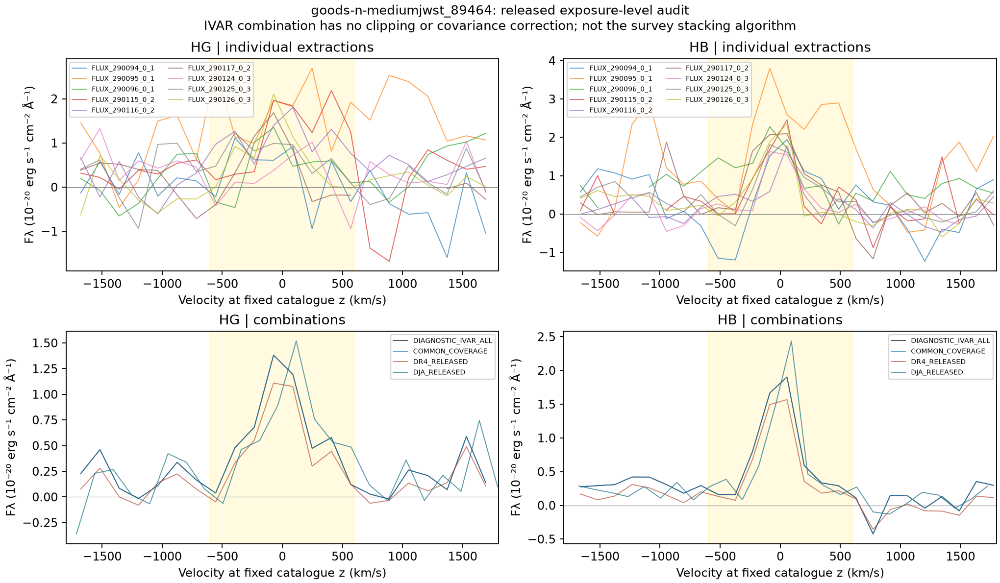
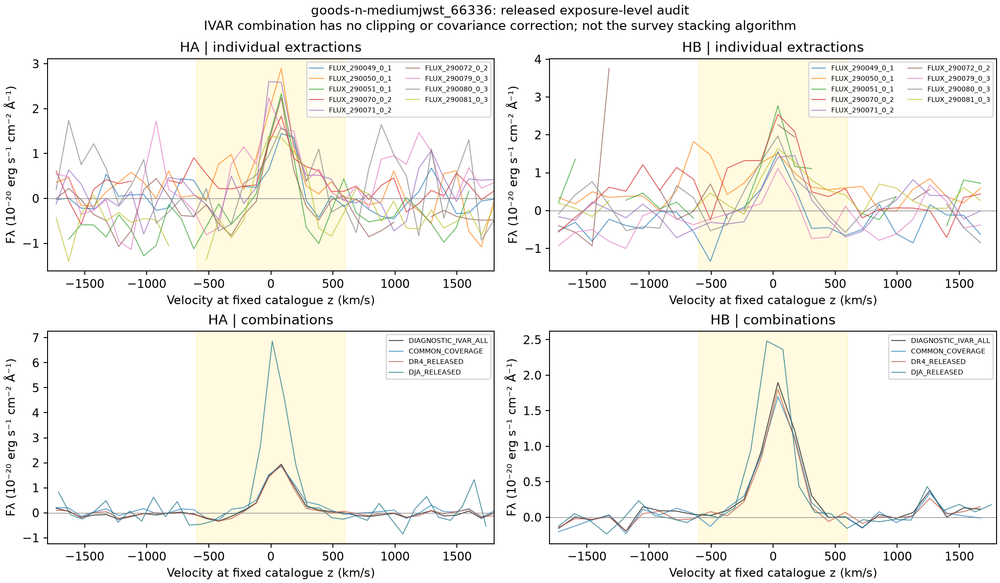

# Exposure-level audit of the Balmer priorities

Research snapshot: **16 November 2026**, after preprint v1.0. Author: Biswajit Jana.

We analysed **21 released individual-exposure/integration extractions**
for three targets, forming 54 individual/combined/comparison spectra.
There are **324 signed-core attempts, 245 usable**.
These are extractions and correlated variants, not new objects or independent detections.

## Main result

GS-10009106's unusual combined ratio depends strongly on which partial-coverage
extractions contribute. Of three intermediate extractions, only `FLUX_7357_0_1`
passes the existing geometry/validity rules for both Hγ and Hβ at ±600 km/s.
It gives Hγ/Hβ=0.407 / 0.440 at ±400 / ±600 km/s, close to DJA's 0.405 / 0.440.
The diagnostic inverse-variance combination of all three gives 0.993 / 0.980;
the released DR4 five-pixel/three-nod product gives 1.240 / 1.268.

Omitting `FLUX_7356_0_1` gives 0.480 / 0.503. That extraction shows weak line
signal in the plotted cores and has lower typical quoted core uncertainties
than the strong-line extraction, so it contributes appreciably to a weighted
combination. Its standalone Hβ and Hγ cores fail our coverage threshold.
`FLUX_7355_0_1` also fails the Hβ coverage rule. Missing pixels and unequal
contributions therefore matter. We have not identified the detector-level cause,
proved a faulty exposure, or reproduced the survey's rejection/stacking algorithm.
The common-coverage result uses one extraction, not an independent confirmation.

## Three-target comparison

| Target | Individual extractions | Both-line coverage passes | Eligible leave-one-out variants | Leave-one-out ratio range | Common-coverage ratios (400 / 600 km/s) |
|---|---:|---:|---:|---|---|
| 66336 | 9 | 7 | 18/18 | 0.958–1.267 | 1.145 / 1.020 |
| 10009106 | 3 | 1 | 4/6 | 0.480–1.199 | 0.407 / 0.440 |
| 89464 | 9 | 9 | 18/18 | 0.620–0.832 | 0.724 / 0.734 |

GN-66336 remains low within the DR4 intermediate products, including after
single-extraction omissions and common-coverage selection. Its disagreement
with DJA remains unresolved, especially for Hα beyond 5.2 µm.

GN-89464 has nine intermediate extractions with usable geometry for both lines.
Its elevated Hγ/Hβ point estimates persist across all eighteen single-extraction
omission/window combinations. Most individual spectra fail the joint S/N cut:
only one of eighteen individual/window ratios qualifies. The gray range below
is not a confidence interval; shared data and errors prohibit treating these
variants as eighteen independent confirmations. No physical class is assigned.

## Methods and calibration context

The [official DR4 spectrum documentation](https://jades.herts.ac.uk/DR4/Readme_DR4_spectra.md)
identifies INTERMEDIATE columns as individual exposure/integration, three-nod,
five-pixel spectra. Fluxes are already slit-loss corrected assuming a point source.
We read the FITS column units, keep signed fluxes, and require finite positive
errors. No extra slit-loss correction, clipping or rescaling is applied.

Diagnostic combinations use a per-pixel inverse-variance mean. Their quoted
errors assume independent diagonal noise; nodded backgrounds and resampling can
violate that assumption. They are not reconstructions of the released DR4 stack.
Leave-one-out combinations remove one intermediate column, not an independent
observing epoch. Common-coverage selection requires both lines to pass the same
±600 km/s coverage/pixel/sideband rules, with **no S/N or ratio selection**.
The ordinary ratio-reporting cut still requires both signed cores at S/N≥5.

The same sideband continuum and ±400/600 km/s core definitions as the preprint
are retained. Wavelength range is 0.6–5.5 µm; missing plotted pixels remain gaps.
Input FITS fingerprints were checked against the prior manifest. Released
calibration is assumed, and raw detector exposures were not reprocessed.

DJA's `path_corr` columns were inspected but not reapplied or removed. Their
median values at the compared lines are nearly equal: 1.284 versus 1.292 for
GN-66336 Hα/Hβ, 1.717 versus 1.712 for GS-10009106 Hγ/Hβ, and 1.193 versus 1.191
for GN-89464 Hγ/Hβ. This column inspection alone does not explain the inter-reduction
differences or establish which reduction is correct. It does not audit all
flat-field, path-loss, background, slit-position or extraction operations.

## What follows

The next diagnostic for GS-10009106 is a traceable mapping from the problematic
intermediate column to its contributing detector data and background subtraction.
GN-66336 needs an extended-wavelength calibration/throughput comparison.
GN-89464 remains a follow-up target for absorption, continuum and line-model
tests with a source-appropriate instrumental response; persistence alone is not
black-hole-star evidence. The preprint v1.0 remains a dated snapshot, and this
report provides the next evidence update without silently changing its results.

Reproduce with `python scripts/analyse_balmer_exposures.py` followed by
`python scripts/build_exposure_audit_report.py`. See `results/exposure_audit/`
for all signed measurements, missing cases, coverage selections, provenance
hashes and the calibration-column inventory.
