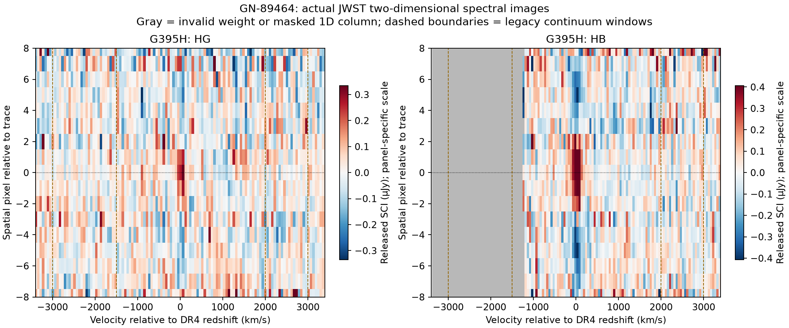
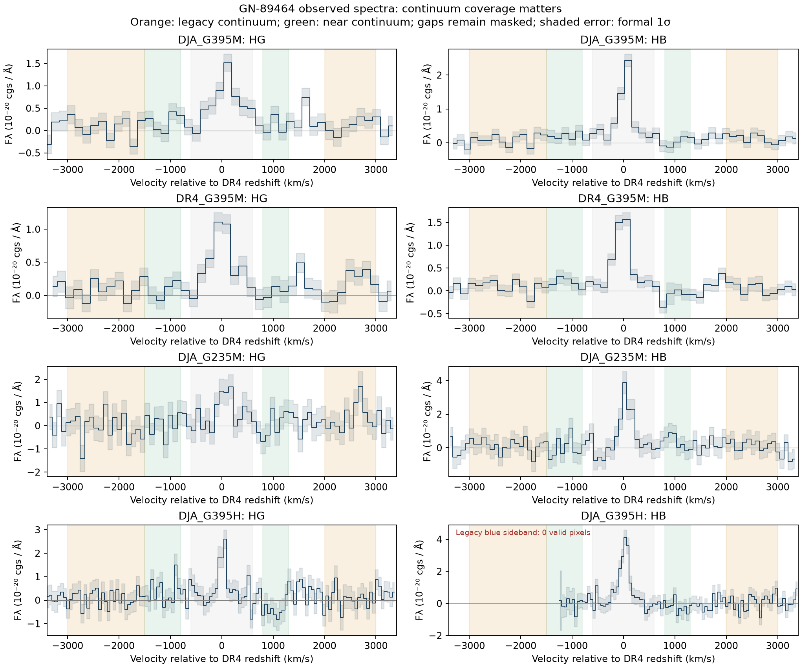
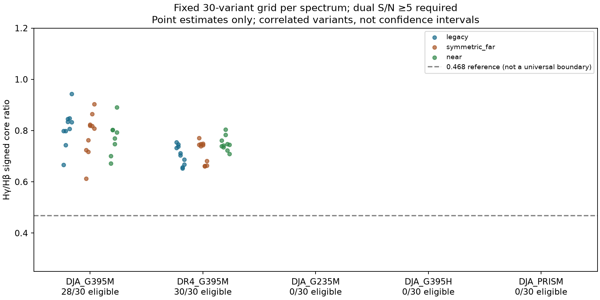

# GN-89464: additional gratings and a continuum-coverage finding

Executed 16 November 2026. Research update after preprint v1.0.

**An identifiable measurement limitation was found; no black-hole star was identified.**
The G395H spectrum of GN-89464 has zero valid pixels in the legacy blue continuum
window around Hβ. A rule that only counted the total continuum pixels accepted
this one-sided extrapolation. Requiring continuum on both sides rejects it.
The same check rejects eight earlier Hα cores for GN-25734, whose red continuum
window is entirely missing. These are measurement-quality findings, not proof
that either object lacks unusual physics or that an archive reduction is wrong.

GN-89464's elevated Hγ/Hβ point estimates survive the medium-resolution
continuum/centering grid. The additional G235M and G395H spectra do not supply
a ratio with both lines at S/N≥5 in any tested variant. This is insufficient
confirmation, not a significant contradiction of the medium-resolution result.

## Actual telescope evidence

These are released JWST SCI arrays, not generated illustrations. Gray pixels
have invalid/nonpositive WHT or fall in a masked 1D column. The ordinate is
spatial pixels relative to the released trace; signed intensities are retained.
Color limits are symmetric, set separately per panel by the 98th percentile of
absolute valid intensity. Negative residuals or nodded traces are not evidence
of stellar absorption. This image is a view of the same observation, not an
independent detection or a new extraction.

## Fixed exploratory grid

Five products of one known target were examined: new G235M and G395H downloads,
cached DJA PRISM and G395M, and the DR4 G395M five-pixel/three-nod extraction.
The identity checks require source 89464, programme 1181, and separation below
0.1 arcsec from the queue coordinates. All five passed; SHA256 fingerprints
were verified. These are **not five new objects or independent reductions**.

The analysis fixes DR4 z=6.724704386327. The `z` values in
`new_products.json` are DJA catalogue metadata and are not substituted into the
fits. A grid of offsets −200, −100, 0, +100, +200 km/s, core half-widths 400 and
600 km/s, and three continuum choices is applied to every product:

| Choice | Blue window (km/s) | Red window (km/s) |
|---|---:|---:|
| Legacy | −3000 to −1500 | +2000 to +3000 |
| Symmetric far | −3000 to −2000 | +2000 to +3000 |
| Near | −1500 to −800 | +800 to +1300 |

The grid was specified after the initial coverage inspection: this is an
exploratory sensitivity test, not a preregistered blind confirmation. All
variants, including failures, are retained. No variant is chosen because it
maximizes an anomaly. Windows avoid the nominal [O III] 4363 center redward of
Hγ but may still contain wings, weak blends, or stellar absorption; this is
not a deblending model.

Each core requires ≥80% valid wavelength coverage and ≥4 pixels. A linear
continuum additionally requires ≥3 valid pixels **on each side**. The signed
integral includes fitted-continuum uncertainty, with diagonal released-pixel
errors. Ratios require S/N≥5 for both signed cores. Missing measurements remain
missing, not zero. No rescaling, clipping, or extra path-loss correction is used.

There are 300 core attempts, 220 usable cores,
and 58 eligible ratios among 150 variants:

| Product | Eligible variants / 30 | Ratio point-estimate range |
|---|---:|---:|
| DJA_G235M | 0 | Not reported |
| DJA_G395H | 0 | Not reported |
| DJA_G395M | 28 | 0.612–0.944 |
| DJA_PRISM | 0 | Not reported |
| DR4_G395M | 30 | 0.653–0.804 |

These ranges are correlated sensitivity variations, **not confidence intervals**.
With zero centering offset and ±600 km/s legacy windows, DJA G395M gives
0.845±0.156 and DR4 G395M gives 0.704±0.133 (formal, first-order independent-line
error propagation only). Shared photons, extraction differences, covariance,
selection and calibration uncertainties prevent interpreting these as independent
confirmations. The 0.468 reference is a diagnostic comparison, not a universal
physical boundary or a calibrated discovery threshold.

## What the high-resolution spectrum actually allows

At zero offset and ±600 km/s, the legacy G395H Hβ core is
(3.390±1.254)×10⁻¹⁸ erg s⁻¹ cm⁻² with **0 blue / 20 red** continuum pixels.
It is retained in `legacy_cores.csv` for audit, but excluded by the new rule.
The near-window measurement has **9 blue / 9 red** pixels and gives
(1.307±0.239)×10⁻¹⁸ erg s⁻¹ cm⁻². Its formal variance is 66.1% attributable
to continuum-fit uncertainty. These overlapping measurements do not provide
an independent significance test of their difference.

G395H Hγ with the near windows is (0.757±0.180)×10⁻¹⁸ erg s⁻¹ cm⁻²,
S/N=4.20, so the pair fails the reporting threshold even though Hβ reaches 5.48.
G235M's legacy Hγ and Hβ reach only 2.59 and 2.82. PRISM has too few pixels
for the narrow-core method; this does not mean it has no line emission.
No absorption profile, density, black-hole mass, or physical class is established.

## Retrospective check of the entire twelve-record queue

All 288 earlier core attempts were audited using their original
apertures, nod selections, redshifts, wavelengths and legacy sidebands.
Of 247 previously measurable cores, 239
meet the two-sided rule, with matching fluxes/errors to numerical precision.
The 8 newly rejected cores are all GN-25734 Hα: two apertures ×
two nod selections × two core widths. Every one has nine blue continuum pixels
and zero red continuum pixels. The product held for the earlier programme-ID
discrepancy stays held; it is not admitted by this audit.

**This supersedes the use of GN-25734's earlier two-nod Hα/Hβ values
(1.73–1.94) as accepted core ratios under the stricter method.** Previously
published tables remain as dated outputs with their original quality rule.
The three main priorities—GN-66336, GS-10009106, GN-89464—lose no previously
measurable cores to this additional check. Their other uncertainties remain.

## Literature and next discriminating evidence

GN-89464 is already listed at matching coordinates in Table 2 of
[Glazer et al., Stacking PANCAKEZ, arXiv:2504.21080v1](https://arxiv.org/html/2504.21080v1).
Its appearance in that sample establishes prior literature context, not the
physical interpretation of this individual source from the paper's stacked spectrum.
This work does not claim a previously unknown object or a new spectral class.

The next useful step is a joint emission/stellar-absorption comparison using
source-appropriate instrumental line profiles and covariance estimates, plus
an audit of spatial neighbours and the slit geometry. More repetitions of the
same noisy core-ratio test cannot establish the physical mechanism. Better
independent Hγ sensitivity and two-sided Hβ continuum coverage would distinguish
the competing explanations more directly.

## Reproduction and files

Run `python scripts/analyse_gn89464_continuum.py`, then
`python scripts/audit_previous_continuum_coverage.py`, then
`python scripts/build_gn89464_report.py`, and finally
`python scripts/verify_gn89464_results.py`. Downloads use the existing manifest
and finite 4 GiB raw-data budget. Only two additional spectra were downloaded;
PRISM and prior products were reused. The analysis script can retrieve missing
inputs from the manifest and validates their fingerprints.

- [All signed cores and failures](../results/gn89464_followup/bilateral_cores.csv)
- [All ratio variants](../results/gn89464_followup/bilateral_ratios.csv)
- [Retrospective coverage audit](../results/gn89464_followup/previous_queue_coverage_audit.csv)
- [Identity checks](../results/gn89464_followup/identity_checks.csv)
- [Execution ledger](../experiments/gn89464_continuum.yaml)

Preprint v1.0 is unchanged as a dated snapshot. This report supplies the subsequent
quality correction and additional observations; it does not complete the search.
