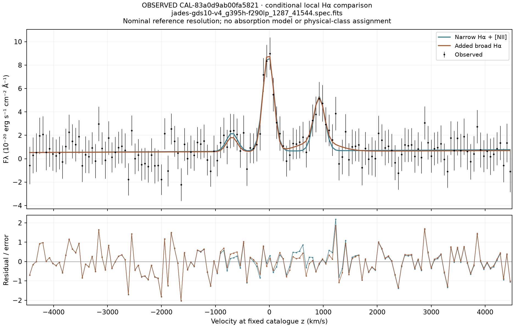
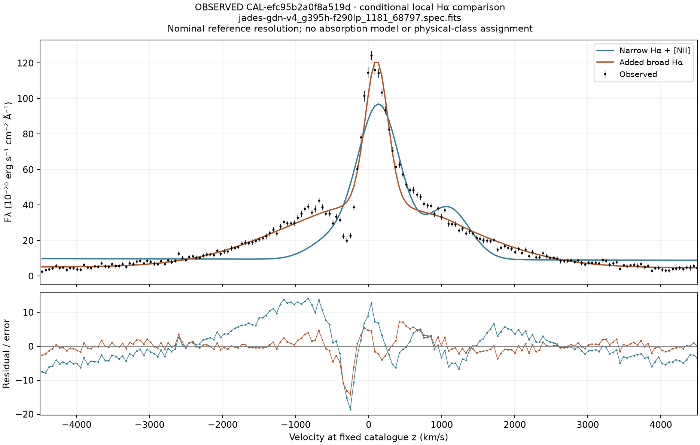

# High-resolution follow-up beyond the benchmark

Research snapshot: **15 November 2026**. Author: Biswajit Jana.

We inspected **12 high-resolution products for nine existing priorities**, then
executed **42 conditional Hα fits** on seven products from six source records.
Four of those six sources do not favour the added broad Gaussian in this test.
The two sources that do favour it are already known objects, and their residuals
show that the simple emission model remains inadequate. **No new black-hole star
or new physical class is established.**

## Coverage before modelling

The [23-source archive inventory](line_anchor.md) supplied the exact source IDs
and product URLs. Eleven previously uncached high-resolution spectra were
retrieved; GS-159717's existing product was reused. Header coordinates were
checked against each selected PRISM product within 0.05 arcsec and the grating
identifier was verified. This is an association check, not a deblending proof.

Fourteen of 24 requested line windows meet the fixed coverage criterion:
at least 80% wavelength coverage and at least twelve good pixels. Seven are Hα
(±4500 km/s) and seven are [OIII] 5008 (±900 km/s). The remaining ten are explicitly
missing. Products are not added together; the two GN-68797 extractions may share
photons and do not count as two objects or independent confirmations.

The reader retains signed measurements, uses finite positive errors and the
released quality/npix mask, and applies the existing 0.7–5.2 µm analysis range.
Thus a line outside that range is unavailable **in this analysis**, not necessarily
absent from every possible instrument configuration or archive. In particular,
GS-13905's expected Hα is at 5.38 µm. GN-38147 has no good Hα pixels in this
downloaded G395H product even though its expected wavelength is 4.51 µm.

The [coverage table](../results/high_resolution_coverage/line_coverage.csv)
includes the median signed pixel flux/error for transparency. That statistic
includes continuum and is not a line detection significance. Low-S/N spectra are
retained; coverage qualification alone does not establish a measurable absorber.

## Conditional Hα model comparison

We compare a linear continuum plus tied narrow Hα and [NII] with the same model
plus a positive Gaussian broad Hα component. The [NII] 6585/6549 flux ratio is
fixed to 2.96. We convert released Fν to Fλ using the FITS wavelengths, fit
the same ±4500 km/s window at fixed catalogue redshift with free local shifts,
convolve Gaussian widths with the instrumental LSF, and integrate over pixels.
No residual clipping or extra photometric scaling is applied.

Narrow intrinsic σ is bounded to 30–500 km/s; broad σ to 100–3000 km/s, with
nonnegative line amplitudes. The broad model uses three starting widths.
We test 0.8, 1.0 and 1.5 times the wavelength-interpolated STScI reference R.
These are sensitivity assumptions, not source-calibrated LSF measurements.
Many fits compensate a changed LSF with intrinsic width, illustrating the
[degeneracy measured in the independent-line control](line_anchor.md).

Positive ΔBIC means the added broad component is favoured within these families.
Negative values favour the simpler model. Neither sign establishes a physical
class, and ΔBIC is not a calibrated significance. The table reports the range
over the three resolution assumptions, with reduced χ² at nominal R.

| Product / fit figure | ΔBIC narrow minus broad | Narrow χ²/ν | Added-broad χ²/ν |
| --- | ---: | ---: | ---: |
| [goodsn-wide0-v4_g235h-f170lp_1211_3901](../figures/high_resolution_fits/goodsn-wide0-v4_g235h-f170lp_1211_3901.png) | -11.1–-11.1 | 1.49 | 1.50 |
| [goodsn-wide0-v4_g235h-f170lp_1211_3417](../figures/high_resolution_fits/goodsn-wide0-v4_g235h-f170lp_1211_3417.png) | -13.4–-13.4 | 0.98 | 0.98 |
| [jades-gdn198-v4_g395h-f290lp_1181_68797](../figures/high_resolution_fits/jades-gdn198-v4_g395h-f290lp_1181_68797.png) | 3596.8–3596.8 | 25.95 | 6.20 |
| [jades-gdn-v4_g395h-f290lp_1181_68797](../figures/high_resolution_fits/jades-gdn-v4_g395h-f290lp_1181_68797.png) | 4748.6–4748.6 | 32.89 | 6.82 |
| [jades-gds06-v4_g395h-f290lp_1286_159717](../figures/high_resolution_fits/jades-gds06-v4_g395h-f290lp_1286_159717.png) | 886.6–1095.2 | 8.87 | 3.36 |
| [jades-gds10-v4_g395h-f290lp_1287_41544](../figures/high_resolution_fits/jades-gds10-v4_g395h-f290lp_1287_41544.png) | -13.2–-13.2 | 0.49 | 0.49 |
| [jades-gdn09-v4_g395h-f290lp_1181_58441](../figures/high_resolution_fits/jades-gdn09-v4_g395h-f290lp_1181_58441.png) | -7.7–-7.7 | 0.84 | 0.81 |

Parameter bounds, released errors, model arrays and signed residuals are retained
in [all fits](../results/high_resolution_coverage/halpha_fits.json) and the
[comparison table](../results/high_resolution_coverage/halpha_comparisons.csv).

## Evidence that changes follow-up priority

**GS-41544:** its optical shape persisted across PRISM reductions, but this
high-resolution spectrum is described by narrow Hα and neighbouring [NII] lines.
Adding a broad Gaussian is not preferred (ΔBIC≈−13.2). The narrow fit's reduced
χ²≈0.49 also shows that the released diagonal error scale/covariance should not
be treated as independently calibrated. This result removes any justification
for treating this local blended feature alone as evidence of broad emission;
it does not classify the whole galaxy or exclude every possible weak broad line.



**GN-3901 and GN-3417:** both came from the earlier joint PRISM screen, yet the
high-resolution test favours the narrow model here (ΔBIC≈−11.1 and −13.4).
**GN-58441**, an ultraviolet-shape priority, also does not favour an added broad
Hα Gaussian (ΔBIC≈−7.7). These are sensitivity-limited model comparisons, not
claims that these sources cannot host accretion.

**GN-68797:** adding a broad component strongly improves the fit in both released
products, but reduced χ² remains approximately 6.2–6.8 and structured residuals
persist. A strong improvement is not an adequate physical explanation. The
identifier and coordinates (RA 189.2291371°, Dec 62.1461898°) match the already
published object in [Nikopoulos et al.](https://arxiv.org/html/2510.06362),
Table 1. It is a recovered known source, not a discovery. Their component
interpretation is not inferred from our simpler phenomenological Gaussian fit.



**GS-159717:** a broad component improves the simple emission model but leaves
substantial residuals. The earlier [absorption benchmark](balmer_audit.md) is
the relevant more detailed comparison. Its ΔBIC values cannot be directly
compared to this table because the model families, units and redshift basis
differ. This follow-up does not replace that experiment.

## Observed source gallery

Each sheet displays released measurements and uncertainties, including blank
panels when coverage is missing. Matching PDF files accompany the PNG images.

- [goodsn-wide0-v4_g235h-f170lp_1211_3901.spec.fits](../figures/high_resolution_sources/goodsn-wide0-v4_g235h-f170lp_1211_3901.png)
- [goodsn-wide0-v4_g395h-f290lp_1211_3901.spec.fits](../figures/high_resolution_sources/goodsn-wide0-v4_g395h-f290lp_1211_3901.png)
- [goodsn-wide0-v4_g235h-f170lp_1211_3417.spec.fits](../figures/high_resolution_sources/goodsn-wide0-v4_g235h-f170lp_1211_3417.png)
- [goodsn-wide0-v4_g395h-f290lp_1211_3417.spec.fits](../figures/high_resolution_sources/goodsn-wide0-v4_g395h-f290lp_1211_3417.png)
- [jades-gdn198-v4_g395h-f290lp_1181_68797.spec.fits](../figures/high_resolution_sources/jades-gdn198-v4_g395h-f290lp_1181_68797.png)
- [jades-gdn-v4_g395h-f290lp_1181_68797.spec.fits](../figures/high_resolution_sources/jades-gdn-v4_g395h-f290lp_1181_68797.png)
- [jades-gds06-v4_g395h-f290lp_1286_10072503.spec.fits](../figures/high_resolution_sources/jades-gds06-v4_g395h-f290lp_1286_10072503.png)
- [gds-deep-v4_g395h-f290lp_1210_13905.spec.fits](../figures/high_resolution_sources/gds-deep-v4_g395h-f290lp_1210_13905.png)
- [jades-gds06-v4_g395h-f290lp_1286_159717.spec.fits](../figures/high_resolution_sources/jades-gds06-v4_g395h-f290lp_1286_159717.png)
- [jades-gds10-v4_g395h-f290lp_1287_41544.spec.fits](../figures/high_resolution_sources/jades-gds10-v4_g395h-f290lp_1287_41544.png)
- [jades-gdn-v4_g395h-f290lp_1181_38147.spec.fits](../figures/high_resolution_sources/jades-gdn-v4_g395h-f290lp_1181_38147.png)
- [jades-gdn09-v4_g395h-f290lp_1181_58441.spec.fits](../figures/high_resolution_sources/jades-gdn09-v4_g395h-f290lp_1181_58441.png)

## Limits and next tests

This is follow-up of selected records, not a new population-complete search.
The total remains **4,731 analysed source records**. Neither a Gaussian broad
wing nor a poor fit implies dense gas, a black-hole star, a novel object, or
failure of established physics. Noise covariance, source illumination, line
blends, absorption and alternative profiles must be tested. The independent-line
control shows why a catalogue grating label cannot supply a trustworthy LSF.

The next model work should address the structured residuals of GN-68797 with
multi-line and independent-reduction checks, while retaining the four sources
that do not favour added broad Hα as controls. Literature novelty checks remain
incomplete for the wider queue; no novelty claim is made here.

## Reproduction

```sh
python scripts/replay_manifest.py --budget-mib 4096
python scripts/inspect_priority_high_resolution.py
python scripts/fit_priority_high_resolution.py
python scripts/build_high_resolution_report.py
pytest -q
ruff check src tests scripts
```

The [coverage execution](../results/high_resolution_coverage/summary.json),
[fit execution](../results/high_resolution_coverage/fit_summary.json),
[product hashes](../results/high_resolution_coverage/products.json), and
[ledger](../experiments/high_resolution_coverage.yaml) preserve what actually ran.
All 53 local tests passed; the run's [verification record](../results/line_anchor/verification.json)
records cache and provenance checks. The conference posters remain dated
12 November snapshots pending the final synthesis.
