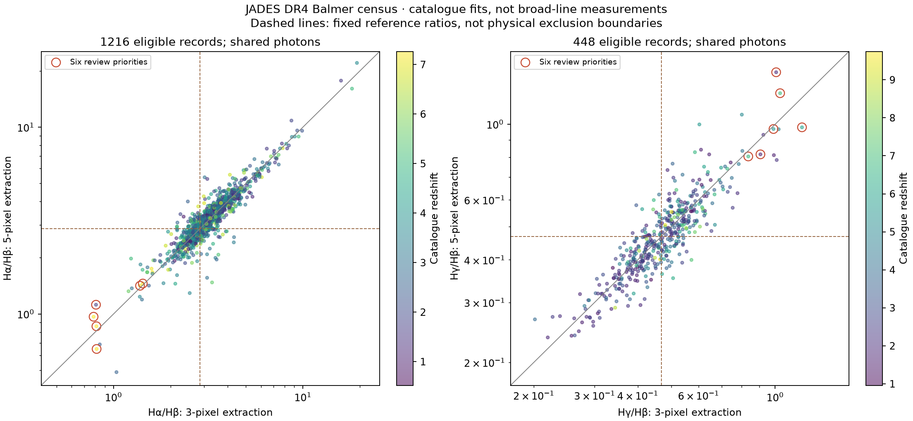
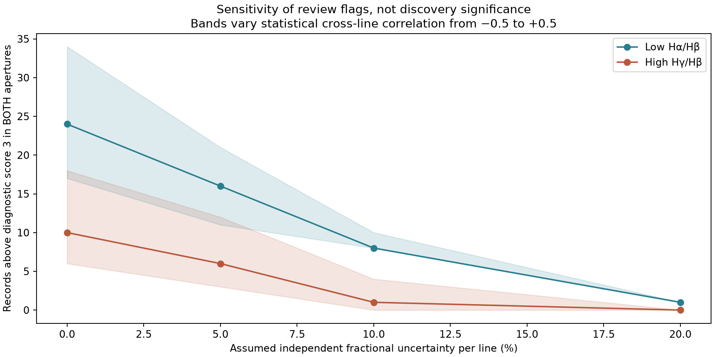
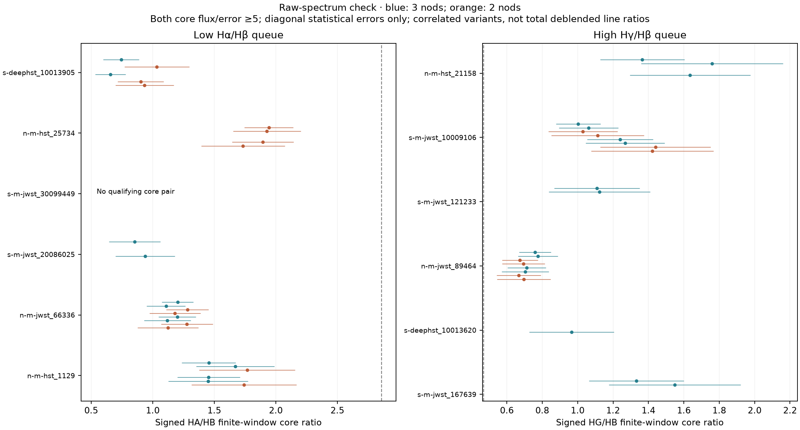
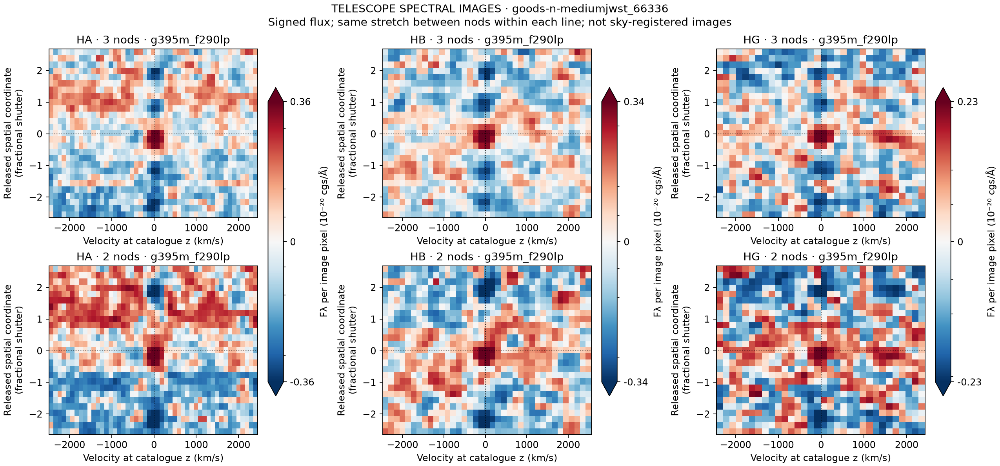
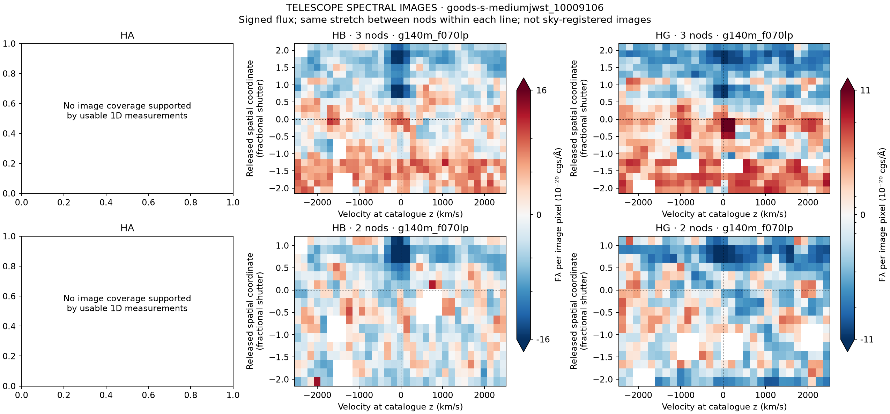

# JADES DR4 Balmer census and observed spectral images

Research snapshot: **16 November 2026**. Author: Biswajit Jana.

We screened **5,190 JADES DR4 target records in two apertures**
and inspected a twelve-record follow-up queue. Of sixteen retrieved 1D products,
fifteen passed the association check; one is held for a programme-ID discrepancy.
There are **247 usable signed core measurements out of
288 attempts**. Three targets have both relevant
line cores measurable in all eight aperture/nod/window variants, but no target is
established as a black-hole star or a new physical class.

## Scope and overlap

This census uses the pinned `Combined_DR4_external_v1.2.1.fits`, all 5,190 rows,
and the `R1000_3pix` and `R1000_5pix` extensions. Exact Unique_ID joins are checked
for uniqueness; the catalogue is not joined by row position or numerical ID alone.
The [archive documentation](https://jades.herts.ac.uk/DR4/Readme_DR4_catalogues.md)
describes the tier/ID identity convention and the extraction products. The actual
FITS Balmer fields are `HBaA_6563`, `HBaB_4861`, and `HBaG_4340`, rather than the
shorter labels in the README. Numeric units are converted to 10⁻²⁰ erg s⁻¹ cm⁻².

There are **1,997 DR4 records with
a positional neighbour within 0.2 arcsec** of the previous 4,731-record sample,
and 3,193 without one. These are
[association leads](../results/jades_balmer_census/previous_positional_neighbours.csv),
not merged identities or a count of newly discovered objects. Repeat targets,
catalogue resegmentation and positional neighbours prevent adding the two totals.
This is a full audit of one pinned catalogue, not all public archives.

## Selection and model limitations

For a ratio to enter the queue, each line must have finite flux, positive error,
both flux/error ≥5 and released SNR ≥5, a valid instrument label, positive redshift,
and redshift flag A, B or C. Both apertures must qualify. This leaves **1,216
Hα/Hβ** and **448 Hγ/Hβ** records. The released SNR and flux/error are separate
quantities. Empty/malformed filter strings were found among missing measurements;
none accompanied valid flux/error pairs for these three lines. The parser refuses
ambiguous labels. All missing and low-S/N rows remain in the machine-readable table.

The [JADES reduction paper, section 5](https://arxiv.org/html/2510.01034v1#S5)
uses positive, single-Gaussian emission fits with restricted widths, and reports
posterior flux summaries. Consequently these catalogue values do not recover
signed noise measurements, broad-line totals or absorption profiles. We do not
turn their low-S/N entries into fabricated Gaussian upper limits. Raw-spectrum
remeasurements below preserve the released signed pixels. Upstream pixel masking
cannot be reversed here.

We rank low Hα/Hβ and high Hγ/Hβ relative to **fixed reference ratios 2.86 and
0.468**. These are commonly used Case-B reference values, not boundaries valid
for every temperature, density or radiative-transfer geometry. The
[multi-component Balmer study](https://arxiv.org/abs/2510.06362) illustrates why
line ratios require component separation and competing explanations. A dust screen
alone moves the usual ratios in the opposite direction to the two search directions,
but rejecting that simplified reference would not establish a black-hole star.

The score is signed `(F_line − r F_Hβ)/sqrt(V)`, reversed for the low-Hα search,
where `V = e_line² + r² e_Hβ² − 2rρ e_line e_Hβ + f²(F_line² + r² F_Hβ²)`.
We take the smaller score across the two apertures. Queue ranking fixes f=0.10
and ρ=0, choosing six positive-score records per direction before spectrum review.
The 24 sensitivity combinations vary f through 0, 0.05, 0.10, 0.20 and ρ through
−0.5, 0, +0.5 for each ratio. These are assumptions, not fitted calibration errors.
There is no calibrated p-value, multiplicity-controlled discovery threshold or
independent-aperture replication claim.

At ρ=0, the number above diagnostic score 3 in both apertures changes from
**24 to 8 to 1** for low Hα/Hβ as f changes from 0 to 10% to 20%; high Hγ/Hβ
changes from **10 to 1 to 0**. Thus many apparent departures are calibration-sensitive.





## Signed spectrum checks

Each selected spectrum was located in an actual archive directory listing.
Target ID, programme ID and header position within 0.2 arcsec were checked.
`goods-s-mediumjwst_30099449` has catalogue PID **1180** but FITS PID **1286**,
with matching target ID and coordinates. The file is retained with its hash,
but excluded from measurement until this discrepancy is resolved. This is an
association hold, not a claim that the observation is absent or the source false.

The follow-up explicitly uses **0.6–5.5 µm** of the released spectra. Earlier
experiments retain their original 0.7–5.2 µm default. Five of the six low-Hα
priorities lie above z=7, placing Hα beyond 5.2 µm in the extended G395M region.
That clustering makes wavelength-dependent calibration a particularly relevant
alternative; it is not evidence of evolution or a newly discovered population.

We integrate signed Fλ over ±400 and ±600 km/s at fixed catalogue z. A weighted
linear continuum is fitted on −3000 to −1500 and +2000 to +3000 km/s sidebands.
Coverage must exceed 80%, with at least four core and six sideband pixels.
Errors propagate the diagonal pixel variances and continuum-fit uncertainty.
The calculation excludes unknown resampling covariance and calibration errors;
sidebands can also contain unmodelled features. The two core widths, two apertures,
and two nod combinations produce eight correlated variants per line.

**These are finite-window core ratios**, not deblended total Balmer decrements:
line wings, [NII], stellar absorption, centroid offsets and instrument response
can affect them differently. Both core flux/error values must be ≥5 to report a
ratio in the table. Unqualified signed fluxes and errors remain in the full output.

| Observed spectrum sheet | z | Selected ratio | Qualifying variants | Core-ratio range |
| --- | ---: | --- | ---: | ---: |
| [goods-s-deephst_10013905](../figures/jades_balmer_sources/goods-s-deephst_10013905.png) | 7.195 | Hα/Hβ | 5/8 | 0.66–1.03 |
| [goods-n-mediumhst_25734](../figures/jades_balmer_sources/goods-n-mediumhst_25734.png) | 1.797 | Hα/Hβ | 4/8 | 1.73–1.94 |
| [goods-s-mediumjwst_30099449](../figures/jades_balmer_sources/goods-s-mediumjwst_30099449.png) | 7.234 | Hα/Hβ | 0/8 | Unavailable |
| [goods-s-mediumjwst_20086025](../figures/jades_balmer_sources/goods-s-mediumjwst_20086025.png) | 7.261 | Hα/Hβ | 2/8 | 0.85–0.94 |
| [goods-n-mediumjwst_66336](../figures/jades_balmer_sources/goods-n-mediumjwst_66336.png) | 7.139 | Hα/Hβ | 8/8 | 1.11–1.28 |
| [goods-n-mediumhst_1129](../figures/jades_balmer_sources/goods-n-mediumhst_1129.png) | 7.084 | Hα/Hβ | 6/8 | 1.45–1.77 |
| [goods-n-mediumhst_21158](../figures/jades_balmer_sources/goods-n-mediumhst_21158.png) | 1.872 | Hγ/Hβ | 3/8 | 1.36–1.76 |
| [goods-s-mediumjwst_10009106](../figures/jades_balmer_sources/goods-s-mediumjwst_10009106.png) | 1.556 | Hγ/Hβ | 8/8 | 1.00–1.44 |
| [goods-s-mediumjwst_121233](../figures/jades_balmer_sources/goods-s-mediumjwst_121233.png) | 6.879 | Hγ/Hβ | 2/8 | 1.11–1.12 |
| [goods-n-mediumjwst_89464](../figures/jades_balmer_sources/goods-n-mediumjwst_89464.png) | 6.725 | Hγ/Hβ | 8/8 | 0.67–0.78 |
| [goods-s-deephst_10013620](../figures/jades_balmer_sources/goods-s-deephst_10013620.png) | 5.917 | Hγ/Hβ | 1/8 | 0.97–0.97 |
| [goods-s-mediumjwst_167639](../figures/jades_balmer_sources/goods-s-mediumjwst_167639.png) | 5.552 | Hγ/Hβ | 2/8 | 1.33–1.55 |



**GN-25734:** catalogue Hα/Hβ is 0.81–1.12 across apertures, but the two-nod
core ratios are approximately 1.73–1.94. Three-nod Hα cores fail the ≥5 criterion.
The large nod dependence makes this a reduction/contamination control, not a
stable physical anomaly. **GS-13905** again shows extraction dependence and
extended-wavelength sensitivity; its previous UV-reduction discrepancy remains relevant.

**GN-66336, GS-10009106 and GN-89464** retain measurable core pairs across all
eight variants. Their ranges are about 1.11–1.28 (Hα/Hβ), 1.00–1.44 (Hγ/Hβ),
and 0.67–0.78 (Hγ/Hβ), respectively. This justifies further checks, not a dense-gas
or black-hole identification. In particular, ordinary stellar absorption around
Hβ, contamination, profile mismatch and flux calibration remain untested alternatives.

## Actual telescope spectral images

Four sheets show signed rectified 2D flux, including negative nod/background
structure. These are telescope data, not generated illustrations. The three
all-eight-variant targets and GN-25734 control were chosen after the core checks,
so this image subset is explicitly exploratory. Each nod product uses its own
spatial grid; rows are fractional shutter coordinates, not sky positions.
The stretch is shared between nod combinations within each line, not between lines.
The images do not replace detector-level rejection or deblending.
Pixels require finite positive 2D errors and a usable corresponding released
5-pixel 1D wavelength bin for that nod variant. In GS-10009106 the Hα panel is
withheld: finite 2D values alone do not supply supported 1D coverage. The 2D
patterns also change between nod combinations, so all-eight core measurability
must not be read as a clean spatial validation.





- [GN-89464 spectral image](../figures/jades_balmer_images/goods-n-mediumjwst_89464.png)
- [GN-25734 nod control](../figures/jades_balmer_images/goods-n-mediumhst_25734.png)

## Literature and next discriminating tests

GN-66336's identifier and coordinates agree with the sample in
[Chen et al., Table A1](https://arxiv.org/html/2505.24080v2#A1).
GN-66336 and GN-89464 also appear at matching coordinates in
[Glazer et al., Table 2](https://arxiv.org/html/2504.21080v1#S2.T2).
They are known galaxies, not newly discovered objects. Those papers are not
evidence that our particular core ratios establish a new physical interpretation.
No complete literature novelty audit has been performed for the remaining queue;
an unsuccessful identifier search does not establish novelty.

The next tests are independent calibration/extraction checks at >5.2 µm for
GN-66336, spatial and stellar-absorption modelling for the high-Hγ targets,
and programme-association reconciliation for GS-30099449. Ordinary nebular,
stellar+AGN and dense-envelope forward models must predict multiple held-out
observables before any physical-class claim. Broader archive and instrument
coverage remains outstanding; continued searching does not guarantee discovery.

## Reproduction and evidence

```sh
python scripts/replay_manifest.py --budget-mib 4096
python scripts/analyse_jades_balmer_census.py
python scripts/inspect_jades_balmer_queue.py
python scripts/image_jades_balmer_queue.py
python scripts/build_jades_balmer_report.py
pytest -q
ruff check src tests scripts
```

- [Census and input hashes](../results/jades_balmer_census/summary.json)
- [All aperture measurements](../results/jades_balmer_census/aperture_measurements.csv.gz)
- [Signed core measurements](../results/jades_balmer_census/signed_core_measurements.csv)
- [1D product provenance and association hold](../results/jades_balmer_census/spectral_products.json)
- [2D image provenance](../results/jades_balmer_census/spectral_images.json)
- [Execution ledger](../experiments/jades_balmer_census.yaml)
- [Verification: 57 tests, lint, input hashes and local links](../results/jades_balmer_census/verification.json)

The conference posters remain dated 12 November snapshots pending final synthesis.
This research programme remains in progress.
