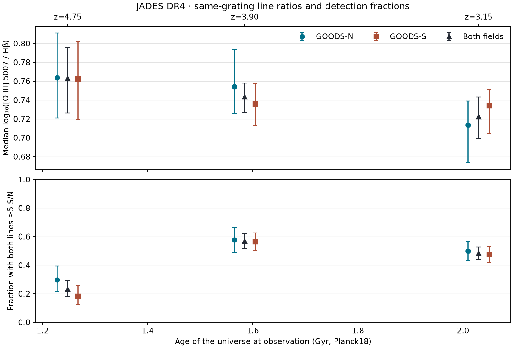
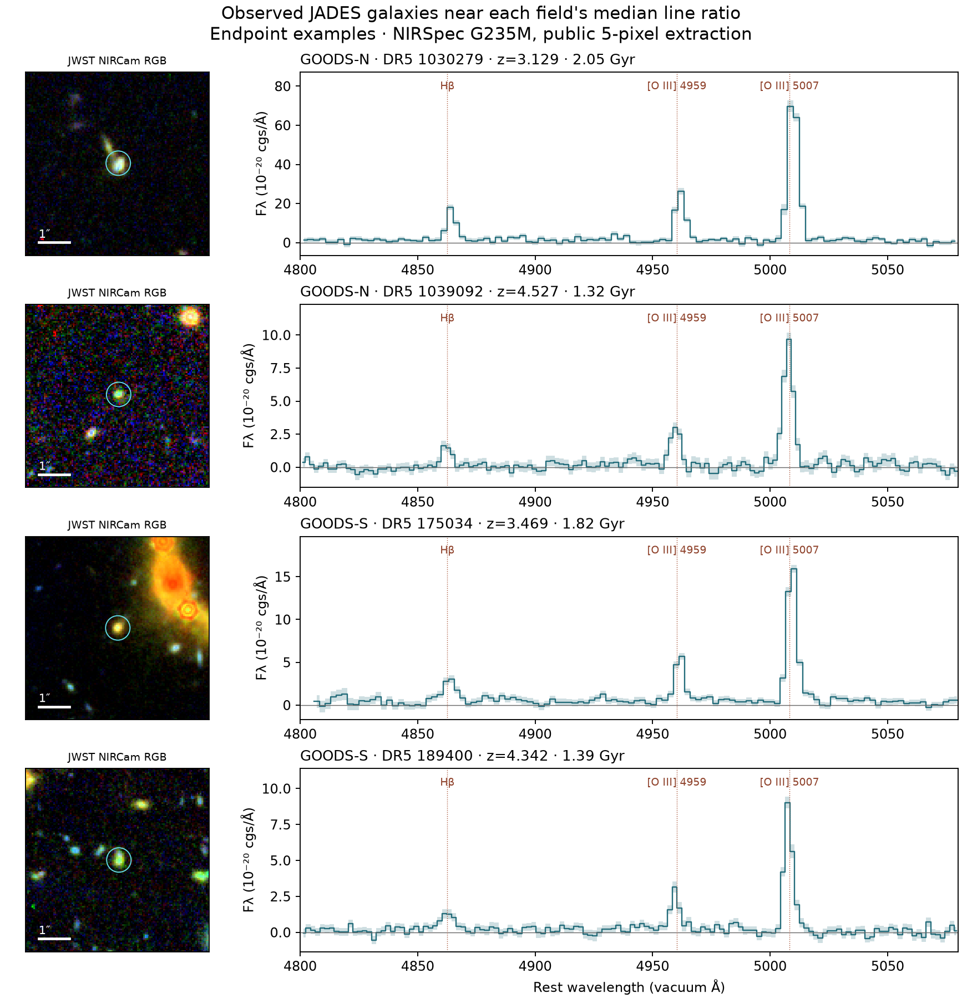

# Early galaxy evolution with JWST spectroscopy

**Biswajit Jana** · Independent research · 25 November 2026

## Research goals

1. **Trace the changing conditions in galaxies.** Compare nebular emission at
   fixed instrumental settings and report the change in the detected sample,
   the coverage and the sensitivity to selection.
2. **Probe reionization at earlier times.** Measure Lyman-alpha emission and
   upper limits in a UV-selected sample with verified systemic redshifts.
   Calibrate recovery as a function of redshift, UV magnitude, equivalent
   width and velocity offset before modelling the neutral intergalactic gas.
3. **Constrain when substantial black-hole growth could have occurred.** Test
   broad-line and continuum-selected candidates against galaxy-only and
   obscured-accretion models. Treat mass, accretion rate, radiative
   efficiency, duty cycle and seed formation time as uncertain inputs.

Goal 1 has a first measurement below. Goal 2 has a JADES pilot with
signed Lyα measurements, upper bounds and artificial-line recovery.
Goal 3 describes follow-up research.
[Reionization pilot](jades_reionization.md) ·
[JADES Lyman-alpha measurements](https://doi.org/10.1093/mnras/stae2670) ·
[JADES intergalactic damping-wing models](https://doi.org/10.1051/0004-6361/202553820) ·
[Accretion growth scenarios](evolution_and_unknown_objects.md).

## Cosmic time

A spectroscopic redshift measures the expansion of wavelengths between
emission and observation. We use the fixed Planck18 flat ΛCDM cosmology
to convert it to the time after the Big Bang. The result compares snapshots
of different galaxies. The age scale is model-derived.

| Redshift | Age after Big Bang |
| ---: | ---: |
| 2.8 | 2.31 billion years |
| 3.5 | 1.80 billion years |
| 4.3 | 1.41 billion years |
| 5.2 | 1.11 billion years |
| 6 | 0.93 billion years |
| 8 | 0.64 billion years |
| 10 | 0.47 billion years |
| 14 | 0.30 billion years |

[Planck cosmological parameters](https://doi.org/10.1051/0004-6361/201833910).

## First measurement

The [O III] λ5007 to Hβ flux ratio compares forbidden emission from
doubly ionized oxygen with hydrogen recombination emission. It responds
to the ionization and thermal state of the gas, its chemical composition,
and the spectrum of the ionizing radiation. Multiple line ratios and
physical models are needed to infer which of those conditions changed.
CEERS provides an external comparison for a future analysis using
additional diagnostics such as O32 and R23.
[CEERS excitation analysis](https://arxiv.org/abs/2301.06696).

We screened all 5,190 entries of the public JADES NIRSpec DR4 v1.2.1
release. The working sample starts with A–C spectroscopic redshifts and
positive NIRCam DR5 counterpart IDs. Within each GOODS field, repeated
DR5 IDs were checked for agreement within 0.25″ and a redshift span
divided by (1 + median redshift) of at most 0.01. Seven discordant groups
and 23 secure records without a positive counterpart ID were excluded.
For each retained repeat group we selected one record by presence of
G235M exposure, redshift quality, then longer G235M exposure, without
using its line flux. This leaves 3,196 unique counterparts across the
release, including 1,253 at 2.8 ≤ z < 5.2. The analysis uses the published
catalogue fits, and the displayed spectra use published JWST reductions.
[JADES data access](https://jades-survey.github.io/scientists/data.html) ·
[DR4 target selection and redshifts](https://ora.ox.ac.uk/objects/uuid%3Ad58d91ee-152c-4f38-a134-0e40203ff016) ·
[DR4 reductions and line measurements](https://ora.ox.ac.uk/objects/uuid%3A1bfabcb1-a81f-481b-be9e-279dbfe89c92).

The primary comparison uses five-pixel extractions with both lines
assigned to nominal G235M/F170LP. Each line must have a flux/error and
a catalogue S/N of at least five. The detection fraction uses the
number of secure unique sources with any G235M exposure as its
denominator. The ratio describes the two-line detections. The bootstrap
interval resamples galaxies within a bin with 4,000 draws. The intervals
omit field-to-field cosmic variance, flux calibration systematics, and
uncertainty in the probability of entry into the sample. The detection
fractions use Wilson intervals.
[NIRSpec grating bandpasses](https://jwst-docs.stsci.edu/jwst-near-infrared-spectrograph/nirspec-instrumentation/nirspec-dispersers-and-filters).

| Redshift | Cosmic age (Gyr) | Detections / exposed | Median log₁₀([O III] / Hβ) and 95% interval |
| --- | --- | ---: | --- |
| 2.8–3.5 | 1.80–2.31 | 254 / 525 | 0.722 [0.699, 0.743] |
| 3.5–4.3 | 1.41–1.80 | 203 / 357 | 0.743 [0.727, 0.758] |
| 4.3–5.2 | 1.11–1.41 | 52 / 224 | 0.763 [0.726, 0.796] |

The point estimate for the difference between the high- and low-redshift
bins is +0.041 dex in the pooled sample, about a 10% higher ratio at
earlier cosmic time. The 95% bootstrap interval is [−0.003, +0.080] dex.
GOODS-N and GOODS-S give +0.050 and +0.028 dex, respectively, with both
field intervals spanning zero.
[Per-field measurements and uncertainty](../results/jades_cosmic_evolution/summary.json) ·
[Target-level input and quality ledger](../results/jades_cosmic_evolution/observed_targets.csv).

## Selection checks

The detection fraction decreases from 57% in the middle bin to 23%
in the highest-redshift bin. In the latter bin, 92 of 224 exposed
sources have a G395M fit label on at least one line. JADES preferentially
uses the redder available disperser for lines measured in an overlap.
Restricting to 2.90 ≤ z ≤ 4.70, inside the nominal shared G235M range
and away from the nominal neighbouring bandpass edges, raises the
highest-redshift fraction to 43/101 (43%). The low-redshift sample
still contains catalogue fits from a G140M extension. The cut also
changes which cosmic ages are represented.

| Sensitivity check | Pooled high-z minus low-z (dex) | 95% bootstrap interval (dex) |
| --- | ---: | --- |
| Five pixels, S/N ≥ 5 | +0.041 | [−0.003, +0.080] |
| Five pixels, S/N ≥ 3 | +0.034 | [−0.002, +0.083] |
| Five pixels, S/N ≥ 8 | +0.056 | [−0.012, +0.093] |
| Three pixels, S/N ≥ 5 | +0.039 | [+0.013, +0.067] |
| Common UV range, −21 ≤ MUV ≤ −19 | +0.076 | [−0.021, +0.134] |
| Nominal grating interior, 2.90 ≤ z ≤ 4.70 | +0.042 | [+0.003, +0.089] |

These are overlapping sensitivity samples. The extraction variants
share photons and the restricted-coverage field estimates differ.
The common UV range reduces one source of sample mismatch, but stellar
mass, dust, target selection and line recovery may still vary. A modest
change among detections remains plausible. Establishing population
evolution requires a wavelength-dependent completeness model, including
Hβ non-detections, and an independent survey comparison. The follow-up
tests forced flux measurement and artificial-line recovery in a random
pilot sample. The uncertainty model should include slit losses and
spectral covariance.
[Forced measurements and injection study](jades_evolution_line_recovery.md) ·
[DR4 selection, depth and completeness methods](https://ora.ox.ac.uk/objects/uuid%3Ad58d91ee-152c-4f38-a134-0e40203ff016).

## Observed examples

One detected source nearest each field's median ratio in each endpoint
bin is shown with a NIRCam cutout and its public JWST/NIRSpec spectrum.
The shaded bands show formal spectral errors. A fixed-window
remeasurement and the released catalogue measurements share the same
observations. Both lines are present in all four examples. The original
integration yielded ratios of 3.84–4.41. The follow-up identified the
weaker [O III] λ4959 line in the blue continuum window and measured
ratios of 4.14–5.02 after masking it. The population comparison above
uses the catalogue profile fits (5.16–5.80 in these four sources).
The images use F444W, F277W and F150W as red, green and blue.
[Continuum correction and signed measurements](jades_evolution_line_recovery.md#a-correction-to-the-earlier-spectrum-examples).

[Example spectra, image receipts and line-core measurements](../results/jades_cosmic_evolution/observed_examples.json) ·
[DAWN JWST Archive mosaics](https://dawn-cph.github.io/dja/imaging/v7/).

## Reproduction and credits

Run `python scripts/analyse_jades_cosmic_evolution.py` followed by
`python scripts/inspect_jades_cosmic_evolution.py` from the repository.
The release tables and calibrated spectrum and image pixels come from
the JADES collaboration, the DAWN JWST Archive, and NASA/ESA/CSA JWST.
Numerical measurement and figure rendering use deterministic code.
[Research record](../docs/research_record.md).
