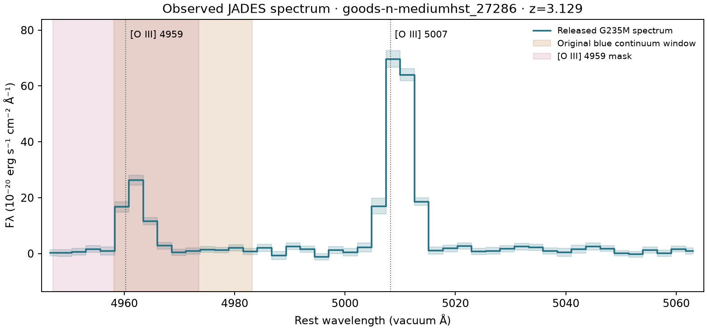
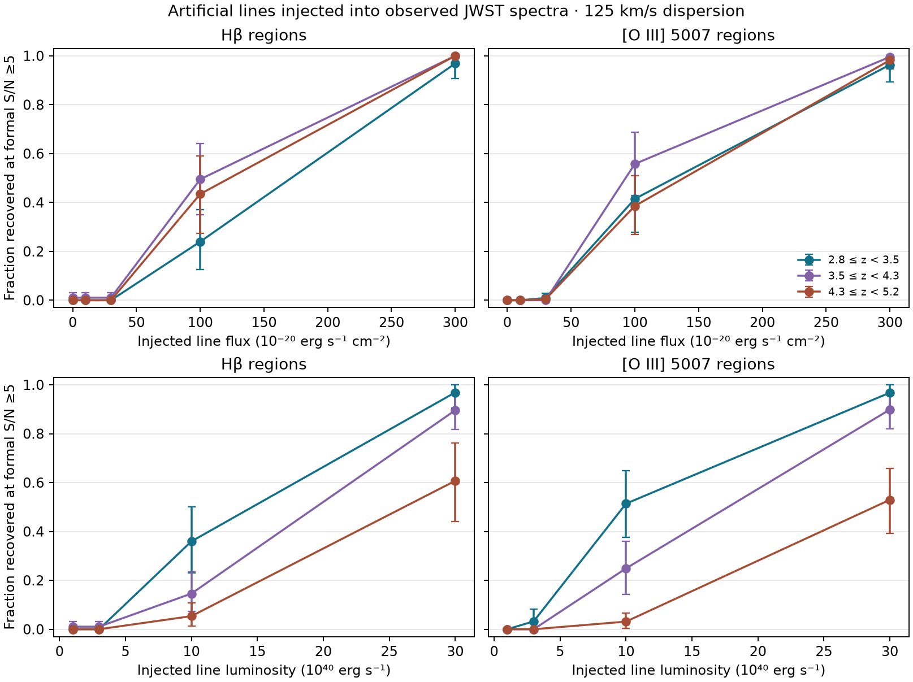

# Line recovery across cosmic time in the JADES spectra

**Biswajit Jana** · Independent research · 25 November 2026

## What we tested

A comparison of JADES catalogue fits found a roughly 10% difference
in median [O III] λ5007/Hβ between redshift 4.3–5.2 and 2.8–3.5.
Its uncertainty includes zero. Requiring both lines to clear a detection
threshold can also change which galaxies enter each bin. Here we use
released G235M spectra to measure both lines at fixed wavelengths,
including weak and negative flux measurements, and test how often
the same method recovers artificial lines.
[Parent study](jades_cosmic_evolution.md) ·
[JADES DR4 spectroscopic data and methods](https://doi.org/10.1093/mnras/stag939).

## A correction to the earlier spectrum examples

The original fixed-window example used −3,000 to −1,500 km/s and
+2,000 to +3,000 km/s to estimate the continuum around [O III] λ5007.
The λ4959 line falls about 2,870 km/s blueward, inside the blue window.
Its light raises the fitted continuum and reduces the λ5007 flux.
We repeated the four original examples with an ±800 km/s mask around
λ4959. The corrected ratios increase by 7.5–14.1% in these four
spectra. The population comparison in the parent study used JADES
catalogue profile fits, which model the oxygen doublet.
[JADES emission-line modelling](https://doi.org/10.1093/mnras/stag939).

| JADES DR5 ID | Original window ratio | Corrected window ratio | Catalogue fit ratio |
| ---: | ---: | ---: | ---: |
| 1030279 | 4.41 | 4.74 | 5.16 |
| 1039092 | 4.40 | 5.02 | 5.80 |
| 175034 | 4.19 | 4.69 | 5.42 |
| 189400 | 3.84 | 4.14 | 5.78 |

The corrected values use finite-window integration and still differ
from the release's fitted-profile ratios. We carry the continuum mask
through the pilot below.

## Sample and measurements

We drew 16 targets from each combination of two GOODS fields and the
three original redshift bins, for 96 total, using a fixed random seed
and without ranking by line strength. The parent sample required a
secure spectroscopic redshift, a unique NIRCam counterpart, and a
G235M exposure. The equal draw across fields makes the pooled estimates
descriptive of this pilot. Four earlier examples were used only for
the continuum check.

We use the public five-pixel, three-nod extraction and the catalogue
redshift. Each line flux is a signed integral over ±600 km/s after
fitting a straight continuum. It requires at least two usable bins on
each side and at least 80% coverage of the core window. Formal flux
errors incorporate the continuum fit and the released diagonal
variances. For Hβ measurements below formal S/N 3, we also retain
a conservative formal bound of max(measured flux, 0) + 3 × error.
Unavailable measurements are recorded as missing.

The injection test places Gaussian profiles into the actual spectra
at nearby wavelengths, avoiding a list of known spectral lines. We
integrate the profiles over each pixel before adding the flux and
apply the same window method to the altered pixels. The original
spectral noise and mask remain in place. The injected widths are 125
and 250 km/s in velocity dispersion. Recovery means a signed result
at formal S/N ≥ 5. Error bars use 4,000 bootstrap resamples of
galaxies because windows within the same spectrum share data.
The control at zero injected flux tests positive excursions in these
placements. The result measures line recovery in usable local
windows. Recovering a survey-wide galaxy population would also require
modelling wavelength coverage, selection for spectroscopy, slit
losses, and redshift success.

[DR4 target selection](https://doi.org/10.1093/mnras/stag836) ·
[Archive and target ledger](../results/jades_cosmic_evolution/forced_sample.json) ·
[Signed measurements](../results/jades_cosmic_evolution/forced_measurements.csv) ·
[Injection trial coefficients](../results/jades_cosmic_evolution/injection_trials.csv).

## What the pilot measured

All 96 drawn spectra were recovered, and 89 had enough usable pixels
to measure both line windows. Nine GOODS-S Medium/JWST records had
catalogue programme 1180 and spectrum header programme 1286. We kept
the two programme labels, verified the exact tier/target identifier and
required agreement within 0.2″. MAST documents the two programme
designations under the released Medium/JWST tier.
[MAST JADES product naming](https://archive.stsci.edu/hlsp/jades).

| Redshift | Both windows usable | Oxygen ≥5 S/N | Both lines ≥5 S/N | Median signed Hβ/[O III] among oxygen detections |
| --- | ---: | ---: | ---: | ---: |
| 2.8–3.5 | 31/32 | 19 | 7 | 0.175 |
| 3.5–4.3 | 31/32 | 26 | 12 | 0.181 |
| 4.3–5.2 | 27/32 | 22 | 6 | 0.134 |

Of 67 oxygen detections, 42 have Hβ below formal S/N 5, including
four negative signed Hβ estimates. Across the dual detections, the
higher-redshift minus lower-redshift difference in median log₁₀
([O III]/Hβ) is +0.034 dex, with a 95% bootstrap interval of
[−0.016, +0.128] dex. Retaining all signed Hβ estimates conditional
on oxygen detection gives a difference of −0.041 in the reciprocal
ratio, with a 95% interval of [−0.102, +0.003]. The two estimates
point in the same direction, but both intervals include zero.
The reciprocal ratio allows weak and negative Hβ estimates to enter
without division by a near-zero Hβ flux. Its selection still depends
on oxygen detection.

## How many faint lines were missed?

The injection study used 875 usable target, line and offset
combinations, evaluated with both Gaussian widths. One control
placement crossed the cutoff with zero artificial flux. Nearby
spectral structure and shared pixel noise remain possible contributors.

At a fixed apparent flux of 10⁻¹⁸ erg s⁻¹ cm⁻², Hβ recovery for the
125 km/s trials is 24%, 49%, and 43% across the three redshift bins.
For comparison at fixed line luminosity, we converted each injected
luminosity to flux with its target's Planck18 luminosity distance
and the isotropic relation F = L / (4π Dₗ²), leaving out attenuation
and lens magnification.

| Redshift | Hβ recovery at 10⁴¹ erg s⁻¹ | [O III] 5007 recovery at 10⁴¹ erg s⁻¹ |
| --- | ---: | ---: |
| 2.8–3.5 | 36% [23%, 50%] | 51% [38%, 65%] |
| 3.5–4.3 | 15% [7%, 23%] | 25% [14%, 36%] |
| 4.3–5.2 | 5% [1%, 11%] | 3% [0.4%, 6.7%] |

Brackets give 95% galaxy-bootstrap intervals. The figures compare
synthetic lines at similar wavelengths to the named transitions.
Only usable windows contribute. The fixed-luminosity comparison shows
how cosmological dimming changes the galaxies a detection cut can
retain in these data. The pilot still allows modest physical evolution
of the gas. Measuring it requires fitting the signed fluxes and
unusable wavelengths across the full target list and testing a
matched sample in another survey.
[All observed estimates, injection counts, and intervals](../results/jades_cosmic_evolution/forced_summary.json).

## Reproduction and credits

Run `python scripts/download_jades_evolution_sample.py` followed by
`python scripts/measure_jades_evolution_lines.py` from the repository.
The analysis uses public JWST/NIRSpec pixels reduced by the JADES team.
The recovery experiment adds explicitly labelled artificial lines to
those pixels. [Research record](../docs/research_record.md).
