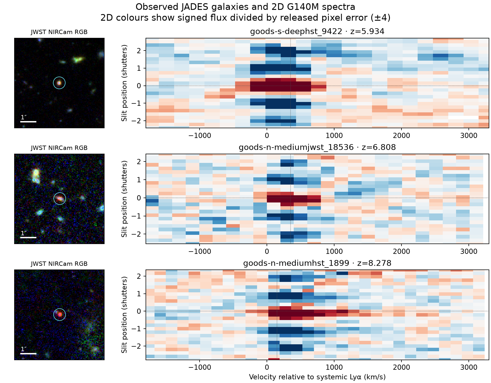
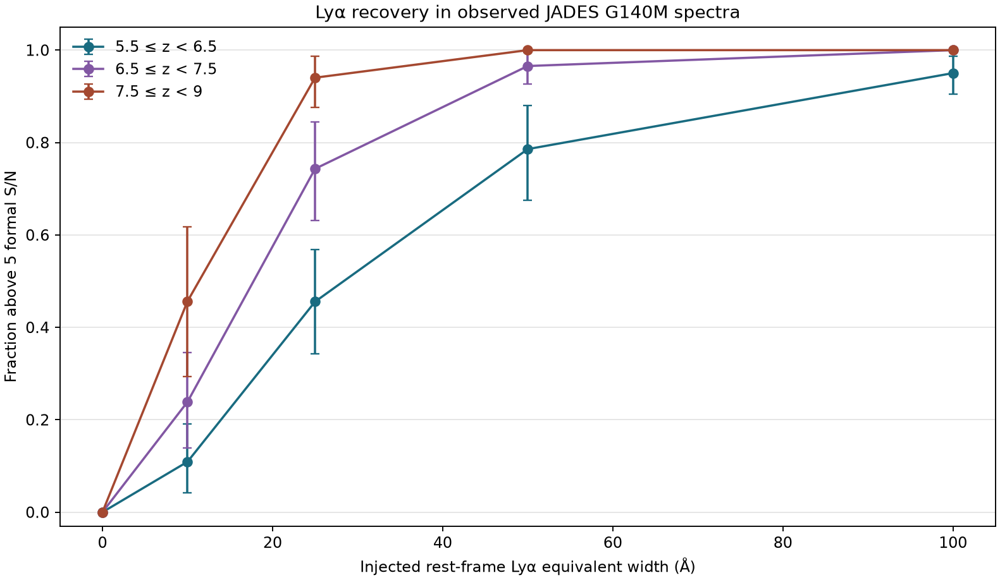
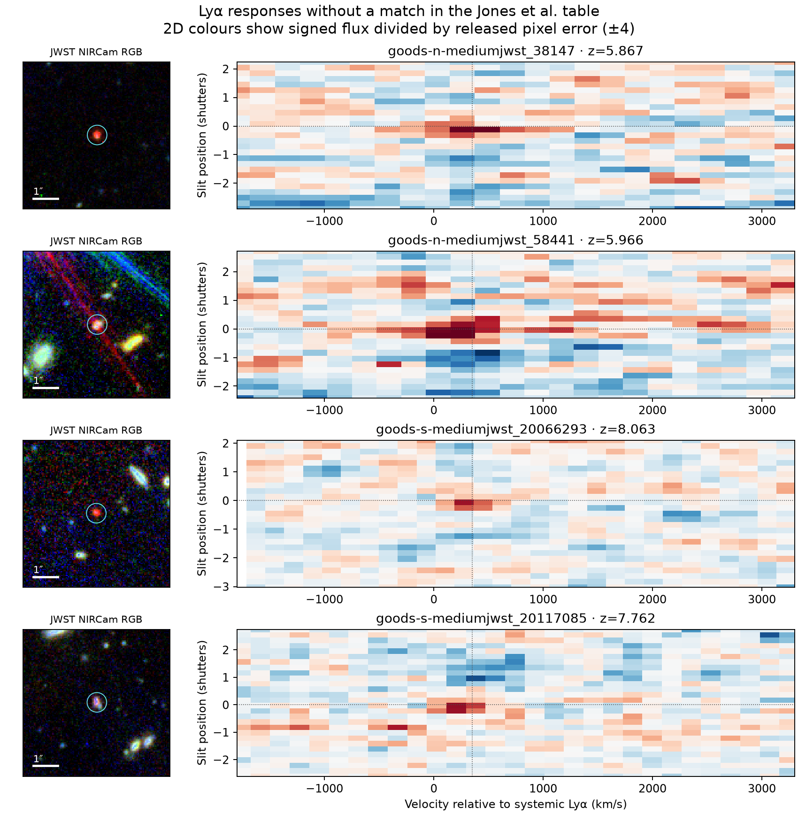

# A Lyman-alpha search across the reionization era

**Biswajit Jana** · Independent research · 25 November 2026

## What JWST can measure

Neutral hydrogen scatters Lyman-alpha (Lyα) photons. Whether we see the
line also depends on how the galaxy produces it, the gas around the
galaxy, and the depth and wavelength of the observation. This pilot
measures the line and the sensitivity of the search before attempting
any inference about the intergalactic neutral fraction.
[JADES reionization analysis](https://doi.org/10.1093/mnras/stae2670) ·
[Research goals and cosmic time](jades_cosmic_evolution.md).

## Selection and method

We screened the public JADES DR4 v1.2.1 catalogue and selected positive
NIRCam counterparts with grade-A spectroscopy, at least two reported
medium-resolution redshift lines, a redshift fit consistent with the
catalogue value, and a separately reported optical [O III] λ5007 fit
at S/N ≥ 5. We required G140M exposure and a catalogue UV magnitude
between −22 and −18. The search therefore reduces reliance on Lyα
itself for target selection. It represents galaxies that meet these
optical spectroscopy and UV cuts.

We obtained 93 released G140M/F070LP spectra drawn at random from
204 eligible counterparts across the GOODS-North and GOODS-South
fields. We drew up to 18 per field and bin. For the highest-redshift
bin this means 3 northern and 18 southern targets. Exact target IDs
and FITS sky positions were checked. Eight products use the documented
GOODS-S Medium/JWST programme naming variant. The catalogue and FITS
programme identifiers are recorded separately.
[JADES data release](https://jades-survey.github.io/scientists/data.html) ·
[Target selection](https://doi.org/10.1093/mnras/stag836) ·
[MAST product naming](https://archive.stsci.edu/hlsp/jades) ·
[Eligible target list](../results/jades_reionization/eligible_targets.csv) ·
[Archive ledger](../results/jades_reionization/sample.json).

We used a fixed bank of red-side profiles at +150, +350, +550 and
+750 km/s relative to 1215.67 Å at the medium-resolution redshift.
The primary Gaussian dispersion is 150 km/s. Profiles are truncated
at the systemic wavelength and integrated over spectral bins. To
avoid crossing the absorption break, we use only bins fully on the red
side and estimate the local continuum from +2,200 to +6,800 km/s.
At least 78% of the model area must fall in usable bins. For every
usable spectrum we retain signed fluxes at the +350 km/s reference
when covered. For spectra below the screen we retain a nominal
equivalent-width bound over the offsets with usable data. Formal
errors include the continuum fit and diagonal pixel errors. They
omit residual covariance and uncertainty in redshift and line profile.

## Observed responses

| Redshift | Time after Big Bang (Gyr) | Drawn | Usable template coverage | Formal responses at S/N ≥ 5 |
| --- | --- | ---: | ---: | ---: |
| 5.5–6.5 | 0.84–1.04 | 36 | 31 | 7 |
| 6.5–7.5 | 0.69–0.84 | 36 | 33 | 6 |
| 7.5–9.0 | 0.54–0.69 | 21 | 20 | 9 |

Twenty-two sources passed the initial screen of 84 with coverage
of at least one template. Of those 84 sources, 31 cover all four
offsets. Among the 62 screened non-detections, the median nominal
rest-frame equivalent-width bounds by bin are 19.9, 11.9 and 8.7 Å.
Equivalent widths use the catalogue UV magnitude, Planck18 luminosity
distance and a flat spectral flux density per unit frequency from
1500 Å to the line. They are conditional on that continuum estimate.

Cross-matching against the 150-entry table in Jones et al. recovered
18 previous grating emitters among the 22 responses. A further
four catalogue matches fell below our detection screen. The strongest
response, JADES-GN-z8-0-LA, is a published emitter at z ≈ 8.28,
about 609 million years after the Big Bang. The template fit recovers
(4.84 ± 0.19) × 10⁻¹⁸ erg s⁻¹ cm⁻² at a formal S/N of 25.3.
Jones et al. report a larger flux for their fitted profile. Our
finite template describes the core of the line under a fixed shape
and velocity grid.
[Jones et al. published comparison sample](https://doi.org/10.1093/mnras/stae2670) ·
[Witstok et al. on JADES-GN-z8-0-LA](https://doi.org/10.1093/mnras/stae2535) ·
[Signed fluxes and limits](../results/jades_reionization/measurements.csv).

## How the recovery rate changes

We injected artificial red-side profiles at nearby wavelength
placements, avoiding known emission-line wavelengths. Trials span
four velocity offsets, simulated rest-frame equivalent widths of 10,
25, 50 and 100 Å relative to the adopted continuum, and two observed
velocity dispersions of 150 and 250 km/s. The released masks and
noise stay fixed. We used 594 zero-strength placements and 16,296
nonzero trials. No zero-strength placement passed the formal
screen. This result describes the sampled placements and cannot
calibrate every source of contamination at the real Lyα wavelength.

| Redshift | Recovery at 25 Å, 150 km/s | 95% galaxy-bootstrap interval |
| --- | ---: | ---: |
| 5.5–6.5 | 46% | 34–57% |
| 6.5–7.5 | 74% | 63–85% |
| 7.5–9.0 | 94% | 88–99% |

The highest-redshift bin has substantially longer GOODS-S exposures
in this draw. Wavelength response, line shape, UV brightness and
field composition can also affect recovery. In the highest bin,
the 250 km/s profiles at 25 Å recover about 85%. The raw fraction
of spectra above the line threshold therefore mixes astrophysics
with sensitivity. Extending the pilot to an emitter fraction will
require completeness at the real line wavelength, treatment of
optical-redshift selection, and a comparison across matched
depth and UV brightness.
[Recovery estimates by redshift, profile and UV brightness](../results/jades_reionization/summary.json) ·
[Artificial-line trials](../results/jades_reionization/injections.csv.gz).

## Four follow-up candidates

Four line responses had no match in the Jones et al. emitter table
under the 0.2″ and redshift-agreement criteria. All show structure
near the trace in the released JADES 2D spectra. Their significance
depends on the extraction. We applied the same template and held
the JADES-fitted velocity fixed in the separate DAWN reductions.

| DR4 target | Redshift | JADES five pixels and three nods | JADES five pixels and two nods | DAWN formal S/N |
| --- | ---: | ---: | ---: | ---: |
| GOODS-N 38147 | 5.867 | 5.34 | 2.61 | 2.90 |
| GOODS-N 58441 | 5.966 | 8.46 | 6.87 | 4.22 |
| GOODS-S 20066293 | 8.063 | 5.18 | 4.48 | 2.95 |
| GOODS-S 20117085 | 7.762 | 5.21 | 3.60 | 2.91 and 2.08 |

**GOODS-N 58441** is the strongest follow-up target. Its JADES and
DAWN spectra both favour the +350 km/s template. The JADES line
core is (4.91 ± 0.58) × 10⁻¹⁸ erg s⁻¹ cm⁻². The DAWN value is
(8.67 ± 2.06) × 10⁻¹⁸ erg s⁻¹ cm⁻². The DAWN estimate has a
larger formal error, and the reductions can share detector exposures.
This warrants
checking the slit background and the individual exposures before
using its flux in a population result.

The literature search found prior studies of some host galaxies.
GOODS-N 38147 is listed as an AGN candidate. GOODS-S 20066293
and 20117085 appear in published galaxy samples under their
imaging positions. An unmatched emitter-table entry establishes
the scope of this cross-check. All four remain line follow-up
candidates. The two DAWN entries for 20117085 have different
reference visits. We retain their separate statistics.
[Roberts-Borsani et al. spectroscopic benchmark](https://doi.org/10.3847/1538-4357/ad85d3) ·
[Hainline et al. galaxy catalogue](https://ora.ox.ac.uk/objects/uuid%3A350ce8e4-9f54-4c8c-a42f-d4e838fb46df/files/rtb09j847h) ·
[DAWN NIRSpec data](https://dawn-cph.github.io/dja/spectroscopy/nirspec/) ·
[Literature, image and extraction checks](../results/jades_reionization/crosschecks.json) ·
[DAWN measurements and receipts](../results/jades_reionization/dja_comparison.json).

The follow-up recovers the 58441 line in separate G140M and PRISM
exposures and finds a published MMT counterpart for the 38147 line.
[Exposure and literature follow-up](jades_reionization_58441.md).

## Reproduction and credits

Run the four commands recorded in the experiment manifest. Observational
inputs are credited to the JADES collaboration, the DAWN JWST Archive,
and NASA/ESA/CSA JWST. Codex assisted with code and research
documentation. Artificial signals appear only in the recovery tests.
[Executed experiment](../experiments/jades_reionization.yaml).
