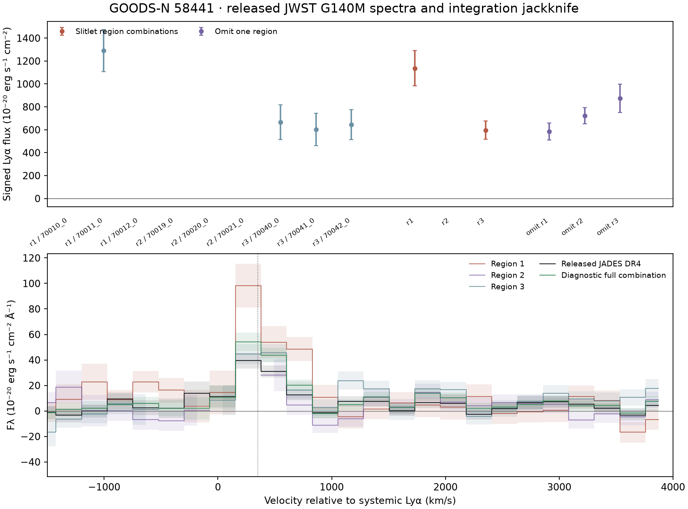
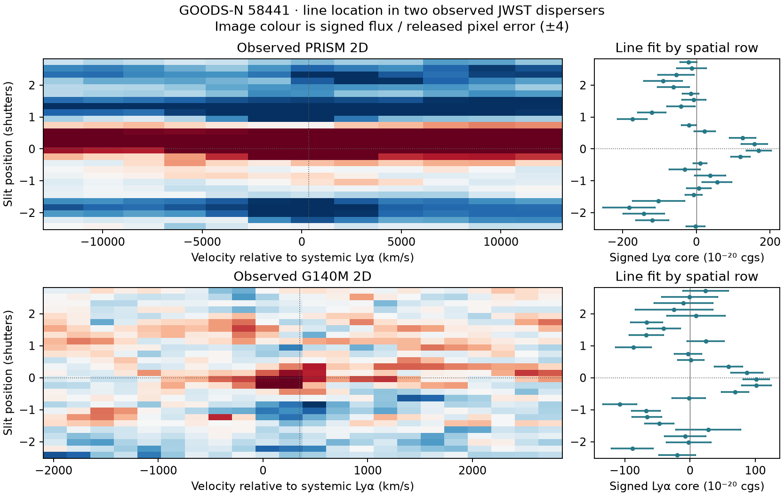

# Two JWST observing modes recover a line in GOODS-N 58441

**Biswajit Jana** · Independent research · 25 November 2026

GOODS-N 58441 is JADES DR5 source 1058441, at RA 189.2864212°,
Dec +62.2070173°. The public medium-resolution catalogue gives
z = 5.966401 from eight lines, including a strong optical oxygen
line. The line we are following falls near 0.84787 μm, the
wavelength expected for Lyman-alpha at +350 km/s relative to
that systemic redshift. Under Planck18 the observation samples
the universe at an age of about 936 million years.
[JADES DR4 spectroscopic catalogue methods](https://doi.org/10.1093/mnras/stag939) ·
[Reionization pilot and sky cutouts](jades_reionization.md).

## The signal survives separate observations

We kept the redshift and line offset fixed at the values used in
the pilot. The released 1D G140M spectrum contains nine
intermediate integrations grouped into three slitlet regions.
Four integrations cover enough of the same line and continuum
windows for a single-extraction fit. They all give a positive
signed line. Regions 1 and 3 each recover the signal at formal
S/N 7.4. Region 2 alone lacks the required wavelength coverage.
Omitting each region in turn gives S/N 7.81, 10.11 and 7.10.
The two regions yield different fluxes, 11.37 ± 1.54 and
5.97 ± 0.81 in units of 10⁻¹⁸ erg s⁻¹ cm⁻². Shared nodded
backgrounds limit the independence of these intermediate
measurements. The released extraction is used for the cross-mode
comparison. All 18 G140M sensitivity fits on that extraction,
varying width and continuum, give S/N 5.1–8.5.
[JADES intermediate product format](https://jades.herts.ac.uk/DR4/Readme_DR4_spectra.md) ·
[Integration and continuum results](../results/jades_reionization/exposure_audit.json).

The archive exposes nine distinct exposure identifiers for each
of G140M and PRISM for this target. The lists have no identifiers
in common. We fit PRISM with a convolved continuum break and a
signed line fixed to the G140M wavelength. The instrument model
uses the STScI resolving-power curve with sensitivity cases for
compact-source resolution, UV slope, and break position.

| Released product | Signed line flux (10⁻¹⁸ erg s⁻¹ cm⁻²) | Formal S/N |
| --- | ---: | ---: |
| JADES G140M | 4.91 ± 0.58 | 8.46 |
| JADES PRISM | 4.05 ± 0.79 | 5.14 |
| DAWN G140M | 8.67 ± 2.06 | 4.22 |
| DAWN PRISM | 14.21 ± 1.80 | 7.91 |

All 27 JADES PRISM continuum and resolution variants give a
positive line at S/N 4.6–5.4. The largest-contribution PRISM bin
contains 37% of the model profile. Removing it leaves a positive
S/N 3.4 response. Removing either of the next two bins gives
4.4–5.0. The three PRISM slitlet groups each have positive
fits, with formal S/N 2.2–4.4. The 2D spectra put the strongest
positive fitted row within 0.05 shutters of the nominal source
trace in each mode. The two reductions of a given observing
mode can share exposures and their formal errors omit covariance
and calibration systematics. One published control, GOODS-S 9422,
shows substantial residual structure in the PRISM fit, illustrating
the limits of this local continuum and line model.
[STScI resolution curve and assumptions](https://jwst-docs.stsci.edu/jwst-near-infrared-spectrograph/nirspec-instrumentation/nirspec-dispersers-and-filters) ·
[PRISM fits and archive receipts](../results/jades_reionization/prism_crosscheck.json) ·
[Exact exposure lists and 2D slit profiles](../results/jades_reionization/58441_flux_scale.json).

## Line identification and flux limits

An [O III] λ5007 interloper at z ≈ 0.693 would predict a
companion at 0.83976 μm. We fitted both lines in the G140M
spectrum with signed amplitudes and the theoretical 2.98 ratio
as a check on their fitted contrast. The companion falls
3.1–3.9 formal error units below the doublet prediction across
eight width and continuum variants, including variants allowing
a separate systemic Lyα continuum break. This weakens the
simple oxygen-doublet interpretation.

The continuum is positive blueward of systemic Lyα and its
level differs by reduction. DAWN PRISM continuum levels are
about four times the JADES levels in several UV windows.
DAWN's tabulated path-loss factor is about 2.22 near the line.
A diagnostic division by that column brings both DAWN
line fluxes closer to the JADES values, while a difference
persists. The division tests scale dependence without claiming
to reconstruct either pipeline. The broad continuum, shutter
transmission and projected neighbours need to be modelled before
inferring a calibrated equivalent width or escape fraction.
The results support repeatable line emission consistent with
Lyα in this already catalogued galaxy.
[Oxygen doublet calculation](https://doi.org/10.1046/j.1365-8711.2000.03184.x) ·
[JADES path-loss calibration](https://doi.org/10.1093/mnras/stag939) ·
[DAWN extraction and path loss](https://dawn-cph.github.io/dja/blog/2024/03/01/nirspec-extractions-v2/) ·
[Flux-scale plot](../figures/jades_reionization_58441_flux_scale.png).

## Literature and the other candidates

The comparable PRISM S/N values for GOODS-N 38147, GOODS-S
20066293 and GOODS-S 20117085 are 1.91, 1.33 and 0.04.
In the published 62-entry MMT/Binospec table, GOODS-N 38147
matches a reported emitter within 0.078″. Its line redshift
corresponds to +320 km/s relative to the JADES systemic
redshift, close to our fixed +350 km/s template. The MMT table
has zero emitters within 1″ of 58441, with the nearest listed
emitter 76.2″ away. The earlier Jones et al. table also had no
coordinate match for 58441. The scope of these literature
checks supports follow-up of the line. Priority and publication
status beyond those catalogues remain open.
[MMT/Binospec study](https://doi.org/10.1051/0004-6361/202557392) ·
[Coordinate checks](../results/jades_reionization/mmt_literature_check.json).

## Reproduction and credits

The four executed commands and input ledgers are in the experiment
record. Observations and instrumental calibration are credited to
the JADES collaboration, the DAWN JWST Archive, STScI and
NASA/ESA/CSA JWST. Codex assisted with code and research documentation.
[Executed experiment](../experiments/jades_reionization_58441_followup.yaml).
