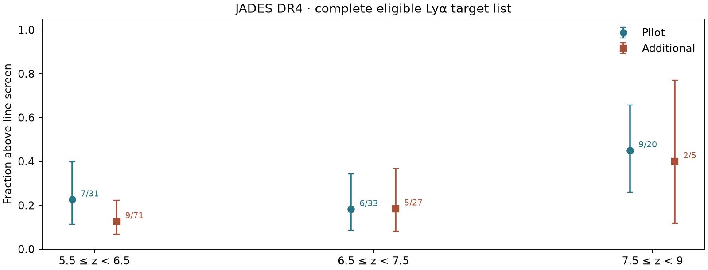
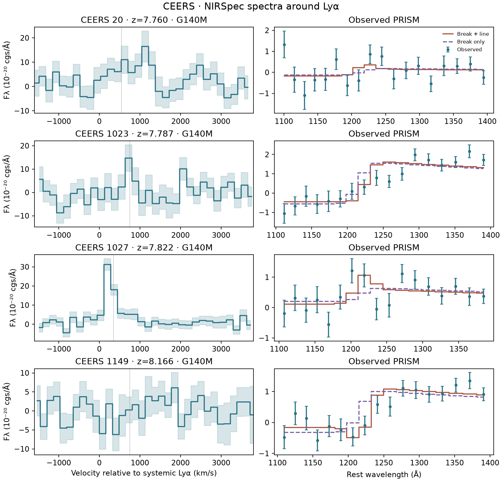

# Lyman-alpha in the full eligible JADES sample and a CEERS comparison

**Biswajit Jana** · Independent research · 25 November 2026

We expanded the JADES pilot from 93 to all 204 targets in its eligible
DR4 roster. Sixteen of the 111 additional spectra passed the Lyman-alpha
(Lyα) screen. All sixteen match previously published emitters. A comparison
in a separate JWST field recovered the known emitter CEERS 1027.

## JADES DR4

The roster contains galaxies in GOODS-N and GOODS-S with secure systemic
redshifts, optical emission lines, G140M exposure, and rest-frame UV
magnitudes from −22 to −18. It covers 5.5 ≤ z < 9, or about 0.54–1.04 Gyr
after the Big Bang under Planck18. We used the pilot's G140M/F070LP
products and its signed, narrow Lyα templates at +150, +350, +550 and
+750 km/s relative to the systemic wavelength. A usable spectrum supports
at least one template and its continuum fit. A screen hit has formal
flux/error ≥5 at the best covered offset. Aperture and nod variants of
screen hits use the same wavelength as the primary fit and share data.
[JADES DR4 spectroscopy](https://doi.org/10.1093/mnras/stag939) ·
[Pilot and artificial-line recovery](jades_reionization.md).

| Redshift | Pilot, usable / drawn | Pilot, above screen / Jones matches | Additional, usable / drawn | Additional, above screen / Jones matches |
| --- | ---: | ---: | ---: | ---: |
| 5.5–6.5 | 31 / 36 | 7 / 5 | 71 / 78 | 9 / 9 |
| 6.5–7.5 | 33 / 36 | 6 / 6 | 27 / 28 | 5 / 5 |
| 7.5–9.0 | 20 / 21 | 9 / 7 | 5 / 5 | 2 / 2 |
| Total | 84 / 93 | 22 / 18 | 103 / 111 | 16 / 16 |

This gives 187 usable spectra and 38 screen hits. Thirty-four hits match
the Jones et al. emitter table within 0.2″ and a fractional redshift
difference of 0.002. Earlier follow-up matched GOODS-N 38147 to a published
MMT emitter. The three other pilot leads include GOODS-N 58441, which has
a repeatable line in separate JWST exposures with source attribution and
flux calibration still under investigation, and two GOODS-S leads with
weak PRISM responses. All of the new hits had matches, so this expansion
yielded zero additional targets for independent JADES PRISM validation.
[Jones et al. emitter table](https://doi.org/10.1093/mnras/stae2670) ·
[MMT match and the GOODS-N 58441 follow-up](jades_reionization_58441.md).

The error bars are 95% Wilson intervals for the observed counts. The
high-redshift additional bin has five usable spectra. The optical-line
and UV magnitude cuts, differing exposure depths, and wavelength-dependent
completeness prevent interpreting these fractions as the redshift evolution
of intrinsic Lyα incidence or the neutral hydrogen fraction.

## CEERS

We queried the project’s DAWN v4 catalogue snapshot for grade-3 CEERS
sources in the same redshift range with archive [O III] 5007 S/N ≥5 and
both G140M and PRISM coverage around Lyα. One apparent join paired CEERS
499 in G140M with CEERS 498 in PRISM. Their catalogue positions are
0.298″ apart, outside the 0.15″ limit. Four sources passed the coordinate
and relative-redshift consistency cuts. The optical redshift anchor is
the archive value from the product with the highest [O III] S/N. The
PRISM fit uses a convolved continuum break and a signed line at the
wavelength selected in G140M. Fluxes below are in 10⁻¹⁸ erg s⁻¹ cm⁻²
with formal 1σ errors from the released diagonal uncertainties.
[DAWN extraction documentation](https://dawn-cph.github.io/dja/blog/2024/03/01/nirspec-extractions-v2/) ·
[STScI NIRSpec dispersers](https://jwst-docs.stsci.edu/jwst-near-infrared-spectrograph/nirspec-instrumentation/nirspec-dispersers-and-filters).

| CEERS ID | z | G140M flux ± 1σ | G140M S/N | PRISM flux ± 1σ | PRISM S/N |
| --- | ---: | ---: | ---: | ---: | ---: |
| 20 | 7.7605 | 1.43 ± 0.54 | 2.64 | 0.94 ± 1.24 | 0.75 |
| 1023 | 7.7872 | 1.47 ± 0.64 | 2.30 | −1.99 ± 1.00 | −1.98 |
| 1027 | 7.8223 | 3.02 ± 0.32 | 9.37 | 1.79 ± 0.99 | 1.81 |
| 1149 | 8.1661 | −0.21 ± 0.44 | −0.48 | −2.94 ± 0.83 | −3.52 |

CEERS 1027 is a published Lyα emitter. The PRISM response remains weak
across all 27 combinations of instrumental resolution, UV continuum slope
and break position, with S/N from 1.36 to 2.01. CEERS 1023 is a published
non-detection. No other target shows a strong positive response. The
negative PRISM fit for CEERS 1149 ranges from −4.12 to −2.87 across the
same variants. A physical absorption measurement would require validation
with a more detailed continuum model and another observation. In this
comparison, requiring a strong PRISM response would discard a real line.
[Tang et al., CEERS 1027](https://doi.org/10.1093/mnras/stad2763) ·
[Napolitano et al., CEERS 1023](https://doi.org/10.1051/0004-6361/202449644).

## Reproduction

[Experiment commands](../experiments/jades_reionization_full.yaml) ·
[JADES product receipts](../results/jades_reionization_full/archive_sample.json) ·
[Signed JADES measurements](../results/jades_reionization_full/measurements.csv) ·
[JADES summary and catalogue matches](../results/jades_reionization_full/screen_summary.json) ·
[CEERS product receipts and fits](../results/jades_reionization_full/ceers_crosscheck.json) ·
[Research record](../docs/research_record.md).

Observations and released reductions are credited to the JADES and CEERS
collaborations, the DAWN JWST Archive, STScI, and NASA/ESA/CSA JWST.
