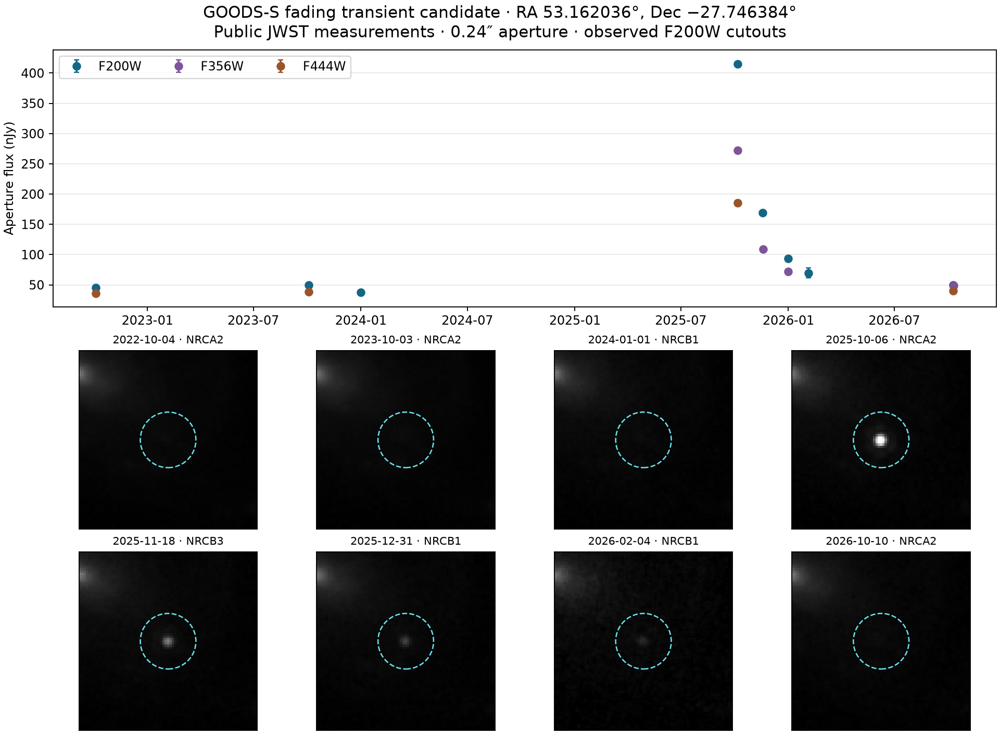
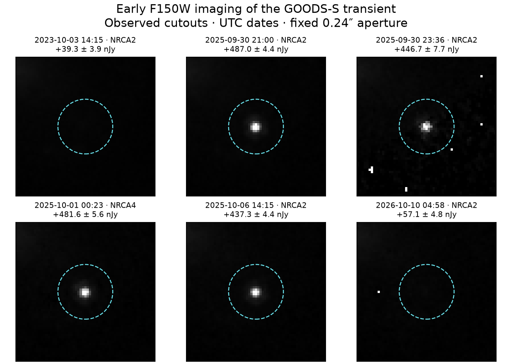
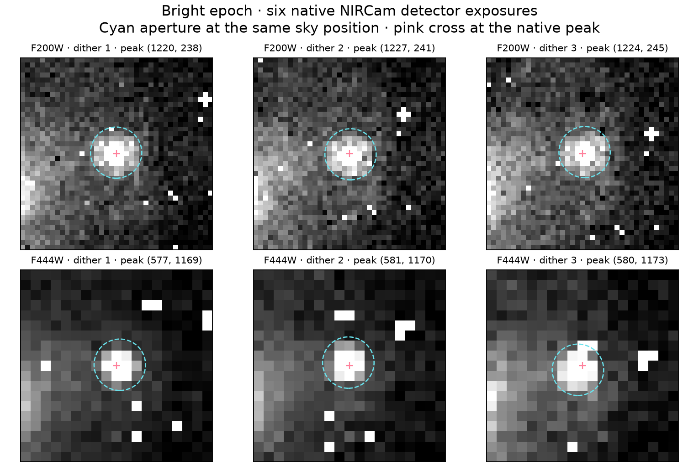
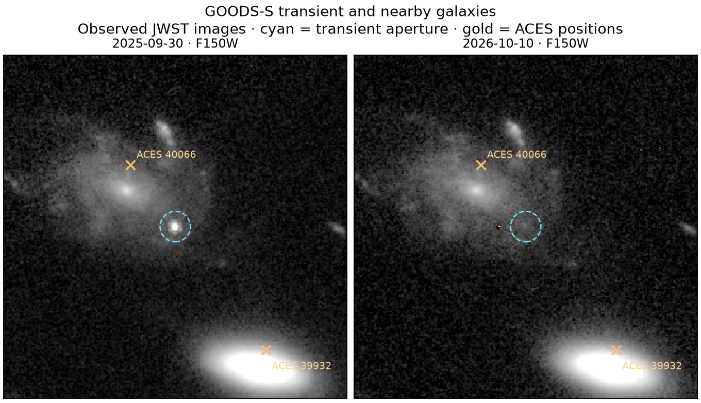
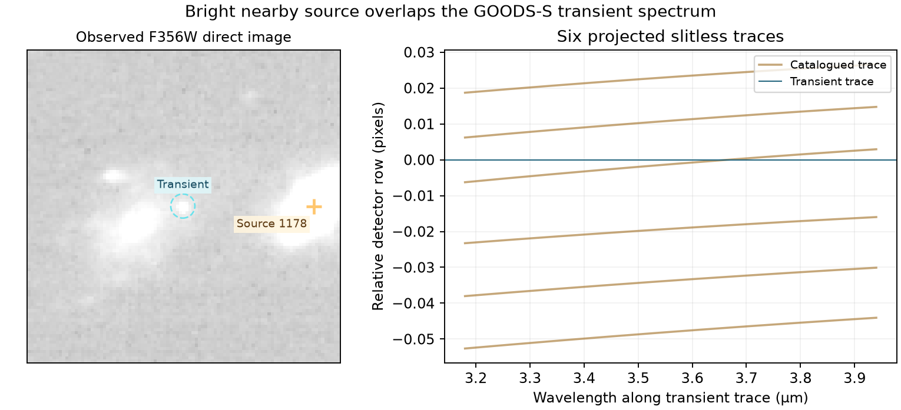
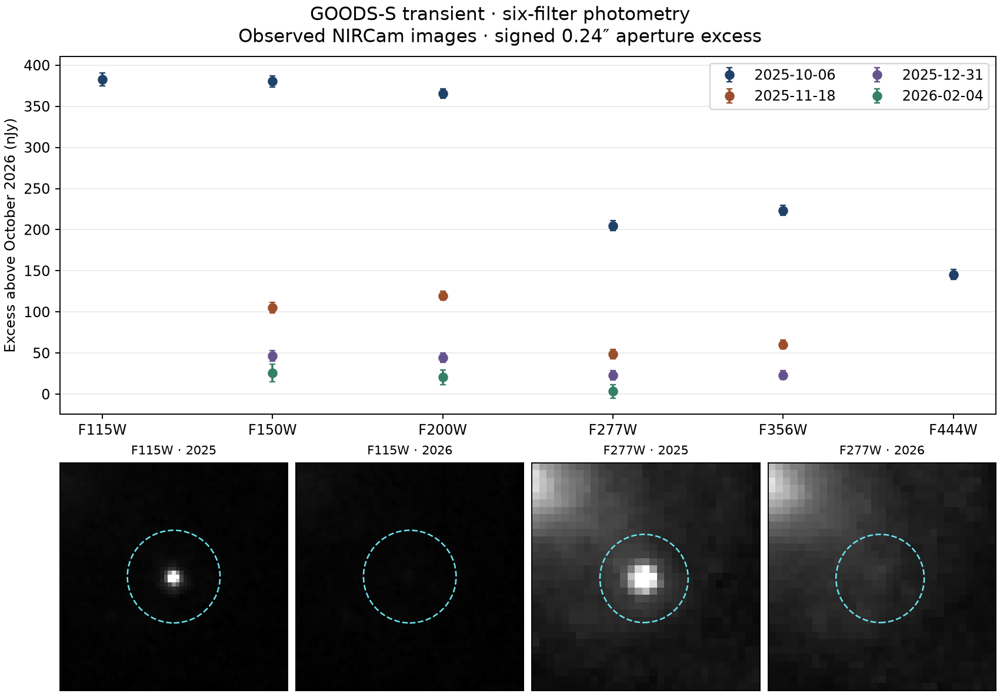
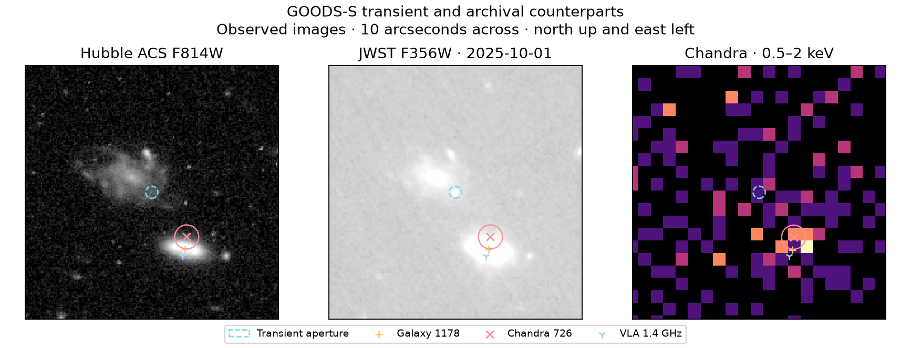
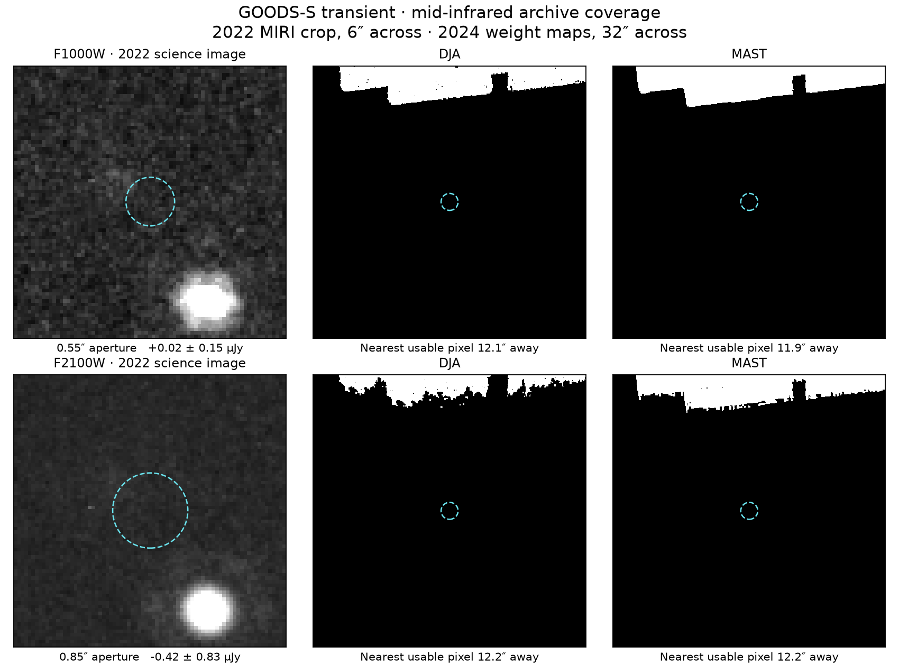

# GOODS-S cross-detector transient search

22 November 2026 · Public JWST NIRCam and NIRSpec observations

## Recovery of an earlier transient candidate

The [previous GOODS-S search](jwst_epoch_search.md) identified a 2025 F444W
flux excess at ZFOURGE CDFS 18559. A subsequent coordinate query in the
DAWN JWST Archive found three PRISM extractions of survey target 2510042
within **0.057″** of the measured excess. They were observed on 28 December
2025, 13 January 2026 and 4 February 2026. The first is already flagged in
the archive as a possible supernova transient. A 17 December 2023 JADES
PRISM observation lies 0.105″ away and provides host context. The four
archive redshifts agree around 2.85. The observing programme includes
supernova follow-up. Transient classification requires modelling the host
contribution and the varying slit projections.
[DJA spectroscopy API](https://dawn-cph.github.io/dja/general/api_summary/#extracted-nirspec-msa-spectra),
[GO 5324](https://www.stsci.edu/jwst-program-info/program/?program=5324),
[spectroscopic product receipts](../results/jwst_cross_detector/control_spectra_products.json).

The fixed 0.24″ F200W aperture gives **318.7 ± 4.0 nJy** in October 2025
and **257.1 ± 4.6 nJy** in October 2026, about a 24% difference relative to
2026. Recentering gives 361.8 and 290.6 nJy. Five nearby comparison
sources have 2026-to-2025 ratios between 0.978 and 1.004, below the
six-source threshold for applying a local correction. Photometry uses
the NRCA3 short-wave detector and the uncertainties are local blank
aperture scatter. Together with the spectroscopic archive history, this
makes the galaxy an independent recovery of an existing transient lead.
[Imaging and spectroscopy measurements](../results/jwst_cross_detector/recovered_control.json).

## New blind search

We examined the module-A part of the visit 1b GOODS-S pointing, using
6 October 2025 and 10 October 2026 observations from the public archive.
F200W covers four short-wave detectors at 20 mas per pixel. F444W and
F356W use the module-A long-wave detector at 40 mas per pixel. Both
bands in the earlier search used a single detector, so a fixed defect
could appear in all of them. This experiment pairs signed peaks between
distinct detectors. [GO 8060](https://www.stsci.edu/jwst-program-info/program/?program=8060),
[GO 12577](https://www.stsci.edu/jwst-program-info/program/?program=12577),
[mosaic product receipts](../results/jwst_cross_detector/mosaics.json).

Each filter is differenced at its delivered scale using robust flux,
background, small-shift and symmetric PSF terms. Signed differences
are ranked with local empirical scatter. Same-sign F200W and F444W
peaks within 0.14″ are paired. The shortlist requires both bands to
change by at least 18% within a 0.24″ science aperture and requires
a ranking score of at least six in one of the bands. F356W is measured
as additional image evidence. The two long-wave filters share their
detector. [Experiment commands](../experiments/jwst_cross_detector.yaml).

## Fading transient at RA 53.162036°, Dec −27.746384°

The search covered a summed common footprint of **3.84 arcmin²**.
Of 154 same-sign pairs, one fading source cleared the aperture gate.
Its October 2025 excess appears in F200W, F356W and F444W. The
short- and long-wave residual peaks are 0.042″ apart. The source
identifier `GS-B-53.162036-27.746384` records the search position.
[Search summary](../results/jwst_cross_detector/field_b_search.json),
[all matched peaks](../results/jwst_cross_detector/field_b_matches.csv),
[2025 and 2026 residual cutouts](../figures/jwst_cross_detector/field_b_candidates.png).

| Observation | F200W (nJy) | F356W (nJy) | F444W (nJy) |
| --- | ---: | ---: | ---: |
| 4 Oct 2022 | 45.6 ± 2.9 | — | 36.0 ± 2.9 |
| 3 Oct 2023 | 50.0 ± 3.4 | — | 38.4 ± 3.0 |
| 1 Jan 2024 | 38.0 ± 3.3 | — | — |
| 6 Oct 2025 | 414.6 ± 4.1 | 272.2 ± 3.9 | 185.8 ± 4.4 |
| 18 Nov 2025 | 169.2 ± 3.8 | 108.9 ± 3.3 | — |
| 31 Dec 2025 | 93.6 ± 3.9 | 71.9 ± 3.5 | — |
| 4 Feb 2026 | 69.8 ± 8.2 | — | — |
| 10 Oct 2026 | 49.4 ± 4.0 | 48.7 ± 4.4 | 40.4 ± 4.4 |

The table uses signed 0.24″ aperture fluxes, a 0.30–0.48″ local sky annulus
and local aperture scatter. The measurements include persistent emission
within the aperture. A dash denotes an epoch and filter combination outside
this analysis. In F200W, the bright-epoch aperture is 8.4 times the October
2026 aperture. The intermediate F200W measurements used NRCB3 and NRCB1.
The intermediate F356W measurements used NRCBLONG. Both bands fade across
independent visits and detector placements. The 2022 and 2023 F444W
measurements agree with the faint 2026 measurement.
[Epoch measurements and catalogue receipts](../results/jwst_cross_detector/field_b_transient_vetting.json),
[FITS product receipts](../results/jwst_cross_detector/field_b_candidate_products.json).

### Earlier detection in a separate programme

F150W imaging from GO 4549 independently detects the source before the
6 October visit. The 0.24″ aperture gives **487.0 ± 4.4 nJy** on
30 September 2025 at 21:00 UTC. Two other F150W mosaics acquired over the
next 3.4 hours measure 446.7 ± 7.7 and 481.6 ± 5.6 nJy. The mosaics span
two pointings and two short-wave detectors. The aperture measures
39.3 ± 3.9 nJy in October 2023, 437.3 ± 4.4 nJy on 6 October 2025, and
57.1 ± 4.8 nJy in October 2026. The source was already bright 5.6 days
before the visit used to find it. The pre-brightening archive check below
examines coverage between the January 2024 faint F200W image and this
detection.
[GO 4549](https://www.stsci.edu/jwst-program-info/program/?program=4549),
[F150W measurements and archive receipts](../results/jwst_cross_detector/field_b_transient_f150w.json).

### Native detector verification

Three F200W exposures on NRCA2 and three F444W exposures on NRCALONG
show the bright source on 6 October 2025. In each image, the brightest
pixel near the target has zero data-quality flags. Its coordinates change
with the dithers. Centroids estimated from unflagged pixels agree with the
local astrometric prediction within 0.019″ in all six frames. The formal
native aperture sum remains missing for apertures containing other
flagged pixels. The compact signal follows the predicted sky location as
it moves across the detector.
[MAST exposure receipts](../results/jwst_cross_detector/field_b_candidate_products.json).

### Public matches and interpretation

The public GO 8060 APT input catalogue identifies this event as
transient **2510038**, just **0.015″** from the photometric position.
The matched row is explicitly labelled `trans` in `MPT_input_v3`.
It has no assigned configuration in the corresponding saved plan.
The same input catalogue is embedded in the GO 12577 APT file.
These records establish prior recognition by the survey team.
The input redshift of 0.77 is planning metadata. The closest of the
92 positions in the earlier JADES transient tables is 13.83″ away,
and the public TNS and DJA extraction checks had no match in their
respective search windows.
[GO 8060 public APT](https://www.stsci.edu/jwst-program-info/download/jwst/apt/8060/) ·
[Target and catalogue match receipts](../results/jwst_cross_detector/goods_s_prior_records.json) ·
[Transient Name Server](https://www.wis-tns.org/search?ra=53.162036&decl=-27.746384&radius=5&coords_unit=arcsec&format=html),
[earlier JADES transient survey](https://arxiv.org/html/2406.05060v4),
[DJA spectroscopy API](https://dawn-cph.github.io/dja/general/api_summary/#extracted-nirspec-msa-spectra).

The closest JADES DR2 entry is NIRCam source 217327, 0.990″ from the
transient. It has catalogue photometric redshift 0.78 and Kron radius
2.04″. The reported offset makes it a plausible host. Multiple nearby
galaxies and the lack of a spectrum at the transient position leave the
host association and distance unresolved. The measured fading supports a
real astrophysical transient. Its type remains open.
[JADES DR2 catalogue](https://vizier.cfa.harvard.edu/viz-bin/VizieR-3?-source=V%2F159%2Fgssample).

### Slitless spectra and optical redshift context

The 30 September and 1 October 2025 F150W images overlap two GO 4549
F356W/GRISMR pointings. We inspected all 11 archived module-A
extractions selected by the exposure footprints, along with the two
direct-image catalogues used by the pipeline. No source position falls
within 0.25″ of the transient. The closest extracted positions are
0.897″ and 0.932″ away in the two pointings. The detector-level
follow-up below checks coverage and overlapping spectra.
[JWST programme 4549](https://www.stsci.edu/jwst-program-info/program/?program=4549),
[MAST product and cross-match receipts](../results/jwst_cross_detector/field_b_transient_wfss.json).

The ACES optical survey measured secure heliocentric redshifts of
0.85183 and 0.85330 for galaxy **ACES 40066**, 1.20″ from the transient.
The other nearby ACES galaxy, **39932**, is 2.41″ away and has redshift
about 0.732. The bright-epoch image places the transient on the outskirts
of the extended emission near ACES 40066. Its host association remains
unconfirmed. If the transient shares that galaxy's redshift, its
30 September F150W excess corresponds to an observed aperture magnitude
of 24.77 AB and to roughly −18.3 AB at a rest wavelength of 0.81 µm,
assuming Planck18 and a blueshifted copy of the observed passband.
The estimate has no extinction or aperture correction.
[Cooper et al., ACES spectroscopy](https://academic.oup.com/mnras/article/425/3/2116/983732),
[ACES redshift catalogue](https://vizier.cfa.harvard.edu/viz-bin/VizieR-3?-source=J%2FMNRAS%2F425%2F2116%2Ftable2).

### What the grism frames can measure

The calibrated first-order trace reaches only the red edge of the nominal
3.14–3.98 µm band in five exposures and covers essentially the whole band
in six. The reconstructed detector positions and wavelengths agree with
the archived extractions. The two GO 4549 F356W direct images measure
269.8 ± 12.0 and 268.5 ± 9.3 nJy in the transient's 0.24″ aperture,
compared with 48.7 ± 4.4 nJy in October 2026.
[Coverage and observed F356W images](../figures/jwst_cross_detector/field_b_transient_grism_geometry.png) ·
[CRDS and MAST receipts](../results/jwst_cross_detector/field_b_transient_grism_products.json) ·
[Coverage measurements](../results/jwst_cross_detector/field_b_transient_grism_geometry.json).

All six full-coverage exposures contain the first-order trace of F356W
catalogue source **1178**, 2.61″ from the transient on the sky. Between
3.18 and 3.94 µm on the transient's wavelength scale, the two predicted
traces stay within **0.053 cross-dispersion pixel** in every exposure.
The galaxy's catalogue F356W flux is **25.71 µJy**, about 96 times the
flux in the transient aperture. This is a brightness comparison using
two aperture definitions. A flat-corrected extraction with linear
sideband subtraction finds a strong blended ridge. The quadratic
sideband fit has insufficient usable pixels to report transient-trace
bins under the extraction's sampling criteria.
[Trace overlap measurements](../results/jwst_cross_detector/field_b_transient_grism_overlap.json) ·
[Detector diagnostic](../figures/jwst_cross_detector/field_b_transient_forced_grism.png) ·
[Native exposure receipts](../results/jwst_cross_detector/field_b_transient_grism_rates.json).

The independent GO 1207 NIRSpec extraction of this galaxy (DJA source
217321, 0.019″ from catalogue source 1178) has a catalogue redshift of
0.73374 and a peak at 3.2528 µm, consistent with hydrogen Paschen α.
The archived NIRCam extractions of source 1178 peak at 3.2494–3.2549 µm
in the predicted line window. Its projected detector column corresponds
to 3.2924–3.2925 µm on the transient wavelength scale. The four forced
extractions meeting the local sample-count criteria show peaks at
3.2882–3.2928 µm. This agreement identifies bright-galaxy line
contamination in the blend. The data leave the transient's spectrum,
redshift and line-flux limits unresolved.
[Line measurements and provenance](../results/jwst_cross_detector/field_b_transient_grism_contaminant.json) ·
[DAWN JWST Archive spectroscopy](https://dawn-cph.github.io/dja/spectroscopy/nirspec/) ·
[Paschen wavelength reference](https://arxiv.org/abs/2609.10097).

### Six-filter photometry

The 6 October 2025 GO 8060 observations record a positive excess in six
filters. Each measurement subtracts the October 2026 flux in the same
0.24″ aperture and filter. Reported uncertainties combine local
aperture noise in both epochs. Aperture corrections and calibration
systematics are outside this calculation.

| Filter | 6 October 2025 excess (nJy) |
| --- | ---: |
| F115W | 382.8 ± 7.8 |
| F150W | 380.3 ± 6.6 |
| F200W | 365.2 ± 5.7 |
| F277W | 204.9 ± 6.1 |
| F356W | 223.5 ± 5.8 |
| F444W | 145.4 ± 6.2 |

The source faded through November and December in all four filters with
measurements at both visits. The F150W–F356W excess colour was −0.58 ± 0.03
AB mag in October, −0.61 ± 0.12 in November and −0.76 ± 0.30 in December.
These measurements are consistent with a constant colour. The template
noise is shared across epochs and the photometry alone leaves the event
type unresolved.
[Signed fluxes and archive receipts](../results/jwst_cross_detector/field_b_transient_colours.json).

### Archival X-ray, radio and optical environment

The published 7 Ms Chandra main and supplementary catalogues contain
1,055 sources. The nearest, CDF-S source **726**, is **2.23″** from the
infrared transient. Its published 68% positional error radius is 0.47″,
and its CANDELS counterpart is 0.38″ from the galaxy that contaminates
the slitless spectrum. The Chandra counterpart's catalogue redshift
of 0.735 is close to that galaxy's independent NIRSpec redshift of
0.73374. The VLA 1.4 GHz search finds one source within 20″, located
0.28″ from the contaminating galaxy and 2.78″ from the transient.
Its catalogue integrated flux density is **58.5 ± 10.9 µJy**. The
positions and redshifts support associating the archival detections
with the contaminating galaxy. The CDF-S astrometry uses the TENIS
reference frame, whose published offsets from Gaia DR1 are a few
tenths of an arcsecond.
[7 Ms Chandra catalogue and maps](https://zenodo.org/records/8021940) ·
[VLA survey catalogue](https://heasarc.gsfc.nasa.gov/W3Browse/all/vlaecdfs1p4.html).

The soft-band image contains nine counts within 1.0″ of the transient,
with two counts in the published background map for that aperture.
At source 726 the equivalent aperture contains 16 counts, with three
in the background map. These are native-pixel sums. The apertures sample
nearby point-spread function wings, and the calculation provides neither
a separate X-ray detection nor a deblended flux limit. The Chandra
footprint service returned 104 distinct ACIS observations from
October 1999 through March 2016, all before the 2025 brightening.
The archival data constrain the source environment before the event.
[Chandra footprint service](https://cxcfps.cfa.harvard.edu/cda/footprint/cdaview.html).

Archival Hubble ACS mosaics measure signed 0.24″ aperture fluxes of
**18.8 ± 3.2 nJy** in F606W and **27.6 ± 4.8 nJy** in F814W at the JWST
transient coordinates. The local background subtraction leaves light
from nearby galaxy structure in the aperture. These fluxes do not
isolate a persistent point source or determine a progenitor magnitude.
The VLT MUSE-Wide DR1 field and exposure maps both return zero coverage
at the transient position.
[DAWN HST cutouts](https://dawn-cph.github.io/dja/general/api_summary/#image-cutouts) ·
[MUSE-Wide DR1 maps](https://musewide.aip.de/serve/table/musewide_dr1/fields/) ·
[Measurements and archive receipts](../results/jwst_cross_detector/field_b_transient_ancillary.json).

The solid circle marks the catalogue's 68% positional error radius for
Chandra source 726. The VLA marker shows the radio catalogue position.

### Coverage before brightening and in the transient survey

An exact-position test against the DAWN JWST Archive detector polygons
found 520 exposure footprints in 88 visit, filter and detector groups.
Between the faint 1 January 2024 F200W image and the bright 30 September
2025 F150W image, only the eight nominal detector polygons from the
18 November 2024 MIRI visit covered the coordinate. Each of the four
F1000W and four F2100W footprints is an outer detector outline.
[DJA exposure search](https://dawn-cph.github.io/dja/general/api_summary/#exposure-metadata).

The 2024 GO 5407 mosaics have zero usable pixels within 1″ of the
transient in both filters. This holds in the DAWN reductions and the
independently produced MAST stage 3 mosaics. The nearest usable pixels
are about 12″ away. On 7 December 2022, the SMILES images give a
0.55″ aperture flux of **+0.02 ± 0.15 µJy** in F1000W and a 0.85″
aperture flux of **−0.42 ± 0.83 µJy** in F2100W. Uncertainties are
the scaled median absolute deviations of 55 nearby apertures.
Neither 2022 flux exceeds the local scatter. The 2024 fluxes and
inter-epoch differences remain missing, leaving the onset interval open.
[SMILES programme](https://archive.stsci.edu/hlsp/smiles) ·
[MEOW programme](https://www.stsci.edu/jwst/science-execution/approved-programs/general-observers/cycle-3-go) ·
[Coverage and photometry receipts](../results/jwst_cross_detector/field_b_transient_precursor.json).

The DJA NIRSpec shutter search returned 1,308 rows within a 15″ query
radius. None of their projected shutter polygons contains the
transient. In GO 8060, which independently targeted transients in
GOODS-S, the nearest listed spectroscopy target is 13.51″ away. This
rules out a direct match in the available GO 8060 shutter listing.
The public observing plan nevertheless lists the event in an input
catalogue. An uncontaminated spectrum of the transient remains
unverified.
[DJA shutter search](https://dawn-cph.github.io/dja/general/api_summary/#nirspec-msa-slits) ·
[GO 8060 programme](https://www.stsci.edu/jwst-program-info/program/?program=8060).
