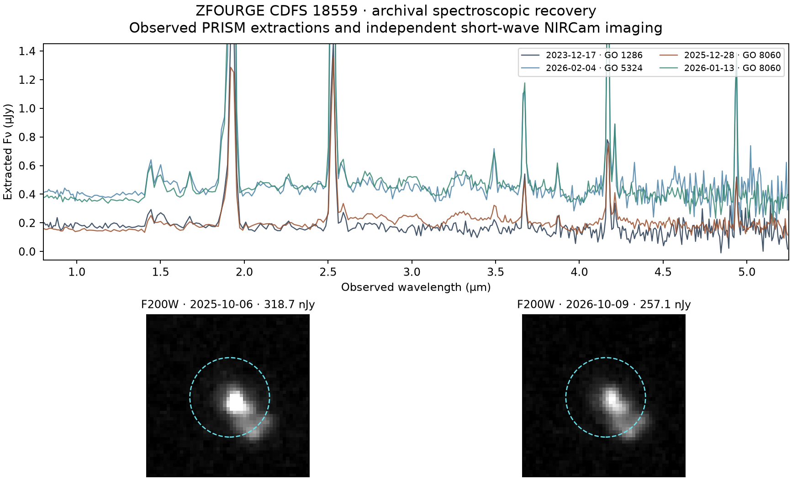

# GOODS-S cross-detector transient search

22 November 2026 · Public JWST NIRCam and NIRSpec observations

## Recovery of an earlier transient candidate

The [previous GOODS-S search](jwst_epoch_search.md) identified a 2025 F444W
flux excess at ZFOURGE CDFS 18559. A subsequent coordinate query in the
DAWN JWST Archive found three PRISM extractions of survey target 2510042
within **0.057″** of the measured excess. They were observed on 28 December
2025, 13 January 2026 and 4 February 2026. The first is already flagged in
the archive as a possible supernova transient. A 17 December 2023 JADES
PRISM observation lies 0.105″ away and provides host context. The four
archive redshifts agree around 2.85. The observing programme includes
supernova follow-up. Transient classification requires modelling the host
contribution and the varying slit projections.
[DJA spectroscopy API](https://dawn-cph.github.io/dja/general/api_summary/#extracted-nirspec-msa-spectra),
[GO 5324](https://www.stsci.edu/jwst-program-info/program/?program=5324),
[spectroscopic product receipts](../results/jwst_cross_detector/control_spectra_products.json).

The fixed 0.24″ F200W aperture gives **318.7 ± 4.0 nJy** in October 2025
and **257.1 ± 4.6 nJy** in October 2026, about a 24% difference relative to
2026. Recentering gives 361.8 and 290.6 nJy. Five nearby comparison
sources have 2026-to-2025 ratios between 0.978 and 1.004, below the
six-source threshold for applying a local correction. Photometry uses
the NRCA3 short-wave detector and the uncertainties are local blank
aperture scatter. Together with the spectroscopic archive history, this
makes the galaxy an independent recovery of an existing transient lead.
[Imaging and spectroscopy measurements](../results/jwst_cross_detector/recovered_control.json).

## New blind search

We examined the module-A part of the visit 1b GOODS-S pointing, using
6 October 2025 and 10 October 2026 observations from the public archive.
F200W covers four short-wave detectors at 20 mas per pixel. F444W and
F356W use the module-A long-wave detector at 40 mas per pixel. Both
bands in the earlier search used a single detector, so a fixed defect
could appear in all of them. This experiment pairs signed peaks between
distinct detectors. [GO 8060](https://www.stsci.edu/jwst-program-info/program/?program=8060),
[GO 12577](https://www.stsci.edu/jwst-program-info/program/?program=12577),
[mosaic product receipts](../results/jwst_cross_detector/mosaics.json).

Each filter is differenced at its delivered scale using robust flux,
background, small-shift and symmetric PSF terms. Signed differences
are ranked with local empirical scatter. Same-sign F200W and F444W
peaks within 0.14″ are paired. The shortlist requires both bands to
change by at least 18% within a 0.24″ science aperture and requires
a ranking score of at least six in one of the bands. F356W is measured
as additional image evidence. The two long-wave filters share their
detector. [Experiment commands](../experiments/jwst_cross_detector.yaml).

## Fading transient at RA 53.162036°, Dec −27.746384°

The search covered a summed common footprint of **3.84 arcmin²**.
Of 154 same-sign pairs, one fading source cleared the aperture gate.
Its October 2025 excess appears in F200W, F356W and F444W. The
short- and long-wave residual peaks are 0.042″ apart. The source
identifier `GS-B-53.162036-27.746384` records the search position.
[Search summary](../results/jwst_cross_detector/field_b_search.json),
[all matched peaks](../results/jwst_cross_detector/field_b_matches.csv),
[2025 and 2026 residual cutouts](../figures/jwst_cross_detector/field_b_candidates.png).

| Observation | F200W (nJy) | F356W (nJy) | F444W (nJy) |
| --- | ---: | ---: | ---: |
| 4 Oct 2022 | 45.6 ± 2.9 | — | 36.0 ± 2.9 |
| 3 Oct 2023 | 50.0 ± 3.4 | — | 38.4 ± 3.0 |
| 1 Jan 2024 | 38.0 ± 3.3 | — | — |
| 6 Oct 2025 | 414.6 ± 4.1 | 272.2 ± 3.9 | 185.8 ± 4.4 |
| 18 Nov 2025 | 169.2 ± 3.8 | 108.9 ± 3.3 | — |
| 31 Dec 2025 | 93.6 ± 3.9 | 71.9 ± 3.5 | — |
| 4 Feb 2026 | 69.8 ± 8.2 | — | — |
| 10 Oct 2026 | 49.4 ± 4.0 | 48.7 ± 4.4 | 40.4 ± 4.4 |

The table uses signed 0.24″ aperture fluxes, a 0.30–0.48″ local sky annulus
and local aperture scatter. The measurements include persistent emission
within the aperture. A dash denotes an epoch and filter combination outside
this analysis. In F200W, the bright-epoch aperture is 8.4 times the October
2026 aperture. The intermediate F200W measurements used NRCB3 and NRCB1.
The intermediate F356W measurements used NRCBLONG. Both bands fade across
independent visits and detector placements. The 2022 and 2023 F444W
measurements agree with the faint 2026 measurement.
[Epoch measurements and catalogue receipts](../results/jwst_cross_detector/field_b_transient_vetting.json),
[FITS product receipts](../results/jwst_cross_detector/field_b_candidate_products.json).

### Earlier detection in a separate programme

F150W imaging from GO 4549 independently detects the source before the
6 October visit. The 0.24″ aperture gives **487.0 ± 4.4 nJy** on
30 September 2025 at 21:00 UTC. Two other F150W mosaics acquired over the
next 3.4 hours measure 446.7 ± 7.7 and 481.6 ± 5.6 nJy. The mosaics span
two pointings and two short-wave detectors. The aperture measures
39.3 ± 3.9 nJy in October 2023, 437.3 ± 4.4 nJy on 6 October 2025, and
57.1 ± 4.8 nJy in October 2026. The source was already bright 5.6 days
before the visit used to find it. The start of the event remains
unconstrained between the earlier faint image and this detection.
[GO 4549](https://www.stsci.edu/jwst-program-info/program/?program=4549),
[F150W measurements and archive receipts](../results/jwst_cross_detector/field_b_transient_f150w.json).

### Native detector verification

Three F200W exposures on NRCA2 and three F444W exposures on NRCALONG
show the bright source on 6 October 2025. In each image, the brightest
pixel near the target has zero data-quality flags. Its coordinates change
with the dithers. Centroids estimated from unflagged pixels agree with the
local astrometric prediction within 0.019″ in all six frames. The formal
native aperture sum remains missing for apertures containing other
flagged pixels. The native images establish that the bright signal does
not originate in one fixed detector pixel.
[MAST exposure receipts](../results/jwst_cross_detector/field_b_candidate_products.json).

### Public matches and interpretation

The 5″ Transient Name Server search returned zero entries. The earlier
JADES transient catalogue and its list of excluded sources contain 92
positions. The nearest is 13.83″ away. The DJA query found no v4
NIRSpec extraction within the four-arcsecond square around this position.
These checks establish the scope of the public search and leave priority
over the active survey unresolved.
[Transient Name Server](https://www.wis-tns.org/search?ra=53.162036&decl=-27.746384&radius=5&coords_unit=arcsec&format=html),
[earlier JADES transient survey](https://arxiv.org/html/2406.05060v4),
[DJA spectroscopy API](https://dawn-cph.github.io/dja/general/api_summary/#extracted-nirspec-msa-spectra).

The closest JADES DR2 entry is NIRCam source 217327, 0.990″ from the
transient. It has catalogue photometric redshift 0.78 and Kron radius
2.04″. The reported offset makes it a plausible host. Multiple nearby
galaxies and the lack of a spectrum at the transient position leave the
host association and distance unresolved. The measured fading supports a
real astrophysical transient. Its type remains open.
[JADES DR2 catalogue](https://vizier.cfa.harvard.edu/viz-bin/VizieR-3?-source=V%2F159%2Fgssample).
