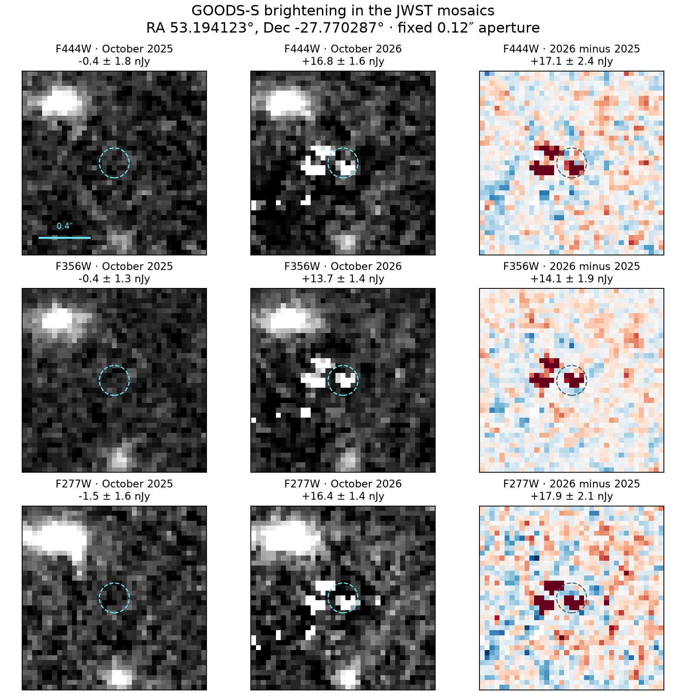
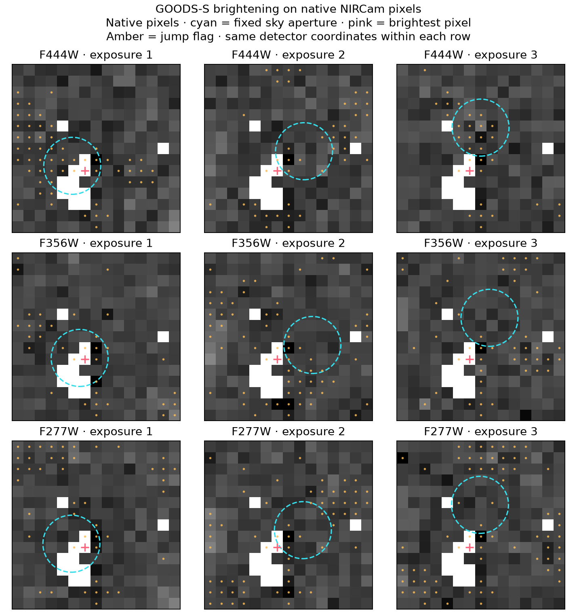
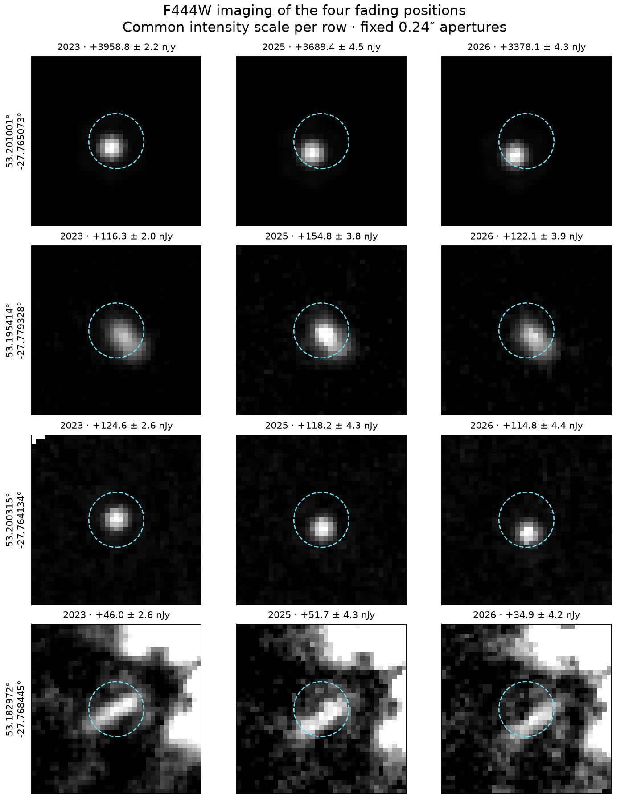
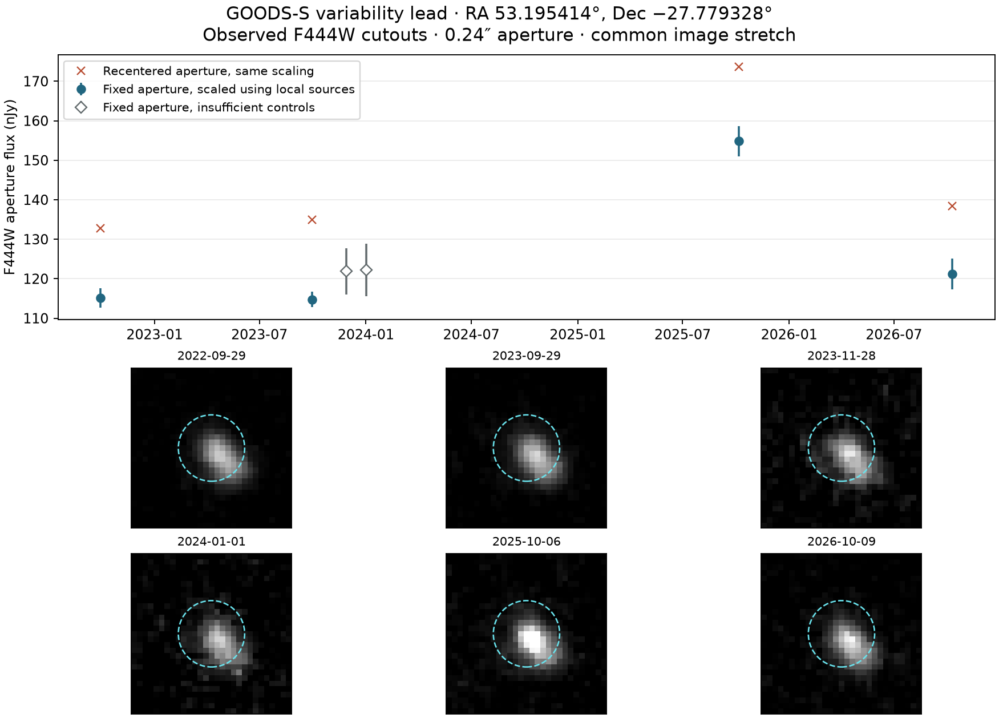

# JWST GOODS-S transient search

22 November 2026 · DAWN JWST Archive mosaics and MAST calibrated exposures

## Search

We searched a 2.88 arcmin² region of GOODS-S for sources that changed between
6 October 2025 and 9–10 October 2026. The search used F356W and F444W exposures
from the first visits of JWST programmes 8060 and 12577. Each filter and visit
combines three NRCALONG exposures in a 40 mas, v7.0 association mosaic. We kept the
original science and inverse-variance maps and recorded their hashes.
[DAWN JWST Archive API](https://dawn-cph.github.io/dja/general/api_summary/),
[programme 8060](https://www.stsci.edu/jwst-program-info/program/?program=8060),
[programme 12577](https://www.stsci.edu/jwst-program-info/program/?program=12577),
[archive receipts](../results/jwst_epoch_search/products.json).

On the shared grid, we fitted a relative scale, a background, two image
derivatives and a Laplacian to account for small changes in alignment and image
sharpness. We ranked signed circular-aperture residuals against local empirical
noise. Same-sign F356W and F444W peaks within 0.16″ gave 140 pairs, including
111 brightenings and 29 fadings. A check for opposite-sign annular residuals and
an integrated flux change of at least 25% in each band left one brightening and
four fading positions. The annular residual check leaves some dipoles and wings
of bright sources in the list. The empirical score is a ranking statistic.
[Configuration](../configs/jwst_epoch_search.yaml),
[search summary](../results/jwst_epoch_search/summary.json),
[all paired peaks](../results/jwst_epoch_search/matched_peaks.csv).

## Brightening at RA 53.194123°, Dec −27.770287°

The mosaic measurements at GS-JWST-53.194123-27.770287 show positive changes in
all three filters, including F277W, which was held out of the initial search.
The 2023 F444W reference yields −1.7 ± 0.9 nJy at these coordinates. The table
uses a fixed 0.12″ radius and a 0.28–0.44″ local sky annulus. Values are signed
aperture fluxes without aperture corrections. The uncertainties are empirical
scatter across local apertures, combined in quadrature for the change. F356W
has missing-weight pixels within the larger 2026 apertures.
[Follow-up products](../results/jwst_epoch_search/target_followup_products.json),
[aperture and detector measurements](../results/jwst_epoch_search/candidate_photometry.json).

| Filter | Oct 2025 (nJy) | Oct 2026 (nJy) | Change (nJy) |
| --- | ---: | ---: | ---: |
| F444W | −0.4 ± 1.8 | 16.8 ± 1.6 | +17.1 ± 2.4 |
| F356W | −0.4 ± 1.3 | 13.7 ± 1.4 | +14.1 ± 1.9 |
| F277W | −1.5 ± 1.6 | 16.4 ± 1.4 | +17.9 ± 2.1 |

Each row uses the same intensity stretch for the two science frames. The right
column shows direct subtraction on the common grid. The cyan ring indicates the
fixed sky aperture. These are measured pixels, including the instrumental
signal described below.

## Detector check

We mapped the target into the native MAST `cal.fits` frames using each
detector's SIP world-coordinate solution plus a local translation fitted to
nearby unflagged source centroids. Dithering moves the sky across the detector.
The detector panels retain finite jump-flagged values to diagnose the artifact.
The forced native aperture measurements exclude all flagged pixels, and a
masked source aperture is reported as missing. Pixel positions in the receipts
use zero-based coordinates. [MAST product receipts](../results/jwst_epoch_search/dither_products.json),
[JWST data-quality flags](https://jwst-pipeline.readthedocs.io/en/2.0.1/jwst/references_general/references_general.html).

**The brightening is a detector artifact.** The brightest nearby pixel is
`(1001, 1178)` in all nine exposures. It carries the `JUMP_DET` flag each time.
The predicted sky position spans 4.01, 4.22 and 4.07 native pixels in F444W,
F356W and F277W, respectively. Local registration residuals are 0.24–0.47
pixel RMS. The same bright-pixel pattern repeats in every panel as the expected
sky position moves. The three filter detections therefore share an instrumental
origin.

A 5″ position query found no entries in the public Transient Name Server or
among 92 published positions in Tables 4 and 9 of the earlier JADES transient
survey. The closest SIMBAD entry is a galaxy 0.93″ away. The limited catalogue
checks are recorded for reproducibility. [Query receipts](../results/jwst_epoch_search/novelty_queries.json),
[DeCoursey et al., JADES Transient Survey](https://arxiv.org/html/2406.05060v4).

## Fading positions

All four fading positions have emission in September 2023 F444W data from
JADES programme 1180. In each case the 2025 native F444W peaks move across the
detector with the dithers, unlike the detector artifact above. The brightest
fading residual sits on one lobe of a dipole around a pre-existing source.
The source at RA 53.200315°, Dec −27.764134° shifts within the small apertures.
Its 2025–2026 F444W change falls from −25.5 nJy at 0.12″ to −3.4 nJy at
0.24″. This sensitivity to aperture size makes a position or shape change
a plausible explanation.

The 0.24″ F444W apertures at RA 53.195414°, Dec −27.779328° measure
116.3, 154.8 and 122.1 nJy in 2023, 2025 and 2026. Those at RA 53.182972°,
Dec −27.768445° measure 46.0, 51.7 and 34.9 nJy. Both are leads for follow-up
on variability in pre-existing emission. Blending, epoch-dependent PSFs
and local background changes still need to be assessed before attributing
either change to a distinct astrophysical event.

## Six-epoch follow-up of ZFOURGE CDFS 18559

We selected RA 53.195414°, Dec −27.779328° for follow-up because the 2025
image is brighter than the 2023 and 2026 images through a 0.24″ aperture.
SIMBAD places the known galaxy ZFOURGE CDFS 18559 within 0.11″. A public
Transient Name Server query returned zero entries within 5″.
[SIMBAD galaxy record](https://simbad.cfa.harvard.edu/simbad/sim-id?Ident=ZFOURGE+CDFS+18559),
[archive and catalogue query receipts](../results/jwst_epoch_search/fading_lead_epochs.json).

Three additional F444W visits take the series back to 2022. The raw
fixed-aperture measurements in date order are 116.5, 116.3, 121.9, 122.2,
154.8 and 122.1 nJy. For each epoch with enough coverage, we divided the
flux by the median ratio of nearby sources measured in that epoch and in
2025. Ten controls give a 2026-to-2025 ratio of 1.008 with robust scatter
0.021. On this common scale the target measures 154.8 ± 3.8 nJy in 2025
and 121.2 ± 3.9 nJy in 2026. The excess is 28% relative to 2026 in the
fixed aperture and 25% after recentering in each image. The two earlier
September visits with controls each measure about 115 nJy on the same scale.
The November 2023 and January 2024 visits have only three and four usable
controls, respectively. Their raw values are shown separately. The plotted
errors measure local blank-aperture scatter. They exclude source-dependent
PSF changes, host morphology and calibration uncertainty.

The observations support a candidate 2025 flux excess in a known galaxy.
With only one bright visit, the excess has undetermined duration, physical
origin and reporting priority. [Photometry and control ratios](../results/jwst_epoch_search/fading_lead_epochs.json).

## Limits

This search yielded no confirmed new object. It covers a single repeat
footprint with no measured global false-alarm rate or injection-derived
completeness. A future search can test new signals against detector-frame
consistency and use repeat observations with different pointing or orientation.
The observed images use DJA/Grizli reductions of public JWST/NIRCam observations
and calibrated JWST exposures from MAST. [Reproduction commands](../experiments/jwst_epoch_search.yaml).
