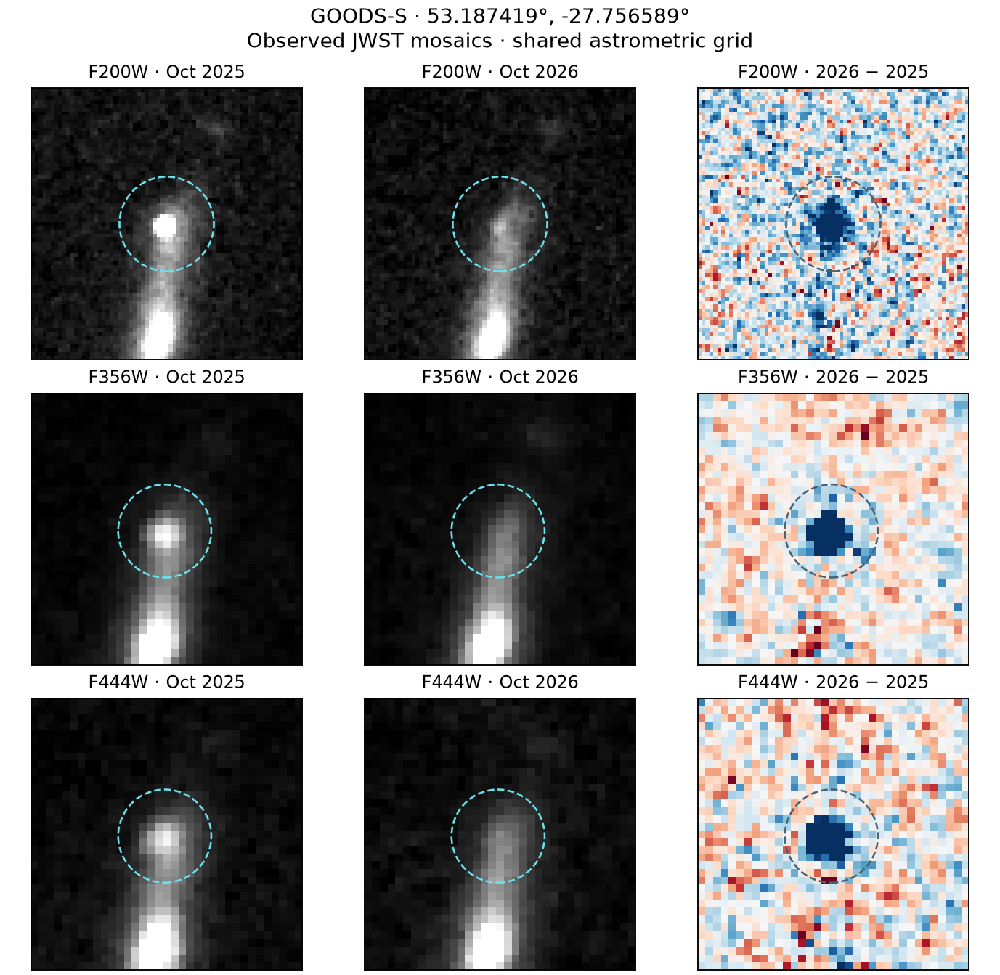
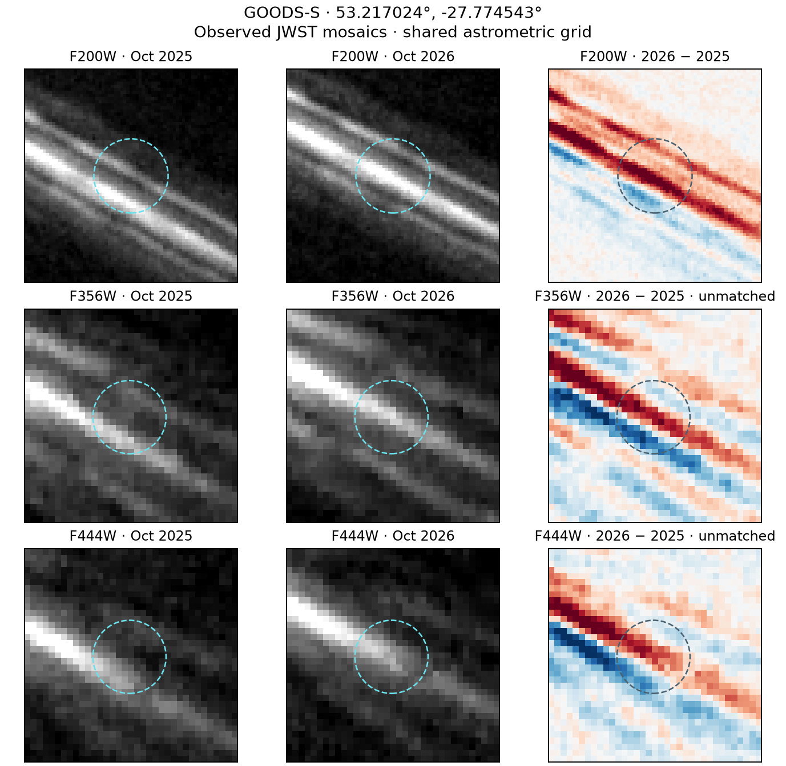

# GOODS-S NIRCam Module A search, pointing 001

The October 2025 and October 2026 images of Module A pointing 001 were
searched over **3.850 arcmin²** of summed short- and long-wavelength
detector overlap. We independently recovered GO 8060 transient **2510131**.
A second three-filter coincidence follows a diffraction spike and was
rejected after inspection of the observed images.

## Search and controls

We used all four F200W short-wavelength detectors and the independent
NRCALONG F356W and F444W mosaics from visits `jw08060001001` and
`jw12577001001`. The screening used the existing ranking cut of 4.5
and the 0.14″ positional tolerance. The aperture gate requires at
least an 18% change at the fixed 0.24″ radius in both filters and a
ranking score of at least 6 in one of them. The 1,931 ranked peaks
made 167 F200W–F444W positional pairs. Eight passed the same-sign
two-filter aperture gate, and two also passed the F356W gate.
One of 24 shifted controls passed the three-filter gate. These
offset trials describe chance overlap near the selected positions.
Spatially correlated structures can pass the unshifted screen.

[Search and shifted controls](../results/jwst_cross_detector/module_a_001_search.json) ·
[Candidate pairs](../results/jwst_cross_detector/module_a_001_matches.csv) ·
[DAWN product receipts](../results/jwst_cross_detector/module_a_001_products.json) ·
[DAWN NIRCam image archive](https://dawn-cph.github.io/dja/imaging/v7/).

## Transient 2510131

At **53.187419°, −27.756589°**, the F200W light dropped from 223 to
135 nJy in a 0.24″ aperture. The locally registered and matched
2026-minus-2025 fluxes are −86.6 ± 4.6 nJy in F200W, −62.7 ± 3.6 nJy in
F356W, and −46.2 ± 4.4 nJy in F444W. Errors are the robust scatter in
nearby difference apertures. The compact fading component is visible
in all three filters above a neighboring galaxy.

The public APT plans place 2510131 only 0.016″ from the search position,
label it `trans`, and assign it as a primary target in P0/c1.
The 24 November TNS snapshot had no entry within 5″, illustrating the
difference in coverage between the registry and public observing plans.
The observing-plan redshift is a target entry. This analysis measures
the fading and leaves the redshift and event type unverified.
[GO 8060 public APT](https://www.stsci.edu/jwst-program-info/download/jwst/apt/8060/) ·
[GO 12577 public APT](https://www.stsci.edu/jwst-program-info/download/jwst/apt/12577/) ·
[Photometry and prior record receipts](../results/jwst_cross_detector/module_a_001_vetting.json).

## Diffraction-spike coincidence

At **53.217024°, −27.774543°**, the difference images show elongated
positive and negative features along a bright diffraction spike. After
local registration, the F200W residual remains elongated. F356W and
F444W had too few stable local references for the fit, so the figures
retain the unmatched common-grid subtraction in those bands. F356W
gives +7.3 ± 6.6 nJy at the same fixed center and aperture, and the
F444W residual lies along the same streak. The aperture differences
measure the streak. This position was rejected as a point-source
variability candidate.

