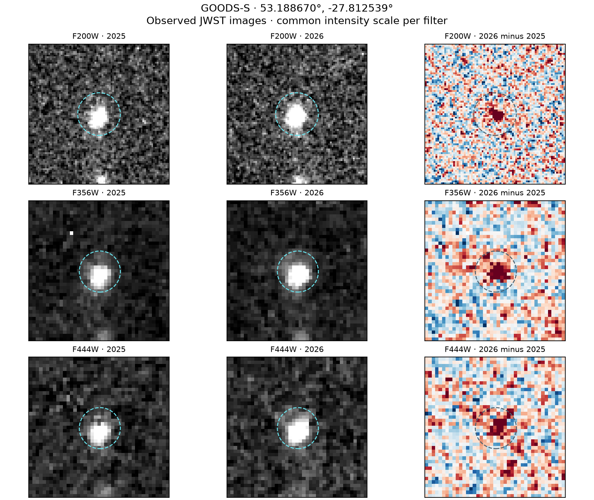
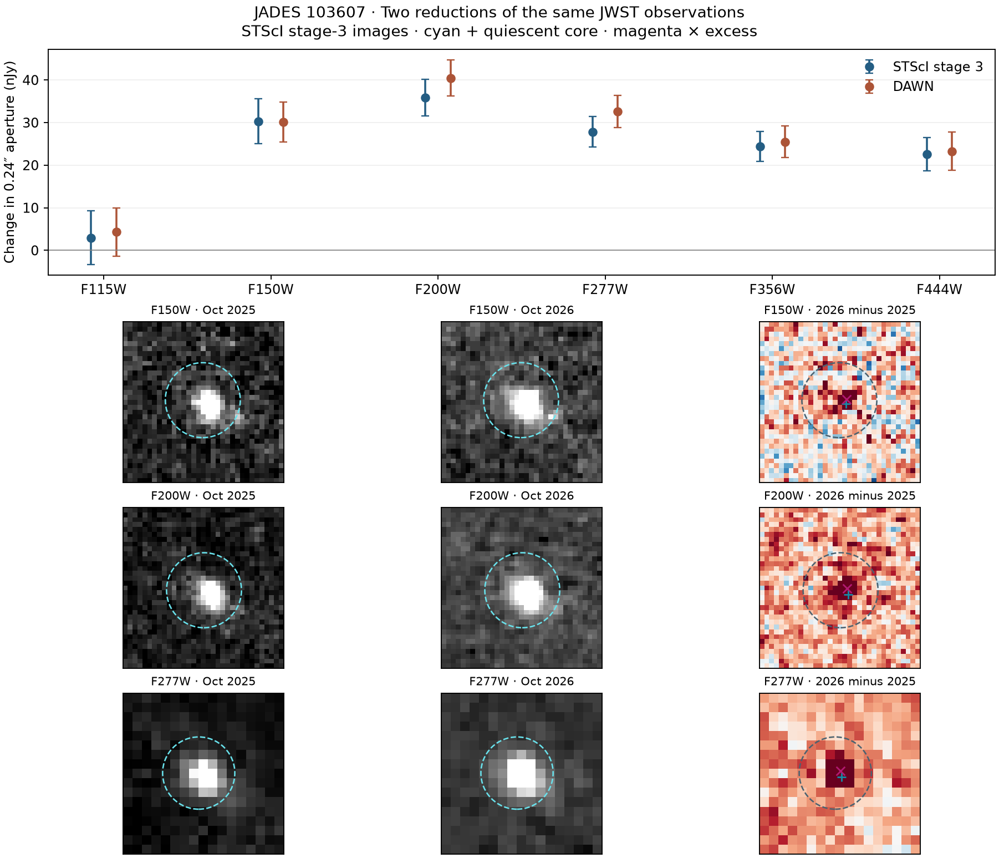

# JWST GOODS-S transient search in NIRCam Module B

23 November 2026 · DAWN JWST Archive mosaics and MAST calibrated exposures

## Search

We compared the two public GOODS-S pointings from programmes 8060 and
12577, in October 2025 and October 2026. This search used the four
short-wavelength Module B detectors in F200W and the separate NRCBLONG
detector in F356W and F444W. Each association combines three
exposures. The science and inverse-variance images come from the same
DAWN release and tangent-plane grid.
[NIRCam detector layout](https://jwst-docs.stsci.edu/jwst-near-infrared-camera/nircam-instrumentation/nircam-detector-overview) ·
[Programme 8060](https://www.stsci.edu/jwst-program-info/program/?program=8060) ·
[Programme 12577](https://www.stsci.edu/jwst-program-info/program/?program=12577) ·
[Product receipts](../results/jwst_cross_detector/module_b_products.json).

The search fits a relative scale, background, two spatial derivatives
and a Laplacian before ranking signed aperture residuals against local
scatter. We pair same-sign F200W and F444W positions within 0.14″. The
aperture criteria require a change of at least 18% of the brighter
0.24″ aperture flux in both filters and a ranking score of at least 6
in one of the two. The three-filter shortlist additionally requires a
matching F356W residual and aperture change with the same sign.
[Search thresholds and coverage](../results/jwst_cross_detector/module_b_search.json).

| Pointing | Summed F200W–F444W overlap (arcmin²) | Ranked peaks | Cross-detector pairs | Two-filter aperture gate | Three-filter gate |
| --- | ---: | ---: | ---: | ---: | ---: |
| 001 | 3.849 | 1,809 | 163 | 1 | 1 |
| 002 | 3.796 | 1,951 | 205 | 5 | 1 |

The sum of the per-detector intersections is 7.645 arcmin². This is a
coverage sum across pointings. There are 342 positive and 26 negative
pairs before the aperture gate. Registration, PSF differences and source
blending can create coincident residuals. The local scores rank peaks
without calibrating a search-wide false-alarm rate.
[All ranked peaks](../results/jwst_cross_detector/module_b_peaks.csv) ·
[All matched positions](../results/jwst_cross_detector/module_b_matches.csv).

As a spatial control, we shifted all F200W locations by 3″, 6″ and 9″
in eight directions each, keeping the two long-wavelength lists fixed.
None of the 48 shifted pointing trials passed the three-filter gate.
This checks incidental positional alignments. Shared residuals
at the same sky position and the exact footprint boundary can affect
the actual search.
[Shifted controls](../results/jwst_cross_detector/module_b_coincidences.json).

## Forced measurements at the two positions

We centered all three filters at the respective F200W search position.
The quoted scatter comes from nearby apertures with the same geometry.
The values use an aperture radius of 0.24″ and a 0.30–0.48″ sky annulus.
The measurements include the persistent underlying source.

| Position (ICRS) | Filter | October 2025 (nJy) | October 2026 (nJy) |
| --- | --- | ---: | ---: |
| 53.188670°, −27.812539° | F200W | 66.9 ± 3.6 | 107.2 ± 3.8 |
| | F356W | 69.0 ± 3.4 | 92.2 ± 3.5 |
| | F444W | 59.7 ± 3.1 | 82.7 ± 4.1 |
| 53.147252°, −27.790612° | F200W | 47.7 ± 3.7 | 17.6 ± 4.1 |
| | F356W | 28.1 ± 3.3 | 7.7 ± 3.3 |
| | F444W | 24.8 ± 3.6 | 8.0 ± 3.8 |

The sign of each change persists across aperture radii of 0.12″,
0.18″ and 0.24″. Centroids of the brighter-minus-fainter pixels lie
within 0.035″ of the first position and 0.052″ of the second position.
These are image diagnostics and include local morphology and PSF
effects.

### Brightening at 53.188670°, −27.812539°

F200W measured 70.4 ± 2.7 nJy in October 2022, 69.0 ± 2.6 nJy in
October 2023, 66.9 ± 3.6 nJy in October 2025, and 66.3 ± 7.9 nJy in
February 2026. The October 2026 measurement rises to 107.2 ± 3.8 nJy.
The February observation used NRCA2 and the October search pair used
NRCB4. F356W also shows an excess in October 2026 relative to 2023
and 2025.

All three bright-epoch F200W and all three F444W frames show clean peak
pixels. The peak positions span 8.06 and 3.61 detector pixels,
respectively, compared with predicted sky tracks of 8.52 and 4.11 pixels.
The clean light centroids stay within 0.045″ of the search position
across the six registered native exposures. The observed changes support
real variability at a persistent source. The time of maximum light and
the physical origin remain open.
[Native exposure images](../figures/jwst_cross_detector/module_b_001_native.png) ·
[Observed light curve](../figures/jwst_cross_detector/module_b_001_lightcurve.png).

The brightening is 0.049″ from JADES source 103607, whose catalogue
photometric redshift is 2.47. The closest DAWN NIRSpec extraction is
1.559″ away at source 103483, a separate catalogue position. The JADES
transient tables and the full TNS snapshot below have no match at the
brightening position. The change is a candidate for previously
unreported variability in the public records searched. Discovery
priority beyond those records remains open.
[JADES catalogue](https://vizier.cfa.harvard.edu/viz-bin/VizieR-3?-source=V%2F159%2Fgssample) ·
[Position measurements](../results/jwst_cross_detector/module_b_spectra.json) ·
[Positional and native exposure checks](../results/jwst_cross_detector/module_b_vetting.json).

#### Three filters held out of the search

We measured F115W, F150W and F277W at the fixed F200W position using
14 additional science and weight mosaic pairs. The older and newer
visits are from October 2025 and October 2026 respectively. F150W and
F277W show a brightening at all three aperture radii. F115W has a compact
positive residual, but the signal declines as the aperture expands.
The F115W measurement in the 0.24″ aperture is consistent with zero.

| Filter | 2025 aperture (nJy) | 2026 aperture (nJy) | Difference-image aperture (nJy) | Nearby-source median flux ratio |
| --- | ---: | ---: | ---: | ---: |
| F115W | 52.7 ± 5.0 | 58.0 ± 4.9 | +4.3 ± 5.7 | 1.001 |
| F150W | 71.4 ± 4.3 | 101.4 ± 4.2 | +30.1 ± 4.6 | 0.999 |
| F200W | 66.9 ± 3.6 | 107.2 ± 3.8 | +40.5 ± 4.3 | 1.005 |
| F277W | 59.8 ± 3.1 | 92.2 ± 3.7 | +32.6 ± 3.8 | 1.007 |
| F356W | 69.0 ± 3.4 | 92.2 ± 3.5 | +25.5 ± 3.8 | 1.007 |
| F444W | 59.7 ± 3.1 | 82.7 ± 4.1 | +23.3 ± 4.5 | 1.008 |

The table uses a 0.24″ aperture radius. Each image and difference image
has its own local sky annulus estimate and nearby-aperture scatter.
The difference values therefore need not equal the subtraction of the
two individual entries. We checked the relative photometric scale with
9–20 nearby sources per filter. Their median newer-to-older ratios differ
from unity by less than 0.9%. Applying those ratios changes each
difference aperture by less than 0.5 nJy. The measured F150W and F277W
brightening is also above the 2022 and 2023 baselines and above an
independent February 2026 GO 5324 visit on Module A. The October 2026
measurements all share the GO 12577 visit. The images have no
point-spread-function matching or total-flux correction. The
aperture-dependent F115W signal leaves a spectral break unverified.
[Six-filter signed photometry and product checksums](../results/jwst_cross_detector/module_b_001_six_filter_change.json).

#### Position of the extra light

F150W, F200W and F277W each have 2022, 2023 and 2025 baseline images.
For each pairing with October 2026, we use 16–20 bright local sources
to estimate a relative translation and the difference in Gaussian core
width. The Gaussian convolution approximates an epoch-dependent
change in core width. We then fit the quiescent-light and residual
centroids separately within radii of 0.18–0.23″. All nine comparisons
place the extra light northwest of the quiescent image centroid.

| Filter | West offset (mas) | North offset (mas) | Projected separation (mas) |
| --- | ---: | ---: | ---: |
| F150W | 26–28 | 13–26 | 30–38 |
| F200W | 27–33 | 20–27 | 35–41 |
| F277W | 30–35 | 17–30 | 36–43 |

Ranges include the fits repeated after an additional common Gaussian
smoothing of 0.030″ standard deviation. The leave-one-out alignment
control yields 68th-percentile positional residuals of 3–6 mas.
Recovery of synthetic Gaussian sources injected into observed
difference-image patches gives 95th-percentile radial errors of 2–9 mas.
Those trials measure position recovery under local noise. We also
subtracted successive pairs of 2022, 2023 and 2025 images at the actual
galaxy position. The 0.24″ difference fluxes span −3.8 to +0.7 nJy
in these six quiescent comparisons. Inserting a Gaussian brightening
at the quiescent light centroid, with peak and width varied by
±20%, gives apparent offsets of at most 6.2 mas across 54 injections.
The measured northwest displacement therefore exceeds the errors
found in both synthetic tests. The fitted quiescent centroid traces
light, and the position of the galaxy's dynamical nucleus is unknown.
The repeated fits use the same bright visit, and chromatic and spatial
PSF effects remain unmodelled.
[FITS receipts, source controls, and positional measurements](../results/jwst_cross_detector/module_b_001_excess_position.json).

#### Independent STScI reduction

The official STScI stage-3 mosaics independently reproduce the
five-filter brightening and the northwest displacement. We measured
the published images for both October visits in all six bands. The
FITS headers report pipeline 3.0.0 with CRDS context
`jwst_1584.pmap`. We read the necessary science and weight stripes
from the twelve public FITS files. Each downloaded range has its own
SHA-256 checksum and upstream object ETag. Sampled header and
image-stripe bytes also match the separate MAST download endpoint
for all twelve products.

| Band | STScI matched difference, 0.24″ aperture (nJy) | West, north offset (mas) |
| --- | ---: | ---: |
| F115W | +3.0 ± 6.3 | — |
| F150W | +30.3 ± 5.3 | 25.6, 12.7 |
| F200W | +35.9 ± 4.3 | 28.2, 25.0 |
| F277W | +27.8 ± 3.6 | 32.9, 27.7 |
| F356W | +24.4 ± 3.5 | — |
| F444W | +22.6 ± 3.9 | — |

The three STScI position vectors lie within 4 mas of the corresponding
DAWN vectors for the same visits. The listed flux changes use local
registration and core-width matching on the STScI images. The
two reductions share the underlying exposures and the positional
fitting method. The comparison tests reduction sensitivity, so
the flux errors and position fits should be treated as correlated.
[STScI pipeline stages](https://jwst-docs.stsci.edu/jwst-science-calibration-pipeline/stages-of-jwst-data-processing) ·
[MAST product and measurement receipts](../results/jwst_cross_detector/module_b_001_mast_comparison.json).

#### Photometry on the detector grid

We measured 36 calibrated native images, comprising three dithers
per visit in each of six filters. All report JWST pipeline 3.0.0
and CRDS context `jwst_1584.pmap`. Old-epoch DAWN references anchor
the local astrometric translations. We split the aperture boundary
pixels into an 8×8 subpixel grid for the integration weights and
leave the science image pixels on their original detector grid.
Relative gains use the largest reference aperture with at least
five matched field sources in each exposure. The fallback is the
archive pipeline's flux calibration. We retain the pipeline-calibrated
measurements for comparison. A visit median requires at least two
usable candidate exposures. Its comparison scatter comes from the
same sky apertures in both visits.

The aperture analysis retains calibrated pixels with either zero
flags or only `JUMP_DET`. Ramp fitting estimates a slope from
valid readout segments around a jump. We require 95% usable aperture
area and an unmasked central 0.07″. We retain missing measurements
when these gates fail. A separate check fits the source core on
pixels with zero data-quality flags and repeats the fit after
discarding each exposure's brightest usable pixel.
[JWST ramp fitting](https://jwst-docs.stsci.edu/jwst-science-calibration-pipeline/stages-of-jwst-data-processing/calwebb_detector1).

| Filter | Change in 0.18″ aperture (nJy) | Change in 0.24″ aperture (nJy) |
| --- | ---: | ---: |
| F115W | +10.3 ± 5.3 | +4.3 ± 7.1 |
| F150W | +28.2 ± 3.9 | +26.9 ± 5.7 |
| F200W | +30.6 ± 3.7 | +32.8 ± 5.5 |
| F277W | +25.7 ± 2.5 | — |
| F356W | +19.3 ± 2.8 | +21.2 ± 4.0 |
| F444W | +17.5 ± 3.0 | — |

Every eligible 0.18″ dither pair shows an increase in the five
filters from F150W to F444W. The pairs reuse exposures. F277W
and F444W each have only one usable older exposure at 0.24″.
The F356W and F444W measurements use the pipeline's flux scale
because the reference apertures did not have enough usable sources
in every exposure. F115W again has a weak, aperture-dependent change.

In F150W, F200W and F277W, each of the three 2026 exposures has a
higher fitted core amplitude than every 2025 exposure when using
only zero-flag pixels. The ordering holds when dropping the
brightest pixel in every fit and varying the assumed Gaussian
width by ±15%. The direct measurements show the brightening
before mosaic resampling. They use the same visits as the two
image reductions.
[Native FITS receipts, signed photometry and core fits](../results/jwst_cross_detector/module_b_001_native_epoch_flux.json).

#### Earlier records of variability and active nuclei

The current public GO 8060 and 12577 APT files contain four identical
embedded input catalogues, verified by their CSV hashes. The three
science planning catalogues include JADES 103607 just 0.052″ from the
brightening. It is a catalogue source with ordinary weight 3 and no
assigned configuration in the corresponding plans. The two labelled
science catalogues list class `JADES` at this position, and neither
has a row labelled `trans` within 1″. The same audit finds two
previously recognized events at their respective coordinates.
[GO 8060 public APT](https://www.stsci.edu/jwst-program-info/download/jwst/apt/8060/) ·
[GO 12577 public APT](https://www.stsci.edu/jwst-program-info/download/jwst/apt/12577/) ·
[Coordinate matches and configuration assignments](../results/jwst_cross_detector/goods_s_prior_records.json).

The brightening is over 29″ from the nearest entry in each of the
three historical HST variability catalogues examined. It lies 29.70″
from the nearest SMILES MIRI AGN catalogue entry and 13.05″ from the
nearest 7 Ms Chandra entry. These are catalogue checks with different
selection functions and observing epochs. They leave an active nucleus,
a supernova and other physical explanations open.
[Villforth et al.](https://vizier.idia.ac.za/viz-bin/VizieR-3?-source=J%2FApJ%2F723%2F737) ·
[Sarajedini et al.](https://vizier.idia.ac.za/viz-bin/VizieR-3?-source=J%2FApJ%2F731%2F97) ·
[Pouliasis et al.](https://doi.org/10.1093/mnras/stz1483) ·
[Lyu et al.](https://arxiv.org/abs/2310.12330) ·
[Luo et al.](https://vizier.cfa.harvard.edu/viz-bin/VizieR-3?-source=J%2FApJS%2F228%2F2).

The SIMBAD cone contains 31 entries within 10″. Two are within 1″
and have redshift values. The original tables show that both values
come from photometry. ZFOURGE CDFS 14409 is 0.399″ away and its
redshift probability distribution peaks at 2.4858. The linked
HDUV/3D-HST source GOODS-S 21067 is 0.222″ from the brightening and
its photometric redshift peaks at 2.263. Both spectroscopic fields
are missing. The nearest of 2,221 MUSE HUDF DR2 entries is 34.65″
away. These positions and redshift estimates are kept separate
from the JADES detection and leave the host's spectroscopic
redshift unmeasured.
[ZFOURGE catalogue](https://doi.org/10.3847/0004-637X/830/1/51) ·
[HDUV catalogue](https://cdsarc.cds.unistra.fr/viz-bin/ReadMe/J/ApJS/237/12) ·
[ESO MUSE HUDF DR2](https://www.eso.org/qi/catalog/show/409) ·
[Redshift provenance receipts](../results/jwst_cross_detector/module_b_001_redshift_context.json).

#### Additional visits before the brightening

The DAWN native-exposure footprints show two more visits to this
position before February 2026. The same signed 0.24″ aperture
measurements from both visits are below the October 2026 values.
This extends the quiescent measurements to NRCA1 and NRCA3.

| Visit | F150W (nJy) | F200W (nJy) | F277W (nJy) | F356W (nJy) |
| --- | ---: | ---: | ---: | ---: |
| 18 Nov 2025 · GO 8060 | 65.0 ± 4.8 | 67.3 ± 3.2 | 67.4 ± 3.8 | 69.3 ± 3.2 |
| 8–9 Dec 2025 · GO 5324 | 76.1 ± 8.9 | 73.8 ± 8.6 | 61.5 ± 8.8 | 60.8 ± 6.8 |
| 9–10 Oct 2026 · GO 12577 | 101.4 ± 4.2 | 107.2 ± 3.8 | 92.2 ± 3.7 | 92.2 ± 3.5 |

At the 23 November 2026 check, the DAWN footprint service had no later
covering exposure than the October 2026 visit. The MAST programme query
returned six untimed entries at calibration level −1 for each of the
two planned 24 November visits. The position falls inside all six
planned field polygons for visit 004 but outside those for visit 003.
Exact coverage requires the observed detector footprints and usable
pixels. The next light-curve point remains unmeasured.
[DAWN exposure search](https://dawn-cph.github.io/dja/general/api_summary/#exposure-metadata) ·
[STScI visit schedule](https://www.stsci.edu/jwst-program-info/visits/?program=12577) ·
[Footprint checks and epoch photometry](../results/jwst_cross_detector/module_b_001_followup_coverage.json).

After the scheduled window on 24 November, the public MAST query
still contained only untimed planning rows for visits 003 and 004.
The two public S3 prefixes for visit 004 had zero objects and DAWN
had no covering exposures after October. The public TNS snapshot
dated 24 November contains 213,742 entries, with zero within 5″
of JADES 103607's brightening. The closest remains AT 2022aewg,
33.75″ away. This establishes the archive and public registry
status at the time of the check.
[24 November archive and registry receipts](../results/jwst_cross_detector/module_b_001_release_20261124.json).

### Fading at 53.147252°, −27.790612°

This position measured 8–11 nJy in F200W from 2022 through January 2024.
It reached 47.7 ± 3.7 nJy in October 2025 and remained bright in an
independent GO 7336 visit on 18 October 2025 at 42.7 ± 3.1 nJy. F200W
then measured 43.4 ± 3.4 nJy in November, 38.1 ± 8.3 nJy in December,
and 16.8 ± 6.8 nJy in February 2026. The sequence includes both modules
and three short-wavelength detectors. An independent GO 4549 F356W
image on 30 September 2025 has 37.3 ± 7.4 nJy in the aperture.

The bright-epoch F200W peak is unflagged and follows the dither in all
three native frames. The first F444W brightest pixel carries a jump
flag. The other two exposures have unflagged peaks, and the centroid
of the cleaned light remains within 0.061″ of the search position in
all six frames. The signed aperture results preserve any measurements
affected by missing data as null.
[Native exposure images](../figures/jwst_cross_detector/module_b_002_native.png) ·
[Observed image subtraction](../figures/jwst_cross_detector/module_b_002_mosaics.png) ·
[Photometry and native product receipts](../results/jwst_cross_detector/module_b_vetting.json).

The fading position is 0.015″ from JADES source 117875. The DAWN JWST
Archive identifies it as GO 8060 NIRSpec target 2510132, 0.025″ from
the search position. It has two PRISM spectra, taken on 28 December
2025 and 13 January 2026. The December grade-2 inspection reports a
redshift of 2.1433 and suggests a Type II supernova. The January
grade-3 inspection reports 2.1411 and labels the source a transient.
This establishes earlier recognition of the fading event. The
photometry independently recovers it. The public APT catalogues also
label source 2510132 `trans` and assign it as a primary target in
three saved plans.
[DAWN NIRSpec release](https://dawn-cph.github.io/dja/spectroscopy/nirspec/) ·
[Prior public spectra and catalogue annotations](../results/jwst_cross_detector/module_b_prior_prism.json).

The 17–18 October 2025 GO 7336 archive search adds seven F277W GRISMR
and four GRISMC exposures over the position. Among their first- and
second-order catalogue extractions, the nearest is 7.96″ from the
transient. This test checks extracted coordinates. An exposure-level
sensitivity or trace-overlap model would require a separate reduction.
[GO 7336 programme](https://www.stsci.edu/jwst/science-execution/approved-programs/general-observers/cycle-4-go) ·
[Slitless extraction inventory](../results/jwst_cross_detector/module_b_spectra.json).

## Public transient snapshot

We checked all **213,716** objects in the public Transient Name Server
snapshot dated 23 November 2026 at 00:00 UTC. The 5″ search found no
entries at either Module B lead or at the original fading GOODS-S event.
The respective nearest entries lie 33.75″, 9.87″, and 22.74″ away. The
check establishes the public registry result on that date. GO 8060
observing plans independently establish prior recognition of both
fading events, including source 2510038 at the original position.
[TNS public archive announcement](https://www.wis-tns.org/astronotes/astronote/2026-315) ·
[Catalogue match receipts](../results/jwst_cross_detector/module_b_vetting.json).
