# JWST GOODS-S transient search in NIRCam Module B

**Biswajit Jana** · Independent research

Updated 26 November 2026 · DAWN JWST Archive mosaics and MAST calibrated exposures

## A rise and fade at JADES 103607

A compact near-infrared excess near JADES 103607 at
**RA 53.18866983°, Dec −27.81253940° (ICRS)** was bright on
9–10 October 2026 and had largely faded by 24 November. The October
excess is seen in five filters, in the individual NIRCam exposures,
and in two reductions. The November visit used a different NIRCam module, and the decline
appears on the individual calibrated detector frames in all four
reobserved filters. The positive October residual and the component
that subsequently faded agree in position to 9–21 milliarcseconds
in three filters. No earlier report of the October 2026 transient
was found in the public records checked through 26 November.
JADES 103607 was already catalogued. The event's physical cause and
secure host association remain open.
[November mosaics and FITS receipts](../results/jwst_cross_detector/module_b_001_november_photometry.json) ·
[Native November measurements](../results/jwst_cross_detector/module_b_001_native_november_fade.json) ·
[26 November priority check](../results/jwst_cross_detector/module_b_001_priority_20261126.json).

## Search

We compared the two public GOODS-S pointings from programmes 8060 and
12577, in October 2025 and October 2026. This search used the four
short-wavelength Module B detectors in F200W and the separate NRCBLONG
detector in F356W and F444W. Each association combines three
exposures. The science and inverse-variance images come from the same
DAWN release and tangent-plane grid.
[NIRCam detector layout](https://jwst-docs.stsci.edu/jwst-near-infrared-camera/nircam-instrumentation/nircam-detector-overview) ·
[Programme 8060](https://www.stsci.edu/jwst-program-info/program/?program=8060) ·
[Programme 12577](https://www.stsci.edu/jwst-program-info/program/?program=12577) ·
[Product receipts](../results/jwst_cross_detector/module_b_products.json).

The search fits a relative scale, background, two spatial derivatives
and a Laplacian before ranking signed aperture residuals against local
scatter. We pair same-sign F200W and F444W positions within 0.14″. The
aperture criteria require a change of at least 18% of the brighter
0.24″ aperture flux in both filters and a ranking score of at least 6
in one of the two. The three-filter shortlist additionally requires a
matching F356W residual and aperture change with the same sign.
[Search thresholds and coverage](../results/jwst_cross_detector/module_b_search.json).

| Pointing | Summed F200W–F444W overlap (arcmin²) | Ranked peaks | Cross-detector pairs | Two-filter aperture gate | Three-filter gate |
| --- | ---: | ---: | ---: | ---: | ---: |
| 001 | 3.849 | 1,809 | 163 | 1 | 1 |
| 002 | 3.796 | 1,951 | 205 | 5 | 1 |

The sum of the per-detector intersections is 7.645 arcmin². This is a
coverage sum across pointings. There are 342 positive and 26 negative
pairs before the aperture gate. Registration, PSF differences and source
blending can create coincident residuals. The local scores rank peaks
without calibrating a search-wide false-alarm rate.
[All ranked peaks](../results/jwst_cross_detector/module_b_peaks.csv) ·
[All matched positions](../results/jwst_cross_detector/module_b_matches.csv).

As a spatial control, we shifted all F200W locations by 3″, 6″ and 9″
in eight directions each, keeping the two long-wavelength lists fixed.
None of the 48 shifted pointing trials passed the three-filter gate.
This checks incidental positional alignments. Shared residuals
at the same sky position and the exact footprint boundary can affect
the actual search.
[Shifted controls](../results/jwst_cross_detector/module_b_coincidences.json).

## Forced measurements at the two positions

We centered all three filters at the respective F200W search position.
The quoted scatter comes from nearby apertures with the same geometry.
The values use an aperture radius of 0.24″ and a 0.30–0.48″ sky annulus.
The measurements include the persistent underlying source.

| Position (ICRS) | Filter | October 2025 (nJy) | October 2026 (nJy) |
| --- | --- | ---: | ---: |
| 53.188670°, −27.812539° | F200W | 66.9 ± 3.6 | 107.2 ± 3.8 |
| | F356W | 69.0 ± 3.4 | 92.2 ± 3.5 |
| | F444W | 59.7 ± 3.1 | 82.7 ± 4.1 |
| 53.147252°, −27.790612° | F200W | 47.7 ± 3.7 | 17.6 ± 4.1 |
| | F356W | 28.1 ± 3.3 | 7.7 ± 3.3 |
| | F444W | 24.8 ± 3.6 | 8.0 ± 3.8 |

The sign of each change persists across aperture radii of 0.12″,
0.18″ and 0.24″. Centroids of the brighter-minus-fainter pixels lie
within 0.035″ of the first position and 0.052″ of the second position.
These are image diagnostics and include local morphology and PSF
effects.

### Brightening at 53.188670°, −27.812539°

F200W measured 70.4 ± 2.7 nJy in October 2022, 69.0 ± 2.6 nJy in
October 2023, 66.9 ± 3.6 nJy in October 2025, and 66.3 ± 7.9 nJy in
February 2026. The October 2026 measurement rises to 107.2 ± 3.8 nJy.
The February observation used NRCA2 and the October search pair used
NRCB4. F356W also shows an excess in October 2026 relative to 2023
and 2025.

All three bright-epoch F200W and all three F444W frames show clean peak
pixels. The peak positions span 8.06 and 3.61 detector pixels,
respectively, compared with predicted sky tracks of 8.52 and 4.11 pixels.
The clean light centroids stay within 0.045″ of the search position
across the six registered native exposures. The observed changes support
real variability at a persistent source. The time of maximum light and
the physical origin remain open.
[Native exposure images](../figures/jwst_cross_detector/module_b_001_native.png) ·
[Observed light curve](../figures/jwst_cross_detector/module_b_001_lightcurve.png).

The brightening is 0.049″ from JADES source 103607, whose catalogue
photometric redshift is 2.47. The closest DAWN NIRSpec extraction is
1.559″ away at source 103483, a separate catalogue position. The JADES
transient tables and the full TNS snapshot below have no match at the
brightening position. The change is a candidate for previously
unreported variability in the public records searched. Discovery
priority beyond those records remains open.
[JADES catalogue](https://vizier.cfa.harvard.edu/viz-bin/VizieR-3?-source=V%2F159%2Fgssample) ·
[Position measurements](../results/jwst_cross_detector/module_b_spectra.json) ·
[Positional and native exposure checks](../results/jwst_cross_detector/module_b_vetting.json).

#### Three filters held out of the search

We measured F115W, F150W and F277W at the fixed F200W position using
14 additional science and weight mosaic pairs. The older and newer
visits are from October 2025 and October 2026 respectively. F150W and
F277W show a brightening at all three aperture radii. F115W has a compact
positive residual, but the signal declines as the aperture expands.
The F115W measurement in the 0.24″ aperture is consistent with zero.

| Filter | 2025 aperture (nJy) | 2026 aperture (nJy) | Difference-image aperture (nJy) | Nearby-source median flux ratio |
| --- | ---: | ---: | ---: | ---: |
| F115W | 52.7 ± 5.0 | 58.0 ± 4.9 | +4.3 ± 5.7 | 1.001 |
| F150W | 71.4 ± 4.3 | 101.4 ± 4.2 | +30.1 ± 4.6 | 0.999 |
| F200W | 66.9 ± 3.6 | 107.2 ± 3.8 | +40.5 ± 4.3 | 1.005 |
| F277W | 59.8 ± 3.1 | 92.2 ± 3.7 | +32.6 ± 3.8 | 1.007 |
| F356W | 69.0 ± 3.4 | 92.2 ± 3.5 | +25.5 ± 3.8 | 1.007 |
| F444W | 59.7 ± 3.1 | 82.7 ± 4.1 | +23.3 ± 4.5 | 1.008 |

The table uses a 0.24″ aperture radius. Each image and difference image
has its own local sky annulus estimate and nearby-aperture scatter.
The difference values therefore need not equal the subtraction of the
two individual entries. We checked the relative photometric scale with
9–20 nearby sources per filter. Their median newer-to-older ratios differ
from unity by less than 0.9%. Applying those ratios changes each
difference aperture by less than 0.5 nJy. The measured F150W and F277W
brightening is also above the 2022 and 2023 baselines and above an
independent February 2026 GO 5324 visit on Module A. The October 2026
measurements all share the GO 12577 visit. The images have no
point-spread-function matching or total-flux correction. The
aperture-dependent F115W signal leaves a spectral break unverified.
[Six-filter signed photometry and product checksums](../results/jwst_cross_detector/module_b_001_six_filter_change.json).

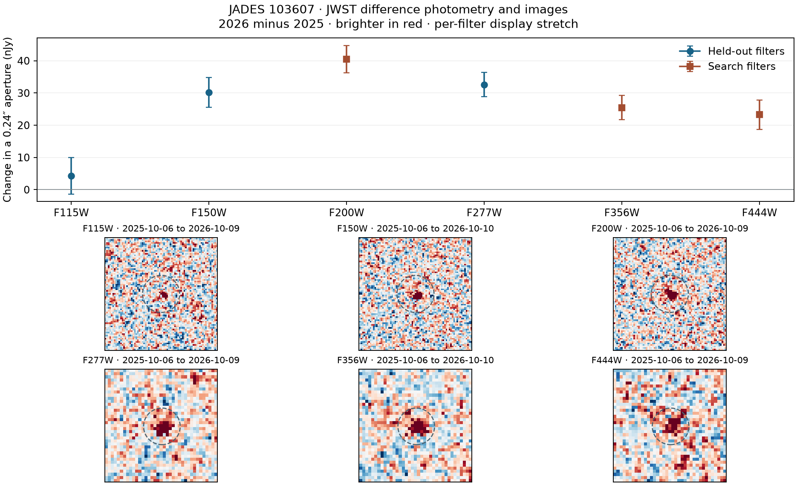

#### Position of the extra light

F150W, F200W and F277W each have 2022, 2023 and 2025 baseline images.
For each pairing with October 2026, we use 16–20 bright local sources
to estimate a relative translation and the difference in Gaussian core
width. The Gaussian convolution approximates an epoch-dependent
change in core width. We then fit the quiescent-light and residual
centroids separately within radii of 0.18–0.23″. All nine comparisons
place the extra light northwest of the quiescent image centroid.

| Filter | West offset (mas) | North offset (mas) | Projected separation (mas) |
| --- | ---: | ---: | ---: |
| F150W | 26–28 | 13–26 | 30–38 |
| F200W | 27–33 | 20–27 | 35–41 |
| F277W | 30–35 | 17–30 | 36–43 |

Ranges include the fits repeated after an additional common Gaussian
smoothing of 0.030″ standard deviation. The leave-one-out alignment
control yields 68th-percentile positional residuals of 3–6 mas.
Recovery of synthetic Gaussian sources injected into observed
difference-image patches gives 95th-percentile radial errors of 2–9 mas.
Those trials measure position recovery under local noise. We also
subtracted successive pairs of 2022, 2023 and 2025 images at the actual
galaxy position. The 0.24″ difference fluxes span −3.8 to +0.7 nJy
in these six quiescent comparisons. Inserting a Gaussian brightening
at the quiescent light centroid, with peak and width varied by
±20%, gives apparent offsets of at most 6.2 mas across 54 injections.
The measured northwest displacement therefore exceeds the errors
found in both synthetic tests. The fitted quiescent centroid traces
light, and the position of the galaxy's dynamical nucleus is unknown.
The repeated fits use the same bright visit, and chromatic and spatial
PSF effects remain unmodelled.
[FITS receipts, source controls, and positional measurements](../results/jwst_cross_detector/module_b_001_excess_position.json).

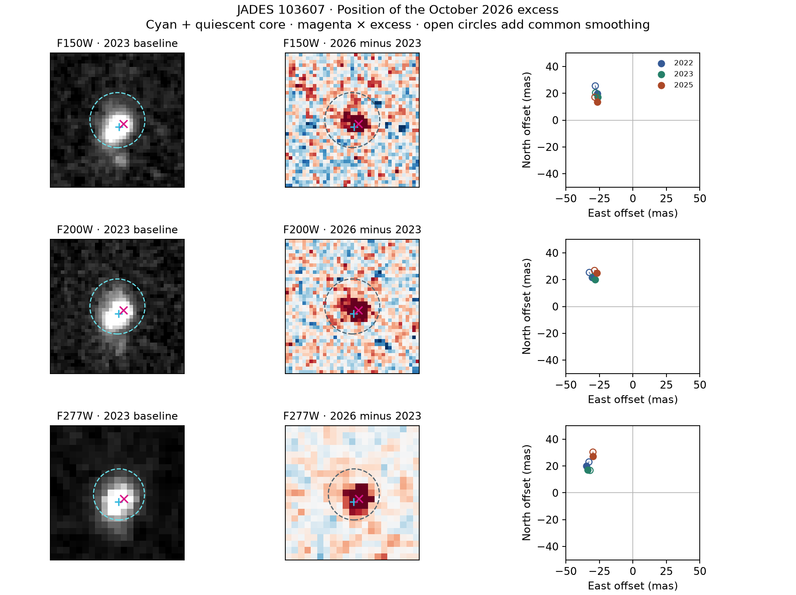

#### Independent STScI reduction

The official STScI stage-3 mosaics independently reproduce the
five-filter brightening and the northwest displacement. We measured
the published images for both October visits in all six bands. The
FITS headers report pipeline 3.0.0 with CRDS context
`jwst_1584.pmap`. We read the necessary science and weight stripes
from the twelve public FITS files. Each downloaded range has its own
SHA-256 checksum and upstream object ETag. Sampled header and
image-stripe bytes also match the separate MAST download endpoint
for all twelve products.

| Band | STScI matched difference, 0.24″ aperture (nJy) | West, north offset (mas) |
| --- | ---: | ---: |
| F115W | +3.0 ± 6.3 | — |
| F150W | +30.3 ± 5.3 | 25.6, 12.7 |
| F200W | +35.9 ± 4.3 | 28.2, 25.0 |
| F277W | +27.8 ± 3.6 | 32.9, 27.7 |
| F356W | +24.4 ± 3.5 | — |
| F444W | +22.6 ± 3.9 | — |

The three STScI position vectors lie within 4 mas of the corresponding
DAWN vectors for the same visits. The listed flux changes use local
registration and core-width matching on the STScI images. The
two reductions share the underlying exposures and the positional
fitting method. The comparison tests reduction sensitivity, so
the flux errors and position fits should be treated as correlated.
[STScI pipeline stages](https://jwst-docs.stsci.edu/jwst-science-calibration-pipeline/stages-of-jwst-data-processing) ·
[MAST product and measurement receipts](../results/jwst_cross_detector/module_b_001_mast_comparison.json).

#### Photometry on the detector grid

We measured 36 calibrated native images, comprising three dithers
per visit in each of six filters. All report JWST pipeline 3.0.0
and CRDS context `jwst_1584.pmap`. Old-epoch DAWN references anchor
the local astrometric translations. We split the aperture boundary
pixels into an 8×8 subpixel grid for the integration weights and
leave the science image pixels on their original detector grid.
Relative gains use the largest reference aperture with at least
five matched field sources in each exposure. The fallback is the
archive pipeline's flux calibration. We retain the pipeline-calibrated
measurements for comparison. A visit median requires at least two
usable candidate exposures. Its comparison scatter comes from the
same sky apertures in both visits.

The aperture analysis retains calibrated pixels with either zero
flags or only `JUMP_DET`. Ramp fitting estimates a slope from
valid readout segments around a jump. We require 95% usable aperture
area and an unmasked central 0.07″. We retain missing measurements
when these gates fail. A separate check fits the source core on
pixels with zero data-quality flags and repeats the fit after
discarding each exposure's brightest usable pixel.
[JWST ramp fitting](https://jwst-docs.stsci.edu/jwst-science-calibration-pipeline/stages-of-jwst-data-processing/calwebb_detector1).

| Filter | Change in 0.18″ aperture (nJy) | Change in 0.24″ aperture (nJy) |
| --- | ---: | ---: |
| F115W | +10.3 ± 5.3 | +4.3 ± 7.1 |
| F150W | +28.2 ± 3.9 | +26.9 ± 5.7 |
| F200W | +30.6 ± 3.7 | +32.8 ± 5.5 |
| F277W | +25.7 ± 2.5 | — |
| F356W | +19.3 ± 2.8 | +21.2 ± 4.0 |
| F444W | +17.5 ± 3.0 | — |

Every eligible 0.18″ dither pair shows an increase in the five
filters from F150W to F444W. The pairs reuse exposures. F277W
and F444W each have only one usable older exposure at 0.24″.
The F356W and F444W measurements use the pipeline's flux scale
because the reference apertures did not have enough usable sources
in every exposure. F115W again has a weak, aperture-dependent change.

In F150W, F200W and F277W, each of the three 2026 exposures has a
higher fitted core amplitude than every 2025 exposure when using
only zero-flag pixels. The ordering holds when dropping the
brightest pixel in every fit and varying the assumed Gaussian
width by ±15%. The direct measurements show the brightening
before mosaic resampling. They use the same visits as the two
image reductions.
[Native FITS receipts, signed photometry and core fits](../results/jwst_cross_detector/module_b_001_native_epoch_flux.json).

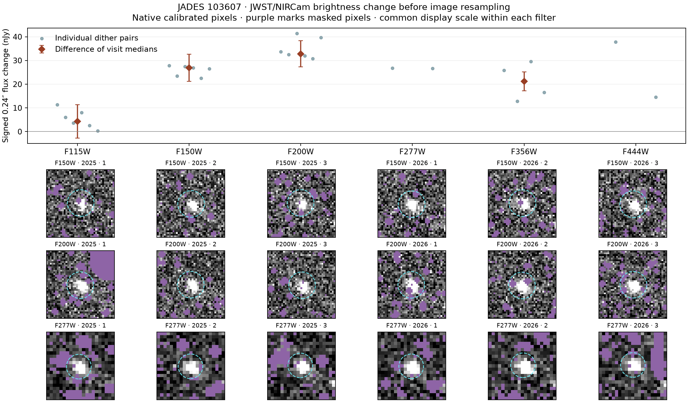

#### Earlier records of variability and active nuclei

The current public GO 8060 and 12577 APT files contain four identical
embedded input catalogues, verified by their CSV hashes. The three
science planning catalogues include JADES 103607 just 0.052″ from the
brightening. It is a catalogue source with ordinary weight 3 and no
assigned configuration in the corresponding plans. The two labelled
science catalogues list class `JADES` at this position, and neither
has a row labelled `trans` within 1″. The same audit finds two
previously recognized events at their respective coordinates.
[GO 8060 public APT](https://www.stsci.edu/jwst-program-info/download/jwst/apt/8060/) ·
[GO 12577 public APT](https://www.stsci.edu/jwst-program-info/download/jwst/apt/12577/) ·
[Coordinate matches and configuration assignments](../results/jwst_cross_detector/goods_s_prior_records.json).

The brightening is over 29″ from the nearest entry in each of the
three historical HST variability catalogues examined. It lies 29.70″
from the nearest SMILES MIRI AGN catalogue entry and 13.05″ from the
nearest 7 Ms Chandra entry. These are catalogue checks with different
selection functions and observing epochs. They leave an active nucleus,
a supernova and other physical explanations open.
[Villforth et al.](https://vizier.idia.ac.za/viz-bin/VizieR-3?-source=J%2FApJ%2F723%2F737) ·
[Sarajedini et al.](https://vizier.idia.ac.za/viz-bin/VizieR-3?-source=J%2FApJ%2F731%2F97) ·
[Pouliasis et al.](https://doi.org/10.1093/mnras/stz1483) ·
[Lyu et al.](https://arxiv.org/abs/2310.12330) ·
[Luo et al.](https://vizier.cfa.harvard.edu/viz-bin/VizieR-3?-source=J%2FApJS%2F228%2F2).

The SIMBAD cone contains 31 entries within 10″. Two are within 1″
and have redshift values. The original tables show that both values
come from photometry. ZFOURGE CDFS 14409 is 0.399″ away and its
redshift probability distribution peaks at 2.4858. The linked
HDUV/3D-HST source GOODS-S 21067 is 0.222″ from the brightening and
its photometric redshift peaks at 2.263. Both spectroscopic fields
are missing. The nearest of 2,221 MUSE HUDF DR2 entries is 34.65″
away. These positions and redshift estimates are kept separate
from the JADES detection and leave the host's spectroscopic
redshift unmeasured.
[ZFOURGE catalogue](https://doi.org/10.3847/0004-637X/830/1/51) ·
[HDUV catalogue](https://cdsarc.cds.unistra.fr/viz-bin/ReadMe/J/ApJS/237/12) ·
[ESO MUSE HUDF DR2](https://www.eso.org/qi/catalog/show/409) ·
[Redshift provenance receipts](../results/jwst_cross_detector/module_b_001_redshift_context.json).

We located 18 archival NIRCam GRISMR exposures whose direct-image
footprints contain the position. Eight are F444W observations from
FRESCO (GO 1895), and ten are F356W exposures from GTO 4549.
All precede the October 2026 brightening. No entry among the 1,800
first-order positions in the corresponding public STScI X1D products
lies within 0.20″. The nearest is 4.07″ away. The search concerns
catalogued extraction centers. The detector geometry and targeted
measurements are described below.
[FRESCO archive](https://archive.stsci.edu/hlsp/fresco) ·
[GO 4549 programme](https://www.stsci.edu/jwst-program-info/program/?program=4549) ·
[Slitless extraction receipts](../results/jwst_cross_detector/module_b_001_archived_grism.json).

#### Optical host spectroscopy

A MUSE-Wide DR1 pointing covers the sky position. Its archived
TDOSE spectrum for CANDELS 10658, 0.209″ from the brightening,
comes from October 2015 observations. The extraction precedes
the event and the seeing was about 1.3″. The 3D-HST master table
also records GOODS-S 21067, 0.221″ away, with best redshift
2.2459 from photometry and no usable grism redshift.
[3D-HST master catalogue](https://doi.org/10.3847/0067-0049/225/2/27) ·
[MUSE-Wide observing log](https://musewide.aip.de/dr1/candels-cdfs-26/quality_control/) ·
[Released CANDELS 10658 spectrum](https://doi.org/10.17876/musewide/dr.1/10658).

We fit signed model amplitudes for six ultraviolet line complexes
in the released spectrum. The fits use a local linear continuum,
a 3 Å observed FWHM for the screen, and the released uncertainties.
Expected wavelengths are converted from vacuum to air. None of
the 751 tested redshifts from 1.85 to 2.60 reaches both formal
S/N thresholds of 5 and 3.5 for two distinct complexes. The highest
single response is C III] at z = 1.918 with formal S/N 4.14.
At that redshift the second response is 0.70. Fixed fits at each of
the four catalogue photometric estimates give no line above S/N 2
for the nominal width. The survey's blind emission catalogue yielded
zero entries within 8″ of the transient position. These checks leave
the host redshift unresolved.
[MUSE-Wide extraction and calibration](https://doi.org/10.1051/0004-6361/201834656) ·
[Catalogue checks and signed fits](../results/jwst_cross_detector/module_b_001_optical_host.json).

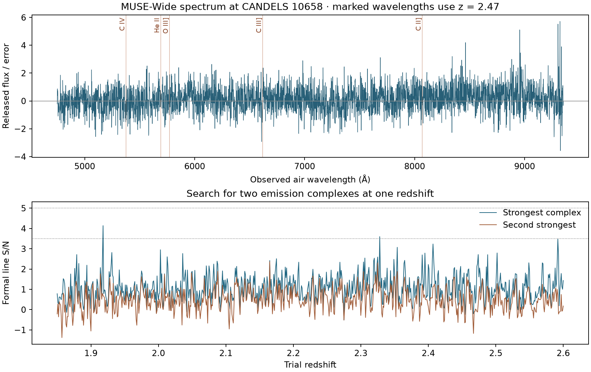

#### Additional visits before the brightening

The DAWN native-exposure footprints show two more visits to this
position before February 2026. The same signed 0.24″ aperture
measurements from both visits are below the October 2026 values.
This extends the quiescent measurements to NRCA1 and NRCA3.

| Visit | F150W (nJy) | F200W (nJy) | F277W (nJy) | F356W (nJy) |
| --- | ---: | ---: | ---: | ---: |
| 18 Nov 2025 · GO 8060 | 65.0 ± 4.8 | 67.3 ± 3.2 | 67.4 ± 3.8 | 69.3 ± 3.2 |
| 8–9 Dec 2025 · GO 5324 | 76.1 ± 8.9 | 73.8 ± 8.6 | 61.5 ± 8.8 | 60.8 ± 6.8 |
| 9–10 Oct 2026 · GO 12577 | 101.4 ± 4.2 | 107.2 ± 3.8 | 92.2 ± 3.7 | 92.2 ± 3.5 |

At the 23 November 2026 check, the DAWN footprint service had no later
covering exposure than the October 2026 visit. The MAST programme query
returned six untimed entries at calibration level −1 for each of the
two planned 24 November visits. The position falls inside all six
planned field polygons for visit 004 but outside those for visit 003.
Exact coverage requires the observed detector footprints and usable
pixels. At that time a new light-curve point could not yet be measured.
[DAWN exposure search](https://dawn-cph.github.io/dja/general/api_summary/#exposure-metadata) ·
[STScI visit schedule](https://www.stsci.edu/jwst-program-info/visits/?program=12577) ·
[Footprint checks and epoch photometry](../results/jwst_cross_detector/module_b_001_followup_coverage.json).

After the scheduled window on 24 November, the public MAST query
still contained only untimed planning rows for visits 003 and 004.
The two public S3 prefixes for visit 004 had zero objects and DAWN
had no covering exposures after October. The public TNS snapshot
dated 24 November contains 213,742 entries, with zero within 5″
of JADES 103607's brightening. The closest remains AT 2022aewg,
33.75″ away. This establishes the archive and public registry
status at the time of the check.
[24 November archive and registry receipts](../results/jwst_cross_detector/module_b_001_release_20261124.json).

#### The 24 November follow-up

MAST released four public stage-3 NIRCam mosaics from GO 12577
observation 004. The adjacent observation 003 stage-3 polygons exclude
the target position. The archived 004 visit is a separate exposure set,
with a telescope orientation about 65° from October. We used verified
FITS byte ranges, required positive pixel weight, and registered and
matched the point-spread functions using nearby sources. The 2025 and
2026 images were measured at the same position in each filter. The
October-to-November baseline is **45.83 days** in F200W and F277W and
**45.78 days** in F150W and F356W, using stage-3 exposure start times.
[STScI visit status](https://www.stsci.edu/jwst-program-info/visits/?program=12577) ·
[MAST and public cloud holdings](../results/jwst_cross_detector/module_b_001_release_20261125.json) ·
[Orientation and foreground measurements](../results/jwst_cross_detector/module_b_001_orientations_and_gaia.json).

| Filter | Oct 2026 − Oct 2025 (nJy) | Nov 2026 − Oct 2025 (nJy) | Nov 2026 − Oct 2026 (nJy) |
| --- | ---: | ---: | ---: |
| F150W | +30.3 ± 5.3 | +11.0 ± 5.3 | −18.3 ± 6.1 |
| F200W | +35.9 ± 4.3 | +1.3 ± 4.0 | −33.1 ± 4.2 |
| F277W | +27.8 ± 3.6 | +4.1 ± 3.8 | −21.7 ± 3.7 |
| F356W | +24.4 ± 3.5 | +1.0 ± 3.7 | −24.5 ± 3.7 |

Values use a 0.24″ radius. Errors are the local aperture MAD scaled
to a Gaussian-equivalent scatter. The estimates share images and
matching references. November is within 1.1 local scatter of the
October 2025 baseline in three filters. F150W retains a marginal
positive residual. In F200W the November baseline excess is 1.3 nJy
compared with 35.9 nJy in October, with a direct decline of 33.1 nJy
between the two visits. The observing cadence leaves the dates of the
onset and peak unresolved.

The fitted centers of the compact October excess and the fading light
are separated by 9 mas in F150W, 11 mas in F200W and 21 mas in F277W.
These are point estimates and the fits share the bright October
epoch. Agreement at that scale and persistence across October
dithers support a single variable component. The 60″ Gaia DR3 cone
returned three sources. The nearest is about 26″ away, both at the
catalogue epoch and after propagating the available proper motions.
The JPL two-pass small-body search returned no matches within the
0.05° by 0.05° coordinate box at the F200W and F150W October
midpoints, using Webb's Earth-centered Horizons ephemeris and a
predicted visual magnitude cutoff of 28.5. Objects fainter than
these optical catalogue limits remain outside the checks.
[Gaia DR3 catalogue](https://cdsarc.cds.unistra.fr/viz-bin/cat/I/355) ·
[JPL Small-Body Identification API](https://ssd-api.jpl.nasa.gov/doc/sb_ident.html) ·
[Relative fits and signed photometry](../results/jwst_cross_detector/module_b_001_november_photometry.json).

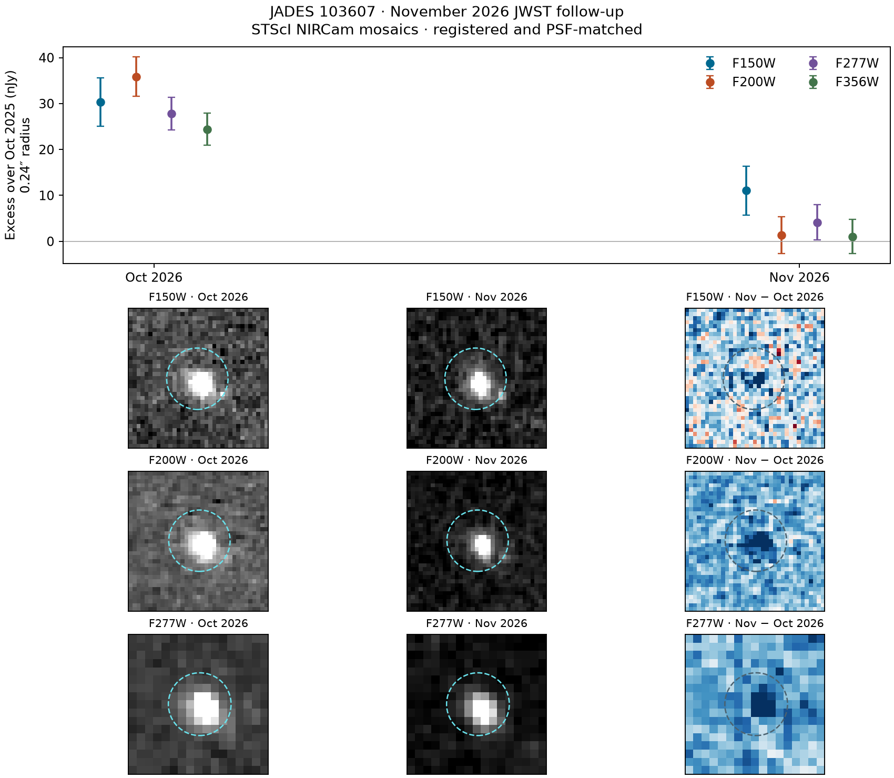

The refreshed public TNS snapshot dated 25 November at 00:00 UTC contains 213,805
entries, with none within 5″. The public live cone search returned HTTP 403. GO 8060 and GO 12577 public APT downloads
still identify JADES 103607 as a galaxy entry and show no `trans` label
within 1″. The earlier JADES transient sample and the variability
catalogues above were also checked. Searches for the JADES ID and
event coordinates yielded no earlier public report of the October
2026 event. These observations support a previously unreported
photometric event in the records searched. They leave publication
priority beyond those records, the precise host association and the
event type open.
[25 November TNS and APT receipts](../results/jwst_cross_detector/module_b_001_release_20261125.json) ·
[Earlier JADES transient sample](https://arxiv.org/html/2406.05060v4).

#### Joint three-epoch uncertainty analysis

A preprint cross-check brings all three STScI epochs to the October 2025
grid and an approximately common point-spread function in each filter.
It uses 168–174 paired control apertures per filter to estimate local
scatter on the signed contrasts and retain their shared-epoch
covariance. The jointly registered F200W excess is +37.8 ± 3.8 nJy
in October and +1.8 ± 4.1 nJy in November relative to October 2025.
The F200W decline is 36.0 ± 3.7 nJy. The signed rise and fade persist
across six aperture and smoothing choices in each of the four filters.
The table above uses pair-specific rather than joint matching.
[Joint measurements and control samples](../results/jwst_cross_detector/module_b_001_joint_epoch_errors.json) ·
[Matched F200W images](../figures/jwst_cross_detector/module_b_001_preprint_f200w.png) ·
[Signed flux differences and scatter](../figures/jwst_cross_detector/module_b_001_joint_epoch_errors.png).

#### Native-pixel check of the fade

We measured 12 calibrated November detector exposures and the 24
corresponding October exposures, using the released FITS files and
the same reference positions and local sky apertures in each visit.
The October visits place the target on NRCB4 and NRCBLONG. In
November it falls on NRCA1 and NRCALONG. Photometry integrates the
original detector pixels at a fixed sky position. We used local
flux-scale references in F150W and F200W and the pipeline calibration
in both long-wavelength bands. The uncertainties below are robust
scatters of differences in matched sky apertures.
[Archive products and native-pixel fits](../results/jwst_cross_detector/module_b_001_native_november_fade.json).

| Filter | Nov 2026 − Oct 2026, 0.24″ (nJy) | Pairs with a decline / usable pairs |
| --- | ---: | ---: |
| F150W | −17.4 ± 6.4 | 6 / 6 |
| F200W | −29.2 ± 5.6 | 9 / 9 |
| F277W | −19.5 ± 5.0 | 4 / 4 |
| F356W | −20.7 ± 4.5 | 4 / 4 |

The decline has the same sign at all three tested aperture radii
in all four bands. A separate fit to the zero-flag detector pixels
in F150W, F200W and F277W puts every November core amplitude below
every October core amplitude. This ordering persists after excluding
the brightest pixel from each fit, and at all three tested fixed
core widths. The differences between pairs share exposures.
The stage-3 and native-pixel analyses share the November observation.
The photometry uses finite apertures and leaves cross-detector
point-spread-function differences as a source of calibration uncertainty.
In the 2025 F277W data, too few dither apertures passed the mask to
measure a baseline difference at 0.24″.

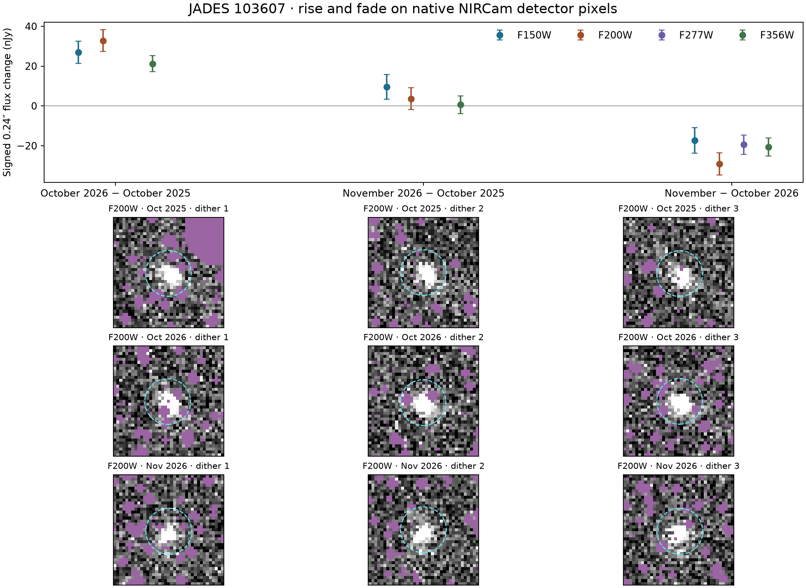

#### Updated publication and registry search

The public TNS snapshot dated 26 November 2026 at 00:00 UTC
contains 213,849 entries. None lies within 5″ of the transient.
We also joined all 83 published JADES Transient Survey II names to
unique TNS positions. The nearest is AT 2022aewg at 33.75″.
The source ID, coordinates, date, and JWST programme searches found
no earlier public report of this October 2026 event. The published
survey covers earlier observations and supplies a positional
cross-check. The registry timestamp and search terms delimit the
priority assessment.
[JADES Transient Survey II](https://arxiv.org/abs/2607.12018) ·
[Transient Name Server](https://www.wis-tns.org/) ·
[Search terms, catalogue joins and receipts](../results/jwst_cross_detector/module_b_001_priority_20261126.json).

#### Additional host spectra and planned coverage

The 26 November position search found no published spectroscopic
entry within 1 arcsec of the transient in these five additional
catalogue checks. DAWN found four extractions of the same nearby
galaxy, JADES 103483. Its spectrum belongs to a source 1.559 arcsec
away. The closest ACES entry has no measured redshift.

| Catalogue | Rows checked | Nearest entry (arcsec) |
| --- | ---: | ---: |
| ACES, 60 arcsec cone | 38 | 4.195 |
| VUDS DR1, 60 arcsec cone | 9 | 9.454 |
| VANDELS DR4, 60 arcsec cone | 6 | 44.066 |
| SMILES DR2, full release | 166 | 38.196 |
| DAWN NIRSpec, local extraction query | 4 | 1.559 |

[ACES](https://doi.org/10.1111/j.1365-2966.2012.21524.x) ·
[VUDS DR1](https://doi.org/10.1051/0004-6361/201527963) ·
[VANDELS DR4](https://doi.org/10.1051/0004-6361/202040059) ·
[SMILES DR2](https://arxiv.org/abs/2508.12599) ·
[DAWN JWST Archive](https://dawn-cph.github.io/dja/) ·
[Catalogue and observing-plan checks](../results/jwst_cross_detector/module_b_001_followup_20261126.json).

The GO 12577 archive and DAWN inventory showed no later covering
exposure than the 24 November visit already measured above. The
current GO 12577 schedule lists 3 to 5 January 2027 for observations
005 and 006. The transient lies outside all twelve corresponding MAST
planning polygons. The nearest edges of the two pointings are 15.48
and 1.31 arcsec away, respectively. Observation 010 has a nominal
NIRSpec footprint encompassing the coordinates, with an inactive
status and no target slit in the checked planning file. These are
public planning snapshots and can change.
[STScI visit status](https://www.stsci.edu/jwst-program-info/visits/?program=12577) ·
[Previous slit-assignment check](../results/jwst_cross_detector/module_b_001_priority_20261126.json).

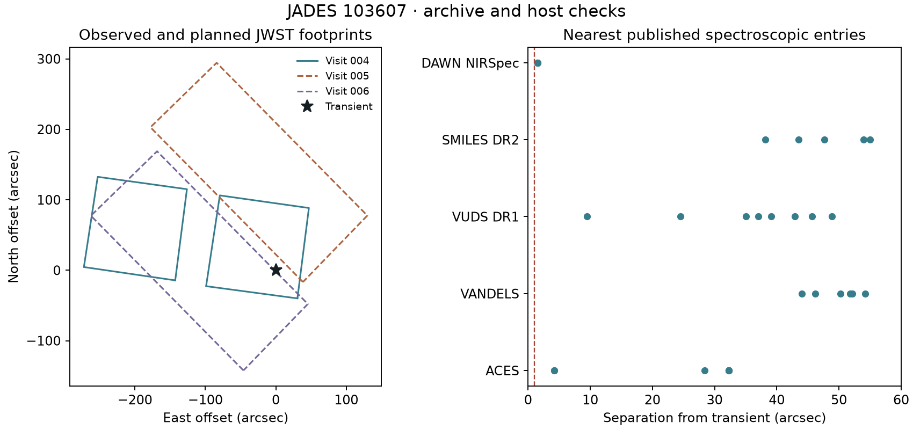

We propagated the transient and galaxy coordinates through the CRDS
distortion and dispersion models for 18 archived NIRCam grism exposures.
The generated dispersion agreed with the archived pipeline extractions
in the wavelength-coordinate check, whose per-exposure 95th-percentile
absolute residual was at most 0.00000023 microns. This comparison checks
the reconstruction of the same calibration model. At the catalogue
photometric estimate of z = 2.47, the 3.308 micron [S III] line, He I
at 3.759 microns and Paschen gamma at 3.797 microns fall on the science
detector in eight GTO 4549 F356W exposures. Paschen beta at 4.449 microns
falls on the science detector in eight FRESCO F444W exposures. All
exposures predate the event.
[GTO 4549](https://www.stsci.edu/jwst-program-info/program/?program=4549) ·
[FRESCO survey](https://doi.org/10.1093/mnras/stad2411) ·
[Per-exposure geometry and calibration receipts](../results/jwst_cross_detector/module_b_001_grism_host_coverage.json).

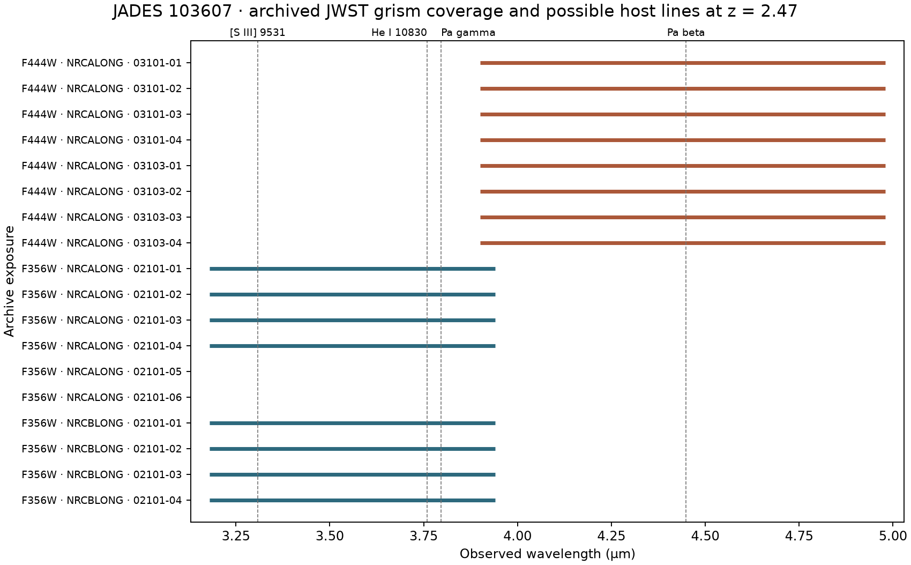

#### Line measurements on the archived detector pixels

We measured 14 line and redshift combinations at the JADES 103607
catalogue position, using 16 pre-event grism exposures with trace
coverage. Each combined result uses five to eight exposures split
between two visits for F356W or two exposure sequences for F444W.
We divided each detector count-rate cutout by its pipeline flat,
masked flagged pixels except those carrying only the jump-detection
flag, and removed a local sky and continuum estimate. The uncertainty
shown is the scaled median absolute deviation of eight apertures
offset across the trace. It measures local scatter in instrumental
count rate.
[JWST ramp fitting](https://jwst-pipeline.readthedocs.io/en/1.20.2/jwst/ramp_fitting/description.html) ·
[Detector ranges, individual apertures and split measurements](../results/jwst_cross_detector/module_b_001_grism_host_lines.json).

| Line at trial z = 2.47 | Observed wavelength (microns) | Signed rate excess (mDN/s) | Exposures used |
| --- | ---: | ---: | ---: |
| [S III] 9531 | 3.3080 | +15.7 ± 42.1 | 6 |
| He I 10830 | 3.7592 | +8.5 ± 17.4 | 7 |
| Paschen gamma | 3.7966 | +0.2 ± 41.1 | 5 |
| Paschen beta | 4.4491 | −76.7 ± 35.9 | 8 |

No positive residual exceeds the local control scatter in the
combined apertures at any of the four trial redshifts. At the
Paschen beta wavelength for z = 2.47, the stacked detector image
shows a bright band parallel to the expected trace, displaced by
several cross-dispersion pixels. The line measurement is affected
by the structured local background. The Paschen gamma aperture at
z = 2.2459 also has a large negative residual. Neither supports
a secure host redshift. These tests cover fixed emission-line
hypotheses. They leave flux calibration, source overlap and
completeness to a contamination model and injection-recovery
analysis.

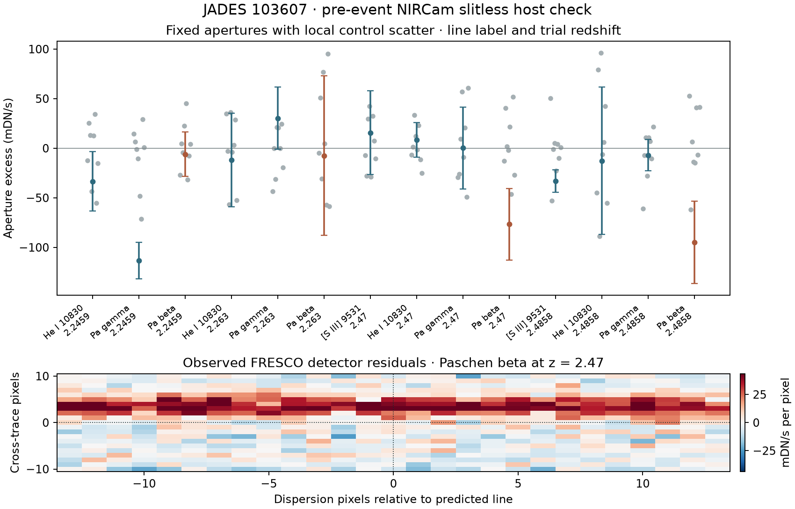

#### Historical cross-survey comparison

The aim is to test for activity at the transient position in observations
from years or decades before the JWST event. This requires three checks.

- Establish which images actually cover the position and record dates,
  bandpasses and local depth. A catalogue can miss a variable source
  that is faint in its combined image.
- Compare separate epochs within each band with matched control
  apertures and check the images for blends. Measure how much of a
  repeat flare the historical data could recover before using a
  nondetection to limit recurrence.
- Use contemporaneous observations for independent confirmation of the
  2026 event. Use older surveys to test recurrence and persistent
  emission, and require additional evidence to identify the source class.

**HST F850LP, August 2002 to February 2003.** Five public GOODS-S
ACS epoch tiles cover the transient position. We used the corrected
science-image WCS and the paired weight arrays on their native pixel
indices. The legacy weight headers can retain a different WCS, so
the matching of zero-weight regions to missing science pixels was
verified for each tile. Differential photometry uses a 0.20-arcsec
aperture and a median reference formed from the other four epochs.
Each measurement has 85–94 nearby control apertures.

The largest positive excess was +15.7 ± 20.2 nJy on 22 September 2002.
All five differences are smaller than their local control scatter,
which runs from 18.8 to 27.7 nJy. This constrains only optical variation
visible at the sampled dates and depth. The optical band differs from
the near-infrared discovery bands, and the epoch reductions have
unmatched PSFs.
[MAST GOODS v0.5 tiles](https://archive.stsci.edu/pub/hlsp/goods/v05/) ·
[ACS measurements and file receipts](../results/jwst_cross_detector/module_b_001_hst_acs_goods_epochs.json).

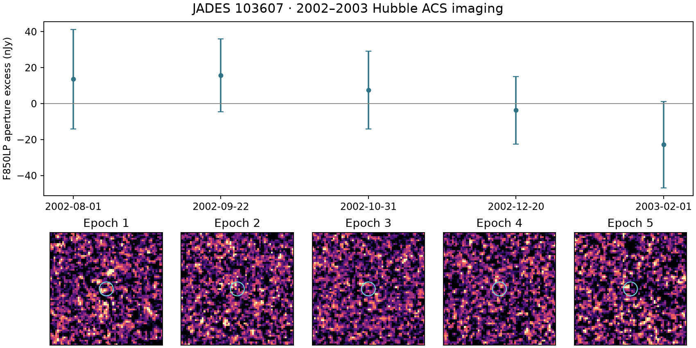

**HST F160W, October 2010 to February 2012.** The target has
positive central weight in ten of the 13 public CANDELS epoch mosaics
checked. The three wide mosaics have zero weight at this position.
We projected the observed pixels onto a common local sky grid using
the drizzled-image TAN coordinates and calibrated each mosaic using
its own FITS reference keywords. We measured a 0.24-arcsec aperture
relative to the median of the other covering epochs. The uncertainty
is the scaled median absolute deviation from 60 local difference
apertures per epoch. We also repeated the target measurement at
one-pixel offsets to gauge its dependence on the aperture center.

The largest positive difference is +20.9 ± 14.3 nJy in the February
2012 mosaic. All ten centered differences fall within 1.5 times their
local control scatter. That scatter ranges from 12.6 to 23.9 nJy,
so five times the scatter is 63 to 119 nJy. The October 2026 JWST
F150W aperture excess was +30.3 ± 5.3 nJy. Its scale is below this
historical F160W benchmark, and the filters and point-spread functions
differ. The HST data do not establish whether a similarly faint
episode recurred. The HST epochs share reference images, and their
PSF differences were left unmodelled.
[MAST CANDELS epoch mosaics](https://archive.stsci.edu/hlsp/candels/goods-s-images) ·
[HST measurements and FITS range receipts](../results/jwst_cross_detector/module_b_001_hst_f160w_history.json).

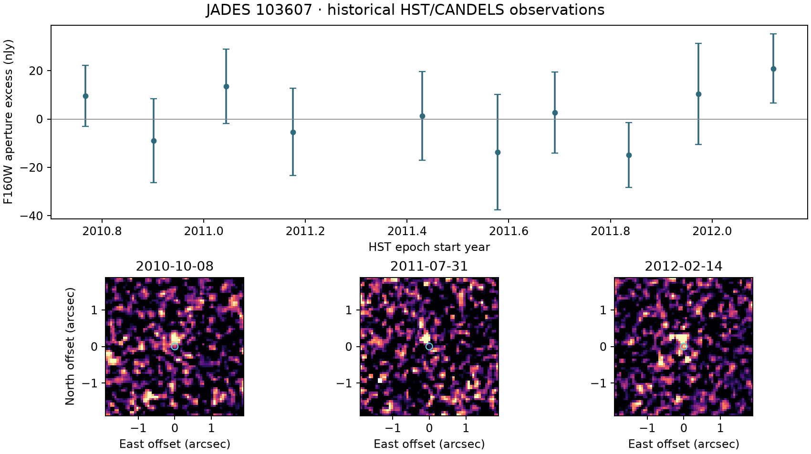

**HST F125W and the paired-epoch check.** Ten CANDELS F125W
epochs cover the position, the same nominal epochs measured in
F160W. We measure each band against its own median reference,
excluding the tested epoch. The largest F125W positive residual
is +18.5 ± 16.5 nJy in January 2011. The February 2012 F160W
residual of +20.9 ± 14.3 nJy has an F125W measurement of
−2.8 ± 16.8 nJy.

For each paired epoch we take the smaller of the two signed
residuals in units of its band's scatter. The target's highest
paired score is 0.88 in January 2011. Across the same ten
epochs, 28 of 58 spatial controls reach or exceed that score.
This rank describes the observed neighbourhood with the same
shared references. The paired record supplies no convincing
earlier brightening in both bands.
[Observed F125W photometry and archive receipts](../results/jwst_cross_detector/module_b_001_hst_f125w_history.json).

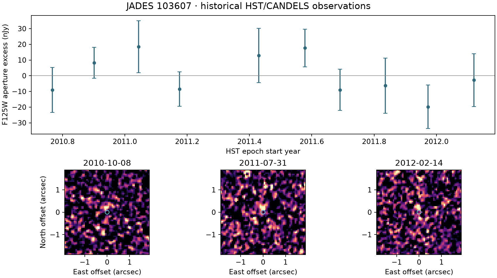

**Recovery at the scale of the JWST signal.** We use nine
archived WFC3 empirical PSFs per band and vary their orientation
and subpixel position. Each trial adds one artificial point
source to a single drizzled epoch difference. The observing
data, local background and leave-one-out reference come from
the public CANDELS images. A recovery must clear five times the
local scatter using the same fixed aperture measurement as the
observed search.

A 30 nJy model source clears the threshold in 0.59% of nearby
control trials in F125W and 0.32% in F160W. No 30 nJy placement
at the actual target reaches it. On the flux grid tested,
pooled recovery first exceeds 90% at 125 nJy in F125W and
200 nJy in F160W. These fluxes describe the injected models in
the HST bands. The tests omit source shot noise, injection
into native detector exposures and colour conversion to JWST.
Shared images and multiple placements limit the independence
of the fractions. The analysis leaves a repeat flare near
30 nJy largely unconstrained in these Hubble data.
[STScI WFC3 empirical PSFs](https://www.stsci.edu/hst/instrumentation/wfc3/data-analysis/psf) ·
[Artificial-source trials and paired-epoch scores](../results/jwst_cross_detector/module_b_001_hst_injection_recovery.json).

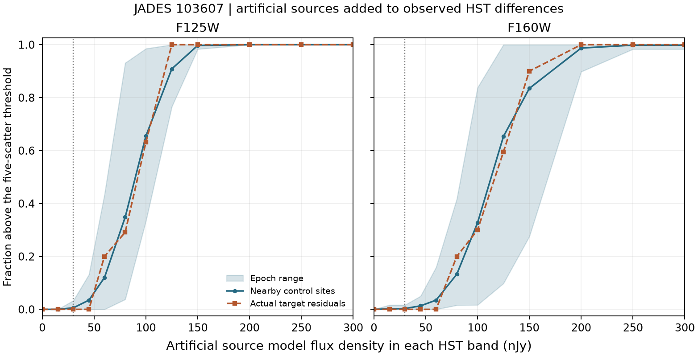

**Spitzer IRAC, August 2004.** The GOODS-S epoch-2 exposure maps
place the target on both 3.6 and 4.5 micron images, with about 57.7
and 91.0 ks of coverage. In the 1.8-arcsec aperture, five times
the local spatial scatter is 694 nJy at 3.6 microns and 637 nJy
at 4.5 microns. These are blended-aperture benchmarks, with no
aperture correction or model for the nearby resolved emission.
The 3.6 micron benchmark is far above the +24.4 ± 3.5 nJy JWST
F356W excess. The checked Spitzer epoch cannot resolve comparable
variability at this position.
[IRSA GOODS-S epoch-2 documentation](https://irsa.ipac.caltech.edu/data/SPITZER/GOODS/docs/goods_dr2.html).

**Same-band Spitzer comparisons, 2004 to 2012.** The SIMPLE
exposure maps cover the position at 3.6 microns in August 2005
and at 4.5 microns in February 2006. Positive weights in the
S-CANDELS archive give 4.5-micron coverage on 25 September 2011
and 3.6-micron coverage from 30 March to 1 April 2012. Each
S-CANDELS mosaic here combines three independently dated
observation requests ordered by start time and selected for
usable target coverage. We compared each observed epoch with the
August 2004 GOODS image in the same IRAC channel. The differential
measurements use a 1.8-arcsec radius and 75–78 adjacent control
apertures.

| IRAC channel | Later epoch | Signed difference from 2004 (nJy) |
| --- | --- | ---: |
| 3.6 microns | August 2005 | +50 ± 152 |
| 3.6 microns | March–April 2012 | +5 ± 194 |
| 4.5 microns | February 2006 | +516 ± 241 |
| 4.5 microns | September 2011 | −156 ± 165 |

The February 2006 residual is about 2.1 times its control scatter.
It overlaps structured difference light from a brighter neighbour
in the observed cutout, so it remains an ambiguous fluctuation.
The other differences are within the local scatter. The
comparisons share a 2004 reference within each channel. They
include the effects of crowding and use the released astrometry
and calibration without matching PSFs. The noise levels leave
repeat episodes comparable to the JWST excess unresolved.
[SIMPLE observing dates and calibration](https://arxiv.org/abs/1011.2764) ·
[S-CANDELS release](https://irsa.ipac.caltech.edu/data/SPITZER/S-CANDELS/overview.html) ·
[Archive query, coverage and forced photometry](../results/jwst_cross_detector/module_b_001_spitzer_epochs.json).

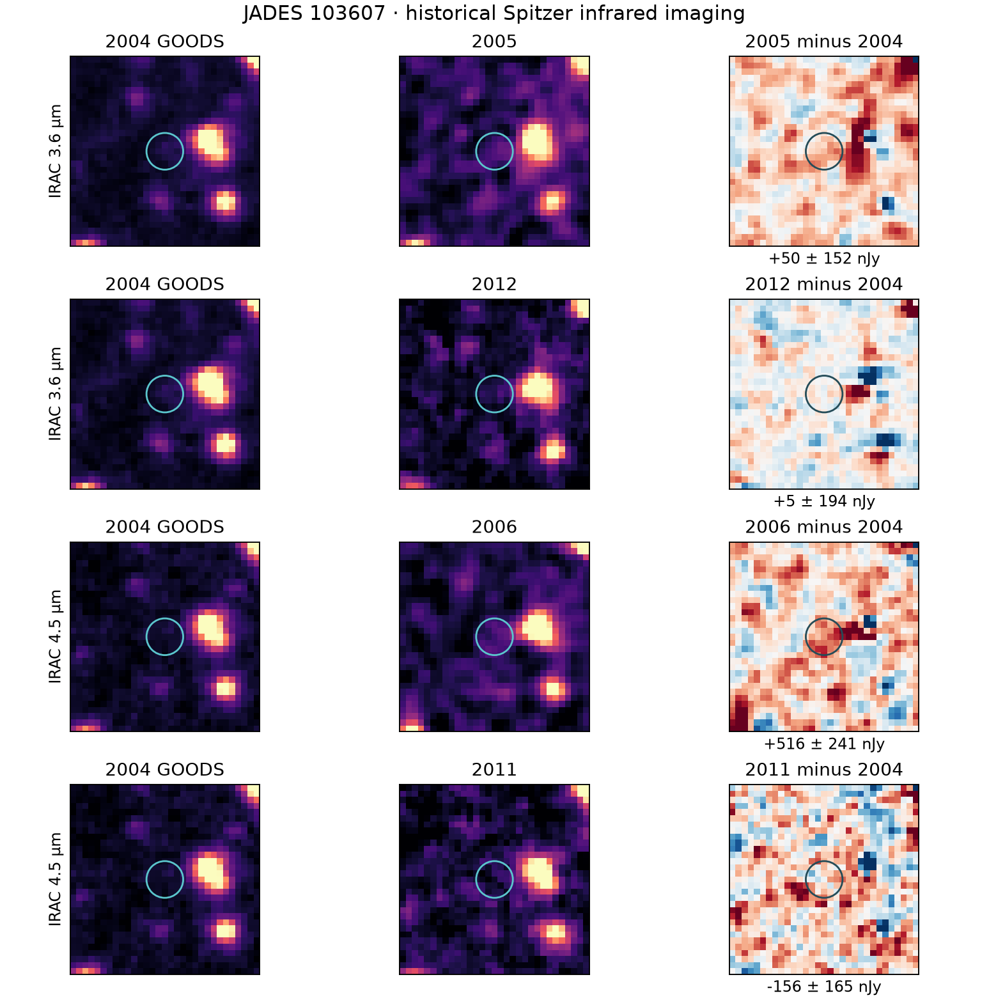

**February 2006 Spitzer neighbour test.** We matched the 2004 and
2011 reference images separately to the February 2006 image in
the 4.5-micron channel, allowing small shifts and differences in
image width and background. With a 1.93-arcsec point-spread template
and a 7.2-arcsec region masked around the target during matching, the
residual amplitudes are +247 ± 163 nJy against 2004 and +391 ± 212 nJy
against 2011. Across all 12 settings the residual reaches at most
2.15 times the local scatter. It extends towards the brighter
neighbour, and both comparisons share the 2006 observations. The
residual remains ambiguous.

As a sensitivity check, we injected a 25 nJy Gaussian point source
into the resampled 2006 image and reran the measurement. Adding the
recovered increment to the observed local control measurements would
put fewer than 2% above a three-scatter threshold at the 1.93-arcsec
width. A 1,000 nJy injection would put 93–99% above that threshold.
These fractions use a fixed source shape and a spatial sample from
the same images. They estimate sensitivity in the Spitzer band.
[IRAC point-spread reference](https://irsa.ipac.caltech.edu/data/SPITZER/docs/irac/calibrationfiles/psfprf/) ·
[Image matching, controls and simulated injections](../results/jwst_cross_detector/module_b_001_spitzer_neighbor.json).

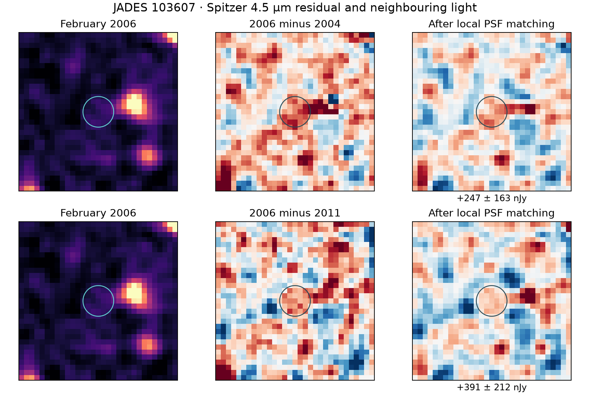

**VISTA VIDEO, November 2010 to August 2018.** ESO publishes
568 individual pawprint images from 227 observing blocks with
footprints covering the position in Z, Y, J, H and Ks. In H alone,
103 pawprints come from 39 blocks. We measured three released
H-band cutouts from the first, middle and last blocks, using a
1.0-arcsec radius aperture and 80 local controls in each image.
The signed aperture fluxes are −0.77 ± 1.65 µJy on 18 December
2010, +1.55 ± 2.39 µJy on 14 January 2014 and −0.22 ± 1.23 µJy
on 10 September 2014. These errors describe local spatial scatter.
Five times that scatter ranges from 6.13 to 11.93 µJy, far above
the scale of the JWST near-infrared excess. The pilot uses finite
apertures without PSF matching or confidence-map weighting.
[ESO VIDEO DR5 calibration and reduction](https://www.eso.org/rm/api/v1/public/releaseDescriptions/189) ·
[Footprint inventory and H-band pilot](../results/jwst_cross_detector/module_b_001_vista_video_coverage.json).

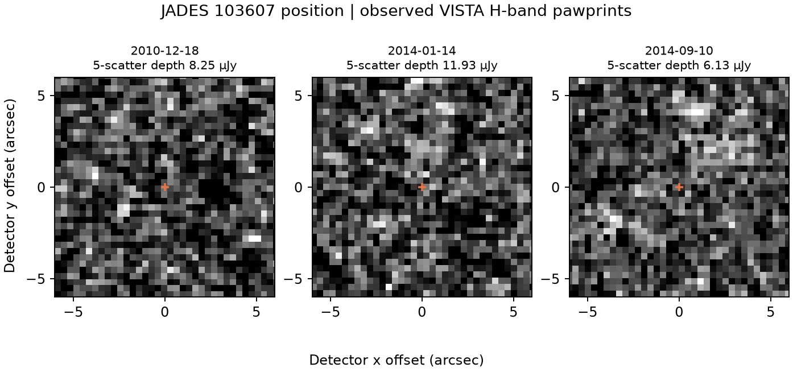

**Dark Energy Survey, DECam z band.** We screened 6,011 calibrated
detector records from the DES proposal in 24 date ranges covering
July 2013 through June 2019. Detector footprints contain the
transient position in 1,459 distinct exposures between January
2014 and December 2018. Of these, 1,140 have matching public DR2
science and mask cutouts and an exact filename match to a Y6 Gold
FGCM zeropoint. The matched products span August 2014 to September
2018 and come predominantly from the DES supernova field C3. We
matched the exposure and CCD numbers before checking the reduction
filename for the zeropoint. The unmatched footprints remain
coverage metadata.
[DES DR2 processing and flux calibration](https://arxiv.org/abs/2101.05765) ·
[NOIRLab single-epoch cutout documentation](https://datalab.noirlab.edu/docs/manual/UsingAstroDataLab/DataAccessInterfaces/SimpleImageAccessSIA/SimpleImageAccessSIA.html) ·
[DES Y6 Gold zeropoint release](https://datalab.noirlab.edu/news/newsletters/2025-06) ·
[Coverage and calibration inventory](../results/jwst_cross_detector/module_b_001_des_z_inventory.json).

Of 107 nights with at least two eligible exposures, the first pixel
analysis selects the longest eligible exposure sum in each available
month and measures up to three exposures per night. All 84 selected
exposures were usable across 28 nights from August 2014 to September
2018. We excluded masked pixels, matched the reported seeing to
1.5 arcsec FWHM with Gaussian kernels and subtracted a median
reference drawn from other observing seasons. Forced photometry
uses a 1.0-arcsec aperture. The median local control scatter is
170 nJy, with a range of 87 to 854 nJy. The largest positive
score occurs on the night beginning 20 August 2017 at
+257 ± 122 nJy. Of 41 control sites covering that night and at
least 80% of the scan, 21 reach a score at least as high.

We added Gaussian and Moffat point-source profiles to the residual
coadds at nearby control positions and repeated the same aperture
measurement. At a threshold of five times the local control scatter,
no 350 nJy injection was recovered in either profile on the sampled
nights. For 24 of the 28 nights the first tested flux with at least
90% recovery is between 1.0 and 2.0 µJy for a Gaussian profile, and
between 1.5 and 3.0 µJy for a Moffat profile. These trials constrain
bright z-band events persisting through the sampled exposures.
They leave fainter activity, shorter flares and unsampled nights
unresolved. This comparison uses observer-frame z-band fluxes.
[Nightly photometry, controls and recovery trials](../results/jwst_cross_detector/module_b_001_des_z_history.json) ·
[Vector figure](../figures/jwst_cross_detector/module_b_001_des_z_history.pdf).

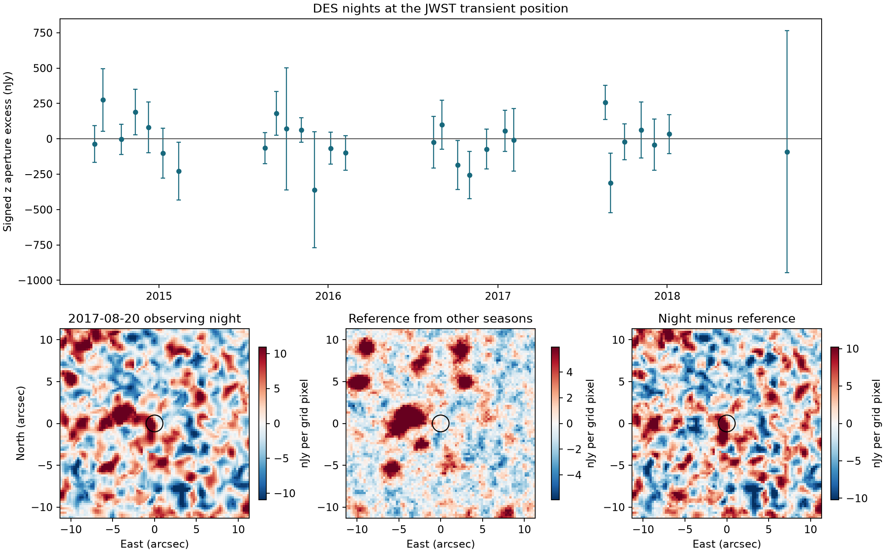

**Euclid DR1 H band, August 2024 and January 2025.** The IRSA
position query returned 34 H-band visit stacks. We inspected the
science, noise and data-quality images in each stack. Thirty-three
visits have usable pixels and local control measurements, including
18 in August and 15 in January. One nominally covering visit has
masked pixels in the target aperture. The published science images
already use calibrated flux density units. We accounted for
pixel area when putting them on a common local sky grid.

The 0.75-arcsec aperture comparison of the two campaign medians
gives +72.8 ± 50.7 nJy in January minus August. The scatter for
individual visits ranges from 73 to 247 nJy. The largest positive
visit is 6 August 2024, with +330 ± 110 nJy relative to the other
visit stacks. Across aperture radii of 0.60–0.90 arcsec and three
reference choices, the score ranges from 1.89 to 3.65 times its local
scatter. Seven control sites cover all 33 tested visits, and one of
them reaches a score at least as high as the target peak. Among
39 sites that cover the peak visit and at least 80% of the whole
scan, seven reach that score. These ranks describe the sampled
controls. The result leaves the excess ambiguous, with unmatched
PSFs and unresolved light as possible contributors.

This work has made use of the Data Release (DR1) data from the
Euclid mission of the European Space Agency (ESA).
[Euclid DR1 near-infrared processing](https://arxiv.org/abs/2611.16119) ·
[IRSA Euclid DR1 stacked NIR data](https://doi.org/10.26131/IRSA682) ·
[Visit photometry and FITS byte-range receipts](../results/jwst_cross_detector/module_b_001_euclid_dr1_h_history.json).

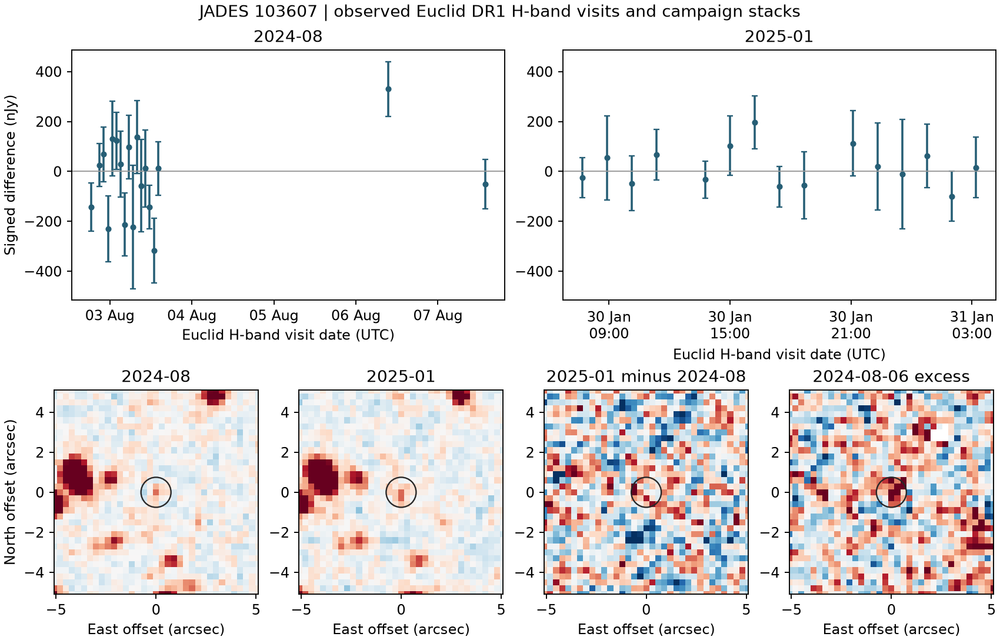

**Euclid 6 August 2024 exposure check.** We repeated the aperture
measurement with a reference made from the same eight other visits in
Y, J and H, five from August 2024 and three from January 2025. The
0.75-arcsec aperture gives −86 ± 107 nJy in Y, −41 ± 117 nJy in J and
+351 ± 132 nJy in H. The uncertainties are robust scatter among nearby
control apertures. The images in the three filters were taken in
sequence during the visit, which limits an interpretation as a
simultaneous color.

The Euclid Q1 archive returns three calibrated H exposures for
observation 3025, with dither indices 0, 2 and 3. The exposure
start times were 09:27:39, 10:03:11 and 10:20:57 UTC. We masked pixels
marked invalid by the Q1 quality flags, required finite positive RMS
and used the detector AB zero points to calibrate the images. Against
the same H reference, dithers 0 and 2 give +376 ± 283 nJy and
+286 ± 278 nJy on DET34. Each excess is within 1.4 times the local
control scatter. Dither 3 places the target on DET44, where masked
pixels prevent an aperture measurement. No calibrated H file for
dither 1 is listed in the public Q1 inventory.

The positive H residual persists under a different choice of visit
reference. The two usable individual exposures share a detector and
reference, and their photons contribute to the same visit stack.
Residual structure and unmatched PSFs limit the interpretation.
These measurements leave both the existence of a distinct 2024
transient and its possible association with the 2026 event unresolved.
[Euclid Q1 calibrated frame documentation](https://euclid.esac.esa.int/dr/q1/dpdd/nirdpd/dpcards/nir_calibratedframe.html) ·
[Exposure and filter photometry with byte-range receipts](../results/jwst_cross_detector/module_b_001_euclid_3025.json) ·
[Vector figure](../figures/jwst_cross_detector/module_b_001_euclid_3025.pdf).

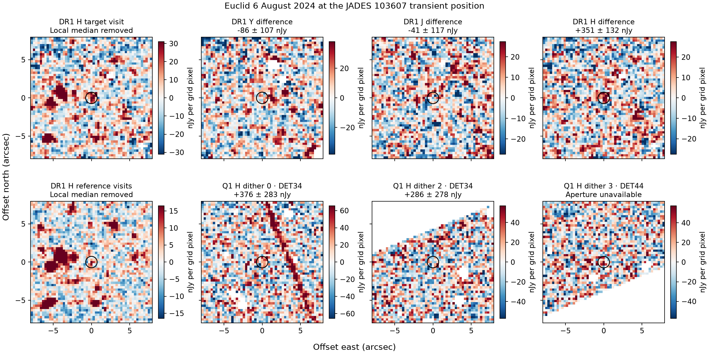

**Swift, 3 August 2024.** The Swift master log returns 156
pointings within 0.5 degrees of the target from July 2007 to
February 2026, including 101 with centers within 8.5 arcmin.
The closest of these inner-cone pointings to the Euclid H excess
is observation 00080490003. Its calibrated XRT exposure map
gives 443.8 s across a 20-arcsec aperture at the transient
position. We counted zero cleaned photon-counting events
in 0.3–10 keV in the aperture and zero in the 32–60 arcsec
background annulus. The one-sided 95% upper bound on gross
aperture rate is 0.00675 counts per second. The bound uses
the aperture-mean exposure and has no PSF or spectral conversion.
The UVOT UVW2 image from the same visit has 152.3 s of exposure at
the exact position. The XRT integration started 60.8 hours before
the first usable Euclid H exposure. It constrains activity at
that earlier time. The UVW2 image contributes coverage with
unmeasured photometric sensitivity.
[Swift observing log](https://heasarc.gsfc.nasa.gov/W3Browse/swift/swiftmastr.html) ·
[Swift XRT exposure-map calibration](https://heasarc.gsfc.nasa.gov/docs/software/lheasoft/help/xrtexpomap.html) ·
[Pointing records, counts and exposure maps](../results/jwst_cross_detector/module_b_001_swift_coverage.json).

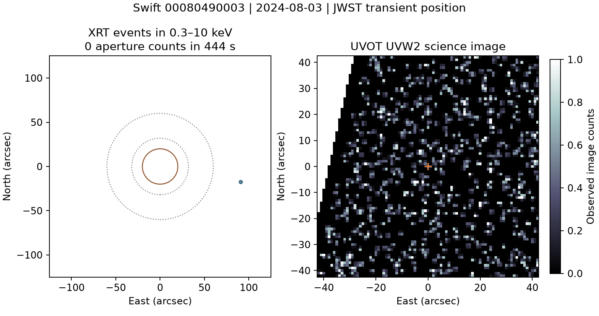

**Swift XRT, July 2007 to February 2026.** We inspected the public
photon-counting products for all 153 Swift master-log entries with
nominal XRT exposure in the half-degree cone. We matched the
cleaned event file to the exposure map by spacecraft time bounds
and usable on-time. This separates the archived photon-counting
window variants when both exist for an observation. Two maps
were unavailable, 13 positions fell outside the map arrays, 23
apertures had zero target exposure and five were only partly
exposed. The remaining 110 visits provide 565.7 ks of summed
20-arcsec aperture exposure, of which 513.1 ks dates to 2007.

In 0.3–10 keV the aperture contains 79 counts against 68.1
expected from exposure-scaled background annuli. The conditional
on/off probability of that many counts or more is 0.128. The
conservative 95% bound on the gross aperture rate is
1.68 × 10⁻⁴ counts s⁻¹. The strongest individual residual is
three counts in 1–2 keV on 16 December 2007. Its local
probability is 0.035, and it does not survive correction over
the 660 visit and band tests. The 20-arcsec aperture includes
a catalogued Chandra AGN 13.05 arcsec away. Two disjoint
6-arcsec apertures at the JWST and AGN positions contain 10 and
7 counts in the combined Swift images. They receive nearly
equal exposure and sample overlapping point-spread functions.
[Swift XRT calibration and angular resolution](https://swift.gsfc.nasa.gov/about_swift/xrt_desc.html) ·
[Luo et al. 7 Ms Chandra catalog](https://cdsarc.cds.unistra.fr/viz-bin/cat/J/ApJS/228/2) ·
[Public product inventory](../results/jwst_cross_detector/module_b_001_swift_xrt_products.json) ·
[Native event measurements and limits](../results/jwst_cross_detector/module_b_001_swift_xrt_history.json).

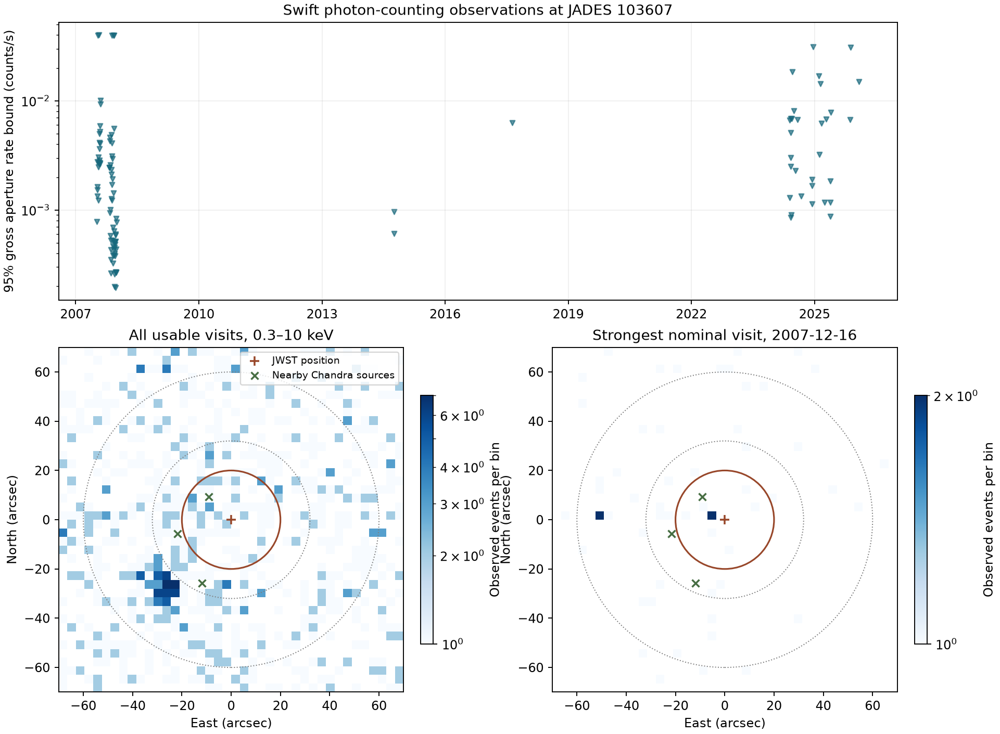

The Living Swift XRT Point Source Catalogue service supplies
forced measurements for 114 individual visits and three
overlapping stacks. Its deepest stack has 523.5 ks of exposure at
the position and a 3-sigma 0.3–10 keV limit of
7.57 × 10⁻⁵ counts s⁻¹ after the service's point-spread and
exposure corrections. One stack spanning July 2007 to November
2020 is flagged in 2–10 keV. The service gives a rate of
4.93 × 10⁻⁵ counts s⁻¹ with lower and upper errors of
1.82 × 10⁻⁵ and 1.98 × 10⁻⁵ counts s⁻¹. The other two
overlapping stacks and all individual visits lack a hard-band
flag. The native 2–10 keV comparison gives 37 counts against
33.4 expected. The analyses use different apertures and background
methods and reuse Swift observations.

The archived hard-band image and model background reproduce the
flagged stack's 69 counts and 47.44 expected within the service's
28.3-arcsec aperture. The one-sided Poisson tail is 0.00194 with
the background model held fixed. It omits background-model
uncertainty and the search trials. Within 6 arcsec of the JWST
position there are three counts against 1.99 expected. The same
aperture at the nearest Chandra AGN has five against 2.09 expected.
Two catalogued Chandra sources lie inside the large aperture and
a third lies near its edge. The Swift image leaves the origin and
timing of the hard-band excess unresolved. The long stack precedes
the Euclid and JWST events.
This work made use of data supplied by the UK Swift Science Data
Centre at the University of Leicester.
[Evans et al. LSXPS analysis](https://www.swift.ac.uk/LSXPS/paper.php) ·
[Upper-limit service method](https://www.swift.ac.uk/LSXPS/uldocs.php) ·
[Hard-band image measurements and archive checksums](../results/jwst_cross_detector/module_b_001_lsxps_hard_stack.json).

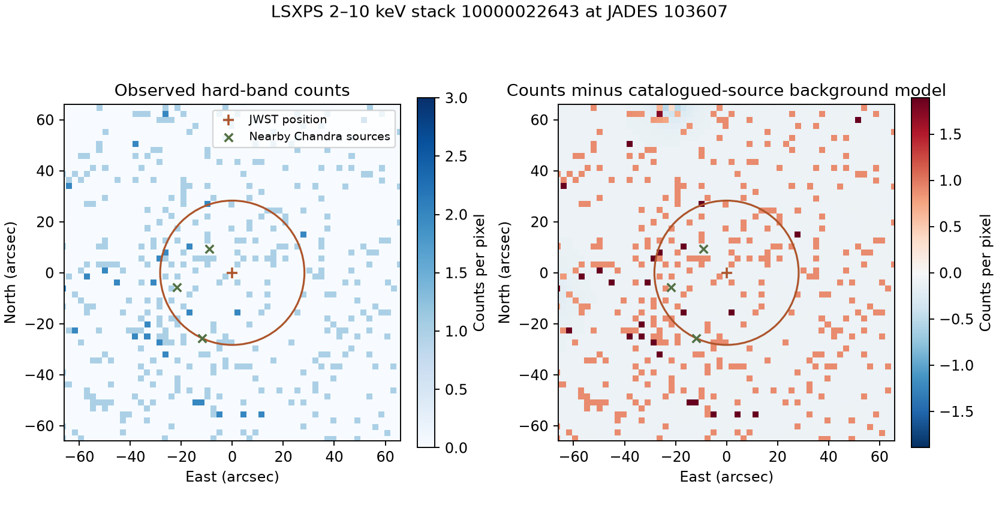

**Chandra 7 Ms Deep Field South, 1999 to 2016.** At the transient
position, a 1.5-arcsec radius gives 13 counts in 0.5–2 keV and 30
in 2–7 keV. The 8–20 arcsec annulus predicts 11.6 and 25.2 counts
in those apertures, respectively. The one-sided background
probabilities are 0.38 and 0.20 under a locally uniform count
background. The conservative 95% Poisson upper bounds are 20.7
and 40.7 expected counts in the aperture without subtracting
background or correcting for the PSF. The local exposure maps
were sampled at the target. These merged images probe persistent
X-ray emission, while short flares require separate observing
intervals and a local response calculation.
[Chandra survey paper](https://arxiv.org/abs/1611.03501) ·
[Released Chandra images](https://zenodo.org/records/8021940) ·
[Chandra and Spitzer measurements](../results/jwst_cross_detector/module_b_001_chandra_spitzer_history.json).

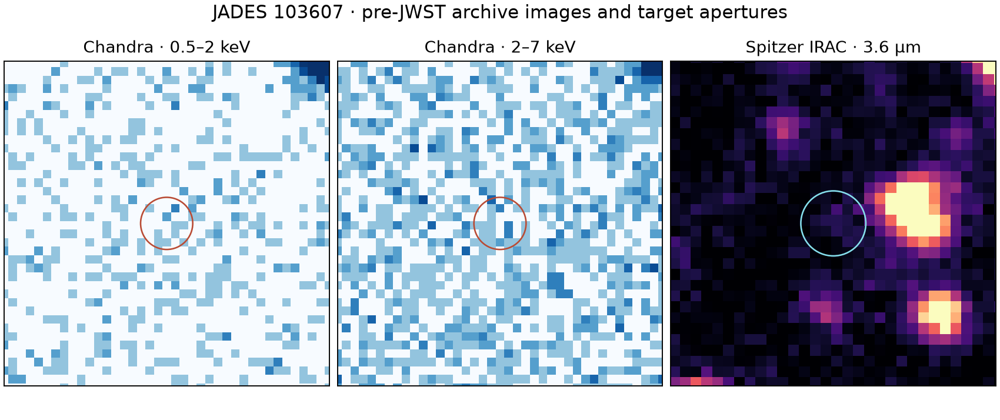

**Separate Chandra observing groups.** The Chandra Data Archive
also provides independent 0.5–6 keV images for the 2000, 2007 and
2010 observing groups. The aperture has coverage in every group.
The table compares the 1.5-arcsec aperture with the local 8–20 arcsec
background annulus. The Poisson bounds conservatively retain the
background counts and omit correction for the PSF.

| Chandra group | Pointings | Counts | Expected background | 95% upper bound on aperture counts |
| --- | ---: | ---: | ---: | ---: |
| 2000 | 9 | 4 | 3.69 | 9.15 |
| 2007 | 12 | 7 | 4.70 | 13.15 |
| 2010 | 31 | 6 | 9.92 | 11.84 |

The most positive aperture is in 2007. Its one-sided background
probability is 0.20, consistent with a chance fluctuation. These
observing groups constrain activity averaged over their sampled
pointings. A shorter flare could be diluted in a merged image or
fall between pointings.
[Chandra Data Archive](https://cxc.harvard.edu/cda/Contrib/CDFS.html) ·
[Window dates, exposure maps and aperture counts](../results/jwst_cross_detector/module_b_001_chandra_epochs.json).

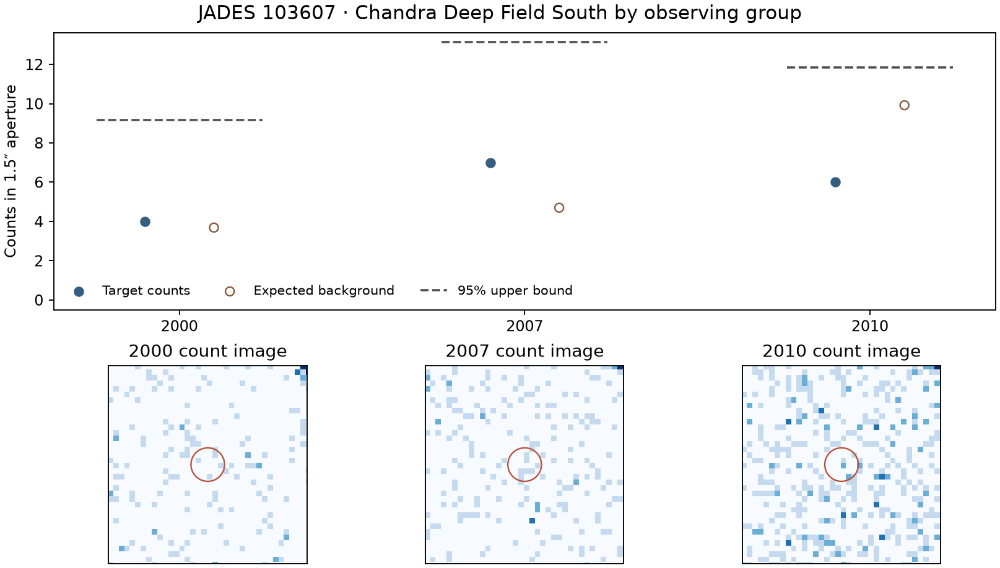

**Chandra event lists, October 1999 to March 2016.** We screened
all 102 observing intervals in the published 7 Ms CDF-S journal.
The two 1999 intervals share a public ObsID 1431 event file.
We split their good times and photons at 1 November 1999 and
use the separately released chip footprints. The 1.5-arcsec
source aperture and 8–20 arcsec background annulus have
sufficient detector-edge clearance in 91 intervals. The
0.5–6 keV test uses full pointings and fixed 10 ks windows
with at least 5 ks of chip good time.

| Chandra group | Usable intervals | Tested 10 ks windows |
| --- | ---: | ---: |
| 1999 | 2 of 2 | 12 |
| 2000 | 7 of 9 | 65 |
| 2007 | 10 of 12 | 89 |
| 2010 | 27 of 31 | 180 |
| 2014 | 27 of 30 | 172 |
| 2015 | 16 of 16 | 100 |
| 2016 | 2 of 2 | 8 |

The strongest window still has two photons on 20 May 2015 and
about 0.074 expected background counts. Its one-sided binomial
probability is 0.00329 under the local background model. The
Bonferroni-adjusted value is 1.0 across the 717 full-interval and
shorter-window tests. No flare reaches statistical significance.

The 626 shorter windows contain 6.16 Ms of chip good time, or
1.19% of the calendar span from the first to last measured
observation. The median conservative 95% upper count rate is
3.00 × 10⁻⁴ counts/s within the aperture. This bound retains
background and omits the time-dependent PSF fraction and detector
response. It applies to emission sustained across the sampled
windows. The sparse sampling leaves brief or unsampled activity
open.
[Chandra survey observing journal](https://arxiv.org/abs/1611.03501) ·
[Combined coverage and trial accounting](../results/jwst_cross_detector/module_b_001_chandra_full_history.json) ·
[1999](../results/jwst_cross_detector/module_b_001_chandra_1999_events.json) ·
[2000](../results/jwst_cross_detector/module_b_001_chandra_2000_events.json) ·
[2007](../results/jwst_cross_detector/module_b_001_chandra_2007_events.json) ·
[2010](../results/jwst_cross_detector/module_b_001_chandra_2010_events.json) ·
[2014](../results/jwst_cross_detector/module_b_001_chandra_2014_events.json) ·
[2015](../results/jwst_cross_detector/module_b_001_chandra_2015_events.json) ·
[2016](../results/jwst_cross_detector/module_b_001_chandra_2016_events.json).

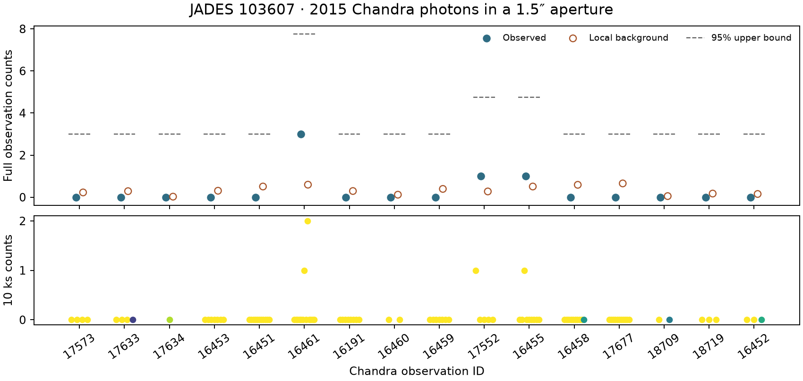

**XMM-Newton, July 2001 to August 2025.** The ESA RapidXMM query
returns 34 distinct pointed observations through August 2019 and
seven slews between August 2005 and August 2025. It provides 96
quality-flag-zero pointed detector measurements and seven slew
measurements in the 0.2–2 keV band. The deepest pointed soft-band
99.87% upper count rates are 2.60 × 10⁻⁴ counts/s (MOS1),
2.22 × 10⁻⁴ counts/s (MOS2) and 5.79 × 10⁻⁴ counts/s (pn).
The slews provide only 1.7–19.7 seconds of effective soft-band
exposure and upper rates of 0.39–4.52 counts/s. These archive
limits refer to detector rates from 15-arcsec pointed or 30-arcsec
slew apertures centered on the archive's nearest sky cell. Nearby
emission can contribute inside those apertures.
[RapidXMM aperture photometry methods](https://doi.org/10.1093/mnras/stac272) ·
[Observation rows, flags and rate limits](../results/jwst_cross_detector/module_b_001_rapidxmm.json).

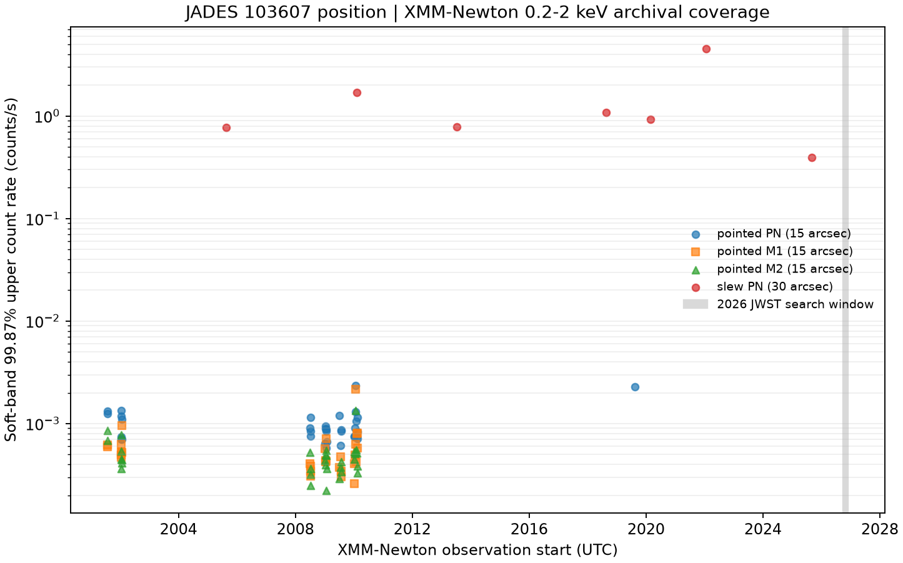

**MeerKAT MIGHTEE, December 2019 to October 2020.** In the
CDFS-DEEP 5.5-arcsec continuum image, the transient position
measures −0.71 µJy/beam at an effective 1.232 GHz. The released
local RMS is 1.29 µJy/beam. The scatter of 148 nearby samples
is 1.35 µJy/beam, giving a five-scatter point-source benchmark
of 6.75 µJy/beam. The nearest catalogue source is 14.15 arcsec
away. A bright persistent radio source is therefore unsupported
at the transient position in this coadd. The radio beam blends
subarcsecond components, and a short radio flare could be diluted
in the combined data.
[MIGHTEE release paper and observing log](https://arxiv.org/abs/2411.04958) ·
[SARAO released images and catalogue](https://doi.org/10.48479/7msw-r692) ·
[Local measurement, sensitivity and FITS receipts](../results/jwst_cross_detector/module_b_001_meerkat.json).

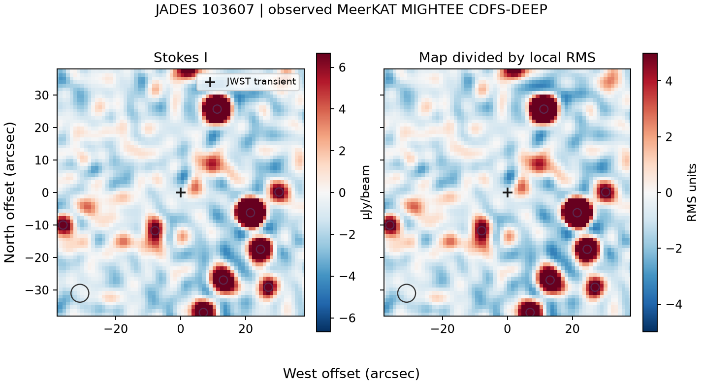

The historical record samples distinct optical, infrared, X-ray
and radio observing windows. The measured flux and count-rate sensitivities
apply to those windows. Gaps in cadence and sensitivity leave the
historical frequency and physical class of the JWST event open.

#### Independent observations during the 2026 event

A MAST query from 1 October through 26 November 2026 returned 19
HST catalogue products in a 4-arcmin position search. The Hubble
images from 25–26 October fall between the two JWST visits. Their
published footprints all miss the transient. The closest edge is
22.94 arcsec away. The other result was a COS spectrum whose
aperture also missed the position. The Chandra and XMM-Newton
pointing logs returned no pointing centers within 0.5 degrees in
the tested date window. The separate RapidXMM positional query also
returned zero pointed or slew observations overlapping this interval.
The Swift master log also returns zero pointing centers within
0.5 degrees for the same interval.
[HST programme 18004](https://www.stsci.edu/hst-program-info/visits/?program=18004) ·
[Chandra observation archive](https://heasarc.gsfc.nasa.gov/W3Browse/chandra/chanmaster.html) ·
[XMM-Newton Science Archive](https://www.cosmos.esa.int/web/xmm-newton/xsa) ·
[Swift log query](../results/jwst_cross_detector/module_b_001_swift_coverage.json) ·
[Observation IDs, footprints and query receipts](../results/jwst_cross_detector/module_b_001_independent_2026_coverage.json).

**Blanco/DECam.** The NOIRLab query screened 374 individual
calibrated-detector footprints from 1 October through 26 November
2026. The four corners in each public metadata record were ordered
around the detector perimeter before testing whether the footprint
contains the transient position. Seventy-four distinct exposures
cover that position geometrically on nine nights. The dates include
28 and 29 October and five nights from 6 to 17 November, between the
two JWST visits. Eleven exposures are from 25 November, one day
after the JWST fade was measured. No exposure found in this search
coincides with the 9–10 October JWST bright visit.

The archive lists future release dates from 23 March to 17 May
2028 for all 74 images. The recorded exposure-level depth reaches
24.4 mag in the deepest image with a published value. The depth
at the transient position and the presence of an optical excess
remain unmeasured. The dated detector footprints establish
independent observing opportunities during the interval.
[NOIRLab Astro Data Archive](https://astroarchive.noirlab.edu/) ·
[Detector corners, filters, depth metadata and release dates](../results/jwst_cross_detector/module_b_001_decam_2026_coverage.json).

**Vera C. Rubin Observatory.** The public Fink difference-alert
search returns zero objects within 5 arcsec for the same
October–November date window. Four objects appear within
120 arcsec. The closest reported position is 26.22 arcsec away
and first alerted on 30 October. These records demonstrate
alert activity in the surrounding field. Target pixel coverage,
local sensitivity and forced photometry remain unknown from
this query.
[Rubin public alert products](https://prompt-products.lsst.io/products/alerts/index.html) ·
[Fink position and time search](https://doc.lsst.fink-broker.org/services/api/conesearch/) ·
[Target and surrounding-field alert receipts](../results/jwst_cross_detector/module_b_001_rubin_2026_alerts.json).

**Zwicky Transient Facility.** The IRSA archive returns 1,026 released
quadrants from distinct exposures covering the position between
2 September 2018 and 25 September 2026. The public search returns
zero results during the October–November 2026 event window, even
when expanded to a quarter-degree box. It also returns zero images
covering the position from 5 through 7 August 2024. The deepest
unflagged historical image metadata give limiting magnitudes of
20.98 in g and 20.83 in r. The Fink ZTF broker returns zero objects
within 5 arcsec in its full history and zero first detections within
120 arcsec during the 2026 event window. These are public archive
and alert results as of 27 November 2026. Target photometry and
coverage from images pending release remain unmeasured.
[IRSA ZTF image-search documentation](https://irsa.ipac.caltech.edu/docs/program_interface/ztf_api.html) ·
[ZTF public release schedule](https://www.ztf.caltech.edu/ztf-public-releases.html) ·
[Fink ZTF cone-search documentation](https://doc.ztf.fink-broker.org/services/search/conesearch/) ·
[Footprint and broker query receipts](../results/jwst_cross_detector/module_b_001_ztf_coverage.json).

**TESS.** We extracted full-frame pixels at the fixed JWST position
from all six sectors returned by the public MAST TESSCut service
on 27 November 2026. The six sectors span October–November 2018,
October–November 2020, and June–October 2026. In total 46,617 of
50,360 cadences passed the quality and finite-pixel checks. Sector
108 ended on 4 October at 20:23 UTC, 122.12 hours before the first
October JWST exposure. TESS-point predicts that sectors 109–111
miss the position. The public TESS images therefore test for a
precursor and earlier optical activity. The JWST bright and fading
visits have no contemporaneous TESS measurement in these data.
[MAST TESSCut](https://mast.stsci.edu/tesscut/docs/getting_started.html) ·
[NASA TESS-point](https://heasarc.gsfc.nasa.gov/wsgi-scripts/TESS/TESS-point_Web_Tool/TESS-point_Web_Tool/wtv_v2.0.py/) ·
[TESS Year 9 observing calendar](https://tess.mit.edu/tess-year-9-observations/) ·
[Cutout and geometry receipts](../results/jwst_cross_detector/module_b_001_tess_inventory.json).

We fitted the calibrated TESS point response at the target and
eight control positions four pixels apart, with a local background
and reference scene model. Each difference used a reference that
excluded the same UTC day. Hourly and daily means used a minimum
cadence completeness of 60%. Error bars include inflation from
the measured residual scatter at each position and timescale.
Matched-profile trials on local control residuals give the
incremental signal needed to cross a score of five in 90% of trials
at the target noise scale. In sector 108, these amplitudes are
**7.66 e⁻/s** for one hour and **8.04 e⁻/s** for one day, equivalent
to approximately **T = 18.23** and **T = 18.18**, respectively. The
brightest standardized positive hour in that sector, on 2 October
at 18:00 UTC, was **2.60 ± 0.85 e⁻/s**. These are TESS-band
measurements of extra light within sampled intervals. TESS's
roughly 21″ pixels blend many sources, and its passband differs
from JWST's near-infrared filters.
[TESS FFI and point-response calibration](https://outerspace.stsci.edu/spaces/TESS/pages/14563420/2.0%2B-%2BData%2BProduct%2BOverview) ·
[TESS magnitude calibration](https://tess.mit.edu/public/tesstransients/pages/readme.html) ·
[Per-sector photometry, cadence counts and sensitivity trials](../results/jwst_cross_detector/module_b_001_tess_history.json).

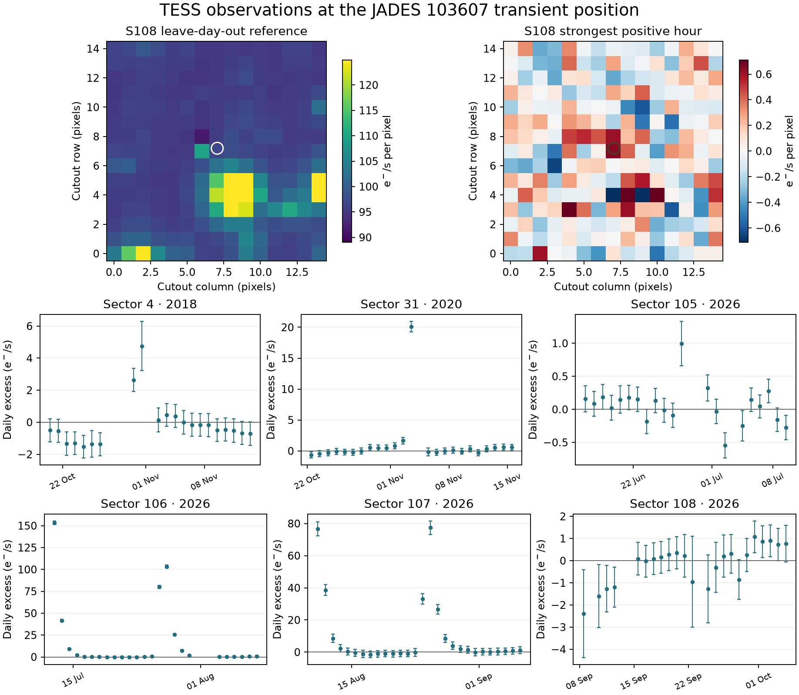

The strongest hourly residuals in sectors 31, 106 and 107 show
stripes that extend across the cutout. Column means explain
93–97% of the image variance in those three peak-hour residuals.
Allowing an independent background offset per column reduced the
largest hourly target scores in these sectors from 40.74, 45.20
and 17.84 to 2.78, 3.22 and 1.83, respectively. Across 3,421
hourly and 142 daily windows, all target scores of five or greater
coincided with at least one control whose absolute score also
reached five, in both fits. The TESS search yielded no credible
evidence of earlier optical activity at the JWST position.
Day-scale signals that persist into the sector reference,
fainter transients and events in the gaps remain unconstrained.

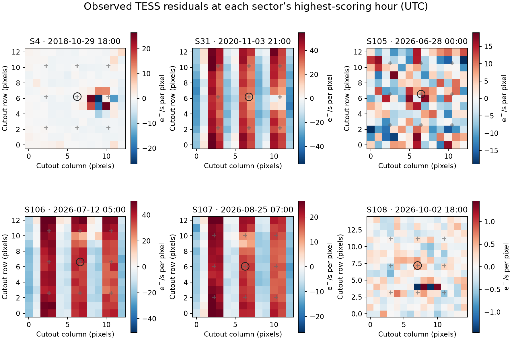

The timeline summarizes the dates behind the historical comparison
and the search for independent evidence during the 2026 event.
The DES z-band measurements, Swift XRT visits, Swift UVOT snapshot,
Euclid H-band visits, ZTF public image dates and TESS cadence days extend
the earlier baseline.
The October–November 2026 records keep unreleased DECam footprints,
nearby Rubin alerts and off-target HST footprints distinct from the
two measured JWST visits.
[Timeline source and date ledger](../results/jwst_cross_detector/module_b_001_cross_survey_timeline.json).

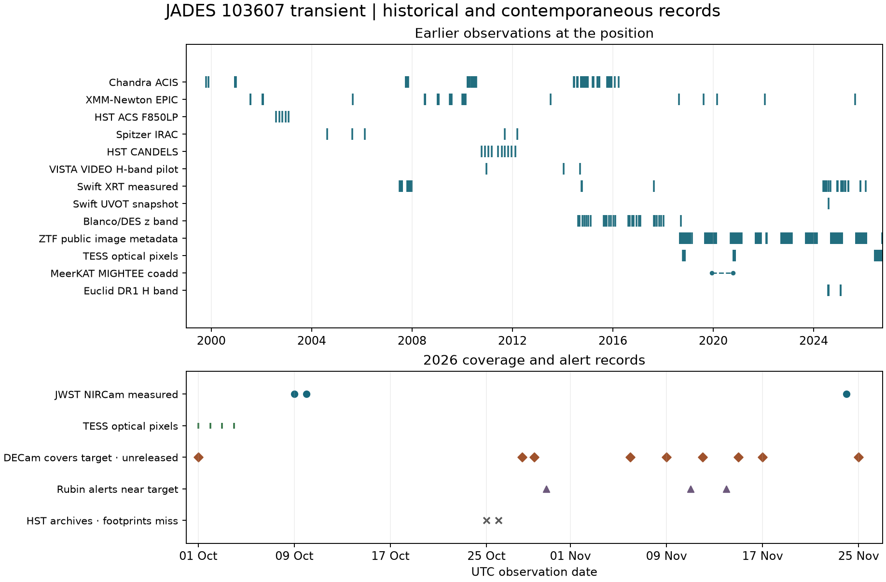

### Fading at 53.147252°, −27.790612°

This position measured 8–11 nJy in F200W from 2022 through January 2024.
It reached 47.7 ± 3.7 nJy in October 2025 and remained bright in an
independent GO 7336 visit on 18 October 2025 at 42.7 ± 3.1 nJy. F200W
then measured 43.4 ± 3.4 nJy in November, 38.1 ± 8.3 nJy in December,
and 16.8 ± 6.8 nJy in February 2026. The sequence includes both modules
and three short-wavelength detectors. An independent GO 4549 F356W
image on 30 September 2025 has 37.3 ± 7.4 nJy in the aperture.

The bright-epoch F200W peak is unflagged and follows the dither in all
three native frames. The first F444W brightest pixel carries a jump
flag. The other two exposures have unflagged peaks, and the centroid
of the cleaned light remains within 0.061″ of the search position in
all six frames. The signed aperture results preserve any measurements
affected by missing data as null.
[Native exposure images](../figures/jwst_cross_detector/module_b_002_native.png) ·
[Observed image subtraction](../figures/jwst_cross_detector/module_b_002_mosaics.png) ·
[Photometry and native product receipts](../results/jwst_cross_detector/module_b_vetting.json).

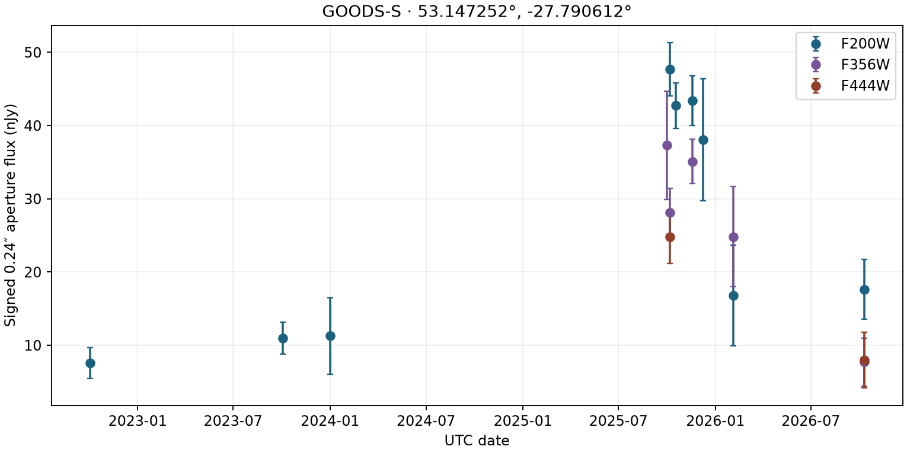

The fading position is 0.015″ from JADES source 117875. The DAWN JWST
Archive identifies it as GO 8060 NIRSpec target 2510132, 0.025″ from
the search position. It has two PRISM spectra, taken on 28 December
2025 and 13 January 2026. The December grade-2 inspection reports a
redshift of 2.1433 and suggests a Type II supernova. The January
grade-3 inspection reports 2.1411 and labels the source a transient.
This establishes earlier recognition of the fading event. The
photometry independently recovers it. The public APT catalogues also
label source 2510132 `trans` and assign it as a primary target in
three saved plans.
[DAWN NIRSpec release](https://dawn-cph.github.io/dja/spectroscopy/nirspec/) ·
[Prior public spectra and catalogue annotations](../results/jwst_cross_detector/module_b_prior_prism.json).

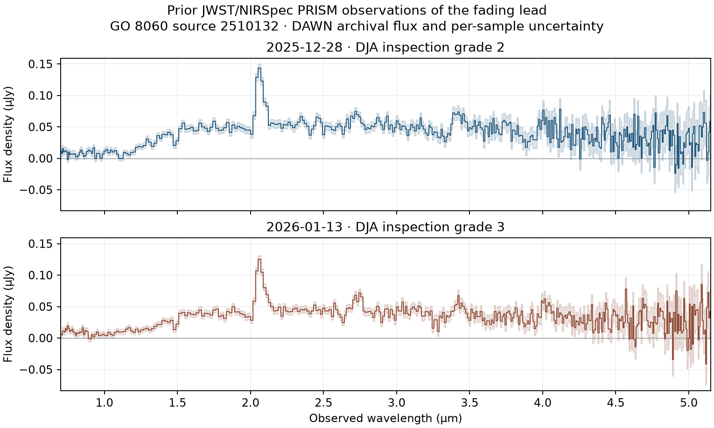

The 17–18 October 2025 GO 7336 archive search adds seven F277W GRISMR
and four GRISMC exposures over the position. Among their first- and
second-order catalogue extractions, the nearest is 7.96″ from the
transient. This test checks extracted coordinates. An exposure-level
sensitivity or trace-overlap model would require a separate reduction.
[GO 7336 programme](https://www.stsci.edu/jwst/science-execution/approved-programs/general-observers/cycle-4-go) ·
[Slitless extraction inventory](../results/jwst_cross_detector/module_b_spectra.json).

## Public transient snapshot

We checked all **213,716** objects in the public Transient Name Server
snapshot dated 23 November 2026 at 00:00 UTC. The 5″ search found no
entries at either Module B lead or at the original fading GOODS-S event.
The respective nearest entries lie 33.75″, 9.87″, and 22.74″ away. The
check establishes the public registry result on that date. GO 8060
observing plans independently establish prior recognition of both
fading events, including source 2510038 at the original position.
[TNS public archive announcement](https://www.wis-tns.org/astronotes/astronote/2026-315) ·
[Catalogue match receipts](../results/jwst_cross_detector/module_b_vetting.json).
