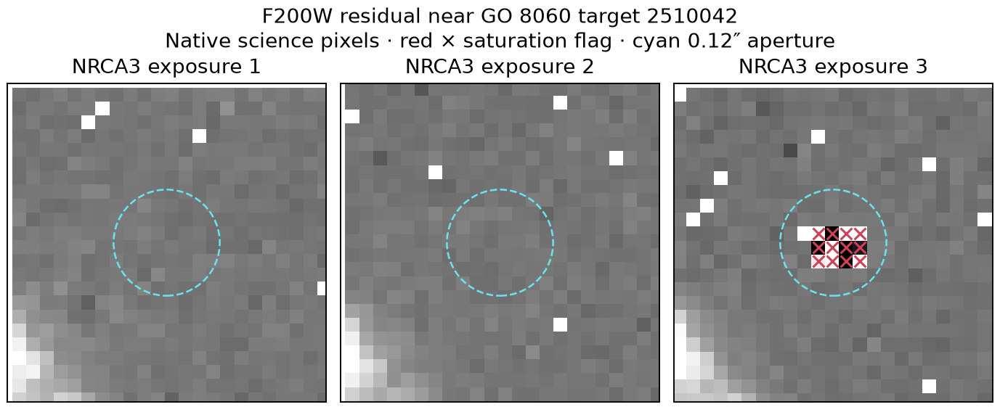
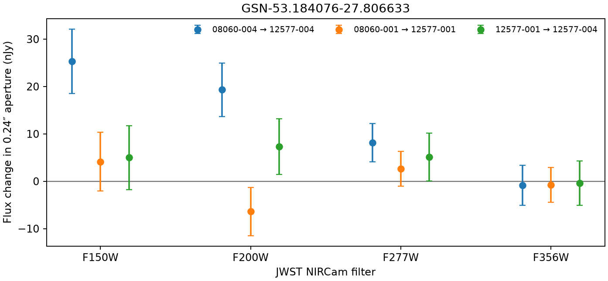

# GOODS-S October and November JWST candidate search

**Biswajit Jana** · Independent research · 25 November 2026

## Search

The November release adds public NIRCam observations 003 and 004 of GO 12577.
We compared their STScI stage-3 source catalogues with two October 2025 and
two October 2026 visits in F150W, F200W, F277W and F356W. We also compared
the two pairs of corresponding October footprints. Twenty-four input
catalogues contained 61,031 usable source entries summed across visits and
filters. The count includes repeat measurements of the same sky sources.
[GO 12577](https://www.stsci.edu/jwst-program-info/program/?program=12577) ·
[STScI source catalogue format](https://jwst-pipeline.readthedocs.io/en/stable/jwst/source_catalog/main.html).

Candidate selection, measurement, and image rendering use deterministic
numerical software. [Research record](../docs/research_record.md).

The matched-catalogue screen required mutual nearest positions within
0.13″ and no catalogued neighbour within 0.28″ of each matched catalogue
source. High-S/N pairs across each common footprint set relative gains and scatter. A lead
required a fractional change of at least 18% and a ranking score of at
least three in both wavelength channels, with a score of at least six
in one band. Apertures use the official 70% encircled-energy products.
Ranking scores include an empirical scatter floor and do not represent
global detection probabilities.

The eight November comparisons returned 19,980 mutual matches across
all filters and three multi-band leads. The two October comparisons
returned 15,035 matches and four multi-band leads. Two sky positions
occur in both searches. We also screened for sources present in at least
three bands on only one side of the October–November comparison. With
a 25 nJy and formal aperture S/N 12 threshold and a projected 2″
geometric margin within the opposite-epoch MAST footprints, two
additional positions survived. This yielded **seven distinct sky
positions** for forced measurement. The stricter footprint search
reduces obvious out-of-field matches. The weight images still determine
actual usable coverage.

[November products and ranking rules](../results/jwst_cross_detector/november_goods_s_catalogue.json) ·
[October matched positions](../results/jwst_cross_detector/october_goods_s_catalogue_matches.csv) ·
[Unmatched-source products and footprints](../results/jwst_cross_detector/november_goods_s_unmatched.json).

## Independent recovery of two previously identified events

JADES 103607 was recovered in all four catalogue filters in the
October 2026 to November 2026 comparison. Local image registration
and fixed 0.24″ apertures recover the same signed change in all four
filters. The catalogue-centred F200W estimate is −32.0 ± 4.5 nJy.
The earlier study used a separately defined sky center and a joint
three-epoch comparison.
[Existing JADES 103607 analysis](jwst_module_b.md).

The search independently recovered **GO 8060 transient 2510042** near
ZFOURGE CDFS 18559. The catalogue position is 0.067″ from the public
observing-plan target. Image-domain F200W gives −59.3 ± 5.1 nJy between
October 2025 and November 2026. F150W, F277W and F356W also fade, by
46.8 ± 6.2, 50.9 ± 4.7 and 32.4 ± 3.8 nJy, respectively. These errors
are local aperture scatter estimates. The result extends the previous
independent recovery to the November observations. The public observing
plan lists the target as a transient.
[Prior NIRSpec evidence](jwst_cross_detector.md) ·
[Observing plan](https://www.stsci.edu/jwst-program-info/download/jwst/apt/8060/).

## Checks on the other leads

At RA 53.176873°, Dec −27.799404°, the 2025 short-wavelength weight
boundary truncates the target aperture. F277W changes by +5.3 ± 5.4 nJy
and F356W changes by −60.9 ± 5.5 nJy at a position next to a bright star.
This position lacks a reproducible brightening in a complete
short-wavelength aperture.

At RA 53.119017°, Dec −27.802528°, the three-band catalogue fade occurs
on a blend. Fixed-aperture measurements in F150W, F200W and F277W are
−6.0 ± 7.3, −12.0 ± 5.9 and −10.4 ± 4.4 nJy at 0.24″. The differences
lack a clear isolated compact core. The pipeline catalogue ranking is
sensitive to how the existing structure was assigned among detections.

At RA 53.202392°, Dec −27.754453°, the October catalogue ranks F150W
and F356W changes. The F150W pixel-domain change is +2.7 ± 5.2 nJy,
and the common F356W weight does not cover the full fixed aperture.

[November aperture and archive receipts](../results/jwst_cross_detector/november_goods_s_catalogue_vetting.json) ·
[October aperture and archive receipts](../results/jwst_cross_detector/october_goods_s_catalogue_vetting.json).

The unmatched November position at RA 53.143730°, Dec −27.813513°
falls on the light of a bright galaxy already present in October.
The F277W and F356W difference cutouts show paired positive and
negative lobes around the galaxy core. F200W measures −3.0 ± 5.3 nJy
at the catalogue position. The November catalogue records a separate
segment in nearby extended light.
[Observed galaxy cutouts](../figures/jwst_cross_detector/november_goods_s_unmatched_GSN-53p143730-27p813513.png).

At RA 53.218706°, Dec −27.771226°, an October source has no corresponding
catalogue segment within 0.20″ in the November visits. The November
mosaics still show the source, with a diffraction spike passing over it
in all four bands. The F200W fixed aperture instead increases by
115.6 ± 4.9 nJy along the spike. The catalogue disappearance reflects
the change in source segmentation and contamination.
[Observed diffraction spike at the search position](../figures/jwst_cross_detector/november_goods_s_unmatched_GSN-53p218706-27p771226.png) ·
[Unmatched-source image measurements](../results/jwst_cross_detector/november_goods_s_unmatched_vetting.json).

## Native check of a single-filter spike

A second position 0.450″ from transient 2510042 shows a November
F200W excess of +74.3 ± 5.1 nJy in the mosaic. F150W, F277W and F356W
are each below three local scatter units in the same 0.24″ aperture.
Checking the exact science and DQ pixels of all three geometrically
covering NRCA3 frames isolates the excess to the third exposure.
The brightest pixels in the first two frames are 4.36 and 4.23 nJy
and carry the jump flag. The third frame contains 12 saturation-flagged
pixels within 0.18″, including a 164 nJy peak. Strict DQ-zero aperture
measurements are unavailable at this position. A saturation-flagged
feature in one exposure drives the anomalous mosaic detection.
[Detector data quality documentation](https://jwst-pipeline.readthedocs.io/en/2.0.1/jwst/references_general/references_general.html) ·
[Native science and DQ receipts](../results/jwst_cross_detector/november_goods_s_f200w_spike.json).

## Search with four additional archival visits

We also compared four GO 8060 visits from 18 November and 31 December
2025 against both November 2026 visits. This supplied 16 additional
catalogues, bringing the search to 40 distinct catalogues and 100,685
usable source entries. The eight additional four-filter comparisons
returned 18,699 mutual matches and two new positions for direct
measurement. Neither had an entry within 5″ in the 25 November 2026
Transient Name Server snapshot.

At RA 53.187663°, Dec −27.794316°, the catalogue brightening is on
extended structure. F150W, F200W, F277W and F356W change by
−15.5 ± 6.6, −1.3 ± 4.7, +3.1 ± 4.0 and −24.1 ± 4.0 nJy,
respectively, in matched 0.24″ apertures. The sign of the larger F356W
residual reverses the catalogue claim. The difference images show
positive and negative residuals along the existing galaxy light,
including other knots in the field.
[Observed images](../figures/jwst_cross_detector/november_goods_s_prior_visits_GSN-53p187663-27p794316.png).

At RA 53.184076°, Dec −27.806633°, a source is visible in both visits.
The catalogue ranked F200W and F277W changes. Forced 0.24″ photometry
measures +25.3 ± 6.8 nJy in F150W, +19.3 ± 5.7 nJy in F200W,
+8.2 ± 4.0 nJy in F277W and −0.9 ± 4.2 nJy in F356W. The first three
residuals connect back to a bright neighbouring source along a
diffraction spike that rotates between visits. The local aperture scatter
does not quantify an error specific to a spike crossing the aperture.
[Observed images](../figures/jwst_cross_detector/november_goods_s_prior_visits_GSN-53p184076-27p806633.png).

Adding the October visits 08060-001 and 12577-001 changed the F200W
comparison to −6.4 ± 5.1 nJy from October 2025 to October 2026, and
+7.3 ± 5.9 nJy from October to November 2026. All eight measurements in
these two checks are within 1.3 times their local aperture scatter of
zero. The common November image also shows the neighbour's diffraction
pattern. The initial brightening is consistent with a change in the
diffraction contamination. Comparisons that share a visit have
correlated errors.
[October 2025–October 2026 cutouts](../figures/jwst_cross_detector/november_goods_s_prior_visits_october_check_08060-001_12577-001.png) ·
[October–November 2026 cutouts](../figures/jwst_cross_detector/november_goods_s_prior_visits_october_check_12577-001_12577-004.png) ·
[Forced photometry and archive receipts](../results/jwst_cross_detector/november_goods_s_prior_visits_october_check.json).

[Additional archive inputs](../results/jwst_cross_detector/november_goods_s_prior_visits.json) ·
[Candidate photometry and registry checks](../results/jwst_cross_detector/november_goods_s_prior_visits_vetting.json).

Across the 40 catalogues, pixel-level vetting recovered two previously
identified events among nine distinct catalogue positions. The other
positions were affected by coverage, blending, or diffraction, and the
separate single-filter feature was confined to a saturation-flagged
exposure. This run produced no additional confirmed transient. The
catalogue and image cuts also limit what the search can recover.
