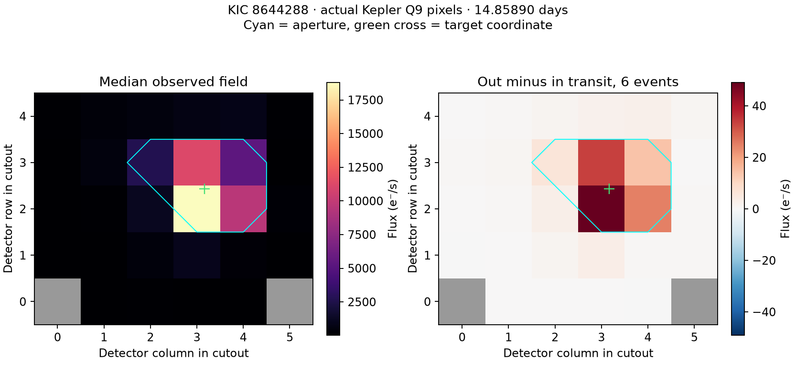
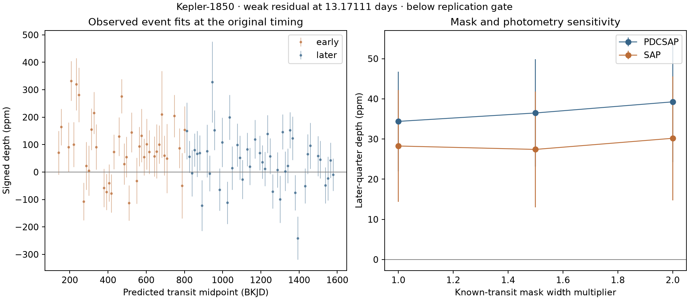

# Search for additional transiting planets in known Kepler systems

Executed 21 November 2026. The search recovered both withheld known
planets. None of the 36 observed peaks from the 12 search systems passed
the replication gate. Kepler-1850 produced the strongest weak residual,
at 13.17111 days, but the later data did not support a candidate-level claim.

## Sample and search

The pinned NASA Kepler Objects of Interest snapshot supplied 893 eligible
hosts with exactly one confirmed named transit, a catalogue stellar radius
of 0.5–1.5 solar radii, a known transit period of 0.5–20 days, and a usable
epoch and duration. The first 12 hosts under a fixed SHA256 ordering formed
the search sample. Kepler-10 and Kepler-18 were included as controls with
one confirmed planet withheld from each mask. Kepler-1437 was included to
test whether masking its known planet would suppress the 32.79-day alias
from the [previous experiment](transit_discovery_search.md). The sample
uses archival availability and defined selection criteria, and the small
number of stars limits what can be inferred about the wider population.
[NASA KOI data](https://exoplanetarchive.ipac.caltech.edu/docs/PurposeOfKOITable.html)

All 15 targets had usable discovery and replication baselines. The **236
long-cadence light curves** supplied 797,215 quality-zero finite samples,
of which 47,096 were inside the known-transit masks. There were 640,158
cadences retained after masking and detrending, including cadences in
early or later quarters used by the search. The code verifies target IDs,
quarters, BJD TDB origins, and file fingerprints. [MAST Kepler archive](https://archive.stsci.edu/missions-and-data/kepler)

The mask removes samples within one published full duration on either
side of each known transit midpoint, with an extra half-cadence margin.
Masked fluxes are excluded before estimating the three-day running
median. The running median does not bridge gaps longer than half a day.
The periods and epochs in the primary masks assume linear timing. A
large transit timing variation can leave residuals, and masking can
remove some events of a different planet.

Quarters 1–8 are searched over **2–50 days**, with trial durations of
0.08, 0.14 and 0.24 days. The logarithmic period grid bounds the change
in predicted transit timing across the discovery baseline between
adjacent grid values to half the shortest trial duration. The code
refines each peak locally and excludes its neighbouring trial periods
before choosing another peak. Harmonics can still reach a different
rank. Three peaks are carried into quarters 9–17 without refitting
period, epoch or duration. Both halves need at least three measurable
events and an event-combined depth-to-error contrast of five. Signed
depths, including brightenings, remain in the tables. The error estimate
uses diagonal cadence noise and local and between-event scatter.
[Astropy box least squares](https://docs.astropy.org/en/stable/timeseries/bls.html)

The same procedure evaluates inverted flux. None of the 45 inverted peaks
passed both halves. The 45 observed peaks include 36 from search hosts,
three from the Kepler-1437 control and six from the withheld-planet controls.
Only three observed peaks passed, all on the withheld-planet systems.
An inverted search on this small sample cannot calibrate the global
false-alarm rate. Within a star, peak trials can overlap substantially.

## What the controls recovered

| System | Recovered period (days) | Interpretation |
|---|---:|---|
| Kepler-10 | 45.29592 | Known Kepler-10 c, after masking b |
| Kepler-18 | 14.85890 | Known Kepler-18 d, after masking b and c |
| Kepler-18 | 29.71795 | Every second transit of Kepler-18 d |
| Kepler-1437 | — | None of the three peaks after masking b passes |

All measurable midpoints of the three passing peaks align with the
catalogue ephemerides at the accepted period ratio and phase tolerance.
The 29.71795-day fit also has a strong dip at phase 0.5, where the
interleaved Kepler-18 d transits fall. Each direct recovery survives a
1.5-times wider known-transit mask and the removal of any one later event.
The recovered periods are grid estimates for vetting. The catalogue gives
more precise ephemerides. [Kepler-10 system](https://exoplanetarchive.ipac.caltech.edu/overview/Kepler-10) · [Kepler-18 system](https://exoplanetarchive.ipac.caltech.edu/overview/Kepler-18)

The difference image uses six Q9 events and the mean of measurements in
windows before and after the predicted dips. The cyan outline marks the
pipeline aperture. The image shows the host field and the change during
transit. No quantitative centroid uncertainty or blend exclusion is
derived from the image.

The post-search catalogue check uses the pinned KOI snapshot and current
queries of the cumulative KOI and DR25 Threshold-Crossing Event tables
for the 15 KIC identifiers. The two live queries return 18 entries each.
Period ratios of 1/4, 1/3, 1/2, 1, 2, 3 and 4 are checked within 0.5%.
A majority of measured event times must overlap at the allowed phase
tolerance for a timing match. Other aliases, neighbouring stars and
uncatalogued signals require further vetting.
[Kepler TCE tables](https://exoplanetarchive.ipac.caltech.edu/docs/Kepler_TCE_docs.html)

## Kepler-1850 residual

The fixed **13.17111-day** ephemeris on KIC 7879433 had the largest minimum
of the two contrasts among the 36 observed search-host trials. There
is no direct or tested harmonic match in the queried tables. The known
1.38579-day planet Kepler-1850 b was masked.
[Kepler-1850 system](https://exoplanetarchive.ipac.caltech.edu/overview/Kepler-1850)

| Photometry, primary mask | Quarters 1–8 | Quarters 9–17 |
|---|---:|---:|
| Pipeline-corrected PDCSAP | 80 ± 18 ppm, 40 events | 34 ± 12 ppm, 46 events |
| Aperture flux SAP | 36 ± 15 ppm, 40 events | 28 ± 14 ppm, 46 events |

Doubling the known-transit mask still gives a positive later depth, but
the contrasts remain below the gate. Out of 97 shifted phases, 29 have
at least 46 usable later events in each reduction. None matches the
original later PDCSAP contrast. Three exceed the later SAP contrast.
These phase samples reuse the same observations and the residual was
selected using both halves. The phase rank therefore does not give a
discovery probability. SAP and PDCSAP also share photons. The residual
remains below the main replication threshold, with no new planet claim.

## Sensitivity check

The first search host, KIC 12404954, received four synthetic injections
into its actual PDCSAP time series before masking and detrending. The
transits used periods of 8.137 and 24.691 days at 200 and 500 ppm.
All four reappeared among the three search peaks, passed replication,
and matched the injected periods and timings. These artificial signals
are explicitly labelled. Four injections into one star cannot quantify
completeness, especially for a shallower 34-ppm residual on another star.

The [execution ledger](../experiments/kepler_companions.yaml) records the
commands. Inspect the [peak table](../results/kepler_companions/candidates.csv),
[catalogue vetting](../results/kepler_companions/vetting.json),
[individual events](../results/kepler_companions/events.csv),
[weak-residual sensitivity](../results/kepler_companions/weak_lead_sensitivity.csv)
and [injection results](../results/kepler_companions/injections.csv).
