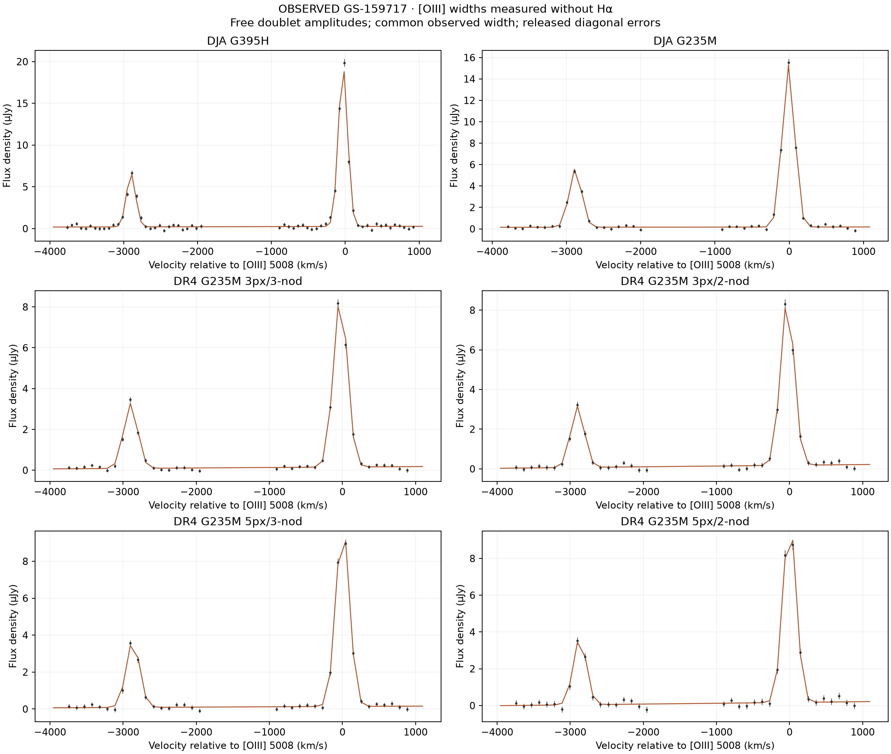
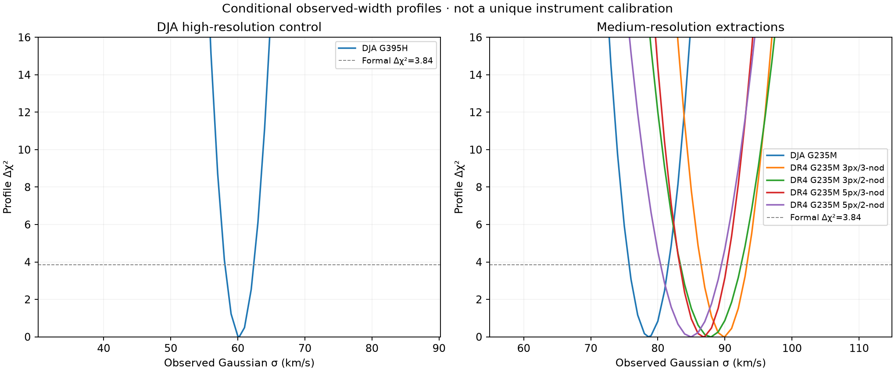
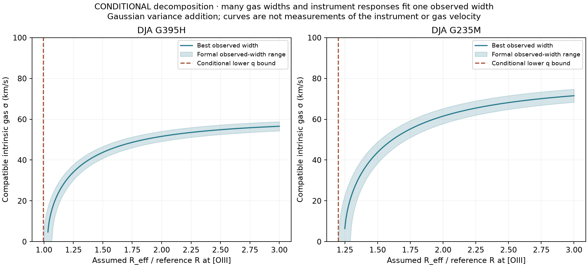

# Can another line calibrate the instrumental blur?

Research snapshot: **15 November 2026**, following the [Balmer benchmark](balmer_audit.md).
Author: Biswajit Jana. Observed measurements and explicitly conditional models.

**The [OIII] doublet provides a conditional lower limit on resolving power, not a
unique instrument calibration.** The same observed width can be produced by
different combinations of intrinsic gas motion and instrument blur. G235M also
shows a reduction-dependent width difference. We therefore do not use this test
to claim a uniquely calibrated absorber or a new black-hole star.

## Data and coverage

We checked eleven extraction variants: DJA G395H, G235M and G395M, plus four
DR4 aperture/nod variants for each medium-resolution grating. Both [OIII] lines
are fitted in ±500 and ±900 km/s windows, giving **22 attempted measurements,
12 fitted and 10 explicitly unavailable**. The unavailable measurements are all
G395M: the released data contain zero usable pixels in these line windows.
A grating name alone would have incorrectly implied a usable calibration line.

Two new observed products (DJA and JADES DR4 G235M), an actual DR4 directory
listing, and the STScI G395H resolution table were retrieved through the finite
4 GiB cache. No archive neighbour was substituted. DR4 target, programme and
coordinates were checked against the existing GS-159717 association. All paths
and hashes are retained in the [input record](../results/line_anchor/inputs.json)
and [download record](../results/line_anchor/downloads.json).

## Observed narrow-line measurements

The model has two independently fitted nonnegative line areas, a common observed
Gaussian width and velocity, and a linear continuum. The area ratio is free.
We integrate the model over the spectral pixels, retain signed flux and missing
values, and use the released diagonal errors without rescaling or residual
clipping. No Hα pixels enter these fits. Wavelengths are vacuum 4960.295 and
5008.240 Å, with z=5.07781 as the velocity reference and a free fitted shift.

Results for ±900 km/s windows:

| Extraction | Observed σ (km/s) | Formal Δχ²≤3.84 range | χ²/(n−6) | Conditional lower R at [OIII] |
| --- | ---: | ---: | ---: | ---: |
| DJA G395H | 60.22 | 58.09–62.37 | 1.77 | 2041 |
| DJA G235M | 78.62 | 75.73–81.57 | 0.99 | 1561 |
| DR4 G235M 3px/3-nod | 89.82 | 86.46–93.27 | 1.09 | 1365 |
| DR4 G235M 3px/2-nod | 87.82 | 83.38–92.41 | 0.82 | 1378 |
| DR4 G235M 5px/3-nod | 86.76 | 83.27–90.31 | 0.75 | 1410 |
| DR4 G235M 5px/2-nod | 84.90 | 80.43–89.48 | 0.92 | 1423 |

The profile statistic refits continuum, amplitudes and velocity at fixed width.
Its threshold is a formal one-parameter likelihood convention, **not a calibrated
95% confidence statement** when correlated errors, non-Gaussian profiles or
calibration systematics are omitted. Grid limits that fail to bracket a crossing
produce null endpoints, not invented limits. All profiles and both window sizes
are stored in [fits](../results/line_anchor/fits.json) and the
[measurement table](../results/line_anchor/width_constraints.csv).



The high-resolution width is stable between the two windows (60.14 versus
60.22 km/s), but its reduced χ² is 2.59 in the narrower window and 1.77 in the
wider one. The Gaussian model and diagonal errors do not fully describe the
data; stable widths alone do not certify the model. We retain that limitation
when discussing instrument bounds.

DJA G235M gives 78.62 km/s; DR4 3px/3-nod gives
89.82 km/s, about 14.3% broader.
This is a comparison of reductions/extractions with shared observations, not an
independent difference-significance test. We do not attribute the discrepancy
uniquely to a pipeline defect, physical variability or gas kinematics.



## What the width can and cannot establish

Under a local Gaussian convolution model,

`sigma_observed² = sigma_intrinsic² + sigma_instrument²`.

Nonnegative intrinsic variance implies
`R_effective ≥ c / (2.35482 * sigma_observed_upper)`.
It supplies **no finite upper limit on R**, because a narrower instrument profile
can be offset by greater intrinsic gas width. Neither term should be fixed to
zero merely to force a unique answer.



For G395H the formal [OIII] bound is R≥2041.
The [STScI instrument documentation](https://jwst-docs.stsci.edu/jwst-near-infrared-spectrograph/nirspec-instrumentation/nirspec-dispersers-and-filters)
provides wavelength-dependent reference resolving powers. Its tabulated values
at this source's [OIII] and Hα wavelengths are 2052 and
2731. **Only if** the ratio of effective to reference
resolution is constant within G395H can the lower bound transfer to approximately
R(Hα)≥2717. This assumption does not
determine the source's illumination profile or guarantee that [OIII] and Balmer
components have the same effective response. Model mismatch further limits the
formal bound. It is not a hard rejection threshold for the previous Hα fits.

G235M cannot be extrapolated to Hα in G395M. The gratings and wavelength coverage
differ, and the common scale factor would be an additional untested assumption.
We leave that transfer null. The medium-resolution absorption sensitivity
identified previously therefore remains unresolved.

The [published source study](https://arxiv.org/html/2506.14870v2) also discusses
line-spread-function and spatial-extent complications. This experiment measures
our released products; it does not reproduce its full multi-line Bayesian model.

## Returning to the wider candidate set

We also inventoried all **23 existing priorities** from the two
search queues. 9 have a listed
high-resolution grating product and 15
have a listed medium-resolution product; these counts can overlap. Product
listings are not evidence of usable line coverage. The GS-159717 G395M gap
demonstrates why coverage must be checked from pixels before further fitting.

The [priority inventory](../results/line_anchor/priority_followup_inventory.csv)
and [individual archive products](../results/line_anchor/priority_archive_products.csv)
record exact source IDs, URLs, cached-file status and expected observed line
wavelengths. No new source has been claimed or automatically merged. The total
search remains 4,731 analysed records.

The [subsequent high-resolution follow-up](high_resolution_followup.md) now
executes pixel-level checks on all twelve listed high-resolution products and
conditional Hα model comparisons where coverage permits. The known benchmark
exercises expose limitations that should be resolved before applying discovery
language to unfamiliar objects.

## Reproduction

```sh
python scripts/replay_manifest.py --budget-mib 4096
python scripts/download_line_anchor.py
python scripts/analyse_line_anchor.py
python scripts/build_line_anchor_report.py
pytest -q
ruff check src tests scripts
```

See the [run summary](../results/line_anchor/summary.json),
[inventory provenance](../results/line_anchor/inventory_provenance.json) and
[execution ledger](../experiments/line_anchor.yaml). Figures have PNG and PDF
versions. Conference posters remain the dated 12 November snapshot until the
final synthesis; this report adds reproducible measurements for that revision.
