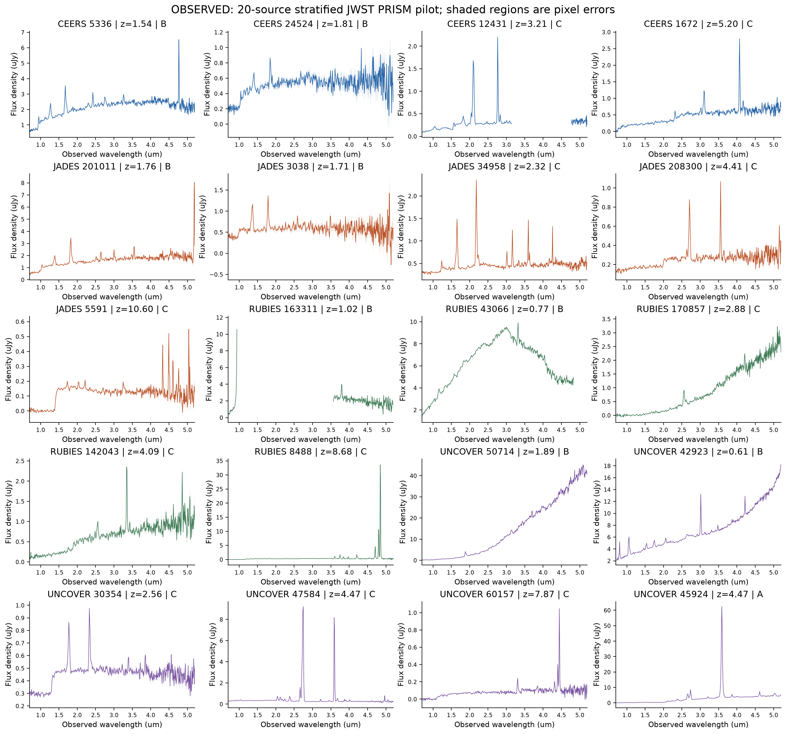
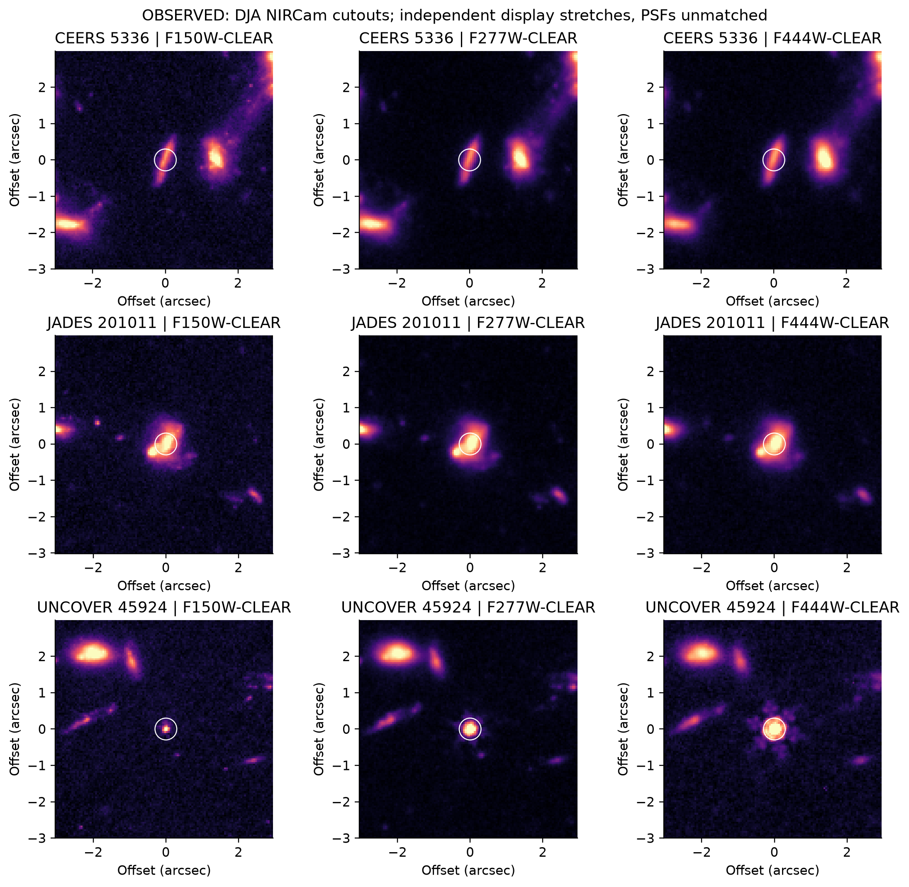
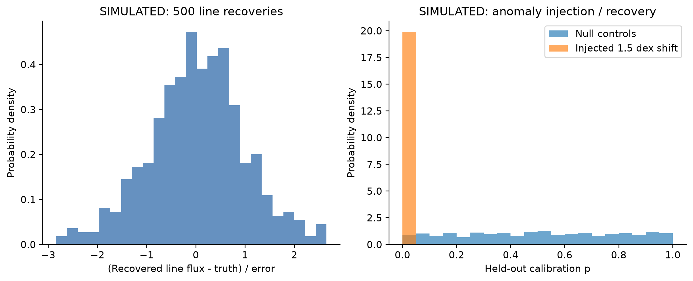
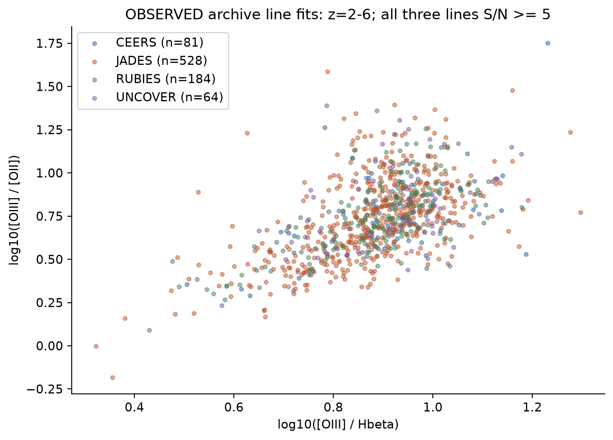
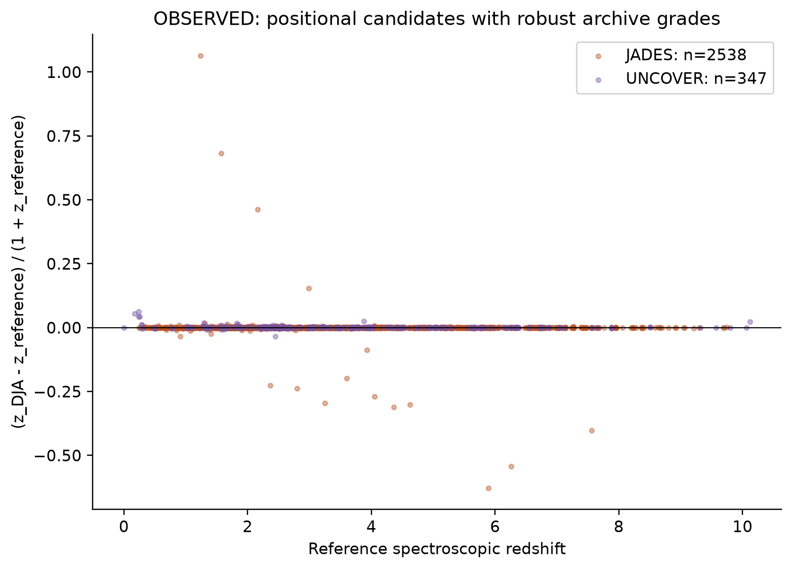

# A Multi-Survey Investigation of Unusual JWST Infrared Sources: Physical Modelling, Competing Interpretations, and the Search for Unexplained Astrophysical Populations

**Research owner: Biswajit Jana. Version 0.1 executed pilot.**

Run `pilot-v0.1-6cb8c15b5c`; machine-recorded execution: `2026-11-11T07:43:08.486862+00:00`.
This report documents an initial investigation. It does not claim the full research
programme or all proposed experiments have been completed.

## Abstract

We constructed a persistent registry of 20,144 upstream
source records and 44,619 spectral products from four JWST
surveys in five fields, retaining separate JADES and UNCOVER reference catalogues.
We downloaded and analysed 20 actual PRISM spectra, measured
16 continuum-ratio proxies and 14 local
emission-blend regions, and measured 9 diagnostic NIRCam
apertures. An error-aware two-feature search ranked 857 archive
sources using 10 field/redshift holdouts. Eight nominal p<=0.01
outliers remain unvetted; none pass the reported 5% Benjamini-Hochberg adjustment.
Known-truth simulations give a 1.0% null false-positive
rate and 96.8% recovery for the specified artificial injection.
Neither these simulations nor the observational ranking establishes a new physical class.

## Research motivation

Unusual infrared colour, a continuum break or a broad blend can arise from several
physical and observational causes. The platform therefore separates measurements,
published labels, model applicability and final interpretation. The pilot includes
one published unusual benchmark and independently selected comparison/archive objects.
GLIMPSE-17775 does not set the architecture or selection. The immediate falsifiable
tests concern archive accessibility, measurement recovery, catalogue agreement and
whether statistical outliers remain significant after accounting for many tests.

## Survey coverage and datasets

| Survey | Upstream source records | Spectral products |
| --- | ---: | ---: |
| CEERS | 1,336 | 2,077 |
| JADES | 12,978 | 33,402 |
| RUBIES | 5,019 | 8,239 |
| UNCOVER | 864 | 901 |

Survey memberships overlap. The unique count of 20,144
uses DJA objid, not a new determination of independent physical objects. Lensed
images and blends have not been reconstructed into source-plane objects.
The full DJA snapshot contains 80,367 spectra; the four-survey
subset is retained. JADES DR4 contributes 5,190 reference
target rows and UNCOVER DR4.1 668; they overlap the DJA
catalogue and are never added to its source count.

MAST public spectroscopy queries for programmes 1210, 1345 and 2561 returned
1,244, 5,253 and 1,187 observation rows respectively. Product inventories were
requested for one observation in each programme, not downloaded in bulk.
Release pages for additional collections are inventoried separately. A page
response is not evidence that every named product can be retrieved. Two guessed
landing endpoints failed (RUBIES and NGDEEP); RUBIES is actually released through
DJA, and NGDEEP has additional published archive paths, recorded in the inventory notes.

The raw cache contains 231.1 MiB under a 512 MiB budget, including
catalogues, 20 spectra, three multi-band cutout files and a resolving-power table.
The DJA master catalogue matches its publisher MD5; all 28 products have local
SHA256 fingerprints. See [manifest](../data/manifests/downloads.json).

## Literature review

The curated references distinguish the survey/reduction publications from physical
interpretations. RUBIES, JADES and UNCOVER have different target-selection and
reduction histories. Published work on UNCOVER 45924 provides evidence beyond a
single low-resolution spectrum; this pilot does not reproduce all of that work.
Dense-gas interpretations and variability/X-ray non-detections motivate tests of
multiple explanations rather than adoption of one mechanism for every LRD.
Quasi-star scenarios are retained as hypotheses requiring quantitative forward models.

Crossref and OpenAlex were queried with two recorded queries each, retrieving ten
metadata records per query. Explicit identifiers deduplicate records; approximate
title matches do not automatically merge preprints and papers. The curated list
connects known arXiv/published versions where verified. ADS public access returned
an access error during research; no comprehensive ADS API search is claimed.
arXiv abstract pages and official release documentation were reviewed. Search logs
describe coverage; this is not a systematic or exhaustive literature review.

## Sample selection

Sample A has 1 published-candidate benchmark (UNCOVER 45924).
Sample B has 8 low-redshift comparison candidates; these are
operational comparison objects, **not independently certified normal-galaxy controls**.
Sample C has 11 archive-selected objects. Grade 3 PRISM rows with
archive median pixel S/N>=5 are ordered by a fixed hash within survey and redshift
bins [0.5,2), [2,4), [4,7), [7,12). Repeated upstream objids are not counted twice.
There is no qualifying CEERS high-redshift entry for the requested final bin;
no replacement is invented. The selected redshift range is
0.606-10.604.

The parent spectroscopy is targeted and heterogeneous. Exposure time is recorded
per product; there is no common survey flux limit. Completeness is unestimated.
Redshift success, continuum S/N, wavelength coverage, upstream colour targeting,
public-release history and extraction quality all impose selection biases.
The line-ratio population additionally requires all three lines at S/N>=5 and a
line-fit redshift within 0.005(1+z) of the archive best estimate. It cannot measure
the incidence of weak-line, line-free, faint or otherwise excluded populations.

## Spectroscopy and imaging methods

FITS column units are validated and converted with Astropy. Nonfinite bins,
nonpositive errors, absent extraction pixels and flagged DQ are masked. Wavelengths
must increase strictly; 0.7-5.2 um is retained to limit edge/extended-order issues.
The published flux is used without an extra aperture/path-loss rescaling.
Released wavelength calibration is assumed; no independent lamp/sky calibration
is performed. Masked gaps remain gaps in figures.

The continuum ratio is inverse-variance mean fnu in rest 4000-4200 angstrom divided
by that in 3400-3600 angstrom. Each band needs at least three usable pixels and
mean S/N>3. This is a continuum proxy, not a unique physical Balmer-break measure.
Errors propagate from pixel variance with redshift held fixed.

The Halpha+[NII] region is fitted with a linear continuum and pixel-integrated
Gaussian blend templates at fixed redshift. Intrinsic sigma=100 and 1500 km/s are
template choices, not measured velocities. The LSF uses interpolated PRISM
resolving power with scale factors 1.0, 1.3 and 1.6; errors are also inflated by 1.5
for sensitivity checks. Linear coefficient covariance propagates to flux and EW.
The blend cannot separate Halpha, [NII], absorption, velocity shifts or scattering.

DJA cutouts supply WCS, SCI and inverse-variance WHT extensions for F150W, F277W
and F444W. Apertures have 0.3 arcsec radius; a clipped-median sky comes from
0.8-1.2 arcsec. PHOTFNU provides the unit conversion. The panels share sky positions
and angular scales but use independent display stretches. PSFs are unmatched;
drizzle covariance, aperture correction, segmentation and deblending are unfinished.
No intrinsic size or morphology difference is inferred.

## Physical models and competing interpretations

Implemented physical baselines are spherical blackbody Lnu, fully ionized-hydrogen
Thomson Eddington luminosity, efficiency-times-accretion-rest-energy luminosity,
and Planck18 luminosity-distance/redshift flux transformations. They use Astropy
constants and units. These are analytic approximations, not complete disc,
stellar-atmosphere, gas-envelope, SPS, nebular or lensing models. No blackbody is
fitted to a real source as proof of its physical class.

The hypothesis registry supports overlapping uncertain populations and checks
which observables a hypothesis requires. All full physical-family solvers are
honestly marked unimplemented. Empirical continuum/narrow/broad blend comparisons
are useful diagnostic alternatives, not a competition between AGN and stars.
The likelihood module supports covariance, a shared Gaussian calibration term,
and independent censored upper limits. Posterior sampling, physical prior studies
and reliable Bayesian evidences have not been performed.

## Simulation design and statistical inference

The seeded experiment (`20261110`) repeats a linear-continuum plus Gaussian line
recovery 500 times with known errors. The recovered amplitude pull mean is
0.024, its standard deviation is
0.975, and nominal 95% coverage is
94.8%. This tests the conditional estimator under
its assumed model, not model misspecification or instrument systematics.

The anomaly experiment uses 1,500 synthetic training inliers, 1,000 calibration
inliers, 1,000 independent null controls and 500 shifted injections with varying
measurement errors. A 1.5 dex shift in one feature is intentionally large.
There are 10/1,000 false positives at p<=0.01
(95% binomial interval 0.481%-
1.831%), and
484/500 injections recovered (95% interval
94.9%-98.2%).
There is no claim that real astrophysical contaminants have this distribution.

## Population results and anomaly detection

The measured continuum proxies span 0.887-
3.745 among the 16 usable cases. UNCOVER 45924 has
ratio 3.745 +/- 0.019 (conditional
statistical error), demonstrating a strong contrast between the specified windows.
It does not identify the emitting or absorbing physical medium.

The archive population includes 857 sources. The two
features are log10([OIII] doublet/Hbeta) and log10([OIII] doublet/[OII]). Separate
[OIII] components are combined where necessary; their covariance is unavailable.
Robust intrinsic covariance is combined with each source's measurement covariance,
including the shared numerator. The calibration set is separate from training.
Each test field is held out in two redshift bins; a survey-independent reduction
is not implied. Full leave-one-survey-out validation remains additional work.

Eight nominal p<=0.01 objects are returned as an **unvetted triage list**. None
passes the reported 5% BH adjustment. In high-z folds, calibration samples of
64-91 objects have minimum p>0.01, so the absence of high-z flags is partly a
resolution limit of calibration, not evidence that the population is ordinary.
Population shift and shared fit errors further limit the p-value interpretation.
No cosmic abundance, physical discovery significance or real-data FPR is inferred.

## Systematic uncertainty analysis

Within 0.3 arcsec, there are 5,437 positional reference
pairs; 2,885 have unambiguous matches and qualifying
archive grades. Their median absolute normalized redshift difference is
0.000142; 24
exceed 0.02. These are candidates for checking, not 24 established incorrect
redshifts. Association, quality conventions, line identification and reduction
can all contribute. This comparison does not use published redshift errors to
test formal significance.

LSF and error-inflation outputs are retained for each fitted source. In
4 of the 14 fitted sources, the preferred
empirical profile changes under the tested resolving-power assumptions. This
directly demonstrates why profile preference alone is not secure physical
broadening evidence. Absolute flux
calibration, correlated spectral noise, redshift uncertainty, aperture/path losses,
foreground contamination, alternate line identification, independent reductions,
blending and source-specific lensing remain material uncertainties. The 2D spectra
are downloaded but not systematically adjudicated. The shortlist is not classified
as physically unexplained until all those checks and a sufficient model library exist.

## Interpretation of unusual candidates

The published UNCOVER benchmark has diagnostic aperture fluxes of approximately
0.344, 2.487 and 4.016 microJy in F150W, F277W and F444W respectively, and a strong
measured continuum contrast. Independent stretches and unmatched
PSFs preclude a quantitative morphology conclusion. Published AGN interpretation
is recorded as literature evidence; it is not inferred solely from our broad
Gaussian template. All 20 source reports retain INSUFFICIENT_EVIDENCE for the
requested full physical comparison. Missing data do not imply a new class.

## Scientific limitations and future observational tests

The initial programme has delivered real metadata, spectra, cutouts and bounded
validation rather than complete physical modelling. It has not yet established
well-characterised controls across all requested populations, fitted complete
competing physical families, performed lens reconstructions or measured variability.
No entire sample is labelled as LRD, BH-star or anomalous.

The highest-priority next work is: inspect the 24 discrepant positional pairs
with their 2D and independent reductions; validate shortlist stability using
full line covariance and reduction alternatives; assemble independently characterised
control labels; build PSF-matched photometry; then add validated SPS, AGN and
gas/stellar-atmosphere grids before posterior comparisons. Hydrogen/helium ratios,
resolved line wings, long-wavelength continuum and multi-epoch observations are
qualitative discriminants. The generic separation function is tested, but no
sensitivity-based exposure forecast has been executed.

## Conclusions and experiment status

Public data support a broad, reproducible multi-survey investigation. Continuum
and line-ratio diversity is measurable in the pilot, while catalogue discrepancies
and selection/instrument limitations require further scrutiny. The implemented
search produces no multiplicity-adjusted physical discovery claim. No observation
has yet been established as unexplained by all meaningful physical models.

EXP-001 and EXP-013 ran as bounded pilots; EXP-014 completed its specified
synthetic experiment. EXP-002, 006, 007, 010 and 012 are partial. All other proposed
experiments are planned, including EXP-009 (photometric-vs-spectroscopic redshifts).
The current reference comparison is spec-z versus spec-z and does not complete
EXP-009. Every status and artifact is recorded in the experiment registry.

## Reproducibility and references

See README commands, the source-level JSON/Markdown reports, measurement CSVs,
input/code hashes in `results/run_summary.json`, the download manifest, dependency
lock, tests, and CI. Six figures are supplied as PNG and vector PDF. Source code
is MIT; dataset rights and acknowledgements remain with the original teams.

- [The DAWN JWST Archive: Compilation of Public NIRSpec Spectra](https://zenodo.org/records/15472354) — Catalogues and uniform msaexp reductions; inspect calibration and counterpart caveats.
- [JADES Data Release 4: Sample selection, observing strategy and redshifts](https://doi.org/10.1093/mnras/stag836) — Selection and redshift reference; targeting is not a random galaxy sample.
- [JADES Data Release 4: Data reduction, analysis and emission-line fluxes](https://doi.org/10.1093/mnras/stag939) — Independent JADES reduction reference; catalogue comparison does not replace full spectral reanalysis.
- [JADES NIRSpec Initial Data Release for the Hubble Ultra Deep Field](https://arxiv.org/abs/2306.02467) — Original deep spectroscopic observations and reduction context.
- [The UNCOVER Survey: First Release of Ultradeep JWST/NIRSpec PRISM Spectra](https://doi.org/10.3847/1538-4357/adaec1) — Independent release, including quality and background advisories; cluster-field lensing needs source-specific models.
- [RUBIES: A complete census of the bright and red distant Universe with JWST/NIRSpec](https://doi.org/10.1051/0004-6361/202452186) — Bright/red targeting affects population comparisons; public reductions supplied through DJA.
- [CEERS Data Release 1.0](https://ceers.github.io/dr1.html) — Photometric and image availability verified; this pilot uses DJA CEERS spectra and cutouts, not the full CEERS DR1 catalogue.
- [An unambiguous AGN and a Balmer break in an Ultraluminous Little Red Dot at z=4.47](https://arxiv.org/abs/2412.04557) — Published-candidate benchmark identity; our single PRISM profile fit is not a reproduction of all its physical evidence.
- [Challenging the AGN scenario for JWST/NIRSpec LRD and non-LRD broad Halpha emitters](https://arxiv.org/abs/2407.04777) — Non-detections in variability and X-rays motivate alternative or modified interpretations; no such observations are analysed in this pilot.
- [Little red dots as young supermassive black holes in dense ionized cocoons](https://www.nature.com/articles/s41586-025-09900-4) — Dense-gas interpretation to test with transfer models and resolved line structure; not assumed for every source.
- [Little Red Dots As Late-stage Quasi-stars](https://arxiv.org/abs/2507.09085) — Theoretical alternative; not implemented or validated here.
- [Distance measures in cosmology](https://arxiv.org/abs/astro-ph/9905116) — Luminosity-distance and spectral-density transformations.
- [The Near-Infrared Spectrograph on JWST: Overview of the instrument and its capabilities](https://arxiv.org/abs/2202.03305) — Instrument resolving-power context; position-dependent LSF remains a systematic.
