# Open search: fainter sources and unfamiliar spectral shapes

Research owner: Biswajit Jana. Research snapshot: 13 November 2026.
No new physical class, black-hole star, or cosmological anomaly is established.

## What was executed

The added fixed sample contains **2,084 sources**, all with PRISM grade 3, 2 ≤ archive median pixel S/N < 5, and 0.5 ≤ z < 12. The highest-S/N product per upstream source ID was selected, excluding the previous sample. No colour or physical-class filter was applied.

**2,084 new sources analysed; 0 failures.** The combined experiment now covers **4,731 upstream source records**, 23.5% of the 20,144-record parent catalogue. This is the full stated S/N ≥ 2 reliable-redshift subset, not a complete JWST census. Upstream IDs are not independently deduplicated physical galaxies.

The unchanged earlier continuum-plus-blend cuts add **0 joint priorities**; the combined count is 11. A non-selection in this fainter sample is not proof of physical absence: continuum coverage and measurement uncertainty limit sensitivity.

| Assigned survey | Combined analysed | Added sources |
| --- | ---: | ---: |
| CEERS | 506 | 180 |
| JADES | 2,897 | 1,328 |
| RUBIES | 1,016 | 442 |
| UNCOVER | 312 | 134 |

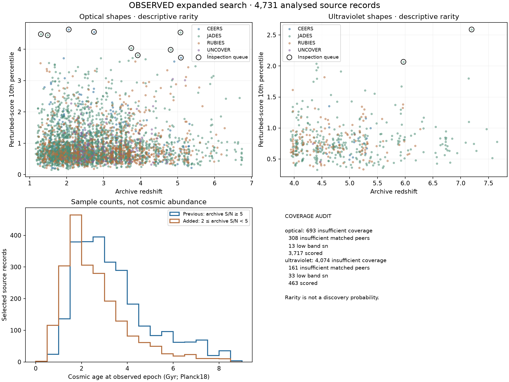

## Search without an assumed object class

Each spectrum is integrated into 12 logarithmically spaced rest-frame bands in 0.32–0.68 µm (optical) and separately 0.14–0.30 µm (ultraviolet). Signed fν is preserved. Pixel-overlap weights propagate both variance and the covariance from pixels shared between adjacent bands. Every band needs ≥80% coverage and at least two contributing pixels; median signed band S/N must be ≥3. Missing bands are never imputed. These bands include emission lines and are not pure continuum measurements.

Shapes are divided by RMS flux, retaining slope and signed structure. The target is excluded from its peers. Peers must be from the same assigned survey, within |Δz|/(1+z_target)<0.15 and a factor of two in archive S/N; at least 30 are required. The score is the RMS residual relative to the peer median, scaled by peer MAD (minimum 0.05) and approximate target band errors. It is not a likelihood or a physical-template fit. Shared normalisation creates bin dependence; the score is not chi-square.

We perturb measured band fluxes 128 times using their covariance, normalise each draw, and rank by the 10th percentile of the descriptive score. This is a conditional noise-sensitivity check, **not** a posterior confidence bound or a false-discovery calibration. Rank percentiles are calculated separately for the two wavelength windows, sorted together, deduplicated by upstream ID, and the top 12 selected for inspection. A fixed queue length does not assert that 12 scientifically significant anomalies exist.

**3,738 unique sources were shape-scored**, with 4,180 usable source/window pairs. Of the 12 queued sources, 0 also pass the earlier joint screen. The two methods ask different questions.

| Window | Status | Source records |
| --- | --- | ---: |
| optical | INSUFFICIENT_COVERAGE | 693 |
| optical | INSUFFICIENT_MATCHED_PEERS | 308 |
| optical | LOW_BAND_SN | 13 |
| optical | SCORED | 3,717 |
| ultraviolet | INSUFFICIENT_COVERAGE | 4,074 |
| ultraviolet | INSUFFICIENT_MATCHED_PEERS | 161 |
| ultraviolet | LOW_BAND_SN | 33 |
| ultraviolet | SCORED | 463 |

## Measured follow-up queue

Scores express relative rarity within restricted empirical peer groups. They do not demonstrate novelty in the literature or failure of established physics.

| Source | Survey ID | z | Window | Score | After removing strongest band | Other-survey score |
| --- | --- | ---: | --- | ---: | ---: | ---: |
| CAL-32a9558e75df5db5 | CEERS 3506 | 2.056 | optical | 4.64 | 3.68 | 4.10 |
| CAL-cb97f77b0458575a | JADES 13905 | 7.197 | ultraviolet | 2.66 | 1.98 | 2.15 |
| CAL-f91bb46f62c056d0 | CEERS 2772 | 2.737 | optical | 4.68 | 4.29 | 3.45 |
| CAL-82610407f3945338 | JADES 159717 | 5.077 | optical | 4.57 | 3.92 | 3.52 |
| CAL-7b976d826a0f5c42 | JADES 51 | 1.302 | optical | 4.53 | 3.87 | 4.32 |
| CAL-7e434e134b865988 | JADES 27395 | 1.487 | optical | 4.49 | 4.12 | 4.98 |
| CAL-83a0d9ab00fa5821 | JADES 41544 | 3.748 | optical | 4.14 | 3.70 | 2.27 |
| CAL-941584bf27525741 | JADES 98 | 4.812 | optical | 4.03 | 3.24 | 3.00 |
| CAL-5ad1397b3fd85dd4 | JADES 27830 | 3.921 | optical | 3.89 | 2.61 | 3.29 |
| CAL-ed111fba06e55a96 | JADES 38147 | 5.870 | optical | 3.85 | 1.54 | 2.60 |
| CAL-c4cc096986f550c1 | JADES 58441 | 5.969 | ultraviolet | 2.14 | 1.90 | 1.62 |
| CAL-6859aea7c7375087 | CEERS 1768 | 5.088 | optical | 3.79 | 2.76 | 3.72 |

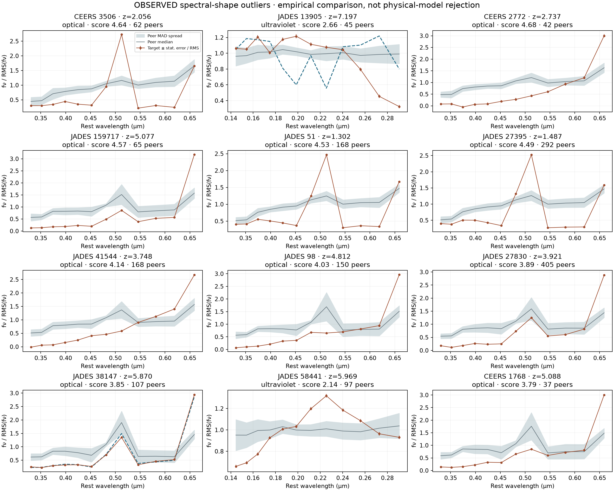

Grey regions show empirical peer scatter, not uncertainty on a physical model. Target bars show released statistical error divided by RMS; the full normalisation covariance is handled only by the perturbation test.

## Attempts to break the anomalies

For every queued source, we remove the largest-residual band, renormalise both target and peers using the remaining bands, and repeat the distance calculation. We also shift (1+z) by ±1% and reintegrate the spectrum against fixed peers. This is a deliberately broad stress test, not an inferred redshift error. Other-survey comparison uses the same redshift/S/N tolerances and at least 30 peers. These checks were added after fixing the search method and do not retroactively change the queue.

| Source | Score at −1% / +1% in (1+z) | Alternate PRISM check |
| --- | --- | --- |
| CAL-32a9558e75df5db5 | 5.31 / 4.79 | NO_ELIGIBLE_ALTERNATE_PRODUCT |
| CAL-cb97f77b0458575a | 2.70 / 2.81 | MEASURED; score 0.73 |
| CAL-f91bb46f62c056d0 | 4.66 / 4.63 | NO_ELIGIBLE_ALTERNATE_PRODUCT |
| CAL-82610407f3945338 | 4.96 / 3.80 | NO_ELIGIBLE_ALTERNATE_PRODUCT |
| CAL-7b976d826a0f5c42 | 5.22 / 4.95 | NO_ELIGIBLE_ALTERNATE_PRODUCT |
| CAL-7e434e134b865988 | 5.16 / 5.40 | NO_ELIGIBLE_ALTERNATE_PRODUCT |
| CAL-83a0d9ab00fa5821 | 4.12 / 4.13 | NO_ELIGIBLE_ALTERNATE_PRODUCT |
| CAL-941584bf27525741 | 4.13 / 3.94 | NO_ELIGIBLE_ALTERNATE_PRODUCT |
| CAL-5ad1397b3fd85dd4 | 4.15 / 3.71 | NO_ELIGIBLE_ALTERNATE_PRODUCT |
| CAL-ed111fba06e55a96 | 4.40 / 3.80 | MEASURED; score 3.71 |
| CAL-c4cc096986f550c1 | 2.17 / 2.17 | NO_ELIGIBLE_ALTERNATE_PRODUCT |
| CAL-6859aea7c7375087 | 3.88 / 3.65 | NO_ELIGIBLE_ALTERNATE_PRODUCT |

Alternate products share the upstream source association and reduction; they are not demonstrated independent exposures or independent extractions. A missing counterpart is missing evidence, not confirmation.

The UV shape of JADES-GS-13905 changes substantially between its two products (score 2.66 versus 0.73); the lower-S/N alternative does not support the same degree of rarity. This is a measurement/depth concern, not established variability. JADES-GN-38147 is more repeatable between products (3.85 versus 3.71), but its score drops to 1.54 after the strongest band is removed and the remaining shape renormalized. Neither check proves a new continuum family.

## Recovering a known LRD and testing resolution

The queue recovers CEERS-3506, an already studied extreme emission-line source ([Zhu et al.](https://arxiv.org/abs/2410.12198v2)), and the known LRD JADES-GS-159717 ([D'Eugenio et al.](https://arxiv.org/abs/2506.14870v2)). The latter passed our old broad-blend cut but failed the continuum-ratio requirement: its measured ratio is 1.33 rather than >2. The class-agnostic search therefore recovers an interesting known object missed by that conjunction. JADES-GS-13905 is also present at matching coordinates in [Chen et al.](https://arxiv.org/html/2505.24080v2). The full queue has not undergone an exhaustive novelty audit.

After the literature lookup, we downloaded the matched DJA G395M and G395H spectra of JADES-GS-159717. This is explicitly a targeted benchmark check. We fixed shoulder windows [-450,-250] and [250,450] km/s and a central window [-120,120] km/s, and measured (mean shoulders minus core) at the archive redshift and published systemic z=5.07781. Pixel-overlap covariance is propagated. A positive value would describe a local central dip, not identify its physical cause.

| Grating | Redshift basis | Shoulder minus core (µJy) | Statistical error (µJy) |
| --- | --- | ---: | ---: |
| G395H | archive | -3.544 | 0.189 |
| G395H | published_systemic | -3.746 | 0.190 |
| G395M | archive | -2.476 | 0.156 |
| G395M | published_systemic | -2.805 | 0.161 |

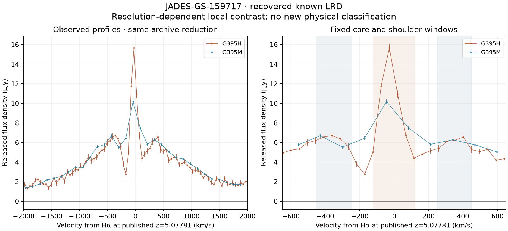

**The simple central-dip test fails here:** the central narrow emission peak dominates, giving negative contrasts in both gratings. The high-resolution profile resolves additional troughs flanking that peak. These measurements neither reproduce nor refute the published emission-plus-absorption decomposition. They show why a fixed core statistic cannot replace a full multi-component fit with the instrumental LSF and extraction checks. The paper's physical conclusions must not be attributed to this simpler test.

## Synthetic method check

A separate, explicitly synthetic test uses 300 noisy log-quadratic continuum peers, 500 calibration trials, and 500 independent trials per scenario. A 99th-percentile synthetic-null threshold is used only for this test; it is not applied as a discovery threshold to the real catalogue.

| Synthetic scenario | Selected / trials |
| --- | ---: |
| heldout_ordinary | 6 / 500 |
| continuum_step | 500 / 500 |
| smooth_bump | 500 / 500 |
| single_band_spike | 500 / 500 |
| negative_band_artifact | 500 / 500 |

The deliberately strong artificial defects also trigger the detector. Thus score alone cannot distinguish unusual astrophysics from defects. This simplified experiment omits extraction/calibration systematics and real population diversity; it does not estimate the real-source false-positive rate. Exact binomial intervals and assumptions are in the [validation record](../results/open_search/synthetic_validation.json).

## Actual source images and spectra

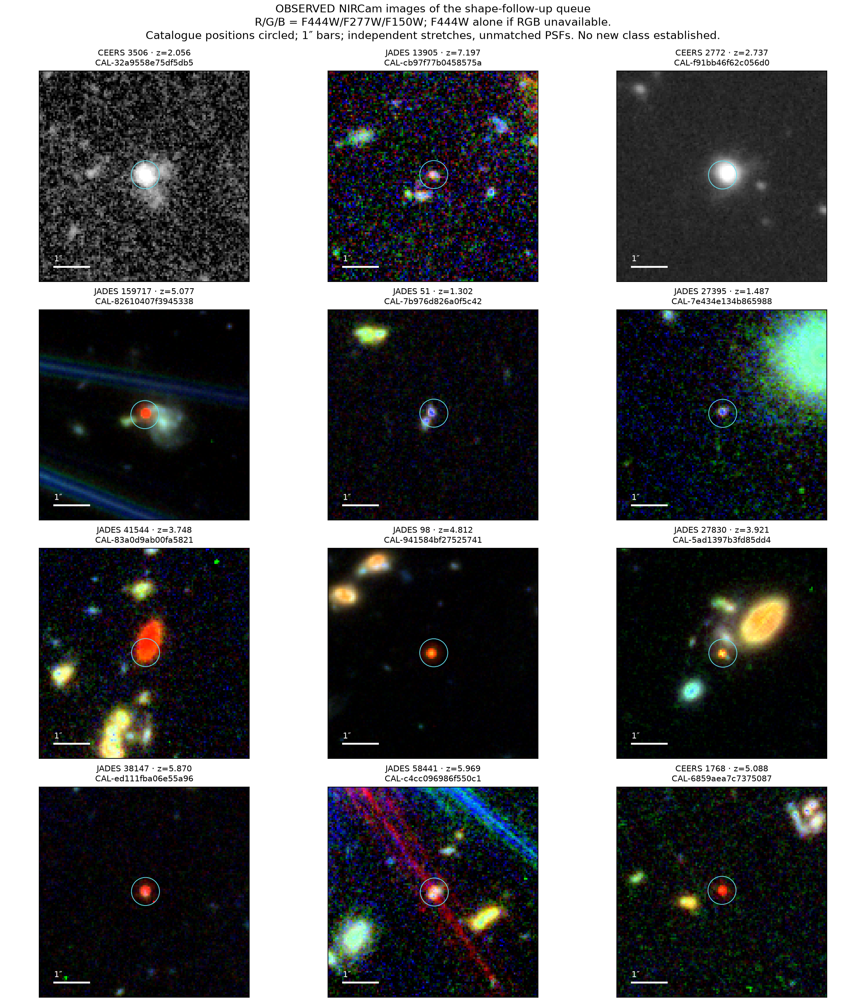

The cutouts contain observed NIRCam pixels, with display stretches and unmatched PSFs stated on the figures. Image brightness cannot be compared directly between independently stretched panels. Nearby components are not automatically merged or assigned to the spectrum.

### CEERS 3506 — CAL-32a9558e75df5db5

The optical shape has a strong excess in the band containing [O III], and the counterpart lies near other visible structure. This is the already published CEERS-3506 extreme emission-line source, discussed by [Zhu et al.](https://arxiv.org/html/2410.12198v2). Its inclusion demonstrates recovery of an interesting known spectrum, not a new class. The cutout has incomplete three-band coverage; the atlas uses F444W alone.

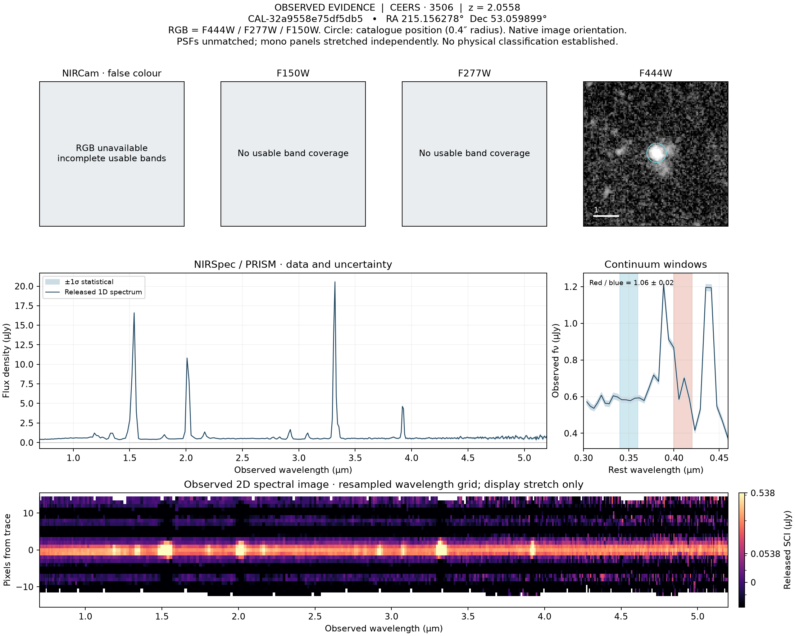

### JADES 13905 — CAL-cb97f77b0458575a

The primary product has a UV downturn near the red end of the search window, but the alternate lower-S/N PRISM product changes the normalized shape substantially (RMS difference 0.382; rarity score 2.66 versus 0.73). The primary 1D/2D sheet also shows substantial short-wavelength flux below the expected Lyman-alpha break location for the assigned z, while the image is crowded. Contamination, extraction and redshift association require review; this is not evidence for exotic UV physics. The same source coordinates and identifier are already listed in [Chen et al.](https://arxiv.org/html/2505.24080v2). A weaker alternate-product score is not by itself proof of variability or an artifact because its errors and depth differ.

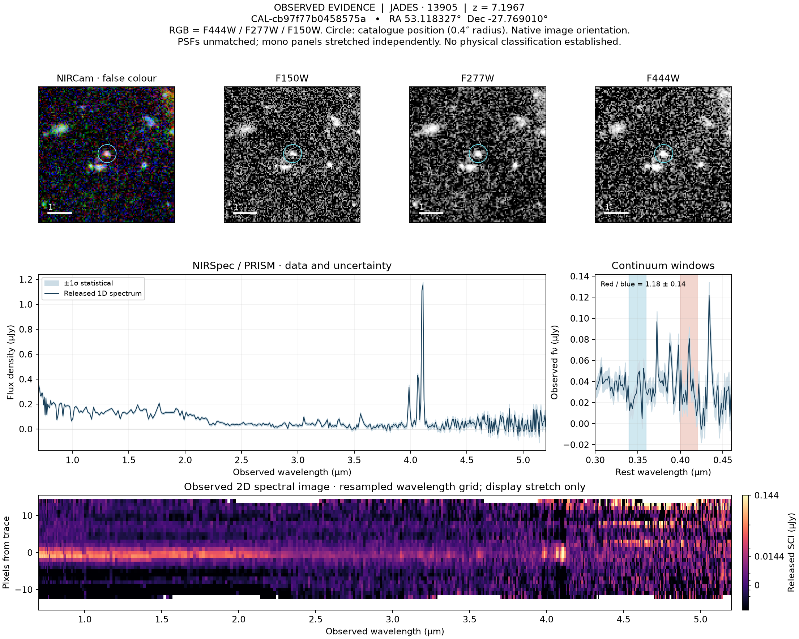

### CEERS 2772 — CAL-f91bb46f62c056d0

The observed spectrum rises strongly toward the infrared and has emission features, with very weak blue optical continuum. The shape remains unusual after the dominant band is removed and the remaining bands renormalized. Dust, host-plus-AGN mixtures and calibration are competing explanations to fit. The F150W cutout does not cover the target position, so the missing blue image must not be interpreted as an astrophysical non-detection. A targeted name search did not establish its literature identity; that is not a claim of novelty.

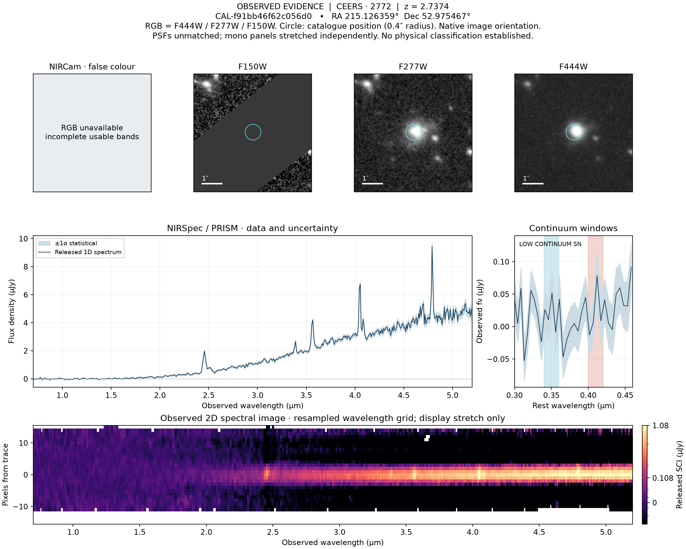

### JADES 159717 — CAL-82610407f3945338

This is the known JADES-GS-159717 / JADES-GS+033223.41-275404.5 little red dot discussed by [D'Eugenio et al.](https://arxiv.org/abs/2506.14870v2). Our old broad-blend screen passes, but the continuum ratio of 1.33 fails the required ratio >2, explaining why that queue missed it. The shape search recovers it without an LRD label. Nearby image components and linear structures make spatial/extraction checks important. The added G395M/G395H comparison is a targeted published-benchmark check, not independent discovery or a complete absorption fit.

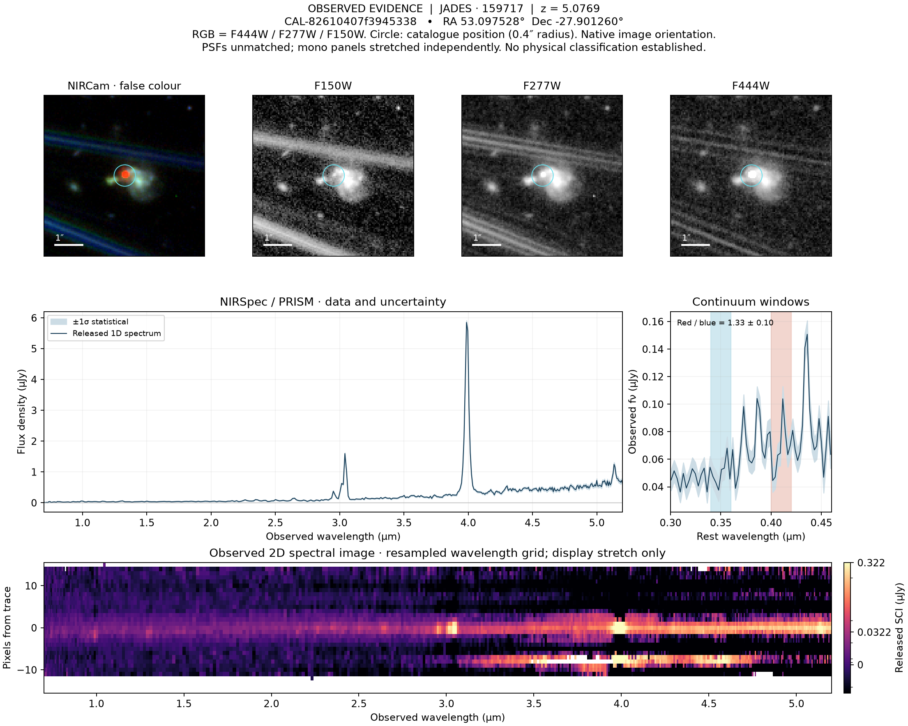

### JADES 51 — CAL-7b976d826a0f5c42

An excess around the optical band containing [O III] accompanies relatively weak continuum bands. This is consistent with an extreme emission-line spectrum as an observational description, but its physical power source has not been fitted. Keep the filename (jades-gds-w08-v4_prism-clear_1212_3941.spec.fits) with the upstream srcid 51: archive identifiers differ and must not be silently equated across catalogues.

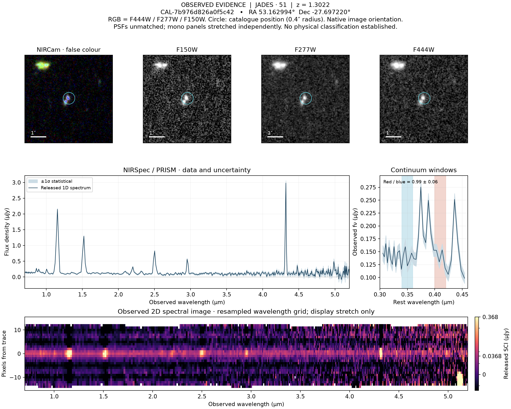

### JADES 27395 — CAL-7e434e134b865988

The band containing [O III] is enhanced relative to nearby continuum bands. A bright, extended image neighbour is visible near the cutout edge. The source and neighbour have not been merged or assigned a common redshift. Stellar/nebular and obscured-AGN models remain to be compared.

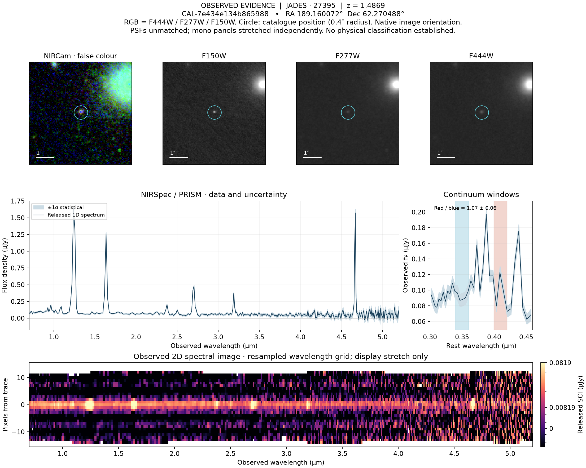

### JADES 41544 — CAL-83a0d9ab00fa5821

The optical shape rises to the red, while the image contains an extended red feature and several nearby components. The other-survey score is appreciably lower than the same-survey score. Blending, dust and host structure need explicit testing before interpreting the spectrum as one unusual compact object.

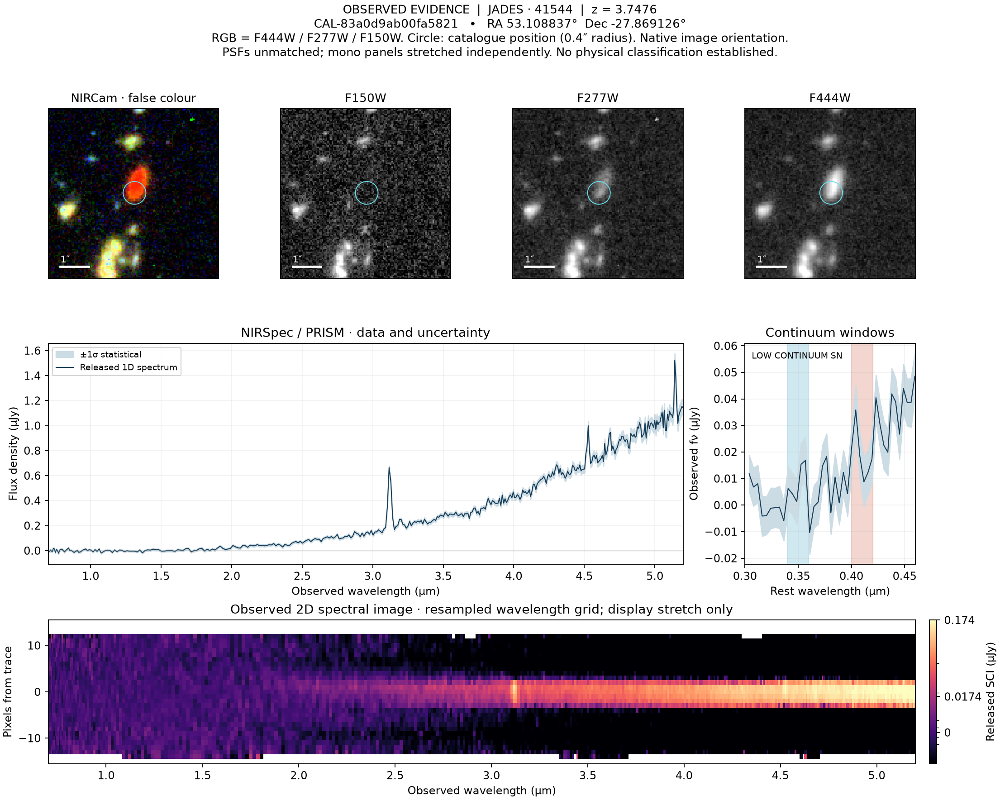

### JADES 98 — CAL-941584bf27525741

The optical spectrum has a red excess, including the band containing Halpha, and the image shows a red counterpart. No eligible alternate PRISM product was found in the pinned catalogue. The filename source number 2993 differs from upstream srcid 98; preserve both identifiers in external catalogue matching. Morphology and colour alone do not identify a black-hole star.

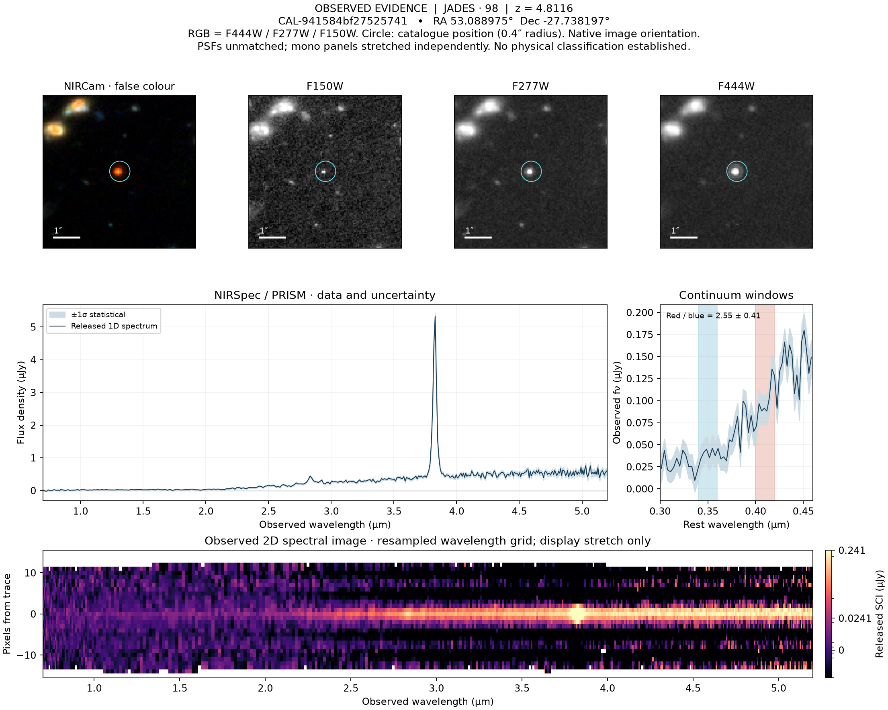

### JADES 27830 — CAL-5ad1397b3fd85dd4

The strongest band is in the Halpha region; removal and renormalization reduce the rarity score. The circled red counterpart has multiple nearby objects. Spatial contamination, ordinary emission-line models and dust must be checked before assigning a new physical explanation.

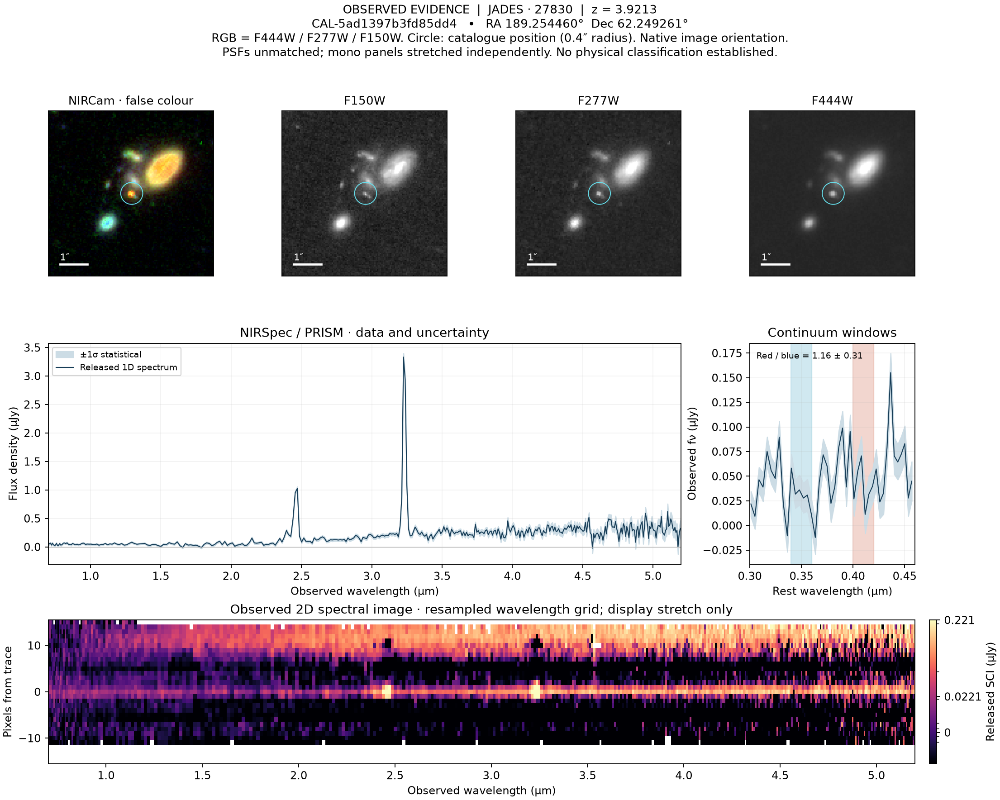

### JADES 38147 — CAL-ed111fba06e55a96

The alternate PRISM product retains a similar normalized shape (RMS difference 0.052), but both products share the DJA reduction and may share exposures. Removing the strongest Halpha-region band and renormalizing reduces the score from 3.85 to 1.54. The rarity is therefore substantially tied to that band, and is not evidence for a wholly unfamiliar continuum family.

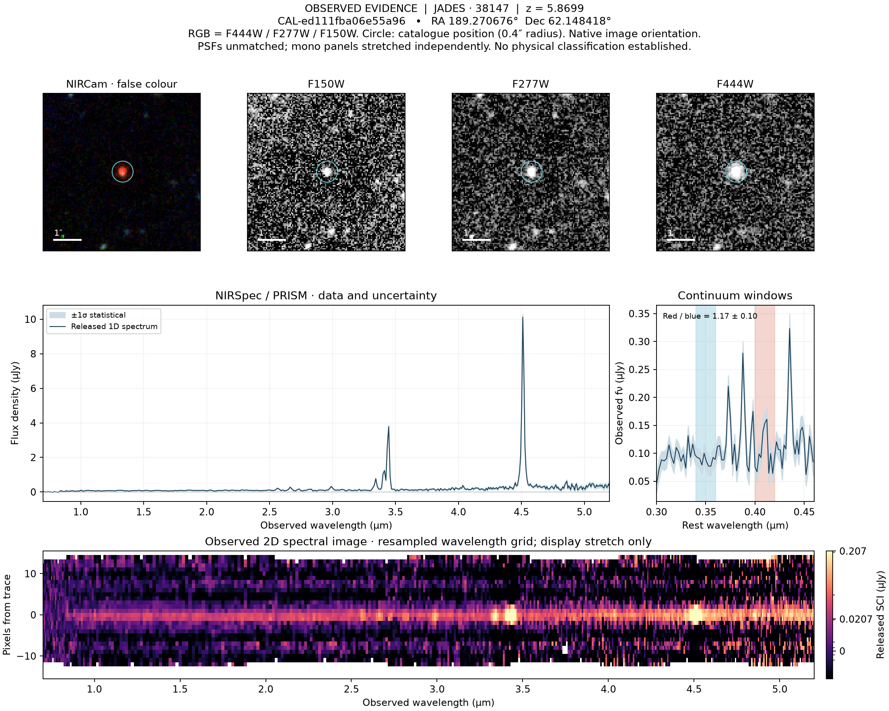

### JADES 58441 — CAL-c4cc096986f550c1

The UV shape has a broad maximum near 0.22 microns and a weaker blue end. It is a modest empirical outlier whose other-survey score is lower. The image is crowded and contains prominent linear structure. Dust curvature, foreground contamination and extraction/calibration are untested alternatives; no unique new absorption mechanism is identified.

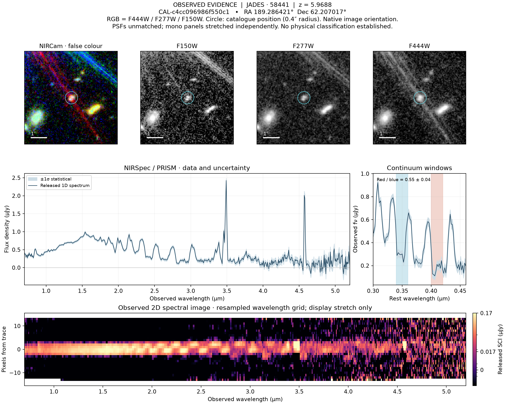

### CEERS 1768 — CAL-6859aea7c7375087

The red optical shape includes a strong Halpha-region band. Its relative rarity decreases when that band is removed and the remaining shape renormalized. The circled counterpart is red in the displayed cutout, with other objects in the field. A full line/continuum decomposition and an independent measurement are still needed.

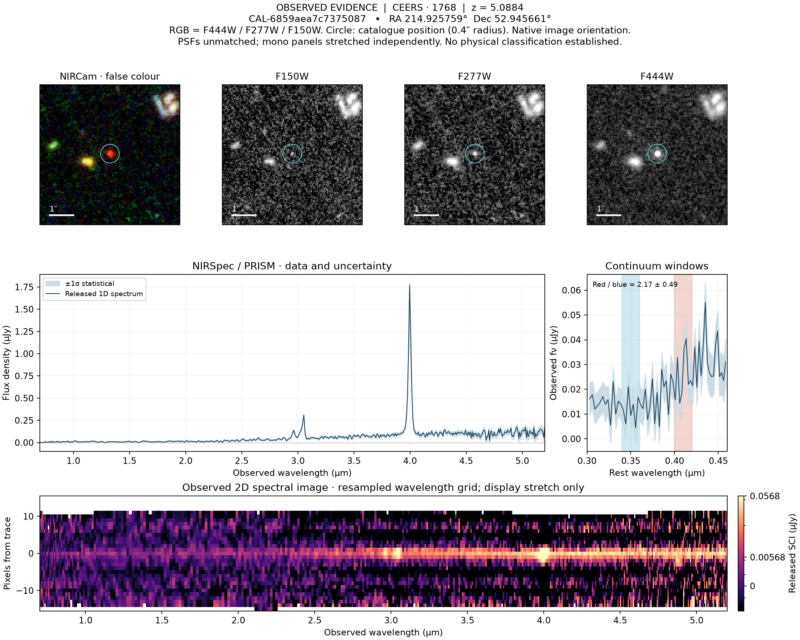

## Evolution and cosmology

The [evolution and unknown-object research note](evolution_and_unknown_objects.md) compares competing published interpretations, defines tests for unfamiliar phenomena, and explains the conditional growth calculation. We computed 180 seed/efficiency/duty/redshift scenarios. No mass or future fate of a source was inferred from its anomaly score.

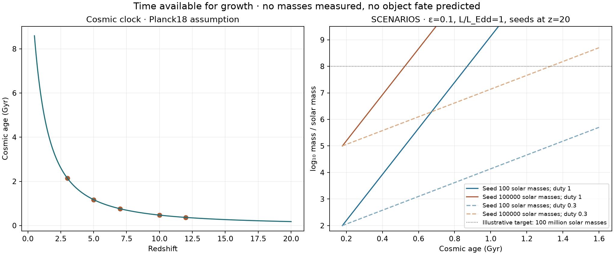

## Reproduction and remaining limits

The [configuration](../configs/open_search.yaml), [run summary](../results/open_search/summary.json), [all signed measurements](../results/open_search/combined_measurements.csv), [shape scores](../results/open_search/shape_scores.csv), [full inspection audit](../results/open_search/inspection_audit.json) and [download ledger](../results/open_downloads.json) preserve denominators and failures. Compressed JSON Lines files retain band covariance, source hashes and peer IDs. Raw files remain outside Git under a 4 GiB cap.

After restoring the earlier experiment and pinned raw inputs:

```sh
python scripts/replay_manifest.py --budget-mib 4096
python scripts/download_open_sample.py
python scripts/analyse_open_sample.py
python scripts/validate_open_search.py
python scripts/inspect_open_sources.py
python scripts/check_recovered_lrd_resolution.py
python scripts/cosmic_growth_context.py
python scripts/build_open_report.py
```

The method remains restricted to reliable archive redshifts and sufficiently covered, positive median band S/N. It can miss narrow-line anomalies, faint sources, redshift mistakes and rare sources without enough peers. Same-survey matching does not eliminate within-survey depth or calibration differences. Selection effects prevent inferring abundance or cosmic evolution from the histogram. A complete physical-model comparison and independent reductions remain necessary before any new-object claim.
