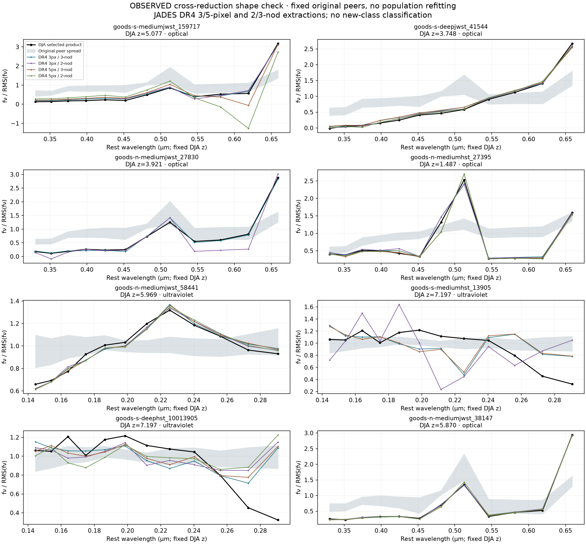
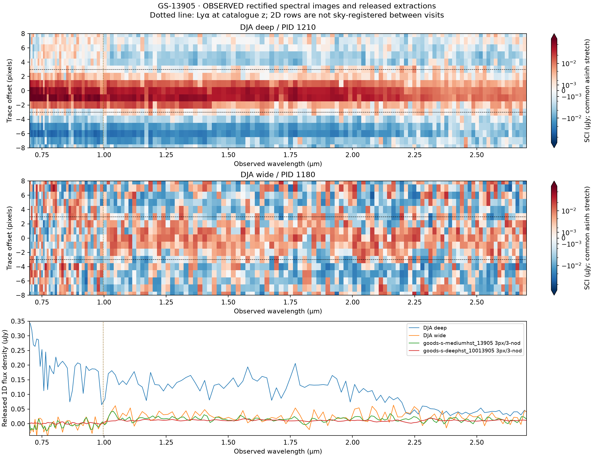
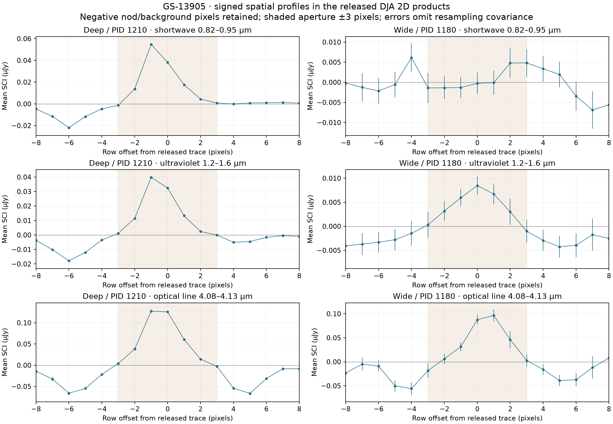

# Which unusual spectra survive a different reduction?

Research snapshot: **14 November 2026**. Observed data; author: Biswajit Jana.

**Several shortlisted spectral shapes persist, but the GS-13905 ultraviolet
anomaly is strongly reduction-dependent. No new black-hole star or new physical
class is established.** This targeted audit follows the
[4,731-record search](open_search.md); it adds validation, not new unique sources.

## Data and comparison design

We retrieved eight public JADES DR4 PRISM products for seven of the twelve
open-search priorities. Associations were reviewed by explicit identifier,
programme and coordinates, then checked against the FITS headers (maximum
separation 0.000161 arcsec). Two JADES-labelled sources have no reference match
within 0.3 arcsec and remain unassociated; three CEERS sources are outside this
JADES audit. These omissions are recorded in the
[configuration](../configs/reduction_audit.yaml).

The [JADES DR4 release](https://jades.herts.ac.uk/DR4/) supplies 3/5-pixel,
2/3-nod extractions and describes its point-source slit-loss assumptions in the
[spectral documentation](https://jades.herts.ac.uk/DR4/Readme_DR4_spectra.md).
We use the FITS column units to convert released Fλ to Fν, preserve negative
fluxes, reject nonfinite values and nonpositive errors, and retain missing
coverage. These products were reduced separately from
[DJA](https://dawn-cph.github.io/dja/spectroscopy/nirspec/); reductions of overlapping
exposures do not provide statistically independent photons.

We held the original redshift, 12 rest-frame bands and original DJA peer set
fixed. No population was retrained and no discovery threshold was chosen from
these outcomes. Of 32 extraction variants, 29 have adequate coverage; 26 also
meet the original median band S/N ≥ 3 floor. Three lower-S/N comparisons are
retained as descriptive diagnostics, explicitly flagged in the
[measurement table](../results/reduction_audit/extraction_comparisons.csv).

Scores below are descriptive distances from noisy empirical peers, **not
significances, probabilities or tests of a physical theory**. Their values depend
on both the measured shape and reported error. Original peers also retain DJA
systematics. The comparison therefore cannot isolate every reduction effect.

## Results across the eight products

| DR4 identifier | Mode | Original DJA score | DR4 score range | Coverage / S/N-qualified variants |
| --- | --- | ---: | ---: | ---: |
| goods-s-mediumjwst_159717 | Optical | 4.57 | 3.90–4.18 | 4 / 4 |
| goods-s-deepjwst_41544 | Optical | 4.14 | 3.77–4.03 | 4 / 4 |
| goods-n-mediumjwst_27830 | Optical | 3.89 | 3.78–4.00 | 2 / 1 |
| goods-n-mediumhst_27395 | Optical | 4.49 | 4.23–4.64 | 4 / 4 |
| goods-n-mediumjwst_58441 | UV | 2.14 | 2.10–2.19 | 4 / 4 |
| goods-s-mediumhst_13905 | UV | 2.66 | 0.61–0.85 | 3 / 1 |
| goods-s-deephst_10013905 | UV | 2.66 | 0.78–1.06 | 4 / 4 |
| goods-n-mediumjwst_38147 | Optical | 3.85 | 3.81–3.98 | 4 / 4 |

Ranges include all coverage-qualified variants; the last column distinguishes
coverage from S/N qualification. Both 13905 rows compare against the originally
selected DJA deep product. The mediumhst row is also a different programme, not
a same-exposure reduction test. The two identifiers represent one reviewed
source association, not two discoveries.



GS-41544, GN-27395, GN-38147 and GN-58441 show broadly consistent normalized
shapes across all four extractions. GS-159717 retains a high descriptive score,
but its 5-pixel extractions show substantial negative excursions in red optical
bands: stability of a scalar score does not guarantee stability of the spectrum.
GN-27830 loses coverage in both 5-pixel variants, and its 3-pixel/2-nod variant
falls below the original S/N floor. These are priorities for inspection, not
established exotic objects.

## GS-13905: an anomaly that does not reproduce cleanly

The deep DR4 variants have median band S/N 10.0–14.2, yet their rarity scores
are 0.78–1.06 instead of 2.66. The discrepancy therefore remains in a usable
deep spectrum and is not explained merely by the shallower comparison being noisy.

Normalized shapes conceal a large absolute-flux discrepancy. The following are
signed wavelength averages of the released 1D flux, in µJy, with propagated
diagonal statistical errors. They are not filter photometry or integrated line
fluxes, and they omit calibration and resampling covariance.

| Released product | 0.82–0.95 µm | 1.20–1.60 µm | 4.08–4.13 µm |
| --- | ---: | ---: | ---: |
| DJA deep, PID 1210 | 0.17359 ± 0.00196 | 0.13724 ± 0.00133 | 0.52334 ± 0.00803 |
| DR4 deep, 3px/3-nod | 0.00182 ± 0.00056 | 0.01207 ± 0.00039 | 0.17320 ± 0.00254 |
| DJA wide, PID 1180 | −0.00172 ± 0.00532 | 0.02596 ± 0.00381 | 0.26826 ± 0.02166 |
| DR4 mediumhst, 3px/3-nod | −0.00183 ± 0.00306 | 0.01767 ± 0.00221 | 0.16445 ± 0.01227 |

The deep DJA/DR4 UV mean-flux ratio is about 11.4. We do **not** turn this into
a difference significance: shared inputs, extraction, slit-loss corrections and
calibration are not represented by independent Gaussian errors. All eight DR4
variants and both DJA products are tabulated in
[observed-band measurements](../results/reduction_audit/uv_observed_bands.json).



The upper panels display actual DJA rectified SCI pixels, with a common asinh
stretch; they are not generated illustrations. Negative nod/background pixels
are retained. The dotted line marks Lyα at the catalogue redshift, z=7.197.
The strong short-wavelength signal in the deep DJA product requires an
extraction/counterpart investigation before interpreting it as high-redshift
source emission.

The signed spatial check does not identify a clearly separate short-wavelength
trace in the deep product. Within ±3 rows, the short-wave, UV and optical-line
centroids are −0.386, −0.479 and −0.368 pixels. This is approximate spatial
coincidence, not proof that one physical object produces all three signals.
Changing the aperture to ±4 rows moves the optical-line centroid to −0.907
pixels, showing sensitivity to surrounding signed structure. The wide
short-wave sum is too weak for a centroid at every tested aperture.



Spatial errors use WHT as inverse variance, consistent with the
[msaexp implementation](https://github.com/gbrammer/msaexp/blob/main/msaexp/slit_combine.py).
This checks the array convention; it does not reproduce the historical pipeline
version. We omit cross-pixel covariance and do not deblend the image or perform
a detector-level re-extraction.

The DJA metadata list 36 deep slit files from 21–24 October 2022 and three wide
files from 8 October, with no filenames in common. Roll angles differ by about
13 degrees and shutter-relative source placements differ. Thus the deep/wide
comparison is **not a controlled variability experiment**. Matching catalogue
coordinates also does not prove that every extracted photon belongs to that
counterpart. Visit-level slit footprints, background treatment and neighbouring
sources remain unresolved.

## Source-by-source figures

Each link contains full released spectra and the normalized comparison, with a
matching vector PDF in the same directory. Existing telescope colour images
remain available in the [open-search evidence gallery](open_search.md).

- [GS-159717](../figures/reduction_sources/goods-s-mediumjwst_159717.png)
- [GS-41544](../figures/reduction_sources/goods-s-deepjwst_41544.png)
- [GN-27830](../figures/reduction_sources/goods-n-mediumjwst_27830.png)
- [GN-27395](../figures/reduction_sources/goods-n-mediumhst_27395.png)
- [GN-58441](../figures/reduction_sources/goods-n-mediumjwst_58441.png)
- [GS-13905, mediumhst](../figures/reduction_sources/goods-s-mediumhst_13905.png)
- [GS-13905, deephst](../figures/reduction_sources/goods-s-deephst_10013905.png)
- [GN-38147](../figures/reduction_sources/goods-n-mediumjwst_38147.png)

## Reproduction and next discriminating tests

```sh
python scripts/replay_manifest.py --budget-mib 4096
python scripts/download_reduction_audit.py
python scripts/analyse_reduction_audit.py
pytest -q
ruff check src tests scripts
```

The [run summary](../results/reduction_audit/summary.json) records input hashes;
the [download record](../results/reduction_audit/downloads.json) identifies the
FITS products, and the [execution ledger](../experiments/reduction_audit.yaml)
separates performed work from outstanding work. The 12 November conference
posters remain dated snapshots; this report supplies additional verified
results for their eventual revision.

Local validation: **47 tests passed**, Ruff passed, and all 4,812 manifest
products passed SHA-256 verification. Raw storage is 3,485,999,737 bytes,
within the 4 GiB cap. Report links and recorded analysis-input hashes were checked.

The next useful tests are visit-level counterpart/extraction checks for
GS-13905 and GS-159717, followed by instrument-convolved competing physical
models for reproducible features. The earlier G395M/G395H central-dip statistic
for GS-159717 is still inadequate for its complex emission/absorption structure;
this phase does not replace it with a full absorption model. Broader searches
must also address uncertain redshifts, foreground contaminants and survey
selection. A larger candidate count alone cannot establish a black-hole star.
