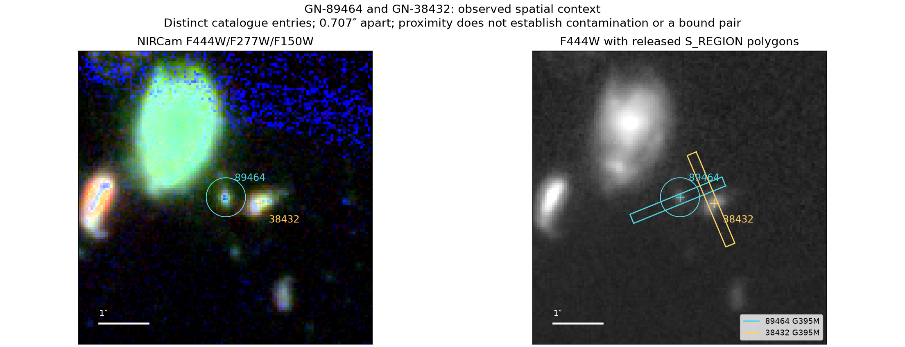
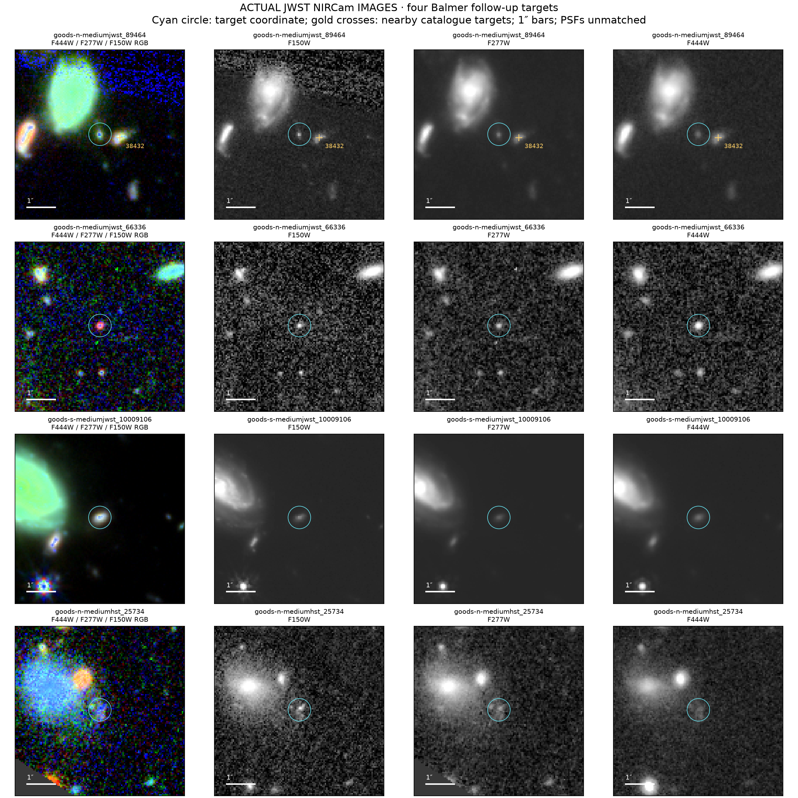

# Actual target images and the GN-89464 neighbour comparison

Executed 16 November 2026. **A useful spatial/spectral comparison, not a new
black-hole-star identification or a newly discovered pair.**

## The finding

The JADES DR4 catalogue places GN-38432 only **0.707 arcsec** from GN-89464.
The catalogue redshifts are 6.717011 and 6.724704 respectively. The small-redshift
offset corresponds to about 299 km/s using c Δz/(1+z); this is not a dynamical
mass or a proof of gravitational binding. At GN-89464's redshift, Planck18 gives
a **conditional projected separation of 3.87 proper kpc**. Redshift errors and
line-centering systematics were not incorporated into these contextual numbers.

Actual NIRCam images show light at both catalogue positions. They remain
separate entries with different DR5 identifiers (1089452 and 1089464), and are
not merged. The nearby bright extended object is also not silently assigned to
either spectroscopic target.

The G395M products contain different released `SCI.S_REGION` footprints.
GN-38432's centroid is outside GN-89464's polygon, with a minimum edge distance
of 0.240 arcsec. GN-89464 is outside GN-38432's polygon by 0.466 arcsec. Each
target is inside its own polygon. Distances were calculated in the local sky
offset frame. These are header polygons, **not a reconstruction of every nod,
the extraction weighting, or wavelength-dependent PSF throughput**. They do not
prove that scattered light or PSF wings contribute zero contamination.

## Signed hydrogen cores

An additional public DJA G395M spectrum for GN-38432 was retrieved. Its source
ID, programme 1181 and header coordinates were checked. The same two-sided
continuum method was applied to both sources, fixing each source's own DR4
redshift. Two core widths (±400/600 km/s) and all three prior continuum choices
were retained. Every ratio below passes the dual-line S/N≥5 reporting rule.

| Target | Eligible variants | Hγ/Hβ point-estimate range |
|---|---:|---:|
| GN-38432 | 6/6 | 0.449–0.509 |
| GN-89464 | 6/6 | 0.802–0.845 |

The neighbour therefore provides an ordinary-ratio comparison in a nearby
sightline. It is not a simple duplicate of the elevated-ratio target. The ranges
describe correlated window variations, not confidence intervals; their separation
does not itself establish a statistically significant difference or a physical
class. Absorption, calibration, continuum assumptions and spatial throughput
remain unresolved for GN-89464. A PSF-aware treatment of all exposures and a
joint emission/stellar-absorption model are the next discriminating tests.

Both identifiers already occur in Table 2 of
[Glazer et al., Stacking PANCAKEZ](https://arxiv.org/html/2504.21080v1).
This report does not claim discovery of the objects or of their proximity.

## Actual images for four follow-up targets

F150W, F277W and F444W data were obtained through the
[DJA cutout service](https://dawn-cph.github.io/dja/general/mapview/).
Original FITS SCI/WHT arrays, coordinate queries and fingerprints are recorded.
The shared image reader converts PHOTFNU to µJy/pixel, subtracts a clipped
annular display background, verifies inter-band WCS registration, and masks
invalid/nonpositive weights. RGB maps F444W/F277W/F150W to red/green/blue with
a shared asinh intensity stretch. Negative flux is clipped only in the RGB
display, not in stored measurements. Single-band panels use independent display
stretches. Gray regions are missing coverage.

PSFs are unmatched and background annuli can contain nearby light. Aperture
statistics in the image metadata are exploratory, not deblended source SEDs or
intrinsic size measurements. Colour and apparent compactness do not classify a
source as a black-hole star. The 0.4-arcsec-radius cyan circles mark positions,
not inferred source boundaries. Each bar is one arcsecond.

The full DR4 neighbour search used 0.1 < separation ≤3 arcsec for all four
targets. Only GN-89464 has other entries inside this catalogue radius:
GN-38432 and GN-27359 (2.347 arcsec, z=2.610062). This catalogue result does not
mean other light or uncatalogued neighbours are absent around the other targets.
No small-Δz velocity is assigned to the clearly different-redshift GN-27359.

## Reproduction

Run `python scripts/download_spatial_context.py`, then
`python scripts/analyse_spatial_context.py`, then
`python scripts/analyse_neighbor_spectra.py`. The first command restores
missing FITS files using the recorded URLs and checks their fingerprints.

- [Catalogue neighbours](../results/spatial_context/catalogue_neighbors.csv)
- [Slit geometry](../results/spatial_context/slit_geometry.csv)
- [All signed cores](../results/spatial_context/neighbor_signed_cores.csv)
- [All ratios](../results/spatial_context/neighbor_ratios.csv)
- [Image provenance](../results/spatial_context/image_products.json)

The earlier research paper remains a dated snapshot. This is a subsequent
observational update, not a completed physical interpretation.
