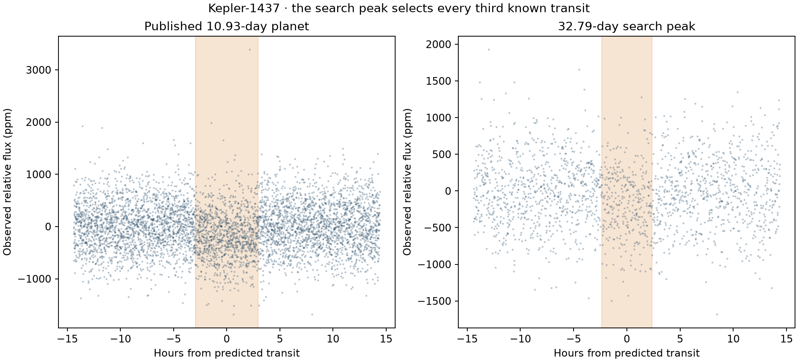
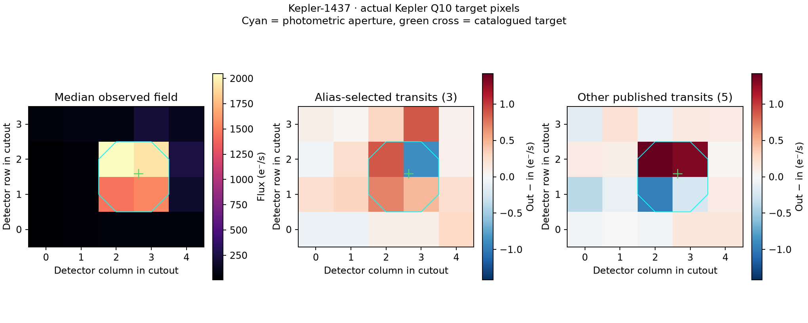
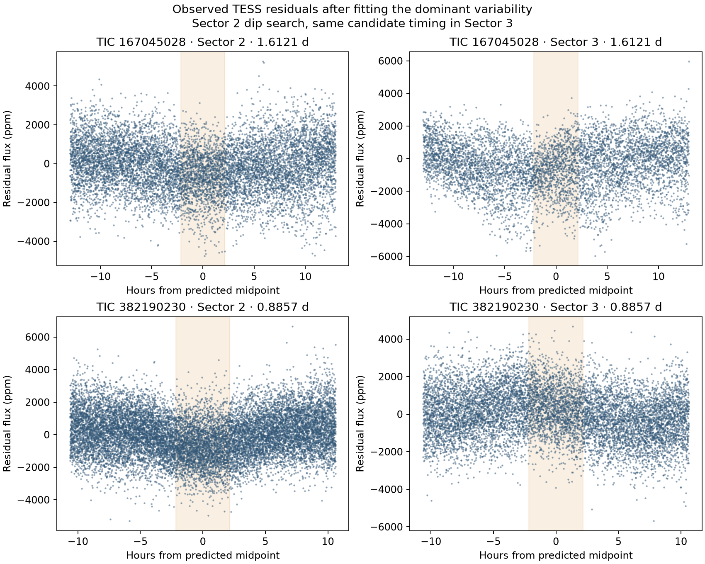

# Long-period Kepler search and TESS residual search

Executed 21 November 2026. The strongest later-quarter peak among the
Kepler search stars had a period of **32.78797 days**. Its timing selects
every third transit of the known 10.92948-day planet **Kepler-1437 b**.
The search recovered the confirmed control Kepler-10 c. No new planet or
new transit candidate passed the fixed replication criteria.

## Kepler search design

The target list includes twelve stars from the earlier short-period pilot,
six additional targets chosen by a fixed hash ordering of the MAST 0114
directory, and the known 45-day planet Kepler-10 c as a control. The search
uses 205 public long-cadence products. Five targets lack a usable baseline
of 100 days in both halves. Fourteen targets, including the control, support
the search, with 522,243 retained cadences in those targets. Numerical
catalogue proximity and hash ordering define a bounded sample, with no
claim of population representativeness. [MAST Kepler archive](https://archive.stsci.edu/missions-and-data/kepler)

For each target, isolate observations from quarters 1–8 before searching
them with box least squares over 20–150 days. The trial durations are
0.12, 0.20 and 0.32 days. The search retains one top peak and refines its
timing near that peak. Quality-zero PDCSAP cadences are flattened with a
four-day median within gap-separated segments. The search floors the input
error at a robust point-to-point scatter estimate for each quarter.

Quarters 9–17 receive the same period, midpoint and duration, with no
adjustment from those quarters. Each event is measured with an exposure-
averaged box and a local linear baseline. Event errors use the pixel
photometry errors and local residual scatter, and the combined errors
include a floor based on event-to-event scatter. The depth-to-error
contrast is a diagnostic. A passing signal requires three measurable
events and a contrast of at least five in each half. Discovery and replication
use different cadences but can share detector systematics. The search
does not estimate a global false-alarm rate or completeness.

The same search is repeated after multiplying the deviations from the
median-normalized baseline by −1. The inverted control probes some false
alarms that mimic periodic dips, and can also expose brightening or
variability. It does not estimate a false-positive rate from this small
sample. The [DR25 Robovetter study](https://archive.stsci.edu/files/live/sites/mast/files/home/missions-and-data/kepler/_documents/Thompson_2018_ApJS_235_38%281%29.pdf)
uses more extensive simulated and inverted-light-curve controls.

| Data searched | Early gate | Both halves |
|---|---:|---:|
| Observed flux, 13 search stars | 5 | 0 |
| Inverted flux, 13 search stars | 3 | 0 |
| Observed flux, Kepler-10 control | 1 | 1 |
| Inverted flux, Kepler-10 control | 1 | 0 |

Kepler-10 c was recovered at 45.29423 days, consistent with the published
45.29422-day period. The measured depths are 401 ppm across eight events
in the early set and 387 ppm across nine events in the later set. Its
later contrast stays above 18 after omitting any one roll season
(quarter modulo four). [Kepler-10 system](https://exoplanetarchive.ipac.caltech.edu/overview/Kepler-10)

Post-search crossmatching uses the NASA cumulative KOI table and Kepler
DR25 Threshold-Crossing Events. It checks target IDs and period ratios
1/4, 1/3, 1/2, 1, 2, 3 and 4 within 0.5%, and checks timing at matching
periods. The snapshot includes four KOI and five TCE entries. The exact
KIC crossmatch cannot identify background sources or establish novelty
from missing entries. [KOI table](https://exoplanetarchive.ipac.caltech.edu/docs/PurposeOfKOITable.html) · [TCE table](https://exoplanetarchive.ipac.caltech.edu/docs/Kepler_TCE_docs.html)

## Why the 32.79-day peak appeared

Kepler-1437 b has a published period of 10.9294815 days and a duration
of 5.893 hours. The 32.78797-day peak differs from three times that period
by 41 seconds. All 34 usable events on the longer timing fall inside the
known planet's transit window even though the fit was independent of the
catalogue. The 10.92948-day ephemeris measures 41 early and 52 later events
with depths of 187 ± 26 ppm and 195 ± 22 ppm, respectively. The 32.79-day
ephemeris uses a subset of the same observations. [Kepler-1437 b](https://exoplanetarchive.ipac.caltech.edu/overview/Kepler-1437%20b)

After removing cadences within one catalogue transit duration on either
side of each predicted midpoint, no measurable events remain at the
32.79-day timing. The same search on the remaining cadences gives a
62.94683-day peak. It has depth-to-error contrasts of 4.93 and 2.01 in the
two halves, below the prespecified threshold. The masked rerun is a
post-search check of the original result, with reduced coverage.

The pixel panels use the earliest later quarter with the most usable
32.79-day events. Each difference uses quality-zero target pixels and
the mean of out-of-transit windows on both sides. The two difference
panels share a colour scale. They show the alias-selected and the other
published transits for comparison. The plots lack a point-spread-function
centroid fit and cannot exclude blends by themselves.

The largest early-quarter contrast among the search stars was a
92.30-day peak on K08223.01's host. Only one early event met the coverage
rules and the signal gave a negative depth in the later quarters. The
published 66.72-day candidate has a separate ephemeris and remains covered
by the [catalogue-directed audit](transit_followup.md).

## Additional signals on the two variable TESS stars

For TIC 167045028 and TIC 382190230, the prior analysis found that a smooth
periodic profile predicted the later sector better than a transit box.
Here the two-harmonic variability frequency is chosen using Sector 2
alone. Each sector gets its own amplitude and phase coefficients for
that same frequency basis. Sector 2 residuals are searched over 0.8–8
days, excluding small-integer frequency ratios within one inverse
Sector 2 baseline of the variability frequency. The fitted dip timing
is then carried unchanged into Sector 3.

| TIC | Residual peak (days) | Sector 2 contrast | Sector 3 contrast |
|---|---:|---:|---:|
| 167045028 | 1.61212 | 2.89 | 1.16 |
| 382190230 | 0.88574 | 7.21 | −3.42 |

The second target has a reasonably deep early dip at the fitted timing
but brightens at that phase in the later sector. Neither residual
signal and neither inverted control passes both halves. The fitting
can absorb or distort additional signals near the removed frequencies,
and it says little about other periods or shallower transits.

## Reproduction and data

The [experiment ledger](../experiments/transit_discovery_search.yaml) lists
the commands and limitations. The [Kepler search table](../results/kepler_long_period/search.csv),
[catalogue matches](../results/kepler_long_period/crossmatch.json),
[alias audit](../results/kepler_long_period/alias_audit.json), and
[TESS residual table](../results/tess_residual_search/search.csv)
retain negative depths, failed gates, and unavailable measurements.
