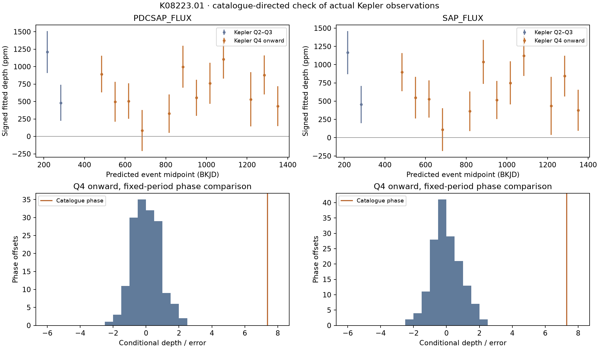
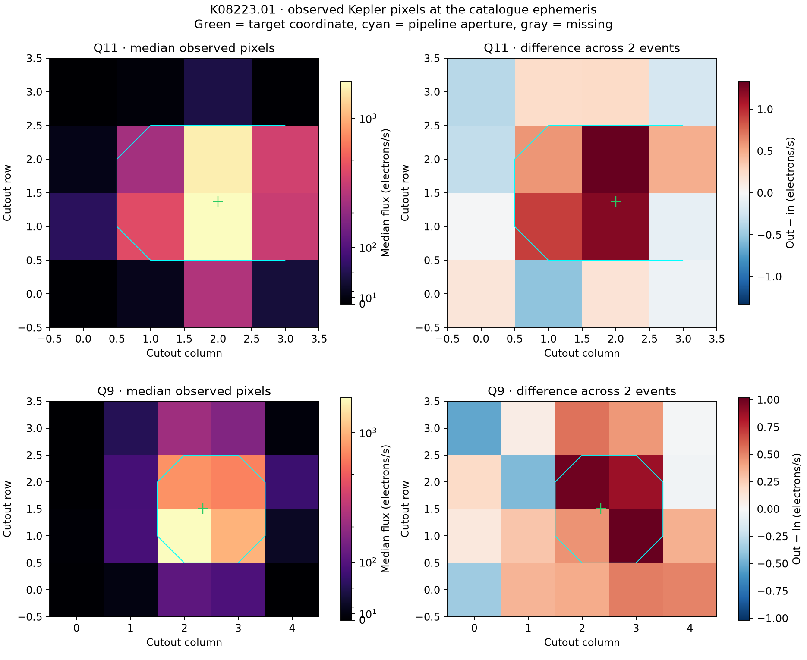
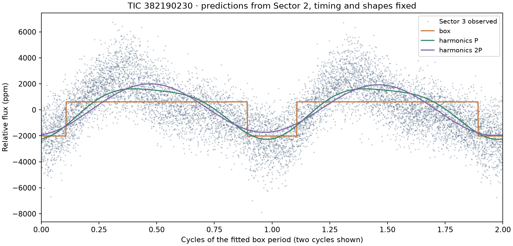

# Kepler candidate follow-up and a TESS replication test

Executed 21 November 2026. Kepler photometry supports repeated dimming at the
published timing of candidate K08223.01. Two TESS search signals repeated across
sectors, and smooth variability models predicted their shapes better than the
tested transit box. This analysis validates zero new planets.

## K08223.01 across the Kepler baseline

The original pilot examined Q2 and Q3. This follow-up retrieved all 13 available
MAST long-cadence products for KIC 11446424, spanning Q2–Q17 with gaps. The later
quarters add observations beyond that pilot. They can overlap the data used to
build the published KOI ephemeris and therefore do not constitute an independent
confirmation. The catalogue entry is a candidate. [MAST Kepler archive](https://archive.stsci.edu/missions-and-data/kepler) · [NASA cumulative KOI documentation](https://exoplanetarchive.ipac.caltech.edu/docs/PurposeOfKOITable.html)

The analysis fixes the catalogue period at 66.716453 days, the midpoint at
150.0569 BKJD, and the duration at 3.855 hours. Each observation is checked
against the FITS target ID and BJD TDB origin. Each event fit uses signed
amplitudes, quality-zero cadences, a local linear baseline with at least three
points on each side, and an exposure-averaged box using the header cadence as
the integration width. The continuous box approximates the underlying sampling
and transit shape. Local residual scatter and between-event scatter can inflate
the diagonal error. Covariance and the uncertainty in the catalogue timing are
outside this error estimate.

| Photometry | Q2–Q3 usable events | Q4 onward usable events | Q4 onward depth (ppm) |
|---|---:|---:|---:|
| Pipeline corrected (PDCSAP) | 2 | 12 | 636 ± 86 |
| Aperture flux (SAP) | 2 | 12 | 634 ± 87 |

All 14 usable events have positive fitted depths in both products, which
share the same photons. Omitting any one later quarter leaves the pipeline
depth-to-error contrast between 6.37 and 7.99. Of 193 shifted phases, 158 have
at least as many measured later events in each reduction and none achieves
the catalogue-phase contrast. The phases share samples and the ephemeris
came from the catalogue, so this comparison does not supply a calibrated
false-alarm probability.

Q11 and Q9 rank highest by summed squared positive-or-negative per-event
depth-to-error ratios in the later pipeline photometry. For each of those two
quarters, the panels show actual median Kepler pixels and the mean difference
across two events. The difference subtracts the in-event mean from the mean
of the two out-of-event windows, with equal weight for each baseline window.
The brightest positive difference falls in the pipeline aperture near the
target in both quarters. The panels are coarse, and the analysis has no
point-spread-function centroid fit or astrometric uncertainty. The host of the
dimming, contamination, and the physical nature of the companion remain open.

## TESS Sector 2 search and Sector 3 replication

The official bulk manifests list 7,239 TIC IDs in both sectors. The sample
contains the first 16 IDs under a fixed SHA256 ordering and one known-planet
control, WASP-18. Selection precedes inspection of light curves and disposition
tables. This is a method-development sample of two-minute SPOC targets. It
contains 34 FITS light curves and 426,135 retained cadences. [MAST bulk products](https://archive.stsci.edu/tess/bulk_downloads.html)

Quality-zero PDCSAP flux is flattened within gap-separated segments using
the two-day median from the Kepler pilot. Sector 2 is searched over a nominal
0.8–8 day period grid with four trial durations, followed by a narrow local
period refinement. The best timing and duration are applied to Sector 3
without a new search. The preliminary gate requires three usable events and
a depth-to-error contrast of at least five in each sector. Correlated events
and timing extrapolation can affect this gate. It is exploratory and provides
neither completeness nor false-alarm calibration.

| TIC | Box period (days) | Sector 2 depth (ppm) | Sector 3 depth (ppm) |
|---|---:|---:|---:|
| 100100827, WASP-18 b control | 0.941418 | 10,080 | 10,043 |
| 167045028 | 1.512007 | 6,425 | 5,552 |
| 382190230 | 0.842492 | 3,275 | 2,950 |

Two of sixteen search stars clear the preliminary gate. Neither TIC has an
exact-ID match in the downloaded TOI and confirmed-planet query results.
Catalogue absence has limited scope because this query does not resolve
alternate identifiers and nearby matches. TIC 167045028 is HD 45527, a known
variable classified as rotational in an earlier TESS study. [Pedersen et al.](https://arxiv.org/abs/1901.07576) · [HD 45527 identifiers](https://simbad.idia.ac.za/simbad/sim-id?Ident=%403104957&Name=HD++45527&submit=submit)

To test whether the repeating signal resembles a transit, fit a box and
two-harmonic light curves at P and 2P in Sector 2 and compare predicted
Sector 3 residuals. Only an overall offset is allowed in Sector 3, equally
for all models. Both search targets favour smooth models on the same held-out
cadences. WASP-18 b favours the box by a wide margin.

| TIC | Box residual RMS (ppm) | Lowest harmonic residual RMS (ppm) |
|---|---:|---:|
| 100100827 | 765 | 2,258 at P |
| 167045028 | 6,433 | 2,394 at 2P |
| 382190230 | 1,708 | 1,458 at P |

These are limited shape comparisons. The better smooth model does not
uniquely distinguish rotation, pulsation, ellipsoidal variability, or blending.
Both signals are deprioritized for near-term transit follow-up. No atmospheric
parameters are available for these targets from the observations used here.

The [execution ledger](../experiments/transit_followup.yaml) records the
reproduction commands. Tables include [all Kepler event attempts](../results/kepler_followup/events.csv),
[all TESS targets](../results/tess_followup/replication.csv), and
[the TESS model comparison](../results/tess_followup/heldout_models.csv).
